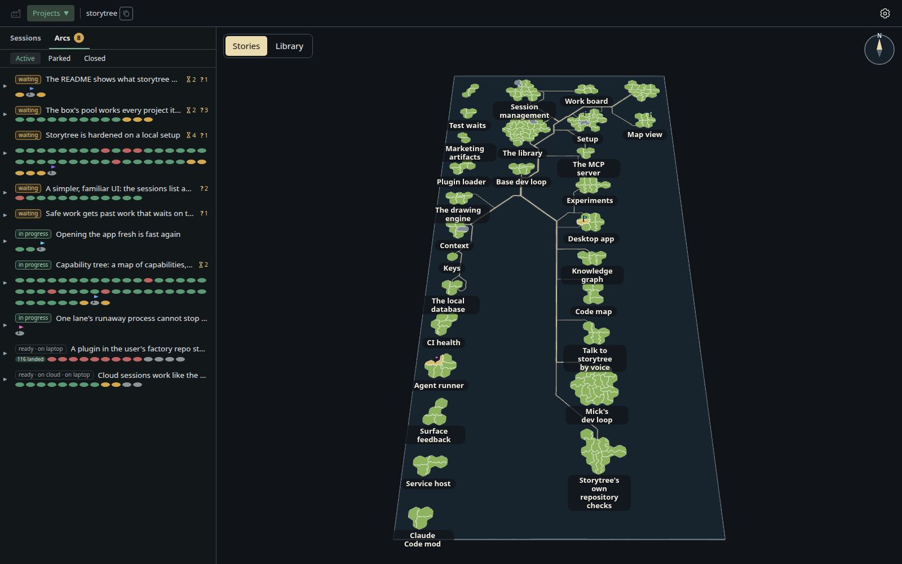
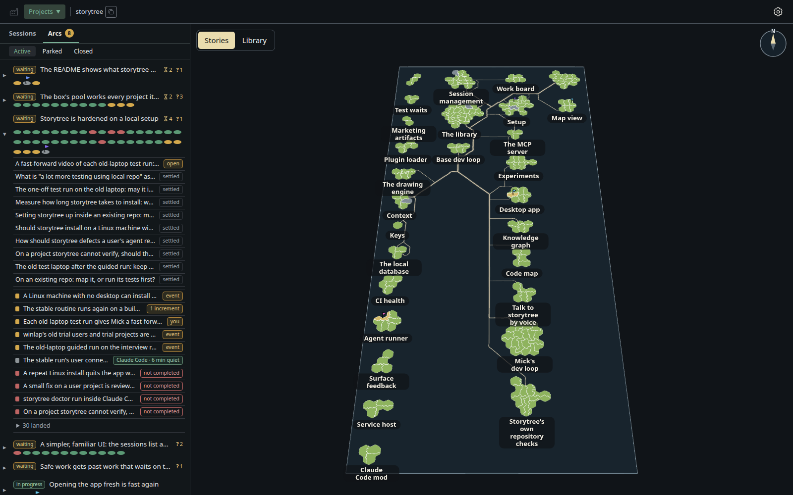
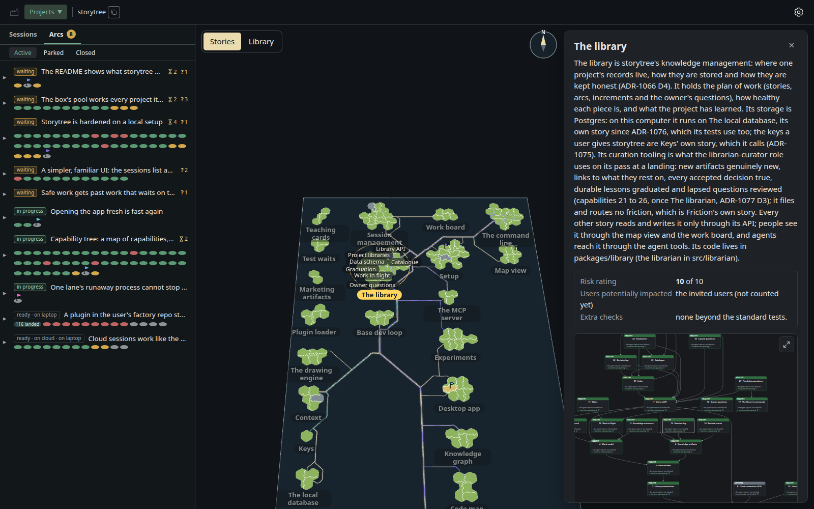
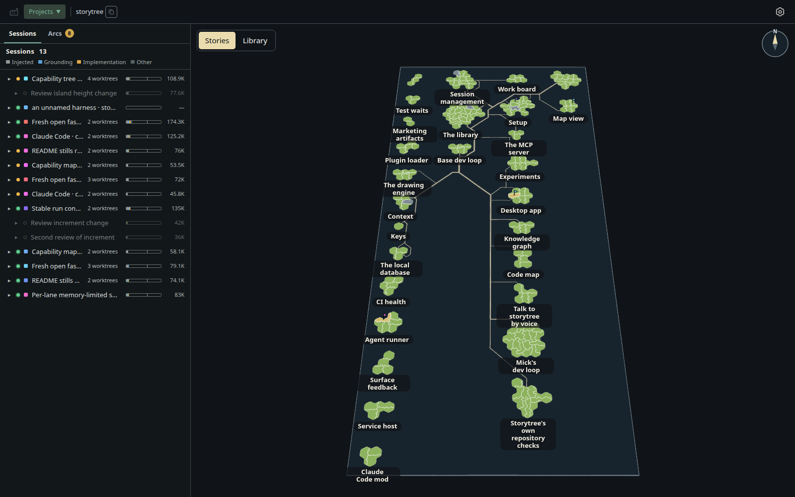
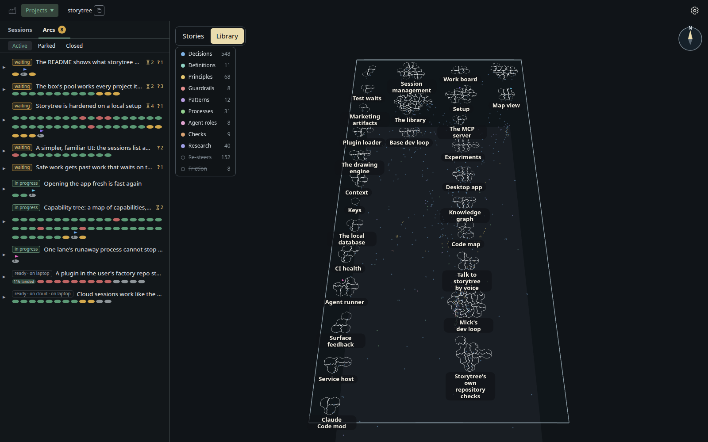

# storytree

A living map of your project, for you and your agents. Here is storytree's own map, grown by its agents:



*Storytree's own map, grown by its agents: each island is one part of the code, and the left rail lists the work on it.*

> **Early alpha: not ready for use yet.** Storytree is built in the open, and this repository is where you can
> follow it. It changes daily, its releases are unsigned, and things break. Watch or star the repository to follow
> along; install it only if you are happy to hit rough edges.

## Official sources

Storytree has two homes and no others: this repository,
[github.com/storytree-ai/storytree](https://github.com/storytree-ai/storytree), and
[storytree.dev](https://storytree.dev). Its maintainer is [@HuaMick](https://github.com/HuaMick).

- Installers come only from this repository's
  [Releases](https://github.com/storytree-ai/storytree/releases), through one one-liner per
  platform. On Windows, in PowerShell:

  ```powershell
  & ([scriptblock]::Create((Invoke-RestMethod 'https://raw.githubusercontent.com/storytree-ai/storytree/release-channel-stable/install-storytree.ps1')))
  ```

  On a Mac or Linux, in a terminal:

  ```sh
  curl -fsSL https://raw.githubusercontent.com/storytree-ai/storytree/release-channel-stable/install-storytree.sh | sh
  ```

- Storytree is not published on npm, PyPI, Homebrew, winget, Docker Hub or any MCP registry. A
  package there under its name is not ours.
- Maintainers never send download links in issues, email or direct messages.
- To check a download by hand, compare its SHA-256 with the `sha256:` digest GitHub shows beside
  that file on the [release page](https://github.com/storytree-ai/storytree/releases):
  `Get-FileHash <file> -Algorithm SHA256` in PowerShell, `shasum -a 256 <file>` on a Mac,
  `sha256sum <file>` on Linux. The one-liners make this check for you.

To report a security problem, see [SECURITY.md](SECURITY.md).

## Install

You need Claude Code or Codex, installed and signed in, on Windows x64 (an arm64 build is included but not
yet tested), a Mac with Apple Silicon (M1 or later) or Linux x64 with a desktop session. Then ask your agent:

```text
Install storytree from https://github.com/storytree-ai/storytree
```

The ask names this address so your agent installs storytree's own release, not a package that borrows its
name. Your agent follows [INSTALL.md](INSTALL.md): each platform's command, what its checks mean, and stable
or alpha. Without an agent to hand, run the one-liner under [Official sources](#official-sources) yourself.
The one-liner installs the stable channel: a build tried before it is offered, which can be weeks behind the newest.
It says which build that is and the day it was published, as does the
[stable channel's page](https://github.com/storytree-ai/storytree/tree/release-channel-stable); work that landed
after that day is only in alpha, which [INSTALL.md](INSTALL.md#stable-or-alpha) says how to choose.
Once it is installed, **Help → First-run guide** in the app covers setup, connection checks, the offline
license and feedback. Anyone may clone this repository, but that is not the install: an agent opened in a
clone takes on storytree's own development guidance (see [CONTRIBUTING.md](CONTRIBUTING.md)).

## What storytree does

Storytree builds a map of your project and glues it to your code. It grows as your agents work, and
says what needs you and what doesn't. It sits beside your coding agent: you keep building with
Claude Code or Codex the way you do now, and storytree shows you what is being built.

### A forest that grows as stories land

Each project is a forest, like storytree's own at the top of this page. Each island is one story:
one thing the project lets someone do, and the code that does it. An island grows as the work on
its story lands, so the shape of the forest is the shape of the project.

### The plan, and where each piece of it stands



*The Arcs tab: each body of work, its pieces as a row of dots, and what is waiting.*

The left rail lists the arcs: each one a body of work with a single aim. Open one to see its pieces
of work, which are planned, in progress or done, and what is waiting, whether on another piece, on
an event or on you. A question only you can answer is written down where you will see it, with
the options and a recommendation, rather than left in a chat.

### How each story works, in plain words



*One story opened: what it does, its risk, and how healthy each part is.*

Click an island to read what its story does in plain language, how risky a change to it is, and a
map of its parts, each with its health. Health shows what your agent *reported*, labelled as the
agent's report. Storytree does not yet check your project's tests itself: so far it checks only its
own project's tests, and shows what it found separately.

### What your agents are doing



*The Sessions tab: every agent at work on the project, and how much of its context each has used.*

The Sessions tab lists every agent session working on the project, in each of its worktrees, with
a bar for how much of its context it has used and on what: what it was given, what it read to find
its footing, and what it built.

### What the project has learned



*The Library tab: what the project has decided and learned.*

As your agents work they write down what they decide and learn: decisions, definitions, principles
and more. The Library tab counts those notes by kind and shows them on the map, and the next
session reads them instead of working them out again.

### A project you already have

Ask your agent to map an existing project and storytree imports it: each package becomes an island,
drawn where its code is, and nothing is written into your folder. Mapping includes running the
project's own tests: your agent runs them in its own shell, under the same permission prompt as any
command it runs, and each part they prove turns green or red. Until they have run, the parts it maps
show yellow, not yet proven.

### Languages

The map reads JavaScript, TypeScript and Python code. A project in another language (Go, Rust or
SQL, say) still gets its plan, its activity and the health its agent reports, but its code never
appears on the map.

## What your library keeps

When you set storytree up, it makes a library for your project: a database on your computer (or the
one your settings name). It keeps your plan (stories, capabilities, contracts, increments), the
decisions and notes your agent writes, the friction it records, and every session's transcript,
which storytree's hooks stream in as the agent works. Obvious secrets are scrubbed from transcripts
before they are stored; the scrub is best-effort, not a guarantee. Raw transcript records are kept
180 days. Your library is yours: nothing in it is sent to storytree. Separately, the app can share a
fixed list of milestone events (never text from your library) only if you turn sharing on, and you
can turn it off or ask for them to be deleted. Ask your agent how storytree works and it can tell
you this.

## Your friction stays yours

When something fights your agent, it records friction in your library, for you and your agent to
act on: you can change your own factory and plugins. storytree never asks you to send it to us. If
you want to, Help > Send feedback drafts a GitHub issue that you review and submit yourself.

## Keys

Storytree borrows the logins you already have (Claude Code or Codex, `gh`, Google sign-in), so most
people never give it a key. When a feature does need one, [docs/keys.md](docs/keys.md) says how to
save it, keep it in your own store, or hand it to a CI job.

## Contributing

To work on storytree itself, see [CONTRIBUTING.md](CONTRIBUTING.md): where this repository's own plan
lives, how changes land, and storytree's earlier generations.

## Reporting an error

If storytree shows you an error, ask your agent to submit a GitHub issue on this repository,
[`storytree-ai/storytree`](https://github.com/storytree-ai/storytree/issues), and it will be worked
on. That is the current workflow; the desktop app's error box says the same (ADR-1119).
A security problem is the exception: report it privately, as [SECURITY.md](SECURITY.md) says, never
in a public issue.

## License

Storytree is **open source**, licensed under the [Apache License 2.0](LICENSE); see [NOTICE](NOTICE).
Anyone, businesses included, may use, modify, embed and redistribute it, including in products of
their own, under that license's terms.
