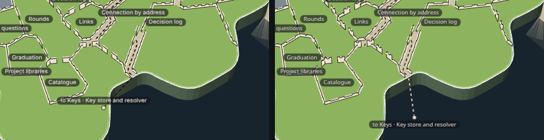
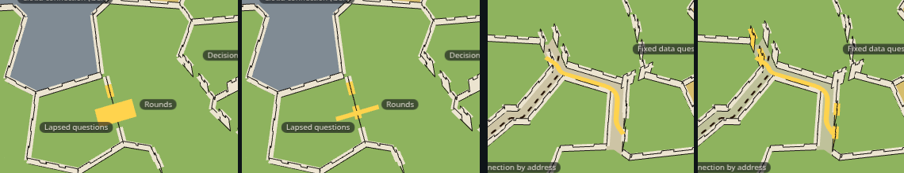

# Capability tree, 3D mock 1, round 3: the map's own territories, walled on their borders

The real map's 3D island for The library, as the desktop app draws it. Each capability keeps the organic territory the map
cuts for it, sized by its lines of code, and a low castle wall runs along its real border. The territories are placed so
that linked capabilities lie side by side: a link between neighbours is a gate in their shared wall. Where two linked
capabilities cannot touch, the territories between them are pulled apart just enough to open a narrow corridor of open
ground, and the path runs down it from gate to gate. Everywhere else the territories touch, as the map's do, and the island
stays full. A mock only: it changes no product code. Round 3 of increment_ebb59b22216f on arc_9bbaa3497530, after Mick on
PR #230's square fields: "I was thinking the wall follows the capability territoriy and we dont shrink the territory down
into a square. If we need a no-mans land territory corridor for a shared pathway to travel through then we would just
create it by creating space between the territories".

**Open it:** `index.html`, straight from disk; it needs no network. Drag to pan, right-drag (or Q/E and R/F) to turn and
tilt, wheel to zoom: the map's own controls. Click a territory, a gate, a path, the road off the coast or a wrench, and the
panel on the right shows what it holds. The window is 1440 × 900 with the story panel's 352 pixels on the right, as the app
lays it out; the rest view frames the whole island.


## What changed from round 2 (PR #230), and why

| Mick asked | What the mock does now |
| --- | --- |
| Keep the map's own territory shapes, no squares | The island is cut by the map's own code (`territories()` in `packages/forest/src/territories/territories.ts`): the same 122 cells on the same coast, and each capability the same number of cells as the map gives it, so its area follows its lines exactly as on the map. The map's own `territoryLand()` draws them, in its own colours. PR #230's square fields and its beige commons board are gone. |
| The wall runs along the territory's real border | One wall along each border between two territories, shared by both, where the map draws its white border line. The coast is left to the island's own cliff. Each wall is cut to the land by the map's own `insideOf()`. |
| Place linked capabilities side by side | Only which cell goes to whom changes. Each capability has a seed, a point on the island; every territory grows from its seed at once, taking the free cell nearest its seed (weighed by its size) until it holds its share. The seeds were moved toward what each capability calls (`dependsOn`), keeping a move when more linked capabilities ended up side by side, the shapes stayed compact and every share was met (`tools/territory-plan.ts`). 23 of the 27 links in the story are now between neighbours. |
| A link between neighbours is a gate in their shared wall | An opening between two small towers, on the longest stretch of wall the two share. No path is drawn for it: the gate is the link. Clicking it shows the called capability's contracts. |
| A corridor only where a path must pass | The 4 links whose ends cannot touch get a way along the borders between other territories. The territories either side of each border it walks are pulled back from it, leaving a narrow strip of open ground, and the dashed path runs down its middle, entering each end through a gate. It never crosses a territory. Ways that share a stretch share it, as the story roads merge (`packages/forest/src/view/border-route.ts` walks only lines already drawn; these walk only borders). |
| Keep the rest | The 2.5D inked walls and towered gates, dashed paths, the flat ink wrench, every name shown, the map's colours, pan and zoom, the road off the coast to Keys (now through its own short corridor to the coast) and every click. |

**What the map still draws, unchanged:** the island's coast, cliffs and shape, the glass sheet, the other islands and the
roads between them, the selection ring, the camera and its controls (`PlanetView`, mounted as the desktop app mounts it).
**What the mock switches off on this island:** the map's own cut of it (its territory fills and white borders), since the
mock draws the same cells with new owners, and the selection's purple lanes, whose job the gates, paths and road take.

## Seeds: what the real map would need

The map's `territories(shares, outline, cellCount)` takes no seeds. It shares its cells out by halving the list of
capabilities in order, so where a territory lands follows its place in that list, not what it calls. The mock does not edit
or copy that code: it imports `territories()` for the cells and each capability's share, and builds the seeding beside it
in `tools/territory-plan.ts`. For the real map to place linked capabilities side by side it would need:

1. `territories()` to take a seed per share (or a growth that starts from given cells), and grow the regions from them
   instead of halving; the cells, their count and each share stay as they are.
2. Something to choose the seeds from the links. The mock searches for them once, at length, in the page (where the road off
   the coast knows where Keys lies), and stores them in `data.json` (`tools/seed.mjs`), so the page grows the same cut at once.
3. For corridors, the drawing to pull territories back from a border a way runs along: the mock cuts each cell by a line
   parallel to that border, which keeps every cell convex, so the map's own fill and coast cut draw it unchanged.

Moving any of this into the map is Mick's later decision.

## What came from anatomy

[anatomy](https://github.com/wheresryan22/anatomy) (MIT) draws ideas as clean isometric diagrams. Nothing of its code or art
is copied; these principles are borrowed:

- **One thin ink weight.** Every outline is one pixel of the same ink (`#1b1814`) at any zoom, as anatomy's lines are one
  non-scaling weight; only the picked mark changes colour.
- **Few tones, one accent.** The marks use the ink, one pale wall tone, one path brown and the parchment commons; gold is
  the one accent, for the picked mark.
- **Every line ends on something.** A path begins and ends in a gate's opening, the road ends at a dot, a wall run ends at
  a corner, a tower or the coast.
- **Depth from shape and order, not shading.** The walls and towers stand up as cut-outs; nothing is lit or hatched.
- **One recipe per symbol.** Every wall run, tower and wrench is built by one function at one scale.
- **No floating text on the drawing.** Names are the map's own nameplates, each on its territory.

Where anatomy and Mick's direction part, Mick's wins: anatomy fills its figures with many small parts, and this mock keeps
the island minimal.

## What is measured, and what is sample

Every number is the real library and code on 2026-11-02 (`data.json`'s `measuredAt`), read by `tools/measure.mjs` from the
project's library and the code survey the map itself uses:

- The library (story_754e87e7d531): 24 capabilities, 14,581 lines in 78 files. 21 healthy, 2 untested (5 · Health record,
  17 · The library's commands) and one, 8 · Cloud connection (GCP), untested and parked, so grey.
- 28 links: 27 inside the story and the one to Keys. 23 are gates between neighbours, 4 run through corridors.
- Open work: one open increment names one of these capabilities, increment_dc514c1a7edb on 8 · Cloud connection (GCP).
  That is the wrench at rest.
- What was laid is counted in `stills/shots.json` under `layer`.

**Sample, clearly marked:** the box "Add sample work (made up, not in the library)" adds a second wrench, lavender and
tagged "sample", on 10 · Work in flight, with three made-up increments on two made-up arcs. Nothing else is sample.

## Palette

| Meaning | Hex |
| --- | --- |
| Healthy, untested, parked territories (the map's, drawn by its own code) | `#97C459`, `#F2D16B`, `#86939D`, at the map's opacity |
| Corridor ground (the open strip a way runs down) | `#bfc19a` |
| Ink: every outline, the road's end | `#1b1814` |
| Wall and tower faces | `#ece4d0` |
| Paths, dashed | `#6e5236`; the road's run off the coast `#ece4d0`, since brown is lost on the dark glass |
| Wrench | `#1b1814` with a `#ece4d0` edge; sample `#d6bdf0` |
| Picked mark (the selection's gold) | `#ffd34d` |

## Stills

All taken by `tools/shots.mjs`, which clicks each mark where it stands on the page and checks the panel's heading.

| Still | What it shows |
| --- | --- |
| `resting.png` | The resting view |
| `whole-island.png` | Panned out to the whole island |
| `close-up.png` | Close up on the middle of the island, Knowledge entrances picked: walls, gates and two corridors |
| `gate.png` | A gate between neighbours: Rounds calls Lapsed questions, and Lapsed questions' contracts |
| `pathway-contracts.png` | A corridor's path: Ranked search calls Knowledge artifacts, and Knowledge artifacts' contracts |
| `wrench-arcs.png` | The Cloud connection wrench's arc list |
| `sample-wrench-arcs.png` | The sample wrench, listing two made-up arcs |
| `territory.png` | Work model's description and contracts |
| `road-off-the-coast.png` | The road to Keys, leaving the coast into the bay south of the island: Key store and resolver's contracts |
| `orbited.png`, `orbited-south-west.png` | Turned and tipped by the map's own keys, two ways |
| `real-today.png`, `side-by-side.png` | The map's island today, beside the mock |

## Rebuild it

From the checkout root, after `pnpm install`:

```sh
node --import tsx docs/design/capability-tree-3d/a-stone/tools/measure.mjs   # data.json, from the library and the code
node docs/design/capability-tree-3d/a-stone/tools/build.mjs                  # index.html, page.js, page.css
node --import tsx docs/design/capability-tree-3d/a-stone/tools/seed.mjs      # data.json's seeds, by a long search (then build again)
node --import tsx docs/design/capability-tree-3d/a-stone/tools/shots.mjs --retake   # stills/
```

`tools/territory-plan.ts` is the plan (who owns each cell, corridors, gates and ways; no drawing); `tools/castle.ts` lays it
on the island and draws it; `tools/look.mjs` takes one quick still while drawing. `index.html?real` draws the map's island as
it is today, with nothing added; `index.html?seed` searches for the seeds again instead of growing the stored ones.

## The look review

Mick's rule: "the adversarial review should just judge if the existing stuff looks nice, not add stuff it thinks is missing
without my go ahead." Each round a fresh reviewer is given only the stills, the page and the brief's review section, never
this session's reasoning or an earlier round's answers. It judges only what is drawn, against the 2.5D cartographer's-map
style, and flags anything that reads as a building, plot or game prop; anything it thinks missing goes under "for Mick" and
nothing is built from it. Findings about the map's own drawing, which the brief keeps unchanged underneath, are rejected with
that reason. Round 2's five review rounds, on the square fields, are in this folder's history (PR #230).

### Round 1: "not yet", 11 findings, three for Mick

| # | Finding | Answer |
| --- | --- | --- |
| 1 | Gate towers are shaded boxes, like dice or toy blocks: a second recipe beside the flat walls | Fixed: each tower is a taller stretch of the same flat cut-out, in the wall's own line, with its own crenellations and walk; the gap between them is the gate |
| 2 | Short walls ending in a tower stick into a territory like a plot fence; towers sit beside the wall line | Fixed with 1: towers stand in the wall's line. A neighbours' gate stands on the longest stretch of wall the two share |
| 3 | North–south borders show as a bare ink line, east–west ones as a crenellated wall | Fixed in part: the wall's walk is nearly twice as wide, so a wall seen end-on reads as a pale band. Its crenellations still foreshorten at the map's own tilt |
| 4 | Lines end on nothing: a corridor runs on past its gate in a square stub, a path starts with a hook, towers stand on the coast | Fixed: a corridor's gate stands at the dead end of the border it opens, so the corridor and its path both end in the gate; neighbours' gates stand mid-way along their longest shared wall, clear of the coast |
| 5 | Corridors read as fortified streets, the loudest thing on the island; widths vary | Fixed in part: corridors are a quarter narrower and their ground a quieter tone than the walls. The strip is one width; it looks wider only where two corridors meet |
| 6 | Wall ink is wobbly and broken | Rejected: every outline is one pixel of the one ink; the walls follow the map's own cell borders, which bend every few units |
| 7 | Picked marks are mostly invisible; the territory's pick is lime, not gold | Fixed: every pick is drawn in solid gold over the drawing and wider; a picked gate also gets a gold bar across its opening |
| 8 | The road's name sits mid-island; its end reads as a drill hole | Fixed: the name stands by the coast it leaves; the end is a pale disc with an ink edge |
| 9 | Names crowd; one hangs off the coast; names sit on walls | Fixed in part: a name near the coast steps inland. Tilted low, names stack but never hide one another (the names rule). A name stands at its territory's middle, so a wall may pass under it |
| 10 | The sample chip's lilac is a second accent | Rejected: it marks made-up work, so it must not pass for real |
| 11 | Two plates both read "Decision log" | Rejected: the library has two capabilities of that title (13 and 22); the mock shows the library's titles |

**For Mick, from round 1** (nothing built from these): a gate drawn as an arched opening between flat towers; an arrow or quay
mark where the road leaves the cliff; a way to tell apart two territories with the same name.

Before (left) and after round 1 (right), close up:


### Round 2: "not yet", 13 findings, three for Mick

| # | Finding | Answer |
| --- | --- | --- |
| 1 | Gates are two plain posts either side of a gap; tilted, crates or a broken wall | Fixed in part: the towers are taller and wider than the wall, with their own crenellations, so the gap reads as an opening between them. Kept flat, in the wall's line, by round 1's answer |
| 2 | Walls break into dashes, with bare gaps | Fixed: some cells' shared sides were not matched both ways, so their wall was dropped; every shared side now gets its one wall, and slivers shorter than a wall's height are left out rather than drawn as ticks |
| 3 | Some shared borders have no wall (Rounds and Lapsed questions); the picked gate sits on a bare line | Fixed with 2. Rounds and Lapsed questions share one short side, which their gate fills |
| 4 | Picked marks too small; the corridor still shows a gate's panel; territory picks are patchy | Fixed: a path's click point is the stretch furthest from any gate, so it picks the path; picks are wider solid gold; the gate and corridor stills are taken close, so the picked mark shows |
| 5 | The road off the coast barely reads; its name sits inland | Fixed: the road runs twice as far onto the glass, and its name stands over its end. The wide sea road beside it is the map's own |
| 6 | Hooks where a corridor meets a gate | Fixed: a way leaves its gate on a slant toward where it heads, so it turns into the corridor without a hook |
| 7 | Extra posts sticking out sideways on corridors | Fixed with 2: the stubs were slivers of wall at corridor corners, now left out |
| 8 | Names straddle walls, crowd, pile up tilted; the wrench stem cuts its name when turned | Rejected: a name stands at its territory's middle and never hides another (the names rule); tilted low they stack, as the map's own do. The wrench and its name are kept from round 2 |
| 9 | The wrench reads as a slingshot or pin | Rejected: the brief keeps PR #230's flat ink wrench |
| 10 | The sample tag's purple | Rejected: it marks made-up work, so it must not pass for real |
| 11 | Walls carry a shaded face | Rejected: walls and towers are drawn unlit in one flat tone; the darker strip is the ink outline of the far side seen through the crenels |
| 12 | Far walls at a grazing angle read as picket fencing | Rejected: the tilt is the map's own camera |
| 13 | The side-by-side caption uses working language and says "the same cells" | Fixed: it now says the cells are the map's own, their owners reseeded |

**For Mick, from round 2** (nothing built from these): the road off the coast in the legend; a mark wherever a wall meets
the coast; gates sized to show at island scale when picked.

Before (left) and after round 2 (right), a gate picked:


### Round 3: "not yet", 9 findings, none for Mick

| # | Finding | Answer |
| --- | --- | --- |
| 1 | Corridors read as walled, paved roads with lane markings, the heaviest marks on the island | Fixed in part: the path is a quarter thinner. The walls either side stay: a corridor's sides are its territories' borders, and the brief puts a wall on every border |
| 2 | Gates cannot be told from broken wall: two plain blocks in a gap, like rubble or dominoes | Fixed: each gate tower now has its own two crenellations, so it reads as a small tower beside the opening, not a loose slab |
| 3 | At rest every border reads as a dashed, stitched line | Fixed in part: the crenellations are half again as wide, so a wall shows fewer, larger teeth. The walls stay one flat recipe in the one ink |
| 4 | Tilted low, the crenellations stand up like a toy castle and the wrench like a game pin | Rejected: the brief keeps PR #230's 2.5D walls and its upright flat wrench; the tilt is the map's own camera |
| 5 | The road off the coast is only a dot and a label on dry land | Fixed: the road stopped at the back of a bay and ran on toward Keys over the land beyond. It now leaves only from a coast that looks out on open sea, straight out from the island, its run onto the glass dashed in the wall's pale tone so it shows on the dark sea, and its name hangs below its dot, moving further out to sea, never back onto the island, to keep clear of other names. That name had been pushed up onto Health record in the whole-island still |
| 6 | The picked territory's gold line is gold on two sides and faint green on the others | Fixed: the gold was drawn before the map's see-through territory fills, which tinted it; it is now drawn after them, solid gold all round |
| 7 | Names collide when tilted; chips sit across walls | Rejected: tilted low, names stack but never hide one another (the names rule), as the map's own do; a name stands at its territory's middle, so a wall may pass under it. The one name that hid another, the road's, is fixed with 5 |
| 8 | "Decision log" appears twice | Rejected: the library has two capabilities of that title (13 and 22); the mock shows the library's titles |
| 9 | The legend's gate looks like two black squares and its wrench is too small to recognise | Fixed: the legend's marks are larger, the gate's pale towers with their ink edge, and the wrench at a readable height |

Before (left) and after round 3 (right), close up: gate towers with crenellations, wider crenels.


The road off the coast at rest, before (left) and after (right):



### Round 4: "not yet", 9 findings, two for Mick

| # | Finding | Answer |
| --- | --- | --- |
| 1 | A gate's towers are lost among the wall's own crenels; a picked gate is a solid gold slab, like a plot | Fixed: the towers stand a quarter taller, clear above the wall's teeth; a picked gate's towers turn gold and a thin gold line runs through its opening instead of a slab |
| 2 | Corridors read as cream causeways, their floor the wall's colour | Fixed: the corridor's open ground is a muted olive, open land between the territories rather than a paved floor. The walls either side stay, as round 3 answered |
| 3 | The wall's top reads as dashed ticks, like the path's dashes | Rejected: the wall is one flat pale band with one ink outline; the ticks are its crenels seen from above, drawn by the one wall recipe, and the path is a brown dash on the corridor's ground, not on a wall |
| 4 | The wrench stands up like a game marker | Rejected: the brief keeps PR #230's upright flat ink wrench |
| 5 | Names sit across walls and stack | Rejected: the names rule, as in round 3: a name stands at its territory's middle and never hides another |
| 6 | "Decision log" twice | Rejected: two capabilities of the library carry that title (13 and 22) |
| 7 | Tilted low, the walls are a jagged mess; the road's name runs into the island's own "The library" tag | Fixed in part: the mock's names now keep clear of the map's island names too. The tilt and the 2.5D walls are the map's camera and the brief's walls |
| 8 | The road off the coast reads as a label pointer | Rejected: the brief keeps PR #230's road off the coast, dashed as the paths are; round 3 made its run onto the glass show |
| 9 | A picked path does not show which two territories it joins | Fixed: a picked path's gates at both ends turn gold with it |

**For Mick, from round 4** (nothing built from these): whether the two "Decision log" capabilities should keep one title; walls drawn lower once the camera tilts low.

Before (left) and after round 4 (right), close up: taller gate towers and olive corridor ground.


A picked gate (left pair) and a picked path (right pair), before and after round 4:


