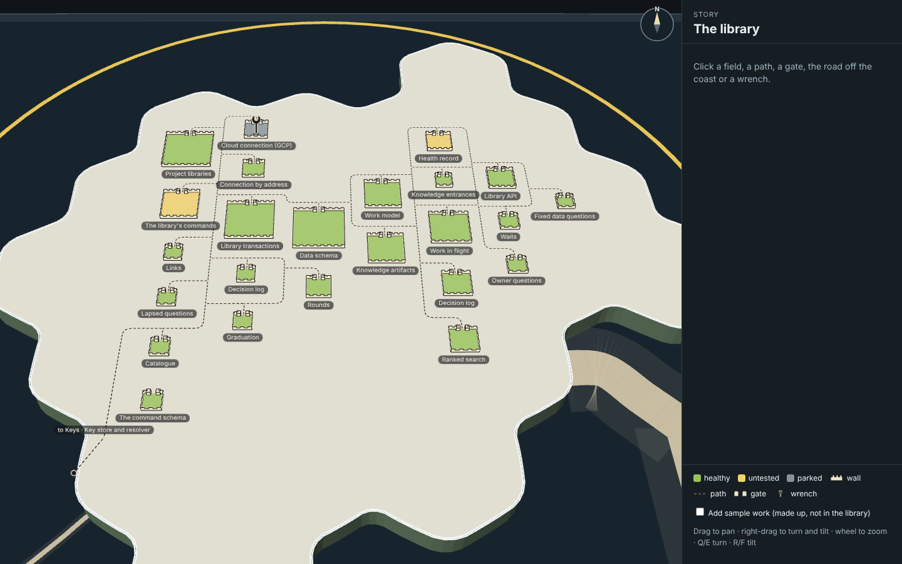
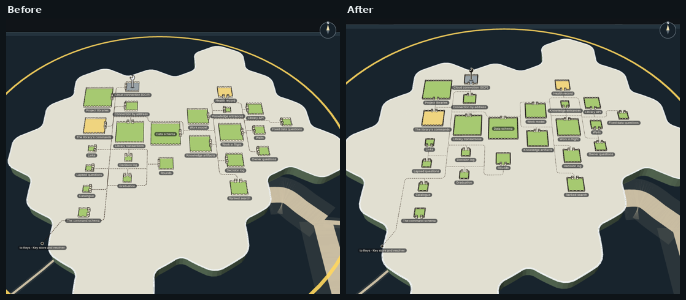
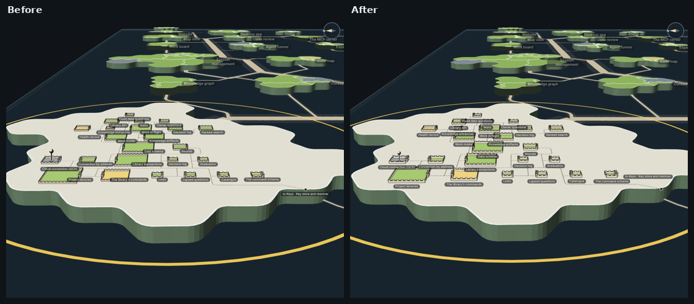
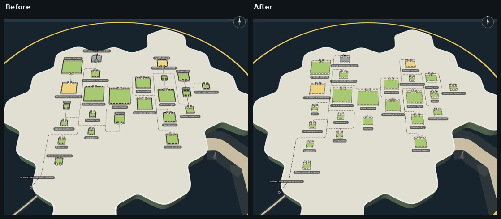
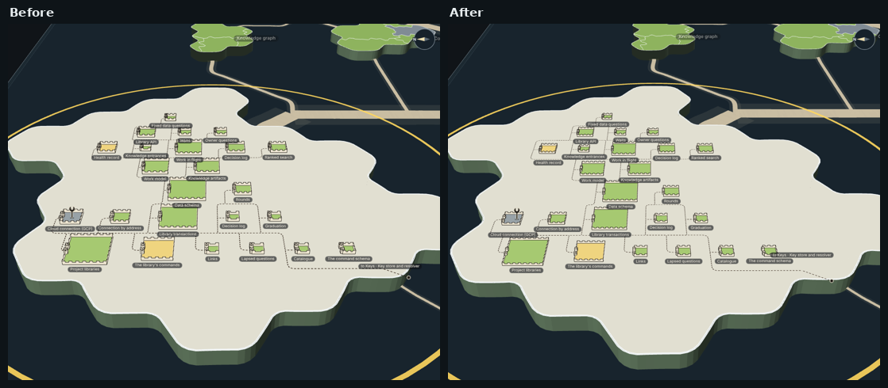

# Capability tree, 3D mock 1, reworked: one roomy island, laid out by dependency, drawn as an inked map

The real map's 3D island for The library, as the desktop app draws it, with its land laid out again: each capability a
walled field in its health colour, the fields placed by what they call, open common ground between them, and the paths
running along the commons from gate to gate. The walls, gates, paths and wrench are drawn as an inked cartographer's map in
2.5D, in the manner of the map's claim flags: flat-drawn, upright, unlit. This is Mick's rework of mock 1 (increment_355de70ab9c4
on arc_9bbaa3497530, question_752b6ef53b90), after "looks very cramped, pathways look a mess". A mock only: it changes no
product code.

**Open it:** `index.html`, straight from disk; it needs no network. Drag to pan, right-drag (or Q/E and R/F) to turn and
tilt, wheel to zoom: the map's own controls. Click a field, a path, a gate, the road off the coast or a wrench, and the
panel on the right shows what it holds. The window is 1440 × 900 with the story panel's 352 pixels on the right, as the app
lays it out; the rest view frames the whole plan, every name and path in sight.



## What changed from mock 1, and why

| Mick asked | What the mock does now |
| --- | --- |
| "looks very cramped": lay it out by dependency on one island, with empty space for the paths | Fields stand in columns by dependency depth, as the map lays its islands out in rows (`packages/forest/src/planet-places`): a capability that calls nothing in the west, each other one a column east of the deepest it calls. In a column the fields are sorted toward the fields they are linked to. Between every two columns, and between the fields of a column, runs a band of open commons. |
| Field area in proportion to lines of code, coloured by health | Each field is a square whose area is its lines (the eight under 220 lines are drawn at 220, so each holds its gate in proportion). The colours are the map's own, read from what it drew. |
| "pathways look a mess": route them like the story-node roads | The paths run only along the commons' centre lines, as the map's border routes run only along lines already drawn (`packages/forest/src/view/border-route.ts`). Each field has one gate, in its north wall; a path leaves by it, takes the shortest way along the lines and enters the other field by its gate. One path per linked pair, never one each way, and a stretch already walked is cheaper, so the ways merge. No path crosses a field. |
| Calmer walls, in a castle-wall look, 2.5D like the claim flags | Four straight runs of wall around each field and nothing else: an upright cut-out with a pale band, crenellations and a thin ink outline, low, unlit and untextured, standing on the land so it reads as the map turns. |
| Simpler gates | An opening in the north wall between two small square towers, drawn the same way; at rest the eye looks north, so the opening shows across the field. |
| A wrench in the claim flags' style, told apart from a flag | A flat ink spanner with an open jaw, standing upright on a small shadow in the front half of its field, constant on screen like the flag; no pole and no pennant. |
| Room, not hiding | Nothing is hidden, at rest or turned: each field's name hangs below it, and a name that would meet another steps clear rather than fading. The island is given more land (1.6 times its lines' worth, the map's own island grown by its own rules), and the rest view is framed on the plan, its names included. |

**What the map still draws, unchanged:** the island's coast, cliffs and shape, the glass sheet, the other islands and the
roads between them, the selection ring, the camera and its controls (`PlanetView`, mounted as the desktop app mounts it).
**What the mock switches off on this island:** the map's own cut of it into territories (its fills, white borders and file
dots), since the fields replace it, and the selection's purple lanes, whose job the paths and the road off the coast take.

## What came from anatomy

[anatomy](https://github.com/wheresryan22/anatomy) (MIT) draws ideas as clean isometric diagrams. Nothing of its code or art
is copied; these principles are borrowed:

- **One thin ink weight.** Every outline is one pixel of the same ink (`#1b1814`) at any zoom, as anatomy's lines are one
  non-scaling weight; only the picked mark changes colour.
- **Few tones, one accent.** The marks use the ink, one pale wall tone, one path brown and the parchment commons; gold is
  the one accent, for the picked mark.
- **Every line ends on something.** A path begins and ends in a gate's opening, the road ends at a dot, a wall run ends at
  a corner or a tower.
- **Depth from shape and order, not shading.** The walls and towers stand up as cut-outs; nothing is lit or hatched.
- **One recipe per symbol.** Every wall run, tower and wrench is built by one function at one scale.
- **No floating text on the drawing.** Names are the map's own nameplates, each on its field or just below it.

Where anatomy and Mick's direction part, Mick's wins: anatomy fills its figures with many small parts, and this mock keeps
the island minimal.

## What is measured, and what is sample

Every number is the real library and code on 2026-11-02 (`data.json`'s `measuredAt`), read by `tools/measure.mjs` from the
project's library and the code survey the map itself uses:

- The library (story_754e87e7d531): 24 capabilities, 14,581 lines in 78 files. 21 healthy, 2 untested (5 · Health record,
  17 · The library's commands) and one, 8 · Cloud connection (GCP), untested and parked, so grey.
- 28 links: 27 inside the story (27 paths, since no two capabilities call each other both ways) and the one to Keys.
- Open work: one open increment names one of these capabilities, increment_dc514c1a7edb on 8 · Cloud connection (GCP).
  That is the wrench at rest.
- What was laid is counted in `stills/shots.json` under `layer`.

**Sample, clearly marked:** the box "Add sample work (made up, not in the library)" adds a second wrench, lavender and
tagged "sample", on 10 · Work in flight, with three made-up increments on two made-up arcs. Nothing else is sample.

## Palette

| Meaning | Hex |
| --- | --- |
| Healthy, untested, parked fields (the map's) | `#97C459`, `#F2D16B`, `#86939D`, at the map's opacity |
| Commons (the land between the fields) | `#d9d1b9` |
| Ink: every outline, the road's end | `#1b1814` |
| Wall and tower faces | `#ece4d0` |
| Paths, dashed | `#6e5236` |
| Wrench | `#1b1814` with a `#ece4d0` edge; sample `#d6bdf0` |
| Picked mark (the selection's gold) | `#ffd34d` |

## Stills

All taken by `tools/shots.mjs`, which clicks each mark where it stands on the page and checks the panel's heading.

| Still | What it shows |
| --- | --- |
| `resting.png` | The resting view |
| `whole-island.png` | Panned out to the whole island |
| `close-up.png` | One field close up (Data schema, picked) |
| `wrench-arcs.png` | The Cloud connection wrench's arc list |
| `sample-wrench-arcs.png` | The sample wrench, listing two made-up arcs |
| `pathway-contracts.png` | Rounds calls Lapsed questions: Lapsed questions' contracts |
| `gate.png` | Work in flight's gate: its calls out, its callers in |
| `territory.png` | Work model's description and contracts |
| `road-off-the-coast.png` | The road to Keys: Key store and resolver's contracts |
| `orbited.png`, `orbited-south-west.png` | Turned and tipped by the map's own keys, two ways |
| `real-today.png`, `side-by-side.png` | The map's island today, beside the mock |
| `round-1.png` to `round-4.png` | Before and after each round of the look review |

## Rebuild it

From the checkout root, after `pnpm install`:

```sh
node --import tsx docs/design/capability-tree-3d/a-stone/tools/measure.mjs   # data.json, from the library and the code
node docs/design/capability-tree-3d/a-stone/tools/build.mjs                  # index.html, page.js, page.css
node --import tsx docs/design/capability-tree-3d/a-stone/tools/shots.mjs --retake   # stills/
```

`tools/layout.ts` is the plan (fields, commons and ways, no drawing); `tools/castle.ts` lays it on the island and draws it;
`tools/look.mjs` takes one quick still while drawing. `index.html?real` draws the map's island as it is today, with nothing
added; `?room=` and `?ground=` change the island's extra land and the rest view's framing.

## The look review

Mick's rule: "I want it kept minimal so the adversarial review should just judge if the existing stuff looks nice, not add
stuff it thinks is missing without my go ahead." Each round a fresh reviewer (the `blind-reviewer` role) was given only the
stills, the page and the brief's review section with the style bar above (the 2.5D cartographer style and anatomy's
principles), never this session's reasoning or an earlier round's answers. It judged only what is drawn; anything it thought
missing went under "for Mick". Findings about the map's own drawing, which the brief keeps unchanged underneath, are
rejected with that reason.

### Round 1: "nearly", 19 findings, none for Mick

| # | Finding | Answer |
| --- | --- | --- |
| 1 | The tan sea roads, lower right, are translucent slabs with seams and a fan of streaks | Rejected: the map's own roads between islands, kept unchanged by the brief |
| 2 | Perspective keystones the fields; asks for a parallel camera | Rejected: the map's own camera, kept unchanged by the brief |
| 3 | Names pile into each other when the map is tipped; the story's gold name is cut by the panel | Fixed the first: a name that would meet another steps down just clear of it (nothing hides). The story's name is the map's own |
| 4 | Gates on east and west walls stack their two towers into a squiggle | Fixed: every gate is in a north or south wall, the walls that face the eye at rest, so the opening shows |
| 5 | East and west walls are a bare ink line from above | Fixed: every wall has a pale walk along its top, so from above it reads as a band |
| 6 | Untested yellow is close to the gold pick | Rejected: both are the map's own (its health colour and its selection gold) |
| 7 | A doubled trunk path, left of centre, smudges into a near-solid stroke | Fixed: it was the road to Keys drawn beside the paths it shares a way with; the road now walks the paths' own stretches |
| 8 | Paths run through names | Fixed: the commons' centre line between two fields of a column runs two thirds of the way down, clear of the upper field's name |
| 9 | The road's end dot stops in the sea, short of the sea road | Fixed in part: the road now ends on the coast. The sea road is the map's own, leaving from its own dock |
| 10 | The island's shaded cliffs, and the land poking past the gold ring | Rejected: the map's own island and selection ring |
| 11 | Path dashes three times the wall's ink weight; the coast's doubled line | Fixed the first: paths are a third thinner. The coast is the map's own |
| 12 | The sample tag sits on a neighbour's name; lilac is a second accent | Fixed the first: the tag stands beside the wrench. The lilac stays: it marks made-up work, so it must not pass for real |
| 13 | Tiny fields dominated by their towers read as rooks | Fixed: smaller towers, and the floor raised from 100 to 160 lines' area |
| 14 | The picked gate is a soft gold smudge | Fixed with 4: the picked gate's ink turns gold on towers that now stand apart |
| 15 | Paths stop short of the gates | Fixed: a path runs through the opening a little into its field |
| 16 | The wrench's base is soft, and the pale wrench vanishes on the grey parked field | Fixed: an ink wrench with a pale edge on a firmer shadow, which shows on every field colour |
| 17 | Name pills are mid grey, unlike the claim flags' | Rejected: they are the map's own capability nameplates, drawn by its own style |
| 18 | The sea plane's edge and the compass at the frame's edge | Rejected: the map's own |
| 19 | Fields crowd the upper half; the lower half is empty | Fixed: the plan is kept near the land's middle, with taller commons between the fields of a column |

Before (left) and after round 1 (right), at rest:



### Round 2: "nearly", 20 findings, two for Mick

| # | Finding | Answer |
| --- | --- | --- |
| 1 | Turned, each name lands on a wall | Fixed: one rule at every turn and zoom. A name hangs on open ground under the field's nearest wall as the eye sees it, or stands over the far wall when the near one holds the gate |
| 2 | The sea roads' fan, slabs and shoulders | Rejected: the map's own roads, kept unchanged by the brief |
| 3 | The road to Keys ends at a dot short of the sea road; its name straddles the coast | Fixed the second: the name stands on the land. Rejected the first: the sea road leaves from the map's own dock, which the mock does not move |
| 4 | The gold story ring is the heaviest line | Rejected: the map's own selection ring |
| 5 | Paths leaving a south gate run through the name below | Fixed with 1: a field's name never stands on its gate's side |
| 6 | The north-east crowded, the south-east bare | Fixed in part: the commons are a tenth wider. The plan's shape is the dependency columns', so a bare stretch of island stays |
| 7 | The name pills are the heaviest shapes | Rejected: they are the map's own capability nameplates |
| 8 | From above, the walls read as film-strip frames | Fixed in part: walls a fifth taller with a narrower walk, so the band and crenellations read as standing. The camera's tilt is the map's own |
| 9 | Walls and wrench heavier than the hair-thin paths; the doubled coast line | Fixed in part: paths a fifth heavier, the wrench smaller. Every outline is already one pixel; the coast is the map's own |
| 10 | Gate stubs dotted unlike the trunks; merged paths meet in T-junctions | Rejected: every path is one dash recipe (short stubs show fewer dashes), and merging where ways are shared is the brief's own rule |
| 11 | The picked path is solid gold, not dashed | Fixed: it is drawn in gold dashes. It still runs a step through each gate into its field, as round 1 asked |
| 12 | The picked gate's towers barely change | Fixed: the towers fill gold and keep their ink outline |
| 13 | Towers dominate the small fields | Fixed: towers and their opening a fifth smaller |
| 14 | The wrench collides with the gate and dominates small fields | Fixed: it is a fifth smaller and stands in the middle of its field; names keep clear of it |
| 15 | The coast's hex lobes and shaded cliffs | Rejected: the map's own island |
| 16 | Names jump between inside and below their field as the zoom changes | Fixed with 1: one rule, every name outside its field |
| 17 | The picked field's wall loses its ink outline | Fixed: the wall's band turns gold and its outline stays ink |
| 18 | The sample tag's lavender is used nowhere else | Rejected: it marks made-up work, so it must not pass for real |
| 19 | The other islands' labels and slabs | Rejected: the map's own |
| 20 | The legend's swatches look nothing like the marks | Fixed: each swatch is a small copy of its mark |

**For Mick, from round 2** (nothing built from these): a pale halo behind a name where it must cross a path; and whether the
other islands' roads should show at all from this view, especially the wide road passing at the right of the rest view.

Before (left) and after round 2 (right), turned and tipped:



### Round 3: "nearly", 19 findings, one for Mick

| # | Finding | Answer |
| --- | --- | --- |
| 1 | Turned, names land on neighbouring fields | Fixed in part with 4: every name hangs under its field's front wall. Tipped low, the far rows stand a few pixels apart, so their names still meet fields there; names never meet each other |
| 2 | Panned out, names sit in other fields; Rounds' name reads as Data schema's | Fixed with 4 and wider commons |
| 3 | Health record's gate towers stand on Knowledge entrances' name | Fixed with 4: gates are at the back of each field, names at the front |
| 4 | Names above some fields and below others | Fixed: one rule, every name below its field at rest. Every gate is now in the field's north wall, so no path leaves through a name |
| 5 | Orthogonal shared trunks read as a circuit board; near-parallel pairs | Fixed the pairs (wider commons, the paths keep to the lines above the fields). Rejected "no shared trunks": the brief asks that paths merge where they share a way |
| 6 | Paths hug walls | Fixed: the commons are wider (13 units from 11), so the centre lines keep further off every wall |
| 7 | Paths seem to reach a field's back wall where it has no gate | Fixed with 4: the back wall is where every gate is |
| 8 | A path ends behind a name | Fixed with 4: the names no longer sit on the lines the paths run along |
| 9 | Three golds; the picked path reads orange | Fixed: the picked path's dashes are drawn crisp in the one gold, with no blend at their edges. The ring's gold is the map's own |
| 10 | Towers on small fields read as ears and dominate | Fixed: squarer towers with a two-notch top, the opening narrower |
| 11 | East and west walls read as heavy double strokes | Fixed: the wall's top walk has no outline of its own, so every wall reads as one pale band with one thin ink line |
| 12 | Walls look like trays when tipped | Rejected: round 2 asked for taller walls so they read as standing at rest; the walls stay a single cut-out with a walk |
| 13 | The wrench reads as a pole and a hook, like a flag | Fixed: a spanner with a round head and a clearly open jaw, one size everywhere |
| 14 | The sample tag's lavender; it crosses a path | Fixed the placing. Rejected the colour: it marks made-up work |
| 15 | The picked wrench crowds its name and gate | Fixed with 4 and 13 |
| 16 | Dashes run past the gate into the field | Fixed: a path ends in the gate's opening |
| 17 | The road's name straddles the coast; its dot short of the map's road; its last stretch is the one diagonal | Fixed the name (on the land). Rejected the rest: the sea road leaves from the map's own dock, and the road heads straight for Keys |
| 18 | A darker face on picked gold | Fixed: the added marks take no fog from the scene |
| 19 | The north-east cramped, the south empty | Fixed in part: wider commons; the bare south is the island's own land beyond the plan |

**For Mick, from round 3** (nothing built from it): should a field with no links (The command schema) have a gate at all?

Before (left) and after round 3 (right), at rest:



### Round 4: "nearly", 17 findings, nothing new for Mick

From this round the reviewer's brief named the map's own drawing as out of scope, in the brief's own words ("The real map's
island, colours, pan and zoom stay underneath, unchanged"), so it judged only the mock's marks against it.

| # | Finding | Answer |
| --- | --- | --- |
| 1 | Zoomed out and turned, names land on neighbouring fields | Fixed: a name hangs below its field's lowest point on the page, across from its middle, at every turn and zoom |
| 2 | Right-angled runs that wrap fields read as a circuit board; parallel trunks | Rejected: the paths keep to the commons' centre lines as the story roads keep to drawn lines, the brief's routing. Wider columns keep trunks further apart |
| 3 | Paths run under the ends of names | Fixed: each column is as wide as its widest name, so names stop short of the trunks between columns |
| 4 | Paths meet fields at corners or run along a wall past its gate | Fixed: more commons above the top field of each column, so the line there keeps off its wall |
| 5 | Small fields are "two towers on a tray"; short walls scribbly | Fixed: the smallest field is drawn at 220 lines' area; a short wall is a plain band without crenellations |
| 6 | Paths heavier and darker than the outlines | Fixed in part: paths a sixth thinner. Their brown stays, the cartographer's road ink Mick's reference shows |
| 7 | The wrench blocks the gate | Fixed: it stands in the front half of its field, away from the gate at the back |
| 8 | The picked path reads as hazard tape | Fixed: a heavier, near-solid gold line over the ink dashes |
| 9 | The picked gate has little mass | Rejected: colouring the wall beside it would read as the field picked; the gate's towers fill gold |
| 10 | The road's name straddles the coast and crosses its line | Fixed: it stands further inland. Its dot is where the road leaves the coast toward Keys; the sea road is the map's own |
| 11 | Tipped low, the front wall hides small fields | Fixed: walls a sixth lower |
| 12 | Fields packed into the upper two-thirds | Rejected: the plan's shape is the dependency columns', centred on the island's middle |
| 13 | The sample tag's lavender | Rejected: it marks made-up work |
| 14 | The picked wrench loses its ink outline | Fixed |
| 15 | Tower tops smudge into a "W" | Fixed: two clean merlons |
| 16 | The picked wall's gold is near the untested yellow | Rejected: round 2 asked that the picked wall keep its ink outline and turn its band gold |
| 17 | The legend's path swatch is tan; the wrench swatch faint | Fixed: drawn in the map marks' own inks |

Before (left) and after round 4 (right), from the south-west:



### Round 5: "nearly", 15 findings, one for Mick: the loop stops here

The brief stops the loop after five rounds, so round 5's findings were not drawn in; the version landed is round 4's, and
these stand, for Mick to judge from the pictures. Where a finding asks for what an earlier round or the brief decided
against, that is said.

| # | Finding (standing) | Note |
| --- | --- | --- |
| 1 | The plan fills the island's upper two-thirds; the north-east cluster is tight while the south and east are bare | The plan's shape is the dependency columns', centred; filling the island would mean a different layout than "placed by dependency" in columns |
| 2 | Tipped low, names land on the next field | Names hang below their own field's lowest point; at a low tilt the rows are a few pixels apart |
| 3 | Paths merge into shared trunks and loops that read as fences round groups of fields | The brief asks that paths merge where they share a way and run along the commons as the story roads do; rounds 3 and 4 answered the same |
| 4 | Paths pass under the ends of some names | Columns are as wide as their names, but a name can still reach the line between columns |
| 5 | The road's name stands apart from its dot and near "The command schema" | Round 3 asked that it stand wholly on land |
| 6 | The road's dot misses where the map's sea road meets the coast | The sea road leaves from the map's own dock |
| 7 | The picked wall's gold band reads like the untested yellow | Round 2 asked for this (a gold band, the ink outline kept) |
| 8 | The picked path's gold looks orange-brown and thin at rest | |
| 9 | On small fields the wrench's head reaches the back wall and gate | Round 4 moved it to the front half, out of the gateway on the larger fields |
| 10 | Gate towers take up half the wall of the smallest fields | Round 4 raised the smallest field to 220 lines' area |
| 11 | Side walls are a thin double line without crenellations | They foreshorten at the map's tilt; short runs are plain by round 4's answer |
| 12 | The picked gate is easy to miss at rest | |
| 13 | Panned out, crenellations and towers blur | |
| 14 | The sample tag's lilac | It marks made-up work, so it must not pass for real |
| 15 | The legend's gate and path icons read darker or more orange than the marks | |

## Where it stands, and what is for Mick

Every round's verdict was "nearly"; none came back clean. What changed most over the loop: gates moved to the back wall
where they read as an opening between two towers, names hang below each field by one rule at every turn, the road stopped
doubling the paths, the walls became one band with one ink line, and the wrench became a spanner with an open jaw. What
reviewers kept returning to, and the brief decides: the orthogonal, merging paths (the brief's routing), the plan's shape on
the island (dependency columns), and how crowded the far rows get when the map is tipped low.

**For Mick** (nothing was built from these):

1. A pale halo behind a name where it must cross a path (round 2).
2. Whether the other islands' roads should show at all from this view, especially the wide road at the right of the rest
   view (round 2).
3. Whether a field with no links, such as The command schema, should have a gate (round 3).
4. No still shows a claim flag and a wrench side by side, so whether they tell apart at a glance on the map itself is
   unjudged (round 5).
5. The wrench's shadow at its foot, like the claim flag's, is the one soft mark (round 4).
