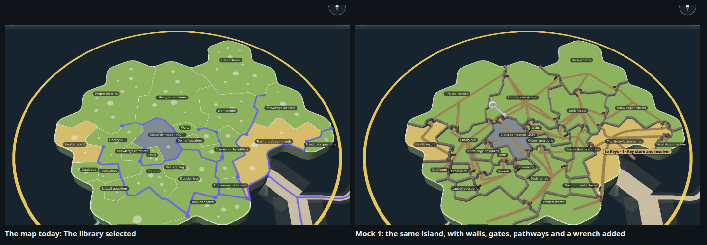

# Capability tree, 3D mock 1: the real island with drystone walls and stone gates

The real map's 3D island for The library, exactly as the desktop app draws it today, with low drystone walls along every
border between territories, an arched stone gateway with an open wooden door wherever a cobbled pathway crosses a wall,
and a wrench over the gate of each territory that open work names. The lightest touch of the three round-two mocks: the
island as it is, plus walls, gates, paths and wrenches (question_752b6ef53b90 on arc_9bbaa3497530; a mock only, changing
no product code).

**Open it:** `index.html`, straight from disk; it needs no network. Drag to pan, right-drag (or Q/E and R/F) to turn and
tilt, wheel to zoom: the map's own controls. Click a territory, a pathway, a gate, the road off the coast or a wrench, and
the panel on the right shows what it holds. The window is 1440 × 900 with the story panel's 352 pixels on the right, as
the app lays it out.




## What comes from the real map, and what the mock adds

**From the real map, unchanged.** `tools/page.tsx` mounts the forest's own view (`PlanetView` from
`packages/forest/src/view/planet-view.tsx`, the component the desktop app mounts) on the plan, story order and code
survey snapshotted in `data.json`, turned into the scene by `forestScene` and `storyNodes` (`packages/forest`) exactly as
`packages/app/src/page/page.ts` does. So the island's shape and coast, its territory per capability (sized by lines of code,
`packages/forest-world` and `packages/forest/src/territories`), their colours by health (`territory-land.ts`), the
territory names, the selection's gold ring, the glass sheet, the other 29 islands and the roads between them, and the
camera that pans, turns, tilts and zooms are all the real code, imported, never copied. The island is shown selected and
framed close up, as the story panel shows it.

**Switched off for this view** (both by the map's own switches): the file dots (`surfaces.fileCircles: false`, Mick's
"a blank island with just the colours"), and the selection's purple lanes across the land, whose job the pathways and
the road off the coast take over.

**Added by the mock** (`tools/stone.ts`), laid in the island's own plate so it turns and tilts with it, and read from what
the map drew (its territory fills and its white border lines), so it lands where the real borders are:

- **A drystone wall on every border between two territories:** 139 border lines, 1,282 ground units, three courses of
  rough stones and a row of capstones. None on the coast. Height carries no meaning (ADR-0804 D1): every wall is the same
  height and every territory stays at one level.
- **A cobbled pathway for each link** (`dependsOn`) between two of The library's capabilities: all 27. A pathway runs
  from each territory's seat (the spot on it farthest from its walls) through the gate into the next territory, so
  pathways that share a stretch share its cobbles. 12 links join neighbours; the other 15 pass through territories
  between (`stills/shots.json` lists each one's way, under `layer.linkWays`).
- **An arched stone gateway with an open plank door** wherever a pathway crosses a wall: 34, one per pair of neighbouring
  territories a pathway or the road passes between, on the longest wall those two share.
- **A road off the coast** for the one link to another story, 15 · Connection by address calling Keys' 1 · Key store and
  resolver: from its territory, through gates, to the shore that faces the Keys island, ending at a signpost naming it.
- **A wrench over a gate** for each territory that open work names, on the gate its own pathway leaves by.

**Clicks:** a territory shows its health, lines, files, share of the island, description, contracts, what it calls and what
calls it; a pathway shows the called capability's contracts (and, on a shared stretch, the other links it carries); a gate
shows the links through it with each called capability's contracts; the road shows Keys' capability's contracts; a wrench
lists every arc, with its increments, that wants that capability. The clicked mark lights in the selection's gold.

## What is measured, and what is sample

Every number is the real library and code on 2026-11-02 (`data.json`'s `measuredAt`), read by `tools/measure.mjs`, which
reads the project's library and the code survey the map itself uses (`packages/map`'s `readCodeSurvey`):

- The library (story_754e87e7d531): 24 capabilities, 14,581 lines in 78 files, no unclaimed code. 21 healthy, 2 untested
  (5 · Health record, 17 · The library's commands) and one, 8 · Cloud connection (GCP), untested and parked, so grey.
- 28 links: 27 inside the story and the one to Keys.
- Open work: one open increment names one of these capabilities: increment_dc514c1a7edb ("Run the live Cloud SQL checks
  and record their health", arc "Cloud SQL sign-in, kept in the back pocket") on 8 · Cloud connection (GCP). That is the
  wrench at rest.
- The walls, gates and pathways are counted from what was laid (`stills/shots.json`, `layer`).

**Sample, clearly marked:** the box "Add sample work (made up, not in the library)" adds a second wrench, on 10 · Work in
flight, with three made-up increments on two made-up arcs, so a wrench listing more than one arc can be seen. It is
lavender, tagged "sample" on the island and in the panel. Nothing else is sample.

## Palette

The land's colours are the map's own (`packages/forest/src/view/territory-land.ts`); the mock's are in `tools/stone.ts`'s
`PALETTE`.

| Meaning | Hex |
| --- | --- |
| Healthy territory (the map's) | `#97C459` at 0.8 |
| Untested or proposed territory (the map's) | `#F2D16B` at 0.8 |
| Unhealthy territory (the map's; none today) | `#E24B4A` at 0.85 |
| Parked territory (the map's) | `#86939D` at 0.8 |
| Wall stones | `#8e8a80`, `#a39d90`, `#7c786f`, `#b3ab9a`, `#958d7d` |
| Capstones and keystones | `#bdb6a6` |
| Door and signpost | `#8a5a32`, bands `#5e3b20` |
| Cobbles, set in packed earth | `#e2d6b8` on `#b7a27c` |
| Wrench | `#c9d0d6` |
| Sample wrench | `#c9a6e8` |
| Picked mark (the selection's gold) | `#ffd34d` |
| Road sign | `#e9d9b4`, ink `#3b3428` |

## Stills

All taken by `tools/shots.mjs`, which clicks each mark where it stands on the page and checks the panel's heading.

| Still | What it shows |
| --- | --- |
| `resting.png` | The resting view, at the panel's size |
| `orbited.png` | The same island turned and tipped nearer level by the map's own keys |
| `close-up.png` | Zoomed in by the wheel: the stones, arches and doors |
| `wrench-arcs.png` | The Cloud connection wrench's arc list |
| `sample-wrench-arcs.png` | The sample wrench, listing two made-up arcs |
| `pathway-contracts.png` | Rounds calls Lapsed questions: Lapsed questions' contracts |
| `gate.png` | A gate: the link through it and the called capability's contracts |
| `territory.png` | Work model's description and contracts |
| `road-off-the-coast.png` | The road to Keys: Key store and resolver's contracts |
| `real-today.png`, `side-by-side.png` | The map's island today at the same framing, beside the mock |

## Rebuild it

From the checkout root, after `pnpm install`:

```sh
node --import tsx docs/design/capability-tree-3d/a-stone/tools/measure.mjs   # data.json, from the library and the code
node docs/design/capability-tree-3d/a-stone/tools/build.mjs                  # index.html, page.js, page.css
node --import tsx docs/design/capability-tree-3d/a-stone/tools/shots.mjs --retake   # stills/
```

`build.mjs` bundles `tools/page.tsx` with esbuild against the forest's own packages (resolved through
`packages/website`, which mounts the same view) into one classic script, so the page opens from disk. `page.js` is 2.8 MB
(three.js, React, the forest's code and the 1.1 MB snapshot inlined), small enough to commit. `index.html?real` draws the
map's island as it is today, file dots and lanes on, with nothing added.
