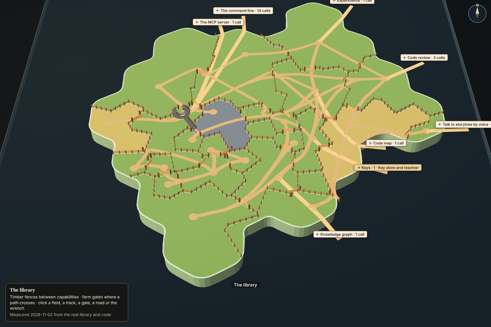
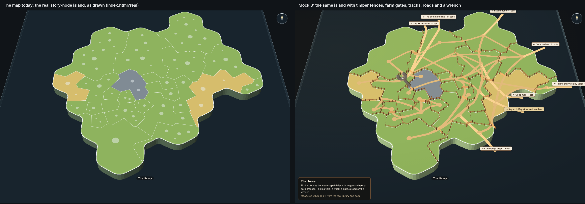

# Capability tree in 3D, mock B: timber fences and farm gates

The real story-node island the map draws for The library, with a low timber fence along every border between two
capabilities, a five-bar farm gate wherever a pathway crosses one, pale dirt tracks for the links between capabilities,
sand roads off the coast for the links to other stories, and a steel wrench where open work wants a capability. Warm
late-afternoon light falls on the timber and the steel, so the island reads cozy rather than cold.

One of three second-round mocks (increment_66bc675dc787 on arc_9bbaa3497530; question_752b6ef53b90 holds the pick). A
mock only: it changes no product code, no package and no test.

**Open it:** `index.html` in Chromium or Chrome, straight from disk, no network. Drag to pan, right-drag (or Ctrl+drag) to
orbit and tilt, scroll to zoom: these are the map's own controls. Click a field, a track, a gate, a road (or its label)
or the wrench; the panel on the right says what it holds. `index.html?real` opens the same island exactly as the map
draws it today, file dots and all.



## What comes from the real map, and what the mock adds

**From the real map, unchanged, imported never copied.** The page *is* the desktop app's renderer
(`apps/desktop/src/renderer/renderer.ts`), bundled by esbuild with everything it imports: `packages/forest` (the forest
view, `planet-view.tsx`, `territory-land.ts`, the forest scene) and `packages/forest-world` (the island's land per
capability, parcel cells, coast clip, relief, shore fall and the planet sheet), drawn with three.js and
@react-three/fiber. The island's outline, its territories and their sizes, their colours by health, the white borders,
the coast and the island's side, the camera and its controls are all the map's. The app's own stand-in bridge for
captures (`apps/desktop/src/capture/fake-bridge.ts`) answers the page from `data.json` instead of a running app.

**Taken away for this view:** the file dots (the `file-circles` group is hidden: "a blank island with just the colours"),
and the app's chrome around the map (menu bar, arcs bar, sessions list, the Stories/Library switch), since the capability
tree shows in the story's panel, not the whole window. The map's notice that its roads between islands were not routed
is hidden too: with one island on show there are no roads between islands to route.

**Added, all in `tools/timber.ts`, placed from the scene the map drew** (its `territory:<capability>` meshes and its
`territory-borders` segments), so it can move back onto the map as a layer:

- **Fences:** posts every 3.2 units and two rails, on each of the 139 border segments between two capabilities, none on
  the coast. Height carries no meaning (ADR-0804 D1): every territory stays at the map's one level; only the fences stand.
- **Tracks:** one per `dependsOn` link between two of The library's capabilities, 27 of them, from the caller's field to
  the called one. Each runs over its own field's land and crosses a fence only at a gate; where two linked fields do not
  touch (15 of 27), it goes through the fewest fields between, gate to gate, and the panel names the fields it crosses.
  The page counts this rather than trusting it: 0 crossings of a fence away from a gate (`tools/capture-report.json`).
- **Farm gates:** 34, one per pair of fields a track or road passes between, swung a little open. A gate's panel lists
  every pathway through it and the contracts of each capability called.
- **Roads off the coast:** the one link out (15 · Connection by address → Keys' 1 · Key store and resolver) and one road
  per story that calls in (7 stories, 22 calls: The command line 14, Code review 3, and five with 1 each), each labelled
  and clickable for the called capability's contracts.
- **Wrenches:** one per territory that an open increment's capabilities list names, on that territory's busiest gate,
  turning to face the viewer. Today exactly one does: 8 · Cloud connection (GCP), wanted by "Run the live Cloud SQL checks
  and record their health" (proposal) on the arc "Cloud SQL sign-in, kept in the back pocket". It is the real one, so no
  sample was needed.
- **Light:** a low warm sun from the west, a warm sky light and a faint wash over the page; the territory fills are the
  map's unlit fills, so health still reads exactly as on the map.

## Palette

| Mark | Hex |
| --- | --- |
| Fence posts, gate posts | `#6b4a2f` |
| Fence rails | `#9a6b43` |
| Farm gate bars | `#c79a63` |
| Dirt track | `#bfa577` |
| Sand road off the coast | `#d4bc8c` |
| Wrench steel | `#b9c2c9` |
| Sun / sky / shade | `#ffd9a8` / `#ffe7c4` / `#5a4a3c` |
| Panel paper / ink / border | `#f6eedf` / `#3b2a1a` / `#8a6240` |
| The map's own fills (unchanged): healthy, not proven yet, parked | `#97C459`, `#F2D16B`, `#86939D` |

## What is measured, and what is sample

Everything is measured; nothing is sample. `tools/measure.mjs` snapshotted the real library (project `storytree`) and
the real code on 2026-11-02 into `data.json`:

- The library's story (story_754e87e7d531) from `projectTree()`, as the desktop app hands it to the page: 24
  capabilities, 287 contracts; 21 healthy, 2 not proven yet (5 · Health record, 17 · The library's commands) and 1 parked
  (8 · Cloud connection (GCP)).
- The code survey from `readCodeSurvey` (packages/map), as the app's `codeSurvey` answers it: 14,581 lines over the 24
  capabilities and none unclaimed. The map sizes each territory from it itself.
- Every `dependsOn` link out of or into the story's capabilities (27 inside, 1 out, 22 in), from the same tree.
- The open increments whose capabilities lists name one of the story's capabilities, from `arcViews()` (1 today).

## Stills

| Still | What it shows |
| --- | --- |
| `stills/resting.png` | The resting view, 1440 × 960 |
| `stills/resting-panel.png` | The resting view at the story panel's size (30rem, 480 × 900), panned to the middle with the map's own drag |
| `stills/orbited.png`, `stills/orbited-zoomed.png` | The same island orbited by the map's right-drag, then zoomed by its wheel |
| `stills/wrench-arcs.png` | The wrench's arc list open |
| `stills/pathway-contracts.png` | A pathway's called capability and its contracts |
| `stills/gate-contracts.png` | A farm gate with four pathways through it |
| `stills/road-contracts.png` | The road off the coast to Keys, with its contracts |
| `stills/territory.png` | A territory's description and contracts |
| `stills/side-by-side.png` | The map's island today (`?real`) beside this mock, same size and framing |



## Rebuild it

From the checkout root:

```sh
node --import tsx docs/design/capability-tree-3d/b-timber/tools/measure.mjs   # re-snapshot data.json (needs the library)
node docs/design/capability-tree-3d/b-timber/tools/build.mjs                  # index.html, renderer.js and the stylesheets
node --import tsx docs/design/capability-tree-3d/b-timber/tools/capture.mjs   # the stills and tools/capture-report.json
```

`build.mjs` bundles `tools/entry.ts`: `tools/boot.ts` (the stand-in bridge), then the desktop renderer unchanged, then
`tools/timber.ts`. The bundle (`renderer.js`, 2.3 MB, `data.json` inlined) is committed so the page opens from disk. The
capture uses the capture kit's `launch`; where Playwright's own Chromium is missing, point `CAPTURE_CHROMIUM` at a
Chromium binary.
