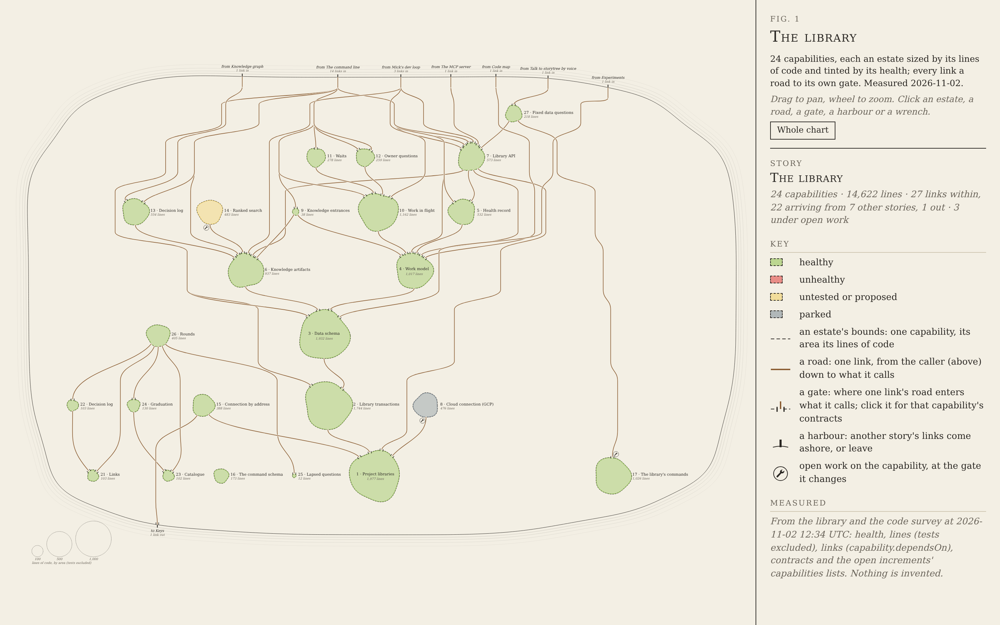

# Capability tree, round 6C: a cartographer's chart, free hand

**The idea, in two sentences.** The library is drawn as a paper chart of one island where each capability is a separate
estate in open country, its area its lines of code and its tint its health, set in rows by dependency so that every road
runs downhill from caller to called through open land, never squeezed along a border. Links from other stories come ashore
at a named harbour on the north coast and fork to their own gates; the one link out leaves by a harbour in the south.

This answers round 5's lesson (increment_841d720e4fb7 on arc_9bbaa3497530): tiling the island with territories left no room
for the links. Here nothing touches: estates have land on every side, which is what made the architecture diagram read, and
the cartographer's conventions carry the look (dashed bounds, solid roads, a harbour per foreign port, a scale of areas).

**Open it:** `index.html`, straight from disk, with no network (the data is in `data.js`). Drag to pan, wheel to zoom,
`0` or **Whole chart** to fit, `Esc` to clear. Click an estate, a road, a gate, a harbour or a wrench.

## Why a flat chart, not the map's three.js island

Mick's 2.5D rule came from the rotating map: "i dont think exactly2d works well on a rotating map". A chart that never
turns has no such problem, and flat ink is what a cartographer draws, so this mock does not rotate and does not keep the
map's island shape: the map's island is a tiling, and the tiling is what left no space for roads. The marks keep the claim
flags' manner (flat, dark ink, small, functional) and the map's health colours. The cost: it is not the real map's scene,
so moving this into the app means a 2D layer for a zoomed-in story, not a change to the 3D island.

## Palette

| Use | Hex |
| --- | --- |
| Paper (land and sea) | `#f3efe4` |
| Ink (coast, bounds, gates, harbours, wrench) | `#2a2723` |
| Soft ink (counts, notes) | `#6b655b` |
| Road | `#8b5e34` |
| Lit route and marks | `#c2412d` |
| Healthy (the map's) | `#97C459` |
| Unhealthy | `#E24B4A` |
| Untested or proposed | `#F2D16B` |
| Parked | `#86939D` |

An estate is its health colour at 42% over paper, with a deeper band of the same colour just inside its dashed bound, as old
maps tint a region's edge. The sea is the coast repeated four times outward in fading hairlines.

## Layout method

1. **Rows by dependency.** Each capability's row is its longest chain of calls down to a capability that calls nothing
   inside the story (Project libraries, Links, Catalogue, Lapsed questions, The command schema, The library's commands sit
   on the bottom row; Fixed data questions on the top, six calls deep). Called is always below caller.
2. **Lanes.** A link that skips rows gets a waypoint (a lane) in every row it passes, so it runs through the gaps between
   estates, never across one.
3. **Order.** Within each row, 40 barycentre sweeps (each node to the mean place of its neighbours above, then below),
   keeping the order with the fewest crossings: 31 at rest, for 50 roads.
4. **Shared roads.** Lanes side by side in a row that come from the same harbour or the same estate run as one road, and
   fork where their destinations part. So a shared arrival splits, as the brief asks, without a hand-drawn trunk.
5. **Placement.** Sixty passes pull every estate toward what it touches and every lane straight, never closer to a neighbour
   than 34 pixels of open land (about 19 beside a lane); rows are 84 pixels apart.
6. **Gates and ports.** Each link's gate is on the upper rim of what it calls, spread in the order its roads arrive; each
   road leaves from the caller's lower rim. A gate is a gap in the dashed bound with an ink post either side.
7. **Coast and harbours.** A rounded island (a superellipse with a small hand wobble) holding every estate; harbours keep
   the layout's order along the north coast, spread so no two names touch.

Names sit inside an estate when they fit, beside it otherwise; every name and its line count are shown at rest. Areas are
true: 15 square pixels per line (the scale of 100, 500 and 1,000 lines is in the sea, bottom left), so Lapsed questions'
12 lines is a dot and Project libraries' 1,977 is the largest estate.

## What is measured and what is sample

Everything is measured; nothing is sample. `tools/measure.mjs` read the library and the code survey on 2026-11-02 (the
time is in `data.json`): the story's 24 capabilities, their health words and parked state, their lines of code and files
(the survey's source files, tests excluded), their contracts, their links (`capability.dependsOn`: 27 within the story,
1 out to Keys), the 22 links from 7 other stories' capabilities into this one, and the 3 open increments whose
capabilities lists name one of these capabilities. Real open work exists, so no sample wrench was needed.

One judgement, said plainly: an increment names a capability, not a link, so which gate its wrench stands at is chosen.
The wrench stands at the capability's most central gate in; a capability nothing calls (Ranked search, Cloud connection)
has no gate in, so its wrench stands where its own road leaves it.

Re-measure from the checkout root: `node --import tsx docs/design/capability-tree-3d/c-cartographer/tools/measure.mjs`
(writes `data.json` and `data.js`). Retake the stills: `node docs/design/capability-tree-3d/c-cartographer/tools/shots.mjs`;
the gate, harbour, wrench and estate stills are opened by real clicks on the marks.

## Clicks

| Click | Shows |
| --- | --- |
| An estate | Its health, lines, files, description, contracts, and its roads in and out (each opens its gate). Its bound and gates light. |
| A gate, or its road | Caller → called, and the called capability's contracts (number and title). Its whole route lights, drawn over the roads it crosses; nothing is dimmed. |
| A harbour | Every link from (or to) that story, each road lit to its own gate, and the list of links. |
| A wrench | Every arc with open increments that name the capability, and each increment. |

## Stills

| Still | What it shows |
| --- | --- |
| `resting.png` | At rest: the whole chart fitted beside the panel, every name shown |
| `whole-chart.png` | Zoomed out a step: sea, harbours, the scale of areas |
| `close-up.png` | The foundations at reading zoom |
| `gate.png` | Library API's own gate into Project libraries: its contracts, its route lit |
| `arrivals.png` | The command line's harbour: 14 links forking to 14 gates |
| `wrench.png` | The library's commands' wrench open |
| `capability.png` | Work model's description and contracts |

## What I would look at next (for Mick; nothing built from these)

1. The command line's 14 links make the top third busy. Showing other stories' roads only up to the coast at rest, with
   the full roads on a harbour click, would calm it most, at the cost of "nothing hidden".
2. The library's commands sits far east with one long road to it; letting a lane bend sideways in open country rather than
   only down would shorten long roads like that one and the road to Keys.
3. The two clusters (the knowledge rounds on the west, the rest) could be two islands, or one island with a bay between.
4. Text is small at the resting zoom on a 1440-wide window; a resting view framed on the busiest two thirds, with the rest
   a pan away, would trade the whole view for legibility.
5. Gates are uniform; a gate's posts could carry a tiny count of the called capability's contracts, so the chart says how
   much each door opens on before it is clicked.
