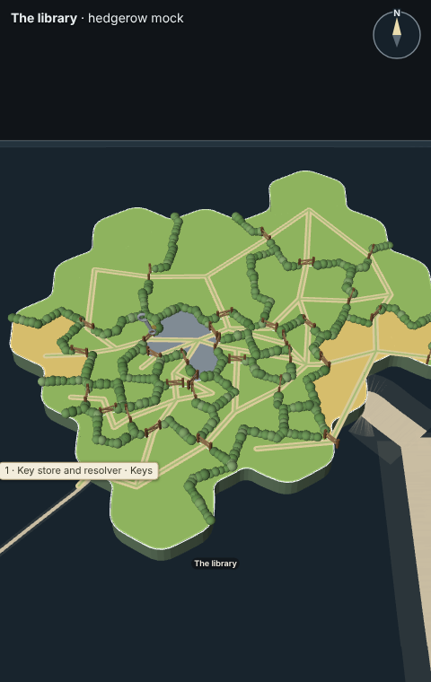
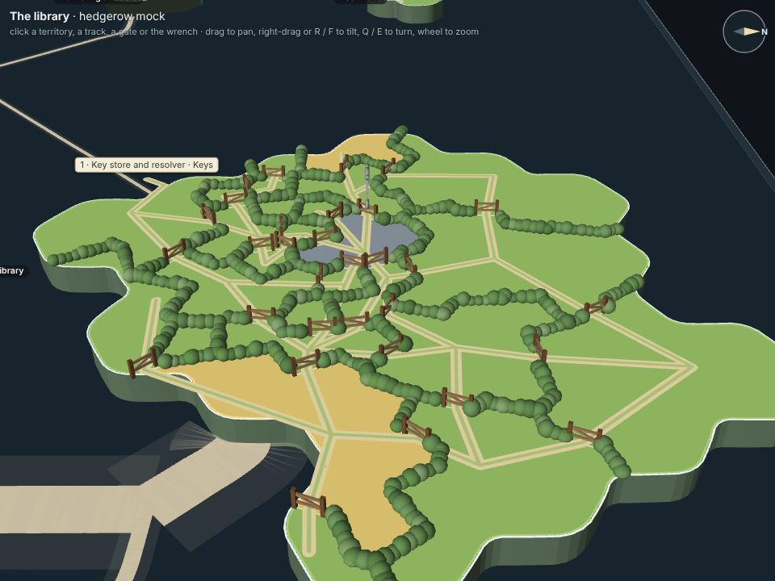
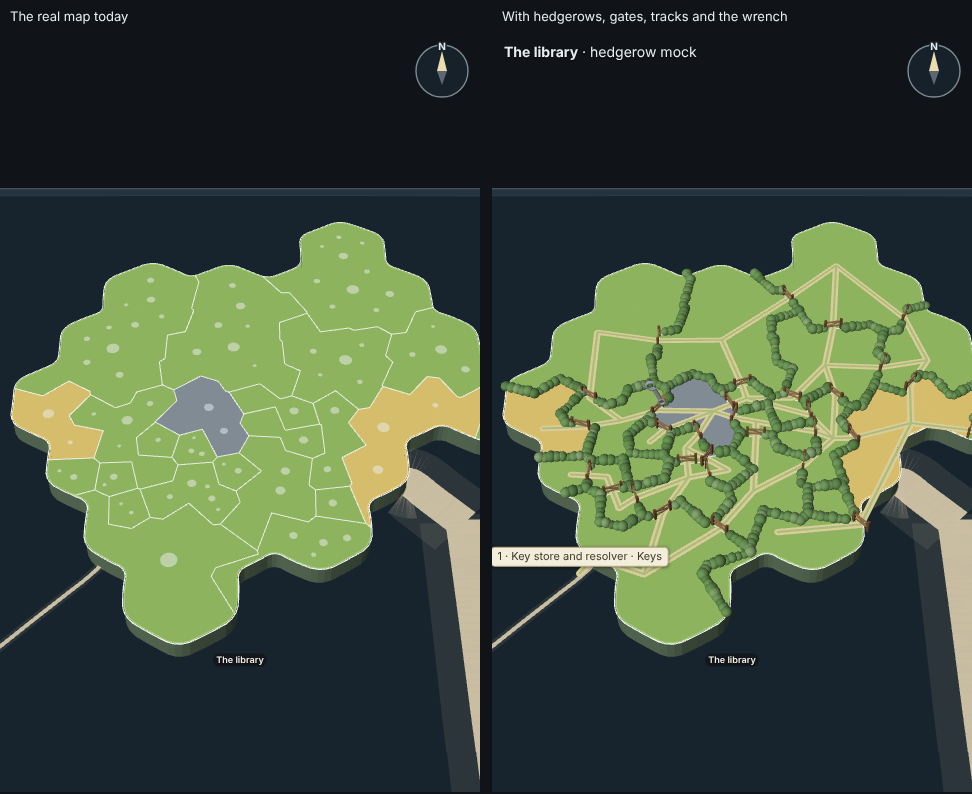
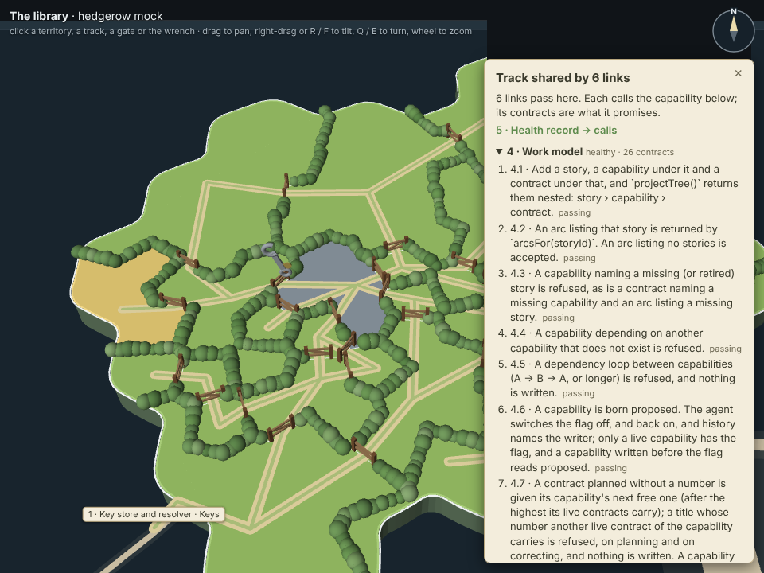

# Capability tree in 3D, mock C: hedgerows and wooden gates

**Direction.** The library's island as the map draws it today, with a soft rounded hedgerow along every border between
two capability territories and a small wooden gate wherever a grassy track goes through a hedge. It is the gentlest of the
three: nothing taller than a hedge, no stone and no timber walls, only quiet greens, worn earth and wood.

A mock only (increment_bee2b78f94e6, on arc_9bbaa3497530). It changes no product code, no package and no test.



## What comes from the real map, and what the mock adds

The page is the real map's own view, imported and never copied: forest's `PlanetView` (packages/forest/src/view), which
draws the glass sheet, every story's island as a raised plate with its coast, its territories cut by
`islandTerritories` and coloured by health by `territoryLand`, its nameplates and the sand roads between islands, with
packages/forest-world doing the plate, coast, relief and roads. The scene is `forestScene` and the layout `storyNodes`,
as the desktop page builds them, from the project's tree as the page reads it. The camera is the map's own: drag to pan,
wheel to zoom, right-drag or R / F to tilt, Q / E to turn. Height carries no meaning (ADR-0804 D1): every territory stays
at one level.

What the mock changes and adds, on The library's island only (`tools/hedgerow.ts`):

- **File dots off**, by the view's own `fileCircles` switch.
- **Hedgerows**: rounded bushes along each border between two territories, laid on the island's own territory map (the
  same `islandTerritories` cut to the same `islandCoast`), so they sit exactly on the borders the map draws. The coast
  keeps the map's own edge.
- **Grassy tracks**: one per capability link (`capability.dependsOn`). A track runs from one territory's seat (the seed of
  its middle cell) through each neighbouring territory on the shortest way, so it crosses hedges only at gates. A stretch
  two links share is drawn once and names both.
- **Wooden gates**: two posts, two rails and a brace, in a gap in the hedge where a track passes. Tracks that pass at the
  same place share one gate.
- **A road off the coast** for a link to another story's capability: a track to the stretch of coast facing that story's
  island, then a short road, labelled with the capability and its story.
- **Wrenches**: one per territory that open increments name in their capabilities lists, hung on its gate.

Clicks: a territory opens its description and contracts (the view's own territory pick, forest 3.15); a track or a gate
opens the called capability's contracts for each link that passes there; the wrench opens every arc, with its
increments, that wants that capability.

## Stills

| | |
|---|---|
|  The same island turned with E and tilted with F |  The real map's island today, and the mock, same size and view |
|  The wrench's arc list |  A shared track's links and contracts |
|  A gate's link and the called contracts |  A territory's description and contracts |

## Palette

The land, its health colours, the coast and the roads are the map's own and unchanged. The mock's own colours
(`PALETTE` in `tools/hedgerow.ts`); hedges, gates and the wrench are lit by the map's own lamp, so they read a shade darker
than their hex:

| Part | Hex |
|---|---|
| Hedge (three shades, mixed) | `#8CC270`, `#A8D48A`, `#79AD62` |
| Track, worn earth | `#D9CB9A` |
| Track, grass strip | `#A9BC78` |
| Gate posts | `#9C6B43` |
| Gate rails and brace | `#D2A472` |
| Wrench | `#C9D2DA`, its tag `#F2D16B` |
| Cards (parchment, ink, edge) | `#F3EDDC`, `#3A3A2C`, `#B9A77E` |

## Measured, and sample

Everything drawn is measured (ADR-0853 D2), snapshotted into `data.json` by `tools/snapshot.mjs` on
2026-11-02T05:21Z from the project's own library, through `pageReads`, the reads the desktop page uses:

- The tree (29 of the project's 30 stories, the one an evidence seed withholds left out; The library's 24 capabilities and 287 contracts, each with its word and health), so territories,
  their colours (two yellow, one parked grey, the rest green) and every card's text are today's.
- This checkout's code survey (`readCodeSurvey`): The library's 78 files, 14,581 lines, so each territory is sized by its
  capability's lines, as on the map.
- Each capability's work state, from the activity log, as the page derives it.
- The order stories were created in (the only part of the history the scene reads; the whole history is about 95 MB).
- The whole snapshot then passes through the evidence seeds' own scrub (`sanitiseSeed`, packages/forest/src/snapshot),
  so no machine name, home folder, username or private link reaches the repository.
- The wrenches: of 77 open increments on 25 open arcs, one names one of The library's capabilities: "Run the live Cloud
  SQL checks and record their health" (arc "Cloud SQL sign-in, kept in the back pocket") names 8 · Cloud connection
  (GCP), the parked grey territory. So there is one wrench, and it is real; no sample was needed. The page adds a
  labelled sample wrench only when no open increment names any of the island's capabilities.

The links are the capabilities' own `dependsOn`: 27 inside the island, 1 to another story (15 · Connection by address
calls 1 · Key store and resolver, on Keys). Only the island's own capabilities' links are drawn; links into it from
other stories are left to the map's own roads.

Measured from the built scene (`stills/capture.json`): 608 bushes, 31 gates, 64 track stretches.

## Rebuild

From the checkout's root, after `pnpm install`:

```sh
node --import tsx docs/design/capability-tree-3d/c-hedgerow/tools/snapshot.mjs   # re-measure data.json from the library your settings name
node docs/design/capability-tree-3d/c-hedgerow/tools/build.mjs                   # index.html, mock.js, mock.css
node --import tsx docs/design/capability-tree-3d/c-hedgerow/tools/capture.mjs    # stills/, opening the page from disk
```

`index.html` opens from disk with no network (the bundle is about 4 MB, `data.json` inlined). The capture uses the
capture kit's Chromium (apps/desktop/src/capture); where Playwright's own browser is missing, name one with
`CAPTURE_CHROMIUM`. `?view=real` draws the map as it is today, with nothing added; `?framing=` sets how close it opens.
