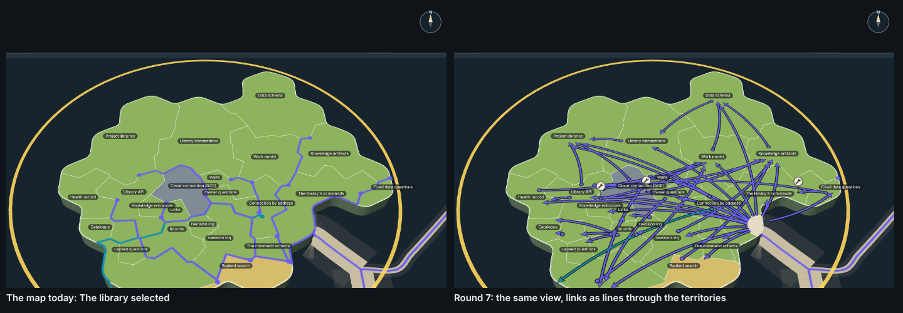

# Capability tree, round 7: links as overlay lines through the territories

The real map's view of The library selected, unchanged, with every link between its capabilities drawn as a line laid over
the map: straight across whatever territories lie between, from a dot in the caller to an arrowhead beside the name of the
capability it enters. The lanes from other islands stop at their dock on the coast instead of running along the borders,
come ashore at a small landing, and fan out from there to each capability they serve.

A mock only: it changes no product code (increment_b9ef202f2da6 on arc_9bbaa3497530).




**Open it:** `index.html`, straight from disk; it needs no network. Drag to pan, right-drag (or Q/E and R/F) to turn and
tilt, wheel to zoom: the map's own controls. Click a line, a territory or a wrench, and the panel on the right shows what it
holds. `index.html?real` is the map as it is today, The library selected, nothing changed.

## The idea

A link is a line on top of the map, not a road on the ground, so it can take the straight way and cross territories, and
where it ends is a mark of its own beside the name it enters, not a point somewhere on a shared border. The base is the
map's own selected-story view, mounted from its own code (`@storytree/forest/view`'s `PlanetView`), territories, colours,
thin white borders, names, roads and lanes as it draws them.

## What is drawn

| What | How |
| --- | --- |
| A link in the story | One line per `capability.dependsOn` link (27): a thread in the lanes' manner, a coloured strip with a thin dark casing, 0.35 units above the land. A quadratic curve bowed 8% of its length to its right, so a pair of links running opposite ways part. |
| Start | A round dot in the caller's territory, beside its name on the side facing where the line goes. |
| Entrance | An arrowhead in the called territory, beside its name on the side facing where the line comes from. A line only passing over a territory has no mark there. Each mark is kept 3 units (about 1.5 marks) clear of every name as the page draws it at rest, 5 units from every other mark and 1.1 units inside its territory's border; where a small territory has no such room the clearances ease (none needed it in this data: 0 marks fell back, 0 marks inside a name). |
| From other stories | The map's lanes, drawn as the map draws them across the sea up to their dock; their stretch on this island's land (the way along the borders, ADR-0991 D4) is left undrawn, and their end marks on this island hidden. From the dock, as the data says (below): a landing and a fan line per capability served, ending on an entrance as a link in the story does. |
| The landing | A disc of open ground, radius 6 units, edged in the territories' border white, set just inland of the dock. Each fan line leaves from its rim facing where it goes; a short thread joins the dock to the rim. |
| Link out | Connection by address calls Keys: a line from a start dot in Connection by address straight to the dock where the map's lane to Keys leaves, in the lane's own colour. |
| The wrench | 6C's wrench (its disc and spanner, `c-cartographer/index.html`'s symbol), set on a stem with a shadow so it stands upright and constant on screen as the claim flag does. It stands beside the capability's most central entrance (the one nearest its name), or where its own line leaves if nothing calls it, on the nearest spot where it covers no name, no other wrench and not the mark. |
| Names | The map's own nameplates, unmoved. The map fades a name that overlaps another (ADR-0917); the mock keeps every one shown. |
| Clicks | A line: the link (or, for a fan line, every link it carries) and the called capability's contracts, number and title; the line lights gold with a gold glow either side. A territory: its health, lines, description, contracts, what it calls and what calls it. A wrench: every arc and increment that names the capability. Nothing is hidden or dimmed. |

## Styles

Sizes are in the island's ground units (about 2.6 pixels each at rest); like the lanes, the lines widen as the map zooms in.

| Mark | Style |
| --- | --- |
| Link in the story | thread `#fbf6e9`, 1.0 wide (the lanes' own thread width) |
| Link from another story (fan lines, the landing's thread) | thread `#6a5fee`, the lanes' ink for what builds on the selection |
| Link out | thread `#0d8fb0`, the lanes' ink for what the selection builds on |
| Casing (every thread, dot and arrowhead) | `#15121a` at 85%, 0.28 each side |
| Arrowhead | 3.6 long, 3.0 wide, the thread's colour, cased |
| Start dot | radius 0.95, the thread's colour, cased |
| Lit line | thread and marks `#ffc93c`, a glow `#ffc93c` at 55%, 3.4 threads wide |
| Landing | ground `#e4e6e1`, edge `#f4f7f8` (the territories' border colour) |
| Wrench | disc `#f3efe4`, ink `#2a2723` (6C's), lit edge `#ffc93c` |
| Territories, borders, names | the map's own (`packages/forest/src/view/territory-land.ts`) |

## What the arrival data showed

Read from the map's own lanes (the links the selection lights, recorded and derived from the code alike) and the library on
2026-11-02 (`data.json`'s `measuredAt`; `stills/shots.json`'s `layer` holds the counts):

- **One arriving road.** The roads from the other islands join one another off the coast, so every lane into The library
  comes ashore at one dock: 203 links from 21 stories, the map's main road (197) and a smaller road from the east that joins
  it just offshore (6). The dock is on the coast of **The library's commands**, which is why the map seems to bring the
  story's road in there.
- **It serves 16 capabilities, so it lands on a landing.** Library API (47 links), Data schema (35), The command schema
  (33), Health record (22), Work model (12), Work in flight (10), Project libraries (10), Waits (9), Library transactions
  (7), Knowledge artifacts (5), Cloud connection (GCP) (5), Owner questions (3), Decision log (2), Knowledge entrances (1),
  Fixed data questions (1), Ranked search (1).
- **None of them is The library's commands.** No link from another story calls it, in the map's links or in the recorded
  ones: the road arrives in its territory, but nothing it carries is for it.
- **Recorded links alone** (`capability.dependsOn`, as the lines inside the story use): 22 links from 7 stories (14 from The
  command line), serving 12 capabilities. It would still be a landing.
- **So there is no direct landing in this data.** The rule is built (a road serving one capability runs straight from the
  dock to that capability's entrance), but no arriving road meets it. The one road that lands directly is the one leaving:
  Connection by address to Keys (`road-out.png`).
- Open work names two of these capabilities: Cloud connection (GCP) (increment_dc514c1a7edb) and Library API
  (increment_e266e8c3086e), so two wrenches.

## Stills

All taken by `tools/shots.mjs`, which clicks each mark where it stands on the page and checks the panel's heading.

| Still | What it shows |
| --- | --- |
| `resting.png` | The resting view: the map's own view of The library selected, with the lines |
| `whole-island.png` | Zoomed out to the whole island and its neighbours' roads |
| `close-up.png` | Entrances close up, where Project libraries, Library transactions and Library API meet |
| `orbited.png` | Turned and tipped by the map's own keys |
| `line-contracts.png` | Library API calls Work model: the line lit, Work model's contracts open |
| `arrival-line.png`, `arrival-landing.png` | The landing's line into Library API (47 links) lit, then the landing close up |
| `road-out.png` | The road out: Connection by address calls Keys, lit, close up at the dock |
| `territory.png` | Work in flight's description and contracts |
| `wrench-open.png` | Library API's wrench open |
| `real-today.png`, `side-by-side.png` | The map today, selected, beside round 7 |

## Rebuild it

From the checkout root, after `pnpm install`:

```sh
node --import tsx docs/design/capability-tree-3d/d-overlay/tools/measure.mjs   # data.json, from the library and the code
node docs/design/capability-tree-3d/d-overlay/tools/build.mjs                  # index.html, page.js and page.css
node --import tsx docs/design/capability-tree-3d/d-overlay/tools/shots.mjs --retake   # stills/
```

`tools/overlay.ts` lays the lines and marks on the island; `tools/page.tsx` mounts the map's own view; `tools/look.mjs`
takes one quick still while drawing.

## What I would look at next (for Mick; nothing built from these)

1. **The starburst at the landing.** Sixteen lines leave one small landing and cross the whole island, because the road
   serves sixteen capabilities. Lines heading the same way could leave together and split later, or the landing could
   stand where most of what it serves is (the north-west), not where the map's dock happens to be.
2. **The middle is busy.** Project libraries, Data schema and Library API take most of the arrows, and their lines cross
   the centre in a fan. Sorting each territory's entrances round its name by where each line comes from (as now) helps the
   ends; the middles might read better if lines into the same capability were drawn as one bundle until near the end.
3. **Names now overlap at rest.** With none faded, Owner questions sits under Connection by address and Catalogue under
   Graduation. The map fades one of each pair today; a name could move clear instead, or the rest view could sit one wheel
   step closer.
4. **Line width.** The lines widen as the map zooms, as the lanes do, so they are fine at rest and heavy close up. A width
   constant on the screen, like the names and the wrench, may suit a mark laid on top of the map.
5. **A direct landing to judge.** No arriving road serves one capability here, so the direct landing is built but not
   seen. Splitting the arrival by story (The command line's 14 recorded links on one road, each other story on its own)
   would show both kinds, at the cost of more lines.

## Earlier rounds (arc_9bbaa3497530; increment_841d720e4fb7 and question_752b6ef53b90 hold more)

| Round | What it tried | Mick's words | Where |
| --- | --- | --- | --- |
| 1 | Stone walls on every territory border, cobbled paths straight across | "looks very cramped, pathways look a mess" | PR #218 |
| 2 | Each capability a square walled field in columns by dependency | "looks quite nice but ... every capability a square block" | PR #230 |
| 3 | The map's territories with castle walls on every border | "looks quite noisy, theres too much wall" | stopped |
| 4 | A walled town inset in each territory, roads between | "still looks vergy noisy. Lets not go with the walls" | PR #237 |
| 5 | No walls; dashed borders, solid roads along them, a gap per gate | "this needs a rethink, feels like the architecture diagram looked nicer" | PR #240 |
| 6A, 6B, 6C | A flowchart in the map's clothes; a circuit board; a free cartographer's chart | none looked good; "6C has a nice wrench icon though that we should use going forward" | `a-stone/`, `b-circuit/`, `c-cartographer/` |
| 7 | This: the real selected view, links as lines through territories | | here |
