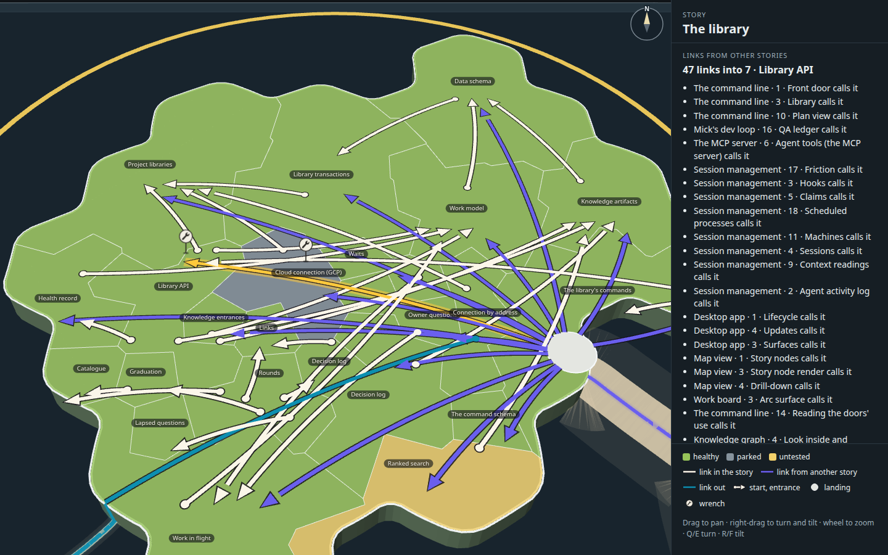
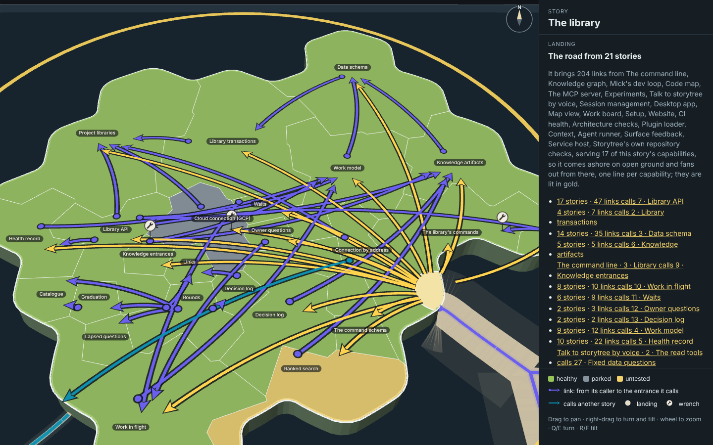
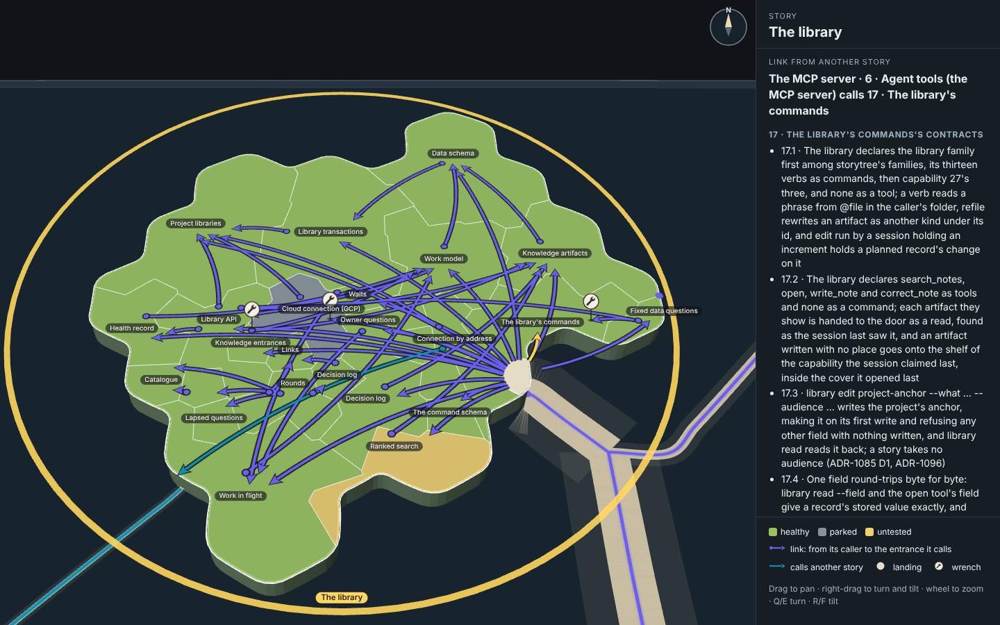
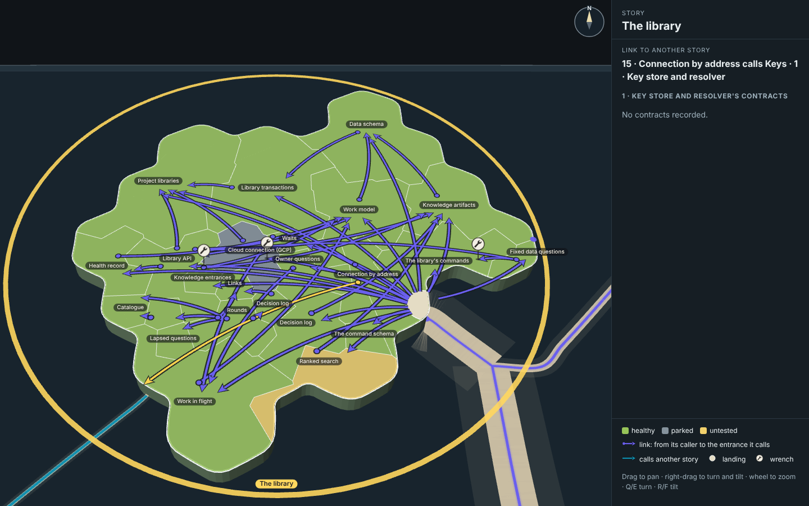
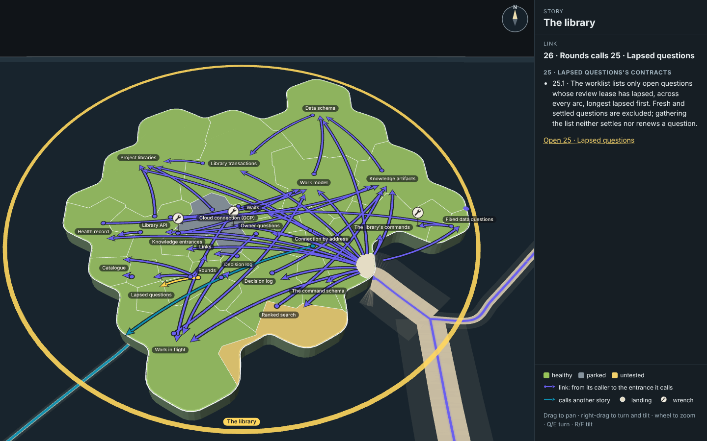
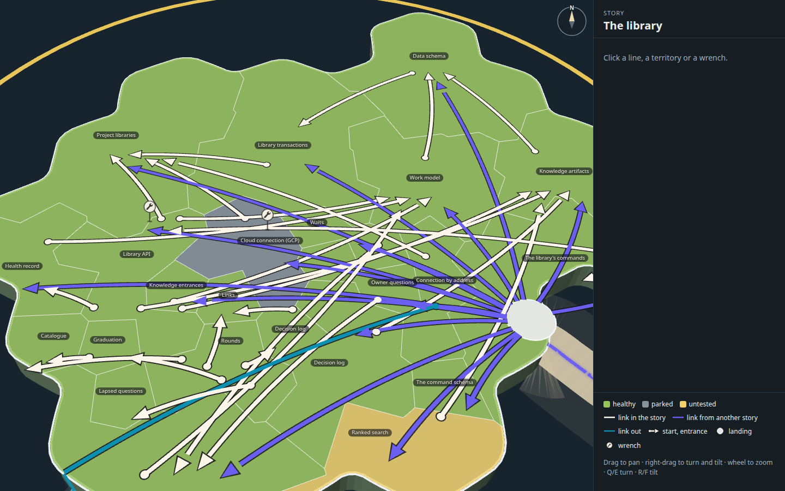
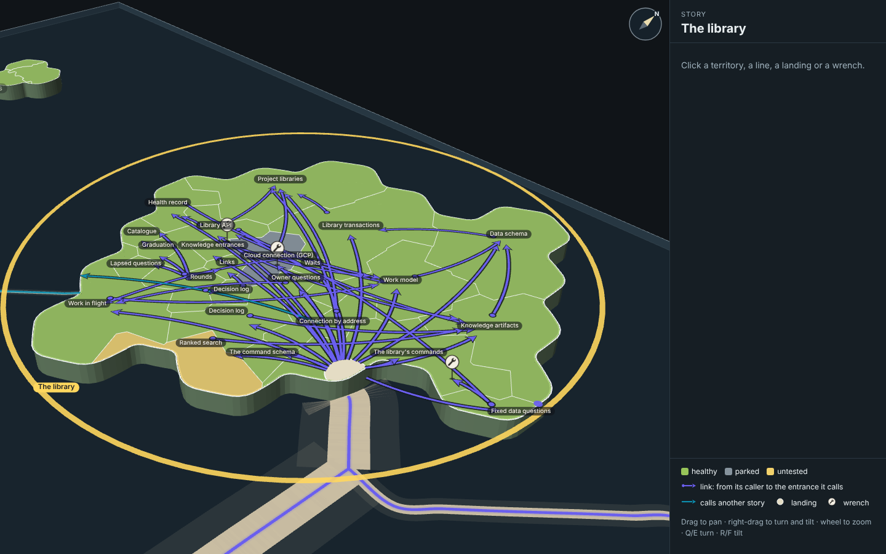
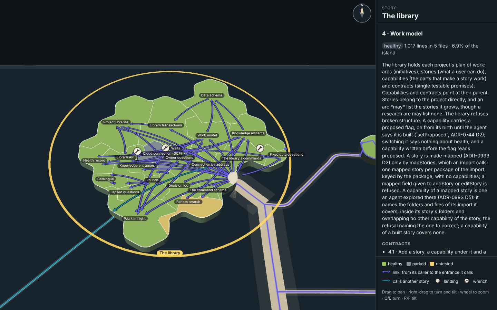
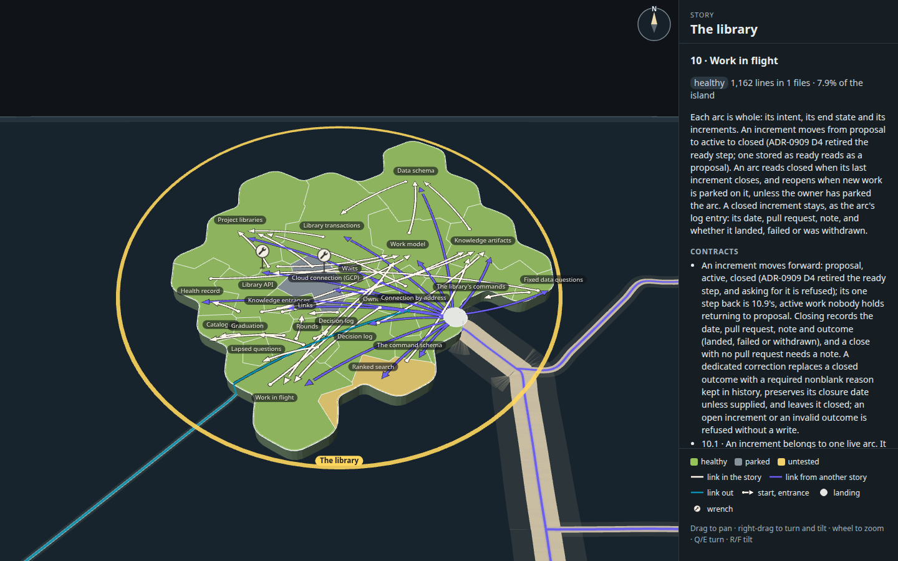
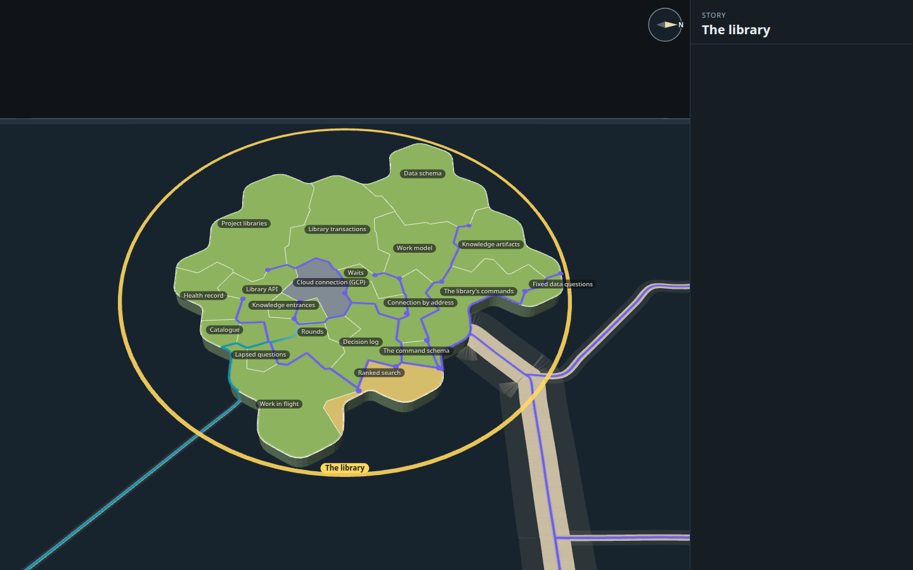

# Capability tree mock, round 7: links as lines through the territories, on the real selected-story view

The map's own view of The library with the story selected, exactly as the desktop app draws it today (its territories,
colours, thin white borders, names, claim flags and the selection's lanes over the sea), with each link between
capabilities laid over it as one line that crosses whatever territories lie between and ends on an arrowhead just
beside the name it calls. A mock only (increment_b9ef202f2da6 on arc_9bbaa3497530): it changes no product code.

**Open it:** `index.html`, straight from disk; it needs no network. Drag to pan, right-drag (or Q/E and R/F) to turn and
tilt, wheel to zoom: the map's own controls. Click a territory, a line, the landing or a wrench. `index.html?real` is the
map today, nothing added.


## The idea

The lanes stop at the coast; inside the island every link is a line laid on top of the map, straight across the
territories from a dot in its caller to an arrowhead inside the territory it calls, so where a link enters is a mark
of its own instead of a stretch of shared border. The road from other stories comes ashore on a small landing of open
ground and fans out, one line per capability it serves.


## What is drawn

| Mark | How | Values |
| --- | --- | --- |
| A link inside the story | One line per link (A calls B), a gentle curve bent left of its way by 12% of its length (so A→B and B→A part), lifted 0.35 ground units over the land, drawn over everything on the land but under the names. | Line `#6a5fee` (the selection lane's own purple), 0.85 units wide (about 2.2 px at rest); casing `#141a20` at 88%, 0.5 units each side |
| Its entrance | An arrowhead at the line's end, inside the called territory, placed by measuring the map's real nameplate on screen: the clear spot nearest the name in the direction the line comes from, at least 1.6 units from any border, 3.6 units from the territory's other marks, off every name. A line passing over a territory marks nothing there. | Arrowhead 3.4 × 3.1 units, notched, `#6a5fee` on a `#141a20` casing |
| Its start | A dot in the caller, placed the same way. A caller shares one dot among its lines that leave within a quarter turn of each other (23 dots for 27 links). | Dot r 0.95 units, `#6a5fee`, casing `#141a20` |
| A link to another story | The same line, from a dot in the caller to the dock, where the map's lane carries on over the sea. | `#0d8fb0` (the lane's own teal for "this story builds on another") |
| The landing | A disc of open ground 7.5 units across the dock, cut to the land (the part over the sea is left out), its rim the map's white border. The road's lines leave from its rim. | Ground `#e4dcc4`, rim `#f4f7f8` |
| Selected | The clicked line (and its start dot) turns gold; nothing else changes, hides or dims. The landing lights all its lines. | `#ffd34d` |
| Wrench | 6C's drawing (its spanner path, ink `#2a2723` on a paper disc `#f3efe4`), stood upright on a short ink stem with a ground shadow, constant on screen like the claim flag. | 22 px disc, 42 px tall |

Every link is a click target and opens the called capability's contracts (number and title). A fan line off the
landing stands for every link the road brings to that capability; its panel also lists them.

## What the arrival data showed

Read from the map's own lanes when The library is selected (the measured library and code survey of 2026-11-02, `data.json`):

- **One road brings everything in.** All 204 links from other stories into The library arrive by a single road off
  the east coast: 21 stories (The command line, Session management, Desktop app, Map view, Code map, Setup, The MCP
  server and 14 more) calling 17 of the library's 19 capabilities. The road from Talk to storytree by voice looks like
  a second road on the map, but it joins the big road out at sea and comes ashore at the same point, so it lands on
  the same landing. The road serves many capabilities, so it gets **a landing**, fanning out into 17 lines.
- **The library's commands is not the main entrance.** Only one link from outside enters it (The MCP server's agent
  tools). The busiest entrances are Library API (47 links, from 17 stories), Data schema (35) and The command schema (33).
  The command line story calls the library through Library API, Library transactions, Data schema and Knowledge
  entrances, not through The library's commands.
- **One road serves a single capability: the way out to Keys.** Connection by address calls Keys' key store and
  resolver; that road carries one link, so it is drawn **direct**: a teal line from Connection by address straight
  across the island to its dock on the south-west coast.

| Still | |
| --- | --- |
| The landing, its 17 lines lit |  |
| The landing up close |  |
| One fan line: The MCP server calling The library's commands |  |
| The direct road out to Keys |  |

## The wrenches

Three open increments name one of The library's capabilities today (measured, no sample). An increment names a
capability, not a link, so 6C's rule picks the place: the capability's most central entrance (the one nearest its
name); when the wrench's disc would cover a name there, it steps back a little along the same line. Library API's and
Cloud connection's wrenches stand on the landing's lines into them; The library's commands' on the line from Fixed data
questions. Clicking one lists every arc and its increments that want the capability, and lights the line it stands on.

## Stills

| | |
| --- | --- |
| At rest, as in Mick's screenshot |  |
| A line's contracts open, the line lit: Rounds calls Lapsed questions |  |
| A wrench open: The library's commands |  |
| Entrances close up (Data schema, Work model, Knowledge artifacts) |  |
| A second angle, turned and tipped |  |
| Zoomed out: the island and its roads |  |
| A territory clicked: Work model |  |
| The map today, selected |  |

All taken by `tools/shots.mjs`, which clicks each mark where it stands on the page and checks the panel's heading
(`stills/shots.json` records each click; the page logged no errors).

## Things to look at next (for Mick; nothing built from them)

1. **Library API, Data schema and The command schema each take 30 to 47 links from outside.** The fan already folds them
   to one line each; what is left crowded is the middle of the island, where the landing's long lines and the inside
   lines cross. Shorter fan lines (ending at the coast side of each territory) would thin it.
2. **Line weight.** 45 lines at 2.2 px read as a web at rest. A thinner line, or inside links in a quieter tone than
   the arrivals, would make the entrances the loudest marks.
3. **Shared starts.** A caller with many links (Rounds calls five) fans from one or two dots; a single dot per caller
   would be calmer, at the cost of some lines starting on the far side of their name.
4. **Marks are placed for the rest view.** Entrances are kept off the names as the names stand at rest; turned far
   round, a name can sit on an arrowhead (the names stay on top, so it is never hidden).
5. **Fan lines run long.** A capability on the far side from the landing (Work in flight, Health record) gets a line
   across the whole island; a junction or two inland would shorten them, if that does not bring the roads back.

## Rebuild it

From the checkout root:

```
node --import tsx docs/design/capability-tree-3d/d-overlay/tools/measure.mjs        # data.json, from the library and the code
node docs/design/capability-tree-3d/d-overlay/tools/build.mjs                       # index.html, page.js, page.css
node --import tsx docs/design/capability-tree-3d/d-overlay/tools/shots.mjs --retake # stills/
```

`tools/page.tsx` mounts the forest's own `PlanetView` (imported, not copied) on the snapshot; `tools/overlay.ts` lays
the lines, the landing and the wrenches in the island's plate and cuts the selection's lanes at the coast;
`tools/panel.tsx` is the story panel; `tools/look.mjs` takes one quick still while drawing. `?bend=0.2` changes the
lines' curve.
