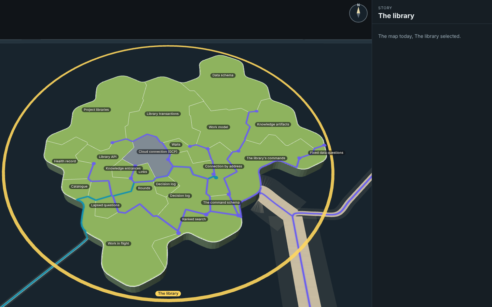

# Capability tree mock, round 8: territories laid out by their links, and lines that pass through gates

Round 7 showed that the mess was the layout, not the styling: the map shares the island out by halving, in id order,
so linked capabilities land far apart and 27 straight lines cross the whole island. And all 203 arrivals came ashore at
one dock and fanned out. This round lays The library's territories out by their links first. Interfaces go on the coast,
each with its own landing, and internals sit beside what they call. The new layout is measured against today's, drawn
plain, and only then styled on the real map's selected-story view, where every line passes through a gate at each
border it crosses. A mock only (increment_0a1b29857a0d on arc_9bbaa3497530): it changes no product code.

**Open it:** `index.html`, straight from disk; it needs no network. Drag to pan, right-drag (or Q/E and R/F) to turn and
tilt, wheel to zoom: the map's own controls. Click a territory, a gate, a line or the wrench. `index.html?real` is the
link layout with nothing added; `index.html?real&layout=today` is the map today.


## The measures

Both arrangements are measured the same way by `tools/layout.ts`, on the same 122 cells of the map's own cut, with the
same cell count for each territory (its lines of code, tests excluded), so only the arrangement differs. A line runs
from its caller's name to the called territory's name: through the gate on their shared border when they are
neighbours, otherwise straight. An arrival runs from where it comes ashore to the name it calls.

| | Today's map | Laid out by the links |
| --- | ---: | ---: |
| Line crossings on the land (inside links and arrivals) | **96** | **3** |
| Total line length on the land, ground units | 3,251 | 1,515 |
| · of it inside links (27) | 1,846 | 1,206 |
| · of it arrivals and the way out (18) | 1,405 | 308 |
| Inside links between neighbours (one gate, one border) | 12 of 27 | **25 of 27** |
| Inside links over a third territory | **15** | **2** |
| · borders those cross, in all | 69 | 6 |
| · most borders one link crosses | 8 | 3 |
| Arrival landings | 1, carrying 17 lines (203 links) | 17, one line each |
| Coast road over the sea, from the harbour to the furthest landing | none | 609 |

Lines per landing in the link layout (lines / links carried): Library API 1/47, Data schema 1/35, The command schema
1/32, Health record 1/22, Work model 1/12, Work in flight 1/10, Project libraries 1/10, Waits 1/9, Library transactions
1/7, Knowledge artifacts 1/5, Cloud connection (GCP) 1/5, Owner questions 1/3, Decision log 1/2, and one link each for
Knowledge entrances, Fixed data questions, Ranked search and The library's commands. The way out to Keys (Connection by
address) leaves by its own gate in the north-west coast.

The two that still pass over a third territory: Library API → Knowledge artifacts (over Work model and Work in flight),
and Knowledge entrances → Work model (over Work in flight and Owner questions).

**The styled build counts its own lines too** (`stills/shots.json`, from what the page drew). Ends there sit in a clear
spot beside each name, not on it, so a few lines clip a corner of a neighbour: 6 of its 27 inside lines cross more than
one border (21 cross exactly one). All 45 lines have their own entrance gate, and 12 more gates are passed through on
the way. No two lines share an opening.

| Today's arrangement, plain | Laid out by the links, plain |
| --- | --- |
|  |  |

## The layout method

1. **Who is an interface.** The map's own selection lanes for The library (`selectionLanes`) list every link with one
   end on the island: 203 arrive, from 20 stories, at 17 of its 24 capabilities, and one leaves (Connection by address
   calls Keys). Those 18 are seeded on coast cells. Every calling story sits in a later layer than The library (places
   2001 to 7001 against its 1001), so all arrivals come by the one road from the east-south-east, and the only way out
   leaves south-west towards Keys (layer 0). So arrivals cannot be grouped by side. Instead the search keeps the
   busiest landings near the harbour and the coast road short.
2. **Internals inland.** The other six (Rounds, Links, Decision log, Catalogue, Graduation, Lapsed questions) call only
   each other, so they are seeded on inland cells and settle as one cluster in the middle.
3. **Growing.** Each territory grows from its seed one cell at a time. The territory furthest short of its count takes
   its free neighbouring cell nearest its seed. A last pass hands cells along a chain of neighbours until every territory
   holds exactly the cells the map gives it. Each stays one piece.
4. **The search.** Simulated annealing (seeded, so it repeats) changes the coast ring's order, its turn and the inland
   seeds. It keeps a change that lowers the score: 14 per crossing, 6 per extra border crossed, 10 per link over a third
   territory, 0.04 per unit of line, 0.07 per unit of coast road and 0.1 per unit the way out lands from Keys' road,
   less 3 per link between neighbours. The kept layout is seed 34 of four seeds (8, 21, 34, 55) at 9,000 steps each.
   A run that weighted the way out ten times harder put Connection by address beside Keys' road but doubled the links
   over a third territory, so the way out instead runs offshore round the coast to Keys' road.
5. **Handing it to the map.** `layout.json` holds each cell's owner. At build time every import of the map's
   territories module is pointed at `tools/territories-shim.ts`. The shim re-exports that module unchanged except
   `islandTerritories`, which returns the map's own cut with each of The library's cells handed to its new owner and the
   borders redrawn (`tools/layout-core.ts`). The map's fills, borders, names, claim flags and lanes then all draw the
   new arrangement. The map's code is imported, never copied or edited.

**What the real map would need to adopt it:** a placement step in `packages/forest/src/territories/territories.ts`
that takes the links (recorded `dependsOn` and the lanes) and returns cell owners in place of `share`'s halving. That
means today's growth, balance and score, or a faster greedy pass, since the annealing takes a few minutes per island.
It would also need to run once per plan change, with a seed so the map does not reshuffle on every redraw, and a
decision for Mick on stability: a new link would move territories, which the halving never does.

## What is drawn on the styled build

| Mark | How | Values |
| --- | --- | --- |
| A link inside the story | One line from a dot in its caller, a gentle curve through its gate(s), to an arrowhead in the called territory near its name, as round 7's lines: lifted 0.35 units, under the names. Between neighbours the line goes through the best gate on their shared border, and its ends are placed toward that gate. | Line `#6a5fee` (the selection lane's purple), 0.75 units wide; casing `#141a20` at 88%, 0.42 units each side |
| A gate | An opening 3 units wide cut in the map's own white border line (`territory-borders`, its segments cut, not covered), with a gatepost each side standing on the border. An entrance gate's posts are larger. No walls. | Posts: ink `#1b2024` square, paper `#f3efe4` face; 1.45 units (entrance 1.8) |
| The entrance gate | The gate where a line enters the territory it calls. It is the link's own (entrances into one territory are at least 3.8 units apart) and its click target: the panel shows the called capability's contracts (number and title), and the whole line, its start dot and the gate's posts light gold. Nothing hides or dims. | Lit `#ffd34d` |
| The arrivals | The map's lane from the 20 calling stories is cut 6.5 units offshore and carries on as a coast road just off the coast, both ways from the harbour, as far as its furthest landing. At each interface's landing a short spur leaves the road, passes the coast through that capability's own gate and ends on its arrowhead. Its panel lists every link it carries. | Road and spurs `#6a5fee` on the `#141a20` casing |
| The way out | Connection by address to Keys: from its dot, through its gate in the coast, offshore round the coast to the map's lane to Keys. | `#0d8fb0` (the lane's teal for "builds on another story") |
| Wrench | Round 6C's drawing, upright and constant on screen like the claim flag, at the entrance gate of the link its work changes. By 6C's rule, when only the capability is named that is the capability's most central entrance. Today one open increment names one of these capabilities: Cloud connection (GCP), whose only way in is its arrival, so the wrench stands at its gate in the coast. | Ink `#2a2723` on paper `#f3efe4`, 22 px disc |

Territories keep the map's kind: organic regions on one island, sized by lines of code, coloured by health (the map's own fills),
with the map's borders and names. Everything is named and nothing is hidden.

## Stills

| | |
| --- | --- |
| At rest, The library selected |  |
| The map today, selected, beside it |  |
| A gate's contracts open, its line lit: Data schema calls Library transactions |  |
| Gates and entrances close up |  |
| An arrival landing: 47 links from 17 stories into Library API, lit |  |
| That landing closer |  |
| The wrench open: Cloud connection (GCP) |  |
| A territory clicked: Work model |  |
| A second angle, turned and tipped |  |
| Zoomed out: the whole island and its roads |  |
| The map today, selected, nothing added |  |

All taken by `tools/shots.mjs`, which clicks each mark where it stands on the page and checks the panel's heading
(`stills/shots.json` records each click; the page logged no errors).

## Things to look at next (for Mick; nothing built from them)

1. **The coast road runs two thirds of the way round.** 17 of 24 capabilities are interfaces, so most of the coast is
   landings, and the road from one harbour reaches round both sides. A second harbour (the map's sea routing bringing
   the north-western callers ashore on the west) would halve it, but that is a change to the sea roads, not the island.
2. **The two long links left** (Library API → Knowledge artifacts, Knowledge entrances → Work model) are what the
   ring cannot make neighbours. Letting a big interface reach inland to touch both would remove them.
3. **Stability.** A layout by links moves territories when a link is added; the halving never does. A seeded,
   incremental placement (keep each seed, re-grow) would keep the island recognisable from day to day.
4. **Gateposts at rest** are about 4 px. They read up close and as a rhythm along each line at rest. A slightly larger
   entrance post would make the click targets easier to find without zooming.
5. **Line ends beside names** make a few lines clip a neighbour's corner (6 styled against 2 measured). Placing the
   arrowhead on the gate side of the name, never past it, would bring the two counts together.

## Rebuild it

From the checkout root:

```
node --import tsx docs/design/capability-tree-3d/e-layout/tools/measure.mjs            # data.json, from the library and the code
SEED=34 ITER=9000 RESTARTS=1 node --import tsx docs/design/capability-tree-3d/e-layout/tools/layout.ts   # layout.json, measures.json
node docs/design/capability-tree-3d/e-layout/tools/plain.mjs                           # stills/plain-*.png
node docs/design/capability-tree-3d/e-layout/tools/build.mjs                           # index.html, page.js, page.css
node --import tsx docs/design/capability-tree-3d/e-layout/tools/shots.mjs --retake     # the styled stills
```

`HARBOUR` and `KEYS` in `tools/layout.ts` are where the map's sea roads come ashore, read off the selection's lanes on
the page (`tools/look.mjs` prints the layer's stats). `tools/page.tsx` mounts the forest's own `PlanetView` on the
snapshot, `tools/overlay.ts` lays the lines, gates, coast road and wrench, and `tools/panel.tsx` is the story panel.
