# Capability tree mock, round 8: territories laid out by their links, then lines that flow through gates

Round 7's lines looked messy for two reasons its own data showed: every other story's road came ashore at one dock and
fanned out across the island, and the territories sat where the map's layout put them, which ignores the links, so the
internal lines crossed the whole island. This round fixes the layout first, measures it against today's, draws both as
plain boxes and arrows, and only then styles it on the real selected-story view. A mock only (increment_0a1b29857a0d on
arc_9bbaa3497530): it changes no product code.

**Open it:** `index.html`, straight from disk; it needs no network. Drag to pan, right-drag (or Q/E and R/F) to turn and
tilt, wheel to zoom: the map's own controls. Click a territory, a gate, a line or the wrench. `index.html?real&layout=today`
is the map today, nothing added.

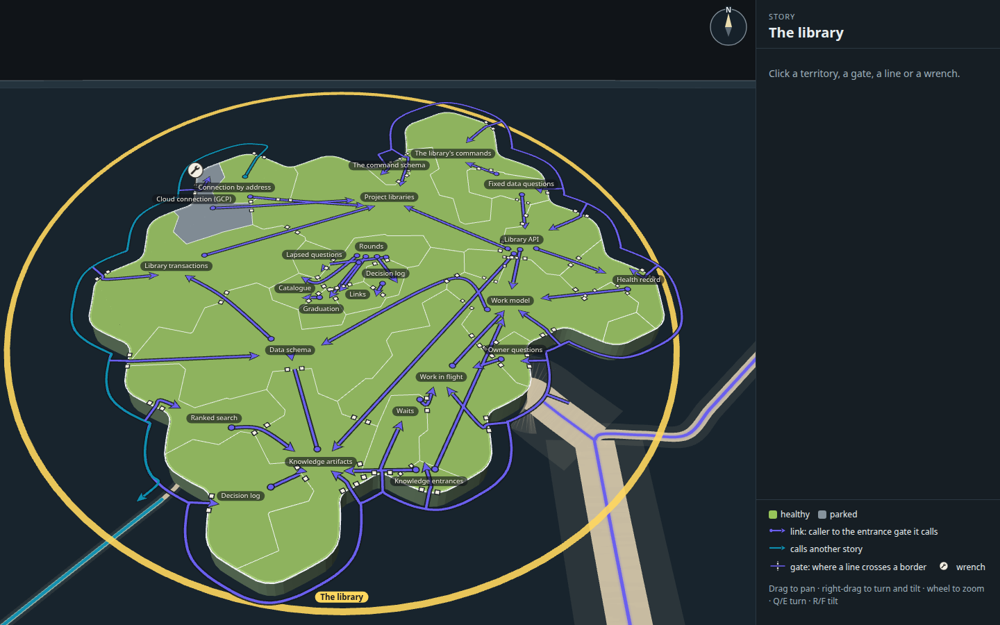

## The plain diagrams

Both arrangements drawn as boxes and arrows, in the manner of the architecture diagram Mick liked: each box where the map
puts that territory's name, each arrow along the way the layout tool measured. Teal is a link to or from another story.

| Today's arrangement | Laid out by the links |
| --- | --- |
| 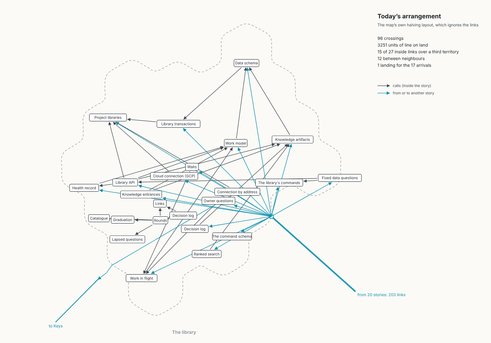 | 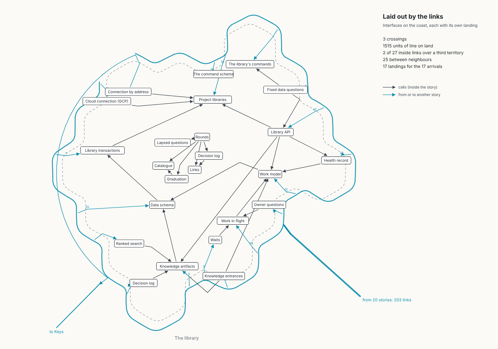 |

## The measures

Measured on the island's ground plan by `tools/layout.ts` (`measures.json` holds every line). "Units" are the map's
ground units, about 2.6 pixels each at rest. The library has 27 links between its own capabilities and 203 arriving
from 20 other stories, onto 17 of its capabilities.

| Measure | Today | Laid out by the links |
| --- | ---: | ---: |
| Line crossings on the land | 96 | 3 |
| Total line length on the land | 3251 units | 1515 units |
| of which inside links / arrivals | 1846 / 1405 | 1206 / 308 |
| Inside links passing over a third territory | 15 of 27 | 2 of 27 |
| Borders those links cross (most for one link) | 69 (8) | 6 (3) |
| Inside links between neighbours (one shared border) | 12 of 27 | 25 of 27 |
| Arrival landings | 1 dock, 17 lines carrying 203 links | 17 landings, one line each (plus 1 line out to Keys) |
| Coast road offshore, from the harbour to the landings | none | 609 units (648 as the page draws it) |

The styled build counts again on the real page, where each line starts and ends beside the territory's name rather than
at the territory's centre: there 21 of the 27 inside links cross one border, and 6 cross a third territory (Library API
to Knowledge artifacts, 5 borders; Health record to Work model, 3; Rounds to Graduation, Knowledge entrances to Work
model and to Knowledge artifacts, and Fixed data questions to Library API, 2 each). Every one of those crossings is a
gate. `stills/shots.json` records the page's counts.

## The layout method

`tools/layout.ts`, using the map's own territory code (`packages/forest/src/territories`) and changing none of it:

1. **The map's own cut.** The island, its coast and its cells are exactly the map's (`islandTerritories`), and so is
   every territory's cell count, which comes from its lines of code, tests excluded. Only which cell belongs to which
   territory changes.
2. **Interfaces on the coast.** Every capability another story calls (from the map's own selection lanes, as round 7
   measured), and the one that calls out (Connection by address, to Keys), is seeded on a coast cell, in a ring order
   round the coast.
3. **Internals inland.** The rest are seeded on inland cells.
4. **Growth.** Each territory grows from its seed a cell at a time (the one furthest short of its count takes its free
   neighbouring cell nearest its seed) until each holds exactly its count, staying in one piece.
5. **Search.** Simulated annealing, seeded so it repeats, changes the ring order, the ring's turn and the inland seeds,
   and keeps a change that lowers the score: crossings, links over a third territory, line length and the coast road's
   length, less a reward for links between neighbours.
6. **Landings.** Each coastal interface gets its own landing on its own stretch of coast. The brief asked to group a
   capability's arrivals by the side its callers' islands lie on; the map merges every calling story's lane into one
   sea road before it reaches the island, so there is one side to arrive from. The road splits offshore into a coast road
   that runs both ways round the island, and each landing is a short spur off it through the coast.

`tools/territories-shim.ts` hands the result to the real map at build time: every import of the map's territories module
is pointed at it, it re-exports the module unchanged except `islandTerritories`, which for The library returns the map's
own cut with each cell given to the owner the layout chose (`tools/layout-core.ts`). So the map's drawing, colours,
borders, names, flags and lanes all read the new arrangement.

**What the real map would need to adopt it:** the territories module would take the island's links (its capabilities'
recorded `dependsOn` and the selection lanes' ends) as an input, run the seeding, growth and search above when it cuts an
island (deterministic, so the same plan always gives the same map), and cache the owners per island so the search runs
once per plan change, not per frame. Nothing else in the map changes.

## The styled build

On the map's own selected-story view, as round 7 built it, with the territories rearranged.

| Mark | How | Values |
| --- | --- | --- |
| A link inside the story | One line per link (A calls B) in the selection lanes' style: from a dot in the caller, through a gate wherever it crosses a border, to an arrowhead inside the called territory near its name. Short and straight, or gently curved through the gate on a shared border (Catmull-Rom through the gate). | Line `#6a5fee` (the selection lane's purple), 0.75 units wide; casing `#141a20` at 88%, 0.42 units each side |
| A gate | An opening 3 units wide cut out of the map's own border line, with a post each side: an ink square with a paper face. No walls. | Posts 1.45 units, ink `#1b2024`, face `#f3efe4` |
| An entrance gate | The gate where a line enters the territory it calls: that link's own, its click target, one per link, never shared. Lines crossing the same border at the same place may share an opening (none on this layout do). | Posts 1.8 units, face 1.15 units, entrances 3.8 units apart |
| An arrival | The sea road splits offshore into a coast road; each interface's landing is a short spur off it, through an entrance gate in the coast, to an arrowhead near the name. | `#6a5fee`, the road 6.5 units offshore |
| The way out | Connection by address to Keys: through its own gate in the coast, offshore along the coast to where the map's lane leaves. | Teal `#0d8fb0` |
| A lit link | Clicking an entrance gate shows the called capability's contracts (number and title) and lights that link's whole line, its posts and its arrowhead in gold. Nothing is hidden or dimmed. | `#ffd34d` |
| The wrench | Round 6C's, upright and constant on screen like the claim flag, at the entrance gate of the link its work changes (6C's rule when only the capability is named: Cloud connection's arrival). Click it for the work. | Ink `#2a2723`, paper `#f3efe4` |

Every name shows; the map's pan, turn and zoom are unchanged; a territory click gives its description and contracts.

| | |
| --- | --- |
| 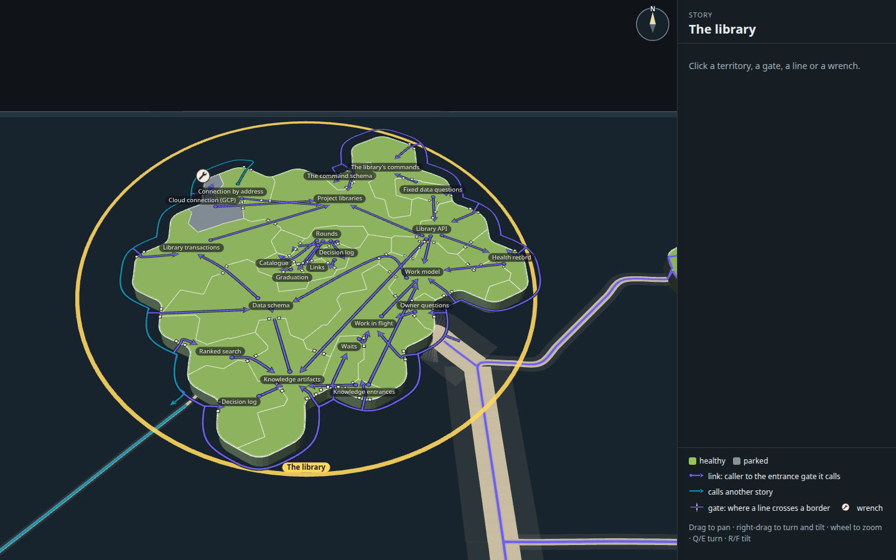 | 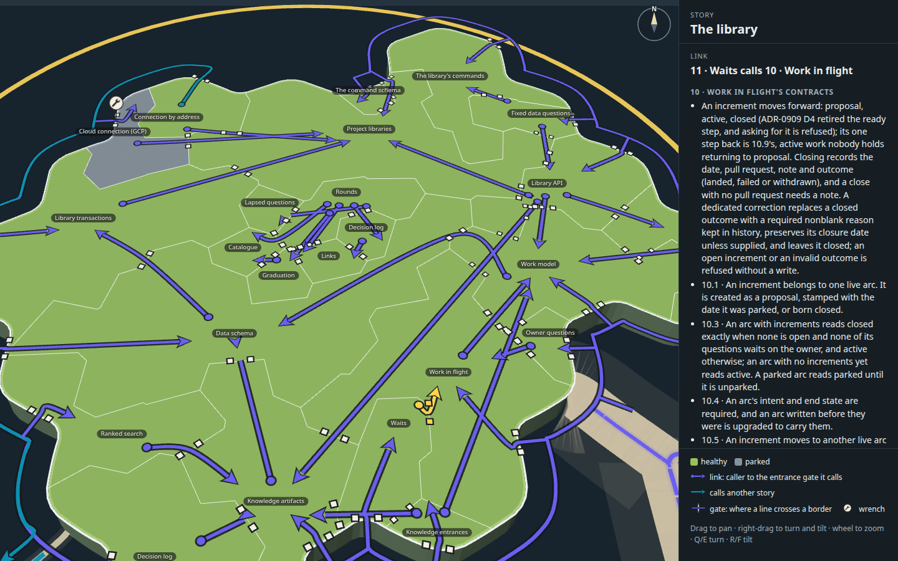 |
| The whole island | Gates and entrances, close up |
| 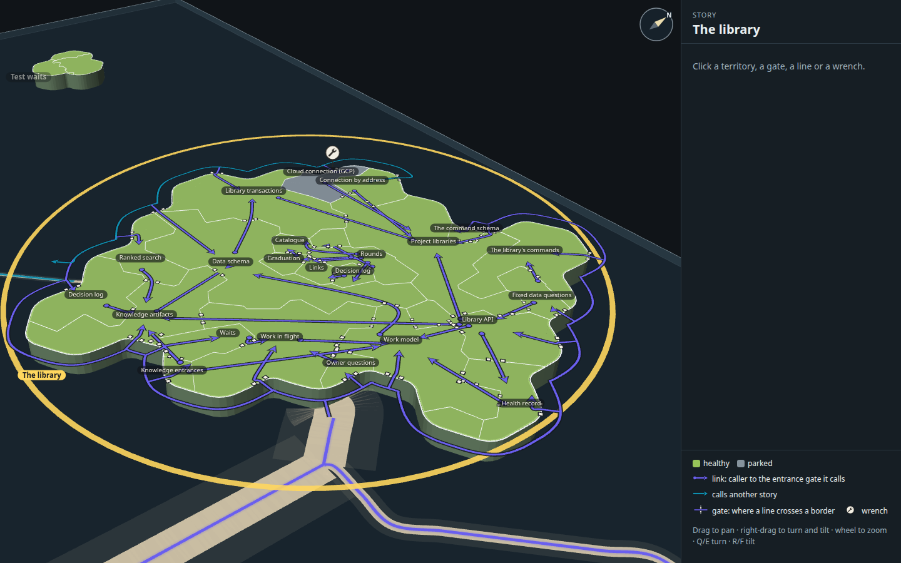 |  |
| A second angle | A gate's contracts open (Waits calls Work in flight), its line lit |
| 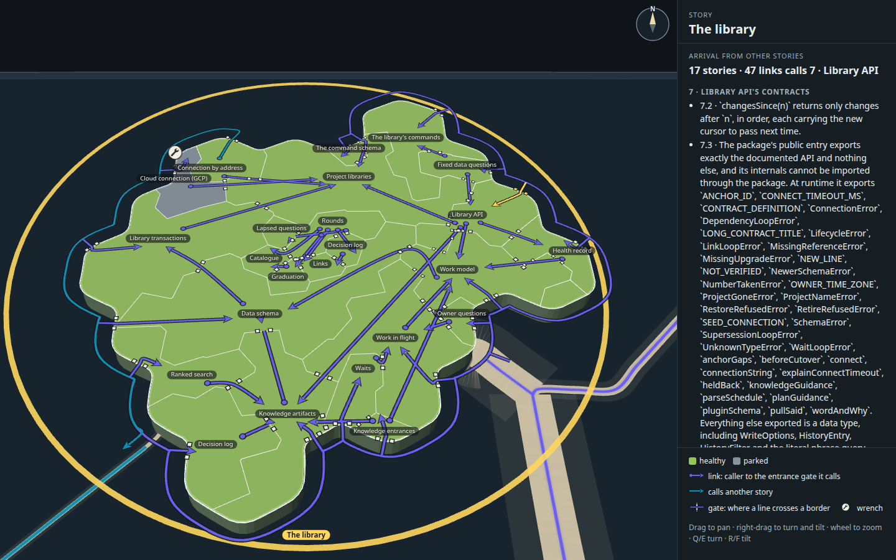 | 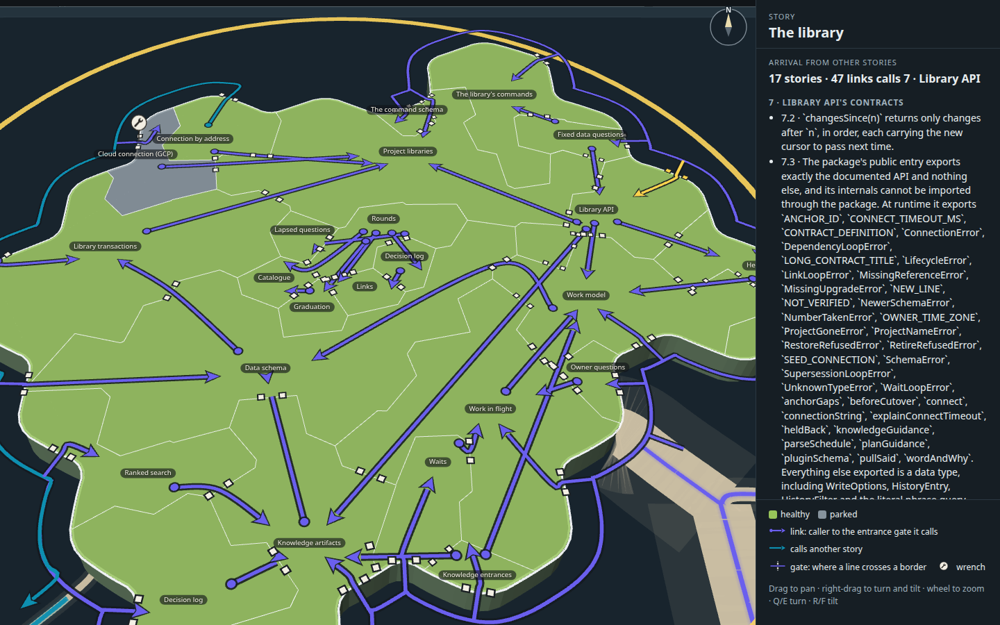 |
| Library API's landing (47 links from 17 stories), lit | The landing close up |
| 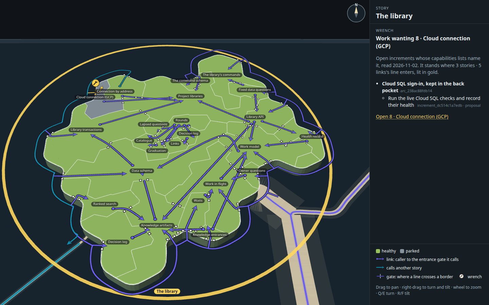 | 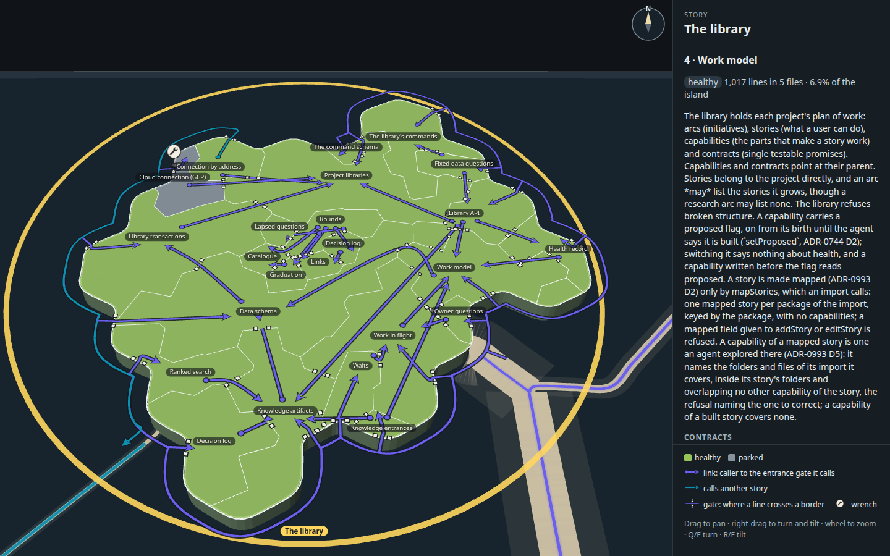 |
| The wrench open | A territory open (Work model) |

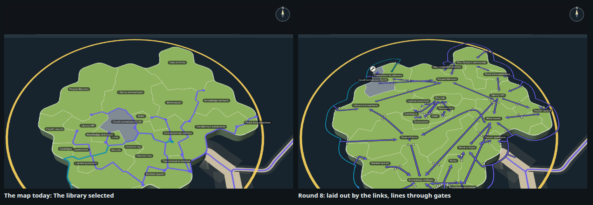

## Five things to look at next

1. **Feed the layout's measured way to the page.** The plan measures 2 links over a third territory; the page, which
   ends lines beside the names, draws 6. Placing each line's ends where the layout measured them would close the gap.
2. **The one long line.** Library API to Knowledge artifacts still runs a third of the island and crosses 5 borders on
   the page. Weighting that link more in the search, or routing it through its neighbours' gates, would shorten it.
3. **The coast road.** It rings most of the island (648 units) because the busiest interfaces are spread round the
   coast. Putting the busiest (Library API 47, Data schema 35, the command schema 32, Health record 22) nearest the
   harbour would shorten it.
4. **Gates at rest.** At the resting zoom the posts read as small white squares; they read as gates only up close. Larger
   posts, or a darker opening, may carry better at rest.
5. **Rounds' knot.** Rounds calls five small territories around it, so five short lines and their gates bunch in the
   island's middle; small territories might need a smaller gate.

## How it was made

From the checkout root:

1. `node --import tsx docs/design/capability-tree-3d/e-layout/tools/measure.mjs` snapshots the plan, code survey and open
   work into `data.json`.
2. `node --import tsx docs/design/capability-tree-3d/e-layout/tools/layout.ts` writes `layout.json` and `measures.json`.
3. `node docs/design/capability-tree-3d/e-layout/tools/plain.mjs` draws the two plain diagrams.
4. `node docs/design/capability-tree-3d/e-layout/tools/build.mjs` builds `index.html`, `page.js` and `page.css` from the
   real map code (with the territories shim).
5. `node --import tsx docs/design/capability-tree-3d/e-layout/tools/shots.mjs --retake` takes the styled stills in the
   desktop capture kit's Chromium, clicking each mark where it stands and checking the panel it opens.
