# Capability tree mock, round 9: roads to towns

Round 8's link layout, redrawn as roads. The arrowheads are gone. The territories are shrunk away from the coast, which
leaves a band of open land round the island and a wider open mouth where the main road comes ashore. Each road runs
through that open land and through gates into the territories, and ends where that territory's roads meet, at one quiet
settlement mark. The gates and the coast road's job stay as round 8 had them. A mock only (increment_f402bbeb5051 on
arc_9bbaa3497530): it changes no product code, and it uses round 8's data snapshot so the numbers compare.

**Open it:** `index.html`, straight from disk; it needs no network. Drag to pan, right-drag (or Q/E and R/F) to turn and
tilt, wheel to zoom: the map's own controls. Click a territory, a settlement, a gate, a road or the wrench.
`index.html?real&layout=today` is the map today, nothing added.

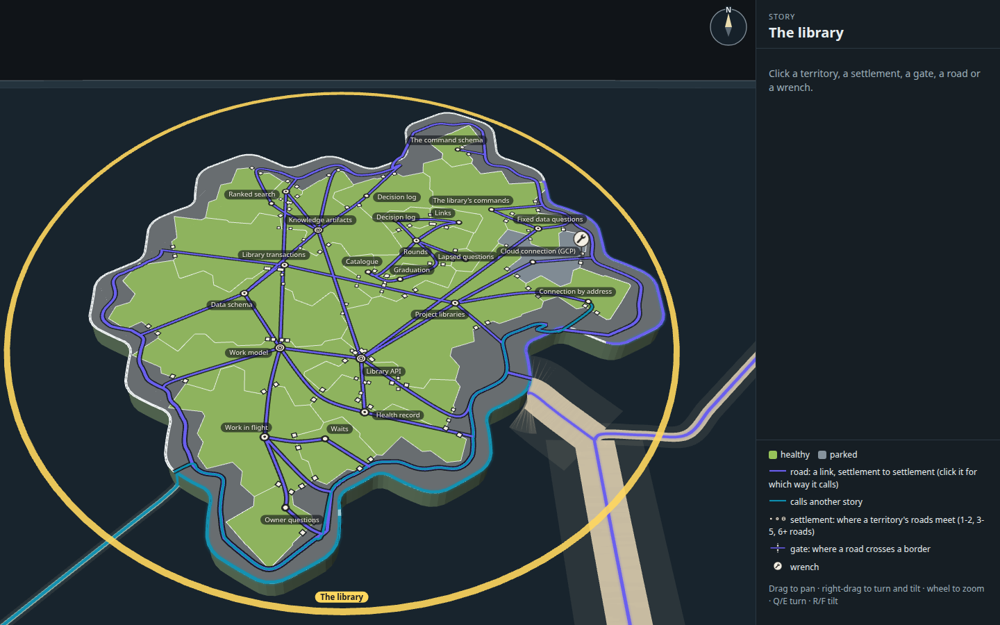

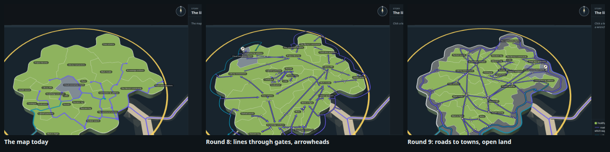

## What changed from round 8

| Round 8 | Round 9 |
| --- | --- |
| An arrowhead inside the called territory, near its name | No arrowheads. A road runs from settlement to settlement, and clicking it says which way it calls |
| Territories fill the island to the coast | Territories end inside the coast, leaving 27% of the island as open land: a band usually 11 units deep, and at the harbour a mouth 28 units deep and about 40 wide |
| The sea road splits offshore into a coast road; landings come through gates in the coast | The sea road comes ashore at the open mouth and forks into a ring road on the open land; each landing leaves it through a gate in the territory's outline. The coast has no gates: it is open beach |
| A line starts at a dot in the caller and ends at an arrowhead, so a territory's lines end at scattered points | All of a territory's roads meet at one settlement beside its name |

The sizes still come from lines of code. The territories' land (188 of the 259 cells) is shared out by lines, largest
remainder first, at least one cell each. No territory's share of the land is more than 1.3 points off its share of the
lines (Project libraries: 13.5% of the lines, 12.2% of the land; Data schema: 13.2% and 12.2%).

## The settlements, and why they are not gimmicks

The mark is a paper disc ringed in ink, graded by how many roads meet there:

| Roads meeting | Mark | Territories |
| --- | --- | ---: |
| 1-2 | a plain ringed disc (hamlet) | 13 |
| 3-5 | the disc with an ink dot (town) | 8 |
| 6 or more | a double ring with a dot (city) | 3 (Work model, Knowledge artifacts, Library API) |

The worry with round 6's buildings was that they decorated without saying anything. This mark avoids that in four ways:

1. **It does the arrowhead's job.** An arrowhead said "this line ends here". With the arrowheads gone, roads still need
   somewhere to end. On a map, roads end at a settlement.
2. **Its grade is data.** Its size is the territory's number of links, in and out, so the cities are the hubs. That is
   readable at rest without opening anything.
3. **It is a convention, not an illustration.** Graded circle symbols for settlements are how topographic and road maps
   have marked villages, towns and cities for two centuries. It is flat, ink and paper like round 6C's wrench, and draws
   no building.
4. **It is a click target.** Clicking a settlement opens its territory, just as clicking its land does.

What it does not carry is direction: a road no longer shows which end calls. The panel says it ("11 · Waits calls 10 ·
Work in flight"). If direction matters at rest, the cheapest return is a small chevron at the gate, not the old arrowhead.

## The plain diagrams

Both arrangements drawn as boxes and lines in the manner of the architecture diagram Mick liked, with the arrowheads
dropped in both so they compare. Each box sits where the map puts that territory's name, and each line runs along the
way the layout tool measured. Teal is a link to or from another story. In round 9 the dotted line is the territories'
outline against the open land, and the thick teal ring is the ring road.

| Today's arrangement | Round 9: roads to towns |
| --- | --- |
| 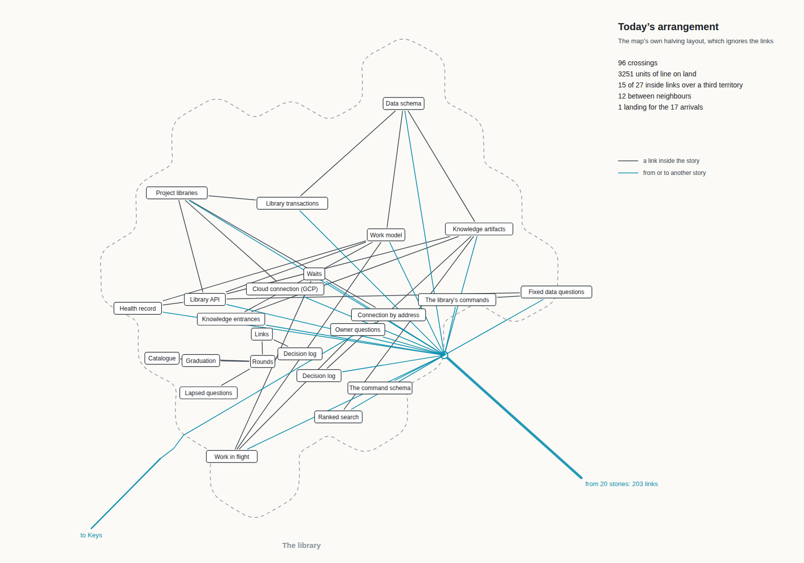 | 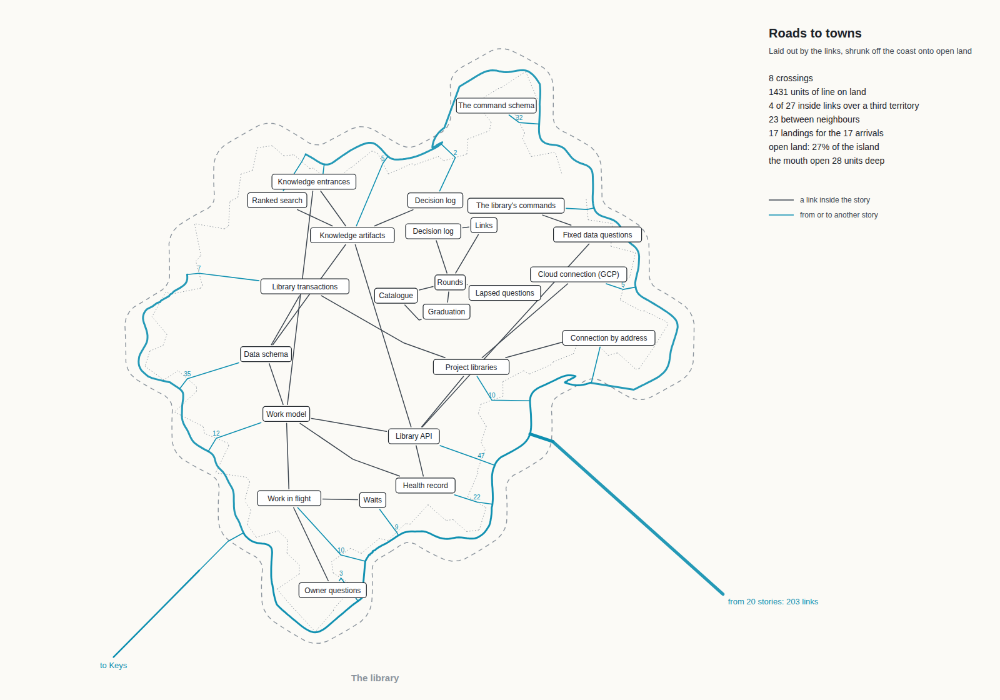 |

## The measures

Measured on the island's ground plan by `tools/layout.ts`, as round 8 measured them (`measures.json` holds every line,
and round 8's own figures). "Units" are the map's ground units, about 2.6 pixels each at rest. The library has 27 links
between its own capabilities and 203 arriving from 20 other stories, onto 17 of its capabilities.

| Measure | Today | Round 8 | Round 9 |
| --- | ---: | ---: | ---: |
| Line crossings on the land | 96 | 3 | 8 |
| Total line length on the land | 3251 units | 1515 units | 1431 units |
| of which inside links / arrivals | 1846 / 1405 | 1206 / 308 | 1004 / 427 |
| Inside links passing over a third territory | 15 of 27 | 2 of 27 | 4 of 27 |
| Borders those links cross (most for one link) | 69 (8) | 6 (3) | 13 (5) |
| Inside links between neighbours (one shared border) | 12 of 27 | 25 of 27 | 23 of 27 |
| Arrival landings | 1 dock, 17 lines carrying 203 links | 17 landings, one line each (plus 1 line out to Keys) | 17 landings off the ring road, one road each (plus 1 out to Keys) |
| Coast road, from the harbour to the furthest landings | none | 609 units offshore | 611 units, on the land (97% of it on open land) |
| Open land | none | none | 27% of the island; mouth 28 units deep |

Shrinking the territories costs some of round 8's tidiness. With 27% less land to arrange them on, two more inside links
cross a third territory (Knowledge entrances to Work model is the worst, over four). Crossings go from 3 to 8. The roads
get shorter (1004 units inside, against 1206), because the territories sit closer together. The arrivals get longer
(427 against 308), because each landing road now crosses the open band.

The styled build counts again on the real page, where each road starts and ends at a settlement rather than at the
territory's centre. There, 21 of the 27 inside roads cross one border, and 6 cross a third territory: Knowledge entrances
to Work model (5 borders), Library API to Knowledge artifacts (4), and Library transactions to Project libraries,
Library API to Health record, and Fixed data questions to Library API (3 each), plus Knowledge artifacts to Data schema
(2). Every crossing is a gate: 60 in all, 45 of them entrances, 18 of them in a territory's outline onto the open land.
`stills/shots.json` records the page's counts.

## The layout method

`tools/layout.ts`, using the map's own territory code (`packages/forest/src/territories`) and changing none of it.
These are round 8's steps, with the changes marked:

1. **The map's own cutter, finer (new).** The island is cut by the map's own `territories()` into 259 cells instead of
   its usual 122, so territories can shrink and still follow their lines.
2. **Open land (new).** Every cell whose seed lies within 9 units of the coast, or within 25 units of where the sea road
   comes ashore, is open land and belongs to no territory. The map draws it as the island's bare ground, and its borders
   outline the territories.
3. **Interfaces on the open land.** Every capability another story calls, and the one that calls out (Connection by
   address, to Keys), is seeded on a cell beside the open land (round 8: on the coast), in a ring order.
4. **Internals inland**, then **growth** and the **search** as in round 8. The search is seeded so it repeats; this
   arrangement is `SEED=12 ITER=9000`, the best of seven seeds (8 to 14).
5. **The ring road (new).** For each step along the coast, the road lies halfway in across the open land (at most 7 units
   in, at least 3 inside the coast), smoothed. It runs both ways from the mouth to the furthest landing. Each interface's
   road leaves it at the gate in its outline nearest the mouth, a little toward its name.

`tools/territories-shim.ts` hands the result to the real map at build time. It re-exports the map's territories module
unchanged except `islandTerritories`, which for The library returns the finer cut with each cell given to the owner the
layout chose, or left open (a cell's territory is -1, which the map's drawing and picking already pass over).

**What the real map would need to adopt it:** round 8's list, plus a cell count per island fine enough for an open band,
and an open-land rule (a band depth and a mouth reach) in the territories module. The drawing needs nothing new for the
open land itself.

## The styled build

On the map's own selected-story view, with the territories rearranged and shrunk.

| Mark | How | Values |
| --- | --- | --- |
| Open land | The island's own bare ground, where no territory is drawn; the territories' borders outline it | the map's ground |
| A road inside the story | One road per link, from settlement to settlement, through a gate wherever it crosses a border; between neighbours it curves gently through their shared gate (Catmull-Rom). No arrowheads | Road `#6a5fee` (the selection lane's purple), 0.75 units wide; casing `#141a20` at 88%, 0.42 units each side |
| The ring road | Through the open land, both ways from the mouth to the furthest landing; the sea road's last stretch crosses the mouth to the fork | `#6a5fee`, 1.0 unit wide, same casing |
| A landing | A road off the ring road, through an entrance gate in the territory's outline, to its settlement | as a road |
| A settlement | Beside the territory's name, where all its roads meet; graded by roads meeting (above) | Ink `#2a2723`, paper `#f3efe4`; radius 1.05 / 1.4 / 1.75 units |
| A gate | Round 8's: an opening 3 units wide cut out of the map's own border line, an ink post with a paper face each side | Posts 1.45 units; entrances 1.8 |
| The way out | Connection by address to Keys: through its gate onto the open land, along the ring road, off at Keys' landfall | Teal `#0d8fb0` |
| A lit link | Clicking an entrance gate or a road shows the called capability's contracts and lights that road and its gate posts in gold | `#ffd34d` |
| The wrench | Round 6C's, at the entrance gate of the link its work changes | Ink and paper |

| | |
| --- | --- |
| 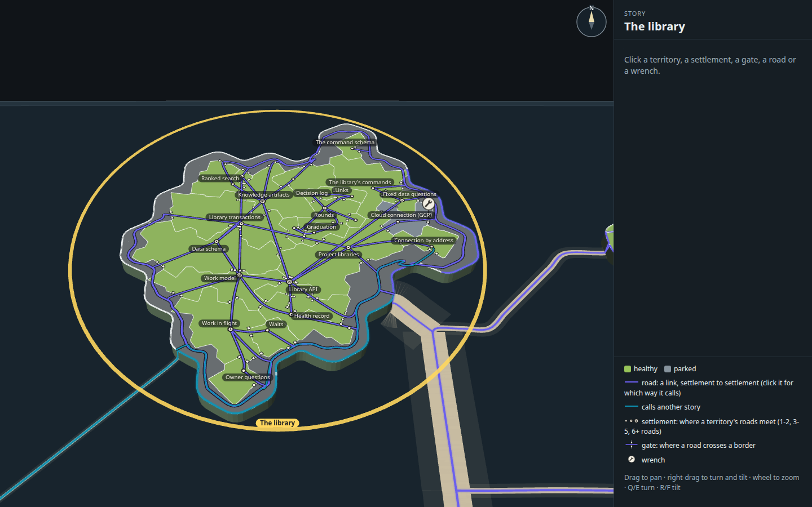 | 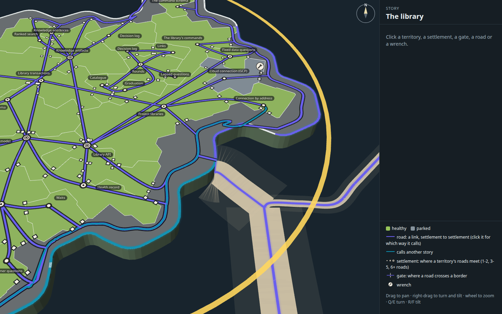 |
| The whole island | The mouth: the sea road comes ashore and forks into the ring road |
| 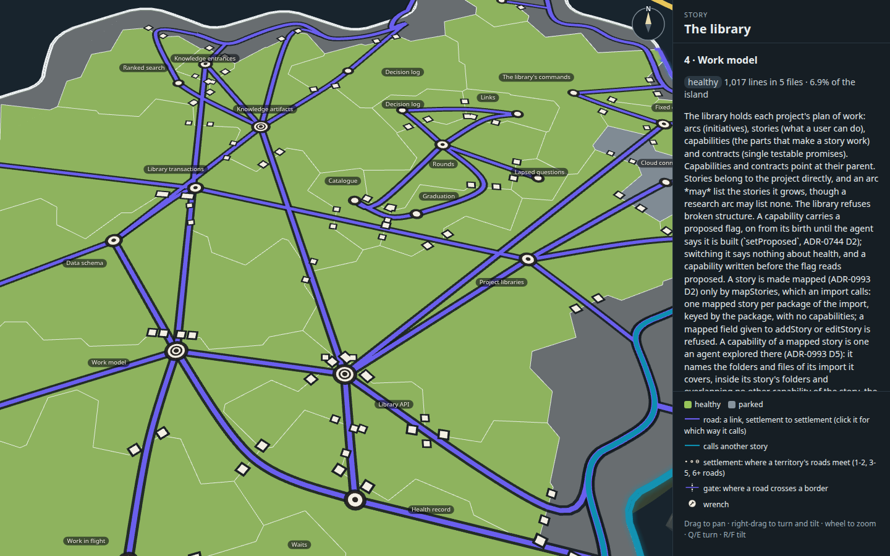 | 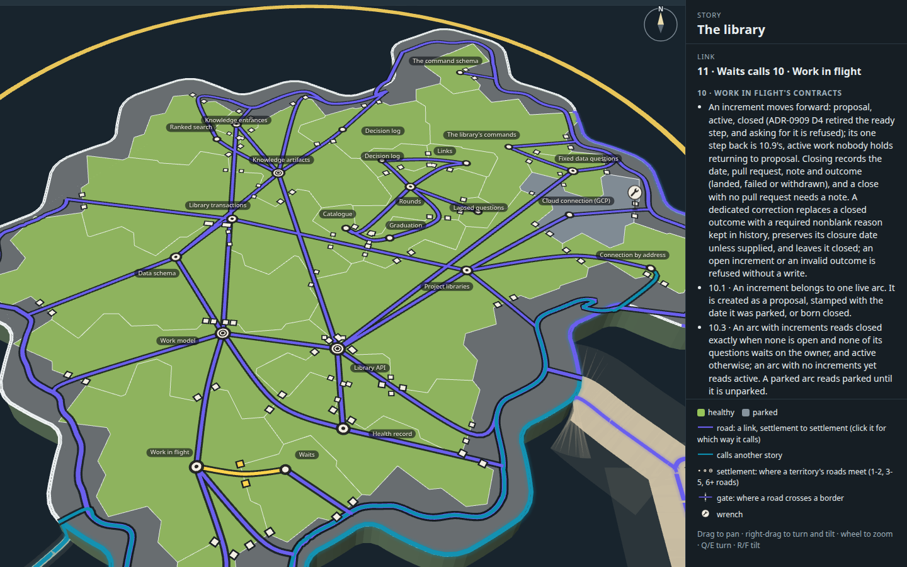 |
| Settlements close up, Work model's opened (a city: 6 roads) | Gates and entrances, close up |
| 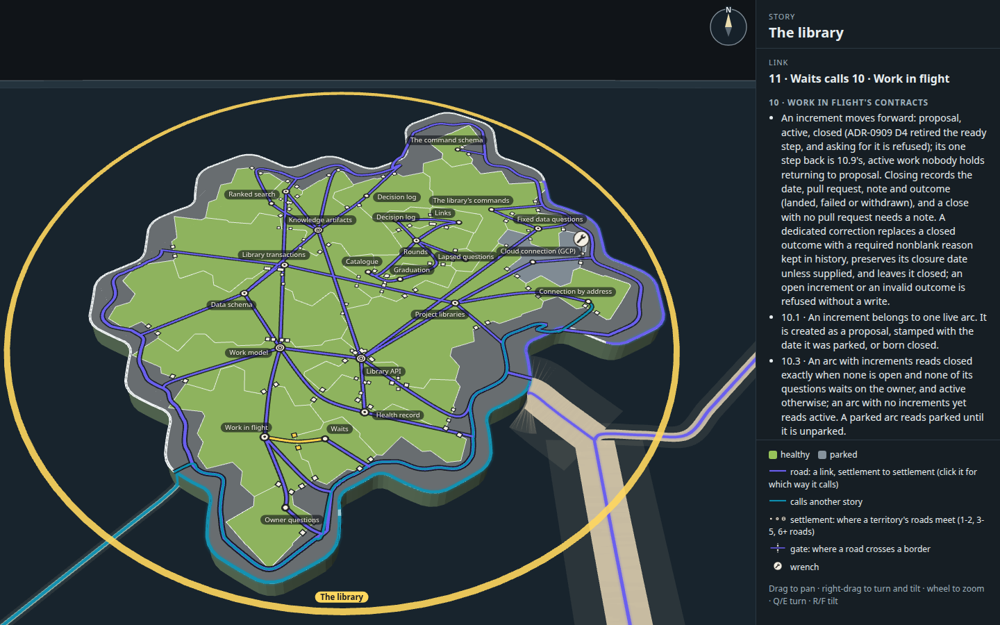 | 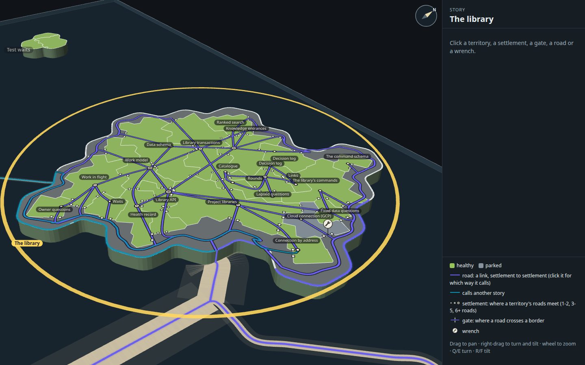 |
| A gate's contracts open (Waits calls Work in flight), its road lit | A second angle |
|  | 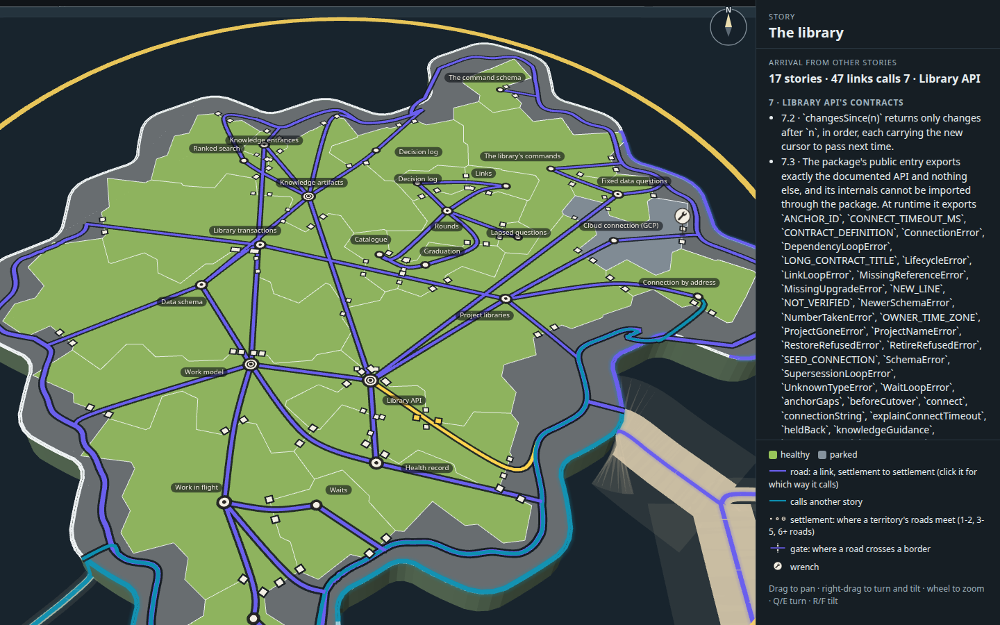 |
| Library API's landing (47 links from 17 stories), lit | The landing close up |
|  | 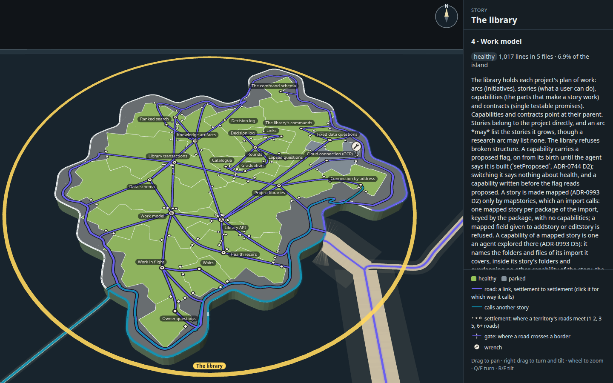 |
| The wrench open | A territory open (Work model) |

## Five things to look at next

1. **The way out to Keys runs the long way.** Connection by address sits beside the mouth, and Keys' landfall is in the
   south-west, so its teal road runs half the ring and lies on top of the purple ring road through the mouth and along
   the south. Seeding it near Keys' landfall, or letting it leave by its own short road off the coast, would fix that.
2. **Gates at rest.** With 60 gates the posts read as scattered white squares at rest, as in round 8. Dropping the pass
   gates, and keeping only the entrances, would remove 15 of them.
3. **Feed the measured way to the page.** As in round 8, the page (roads ending at settlements) draws 6 links over a
   third territory, where the plan measures 4.
4. **The smallest territories are smaller.** Round 8 had seven one-cell territories; now two are one cell and three are
   two, but each cell of the finer cut is about half round 8's, and the open band takes a quarter of the land. Names and
   settlements still crowd in the middle (Rounds, Graduation, Catalogue, Links).
5. **Direction at rest.** If Mick wants to see which way a road calls without clicking, a small chevron at the entrance
   gate is the quietest way back. It is not drawn here, because he asked for the arrowheads to go.

## How it was made

From the checkout root:

1. `data.json` is round 8's snapshot (from `tools/measure.mjs`), kept so the measures compare.
2. `SEED=12 ITER=9000 RESTARTS=1 node --import tsx docs/design/capability-tree-3d/f-roads/tools/layout.ts` writes
   `layout.json` and `measures.json` (about eight minutes).
3. `node --import tsx docs/design/capability-tree-3d/f-roads/tools/plain.mjs --retake` draws the two plain diagrams.
4. `node docs/design/capability-tree-3d/f-roads/tools/build.mjs` builds `index.html`, `page.js` and `page.css` from the
   real map code (with the territories shim).
5. `node --import tsx docs/design/capability-tree-3d/f-roads/tools/shots.mjs --retake` takes the styled stills in the
   desktop capture kit's Chromium, clicking each mark where it stands and checking the panel it opens.
