# Capability tree mock, round 10: shared roads

Round 9's roads to towns, redrawn as one road network. In round 9 every link was its own road, and every arrival rode one
ring road round the coast to its landing, so the shoreline carried most of the road and nothing inland was shared. Here
the links share roads. The arrivals come ashore at the open mouth on one trunk, which branches inland toward the
interfaces it serves. Links inside the story that go the same way travel the same road until they part, like roads
between towns. Round 9's link layout, open land, settlements and gates stay, and there are still no arrowheads. A mock
only (increment_4439b85d3e62 on arc_9bbaa3497530): it changes no product code.

**Open it:** `index.html`, straight from disk; it needs no network. Drag to pan, right-drag (or Q/E and R/F) to turn and
tilt, wheel to zoom: the map's own controls. Click a territory, a settlement, a gate, a road or the wrench. Clicking a link
(its entrance gate, or a road only it travels) lights its whole way in gold along the shared roads. Clicking a shared road
lists the links it carries. `index.html?real&layout=today` is the map today, nothing added.

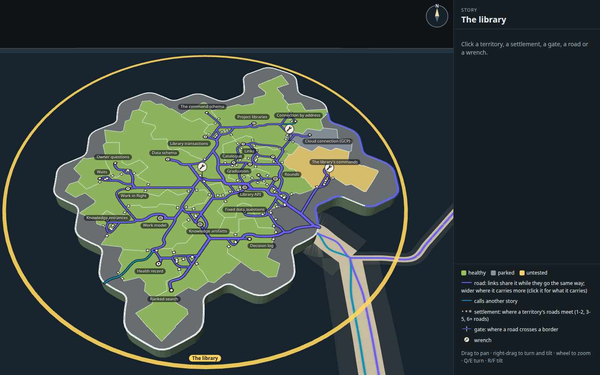

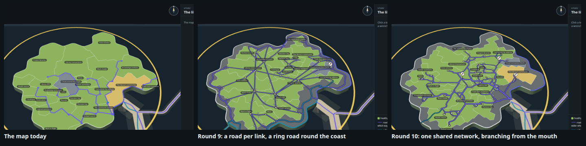

## What changed from round 9

| Round 9 | Round 10 |
| --- | --- |
| One road per link, 45 of them, each drawn on its own | One network of 131 road segments. Each segment is drawn once and carries every link that goes that way: 3.4 links on average, 18 at most |
| The sea road forks at the mouth into a ring road round the coast, and each landing leaves the ring by its own road | The sea road comes ashore at the mouth on one trunk, which branches inland (19 junctions on the arrivals' roads) toward the 18 interfaces. The coast carries 34 units of road, against 617 for round 9's ring on the same land |
| All roads the same width | A road is a quiet step wider where it carries more: 1 link, 2-3, 4-7, 8 or more |
| The way out to Keys ran half the ring the long way, on top of the ring road | It takes its own short road from Connection by address south-west to Keys' landfall |
| A link lit alone | A link lights its whole way in gold along the shared roads; a shared road opens a list of what it carries |

**The data is new.** Round 9 used round 8's snapshot. On 2026-11-03 the librarian's six links to Library API and the MCP
server's link to Rounds were recorded (arc_51ab04705541), so `tools/measure.mjs` was run again: The library now has 35
links between its own capabilities (27 before) and 196 arriving from other stories onto 18 of its capabilities. The
layout search was run again on that data. The survey's derived links inside a story (increment_5a0cfa824c70) have not
landed, so the links here are only the recorded ones.

## The plain diagrams

Both arrangements drawn as boxes and lines in the manner of the architecture diagram Mick liked, with no arrowheads. Each
box sits where the map puts that territory's name. Today's lines run straight, one per link. Round 10's are the road
network the layout tool routed: each segment drawn once, as thick as the links it carries, teal where it carries only links
from or to other stories. The dotted line is the territories' outline against the open land.

| Today's arrangement | Round 10: shared roads |
| --- | --- |
| 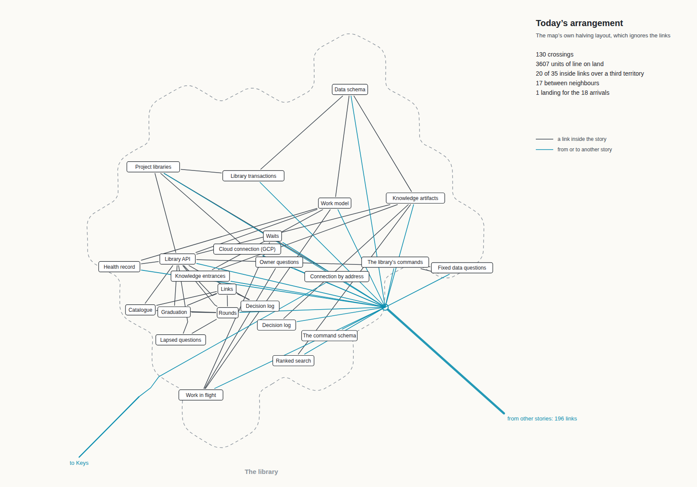 | 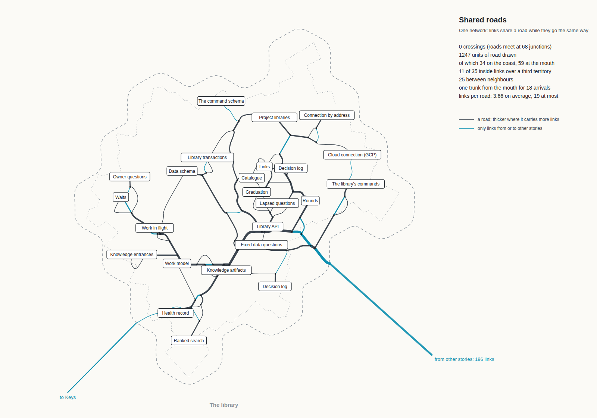 |

## The measures

Measured on the island's ground plan by `tools/layout.ts`, as rounds 8 and 9 measured them (`measures.json` holds every
line, and rounds 8's and 9's own figures). "Units" are the map's ground units, about 2.6 pixels each at rest. Rounds 8
and 9 are as they recorded them, on the older snapshot (27 inside links). The fourth column is round 9's way of drawing
(one road per link, a ring road) on today's data and on the same arrangement as round 10, so those two columns differ
only in how the roads are drawn.

| Measure | Today | Round 8 | Round 9 | Round 9's roads, today's data | Round 10 |
| --- | ---: | ---: | ---: | ---: | ---: |
| Line crossings on the land | 130 | 3 | 8 | 18 | 0 (roads meet at 68 junctions) |
| Total road drawn | 3607 units | 1515 + 609 offshore | 1431 + 611 ring | 2288 units | **1247 units** |
| of which on the coast (the open band) / at the mouth / inland | none on the coast | 609 offshore | 611 on the ring, 97% on open land | 617 / 112 / 1559 | **34 / 59 / 1155** |
| Each link's way, summed (a shared road counts once per link on it) | 3607 | 1515 | 1431 | 1663 | 3742 |
| Inside links passing over a third territory | 20 of 35 | 2 of 27 | 4 of 27 | 10 of 35 | 11 of 35 |
| Borders those links cross (most for one link) | 87 (8) | 6 (3) | 13 (5) | 27 (4) | 25 (3) |
| Inside links between neighbours (one shared border) | 17 of 35 | 25 of 27 | 23 of 27 | 25 of 35 | 25 of 35 |
| Arrival landings | 1 dock, 18 lines carrying 196 links | 17 landings, one line each | 17 landings off the ring road | 18 landings off the ring road | 1 trunk from the mouth, branching to 18 entrance gates |
| Links per road segment, mean (most) | 1 (1) | | | 2.3 (18) | **3.7 (19)**; 3.0 weighted by length |

What sharing buys: the network draws 1247 units of road where round 9's way draws 2288 on the same land, and the coast
carries 34 units of it instead of 617. Each link's own way gets longer (3742 summed, against 1663), because a link now
follows the shared road rather than a straight line to its partner, and every arrival starts at the mouth rather than at
a landing on the ring. That is the trade a road network makes: less road, longer trips.

What it costs: one more inside link over a third territory than round 9's way on the same land (11 against 10), though they
cross fewer borders (25 against 27, at most 3 against 4). Most of the rise from round 9's own 4 of 27 is the new data:
eight more inside links, nearly all among the small territories round Library API (Links, Catalogue, Graduation, Rounds,
Lapsed questions), which call it and each other.

The styled build counts again on the real page, where each road starts and ends at a settlement rather than at the name.
There, 13 of the 35 inside links cross a third territory, 57 gates are cut (each link's own entrance, 54, and 3 that only
let roads pass), 24 of them let more than one link through, and 10 stand in a territory's outline onto the open land. The
page draws 131 segments, 1239 units of road, 3.4 links per segment on average and 18 at most. `stills/shots.json` records
the page's counts.

## The road network

`tools/network.ts`, used by both the layout tool (to measure) and the page (to draw):

1. **One graph of possible roads.** A triangular lattice, a node every 1.6 units, over the island's land. It is planar, so
   two roads can only meet at a junction, never pass over each other: that is why crossings fall to 0. A step that would
   cut across a bay, clip the corner of a third territory, or cross a border too near a corner for a 3-unit gate is left
   out.
2. **Prices.** A step costs its length, 2.6 times that on the open band along the coast outside the mouth (so the coast
   carries road only where nothing inland can serve), plus 4 for a gate where it crosses a border, plus 25 when it takes
   an inside link into a territory that link neither starts nor ends in (3 for an arrival, whose trunk passes through).
   No road passes within 2.6 units of another territory's settlement.
3. **Sharing.** A step another link already uses costs 0.3 of its price, its gate included (a third territory's price for
   an inside link is not discounted: over a third territory is a fault however many share the road). The links are routed
   heaviest first (arrivals by the links they carry, then the way out, then the inside links), then each is torn up and
   routed again against the others' roads, twice, so the network settles. This is a greedy Steiner-like tree: cheaper
   than one road each, not the shortest network there is.
4. **Each link keeps its own entrance gate.** No link may enter the territory it calls (or, for the way out, leave its
   own) within 3.8 units of another link's entrance, from either side. So every link still has a gate of its own, its
   click target, where it enters the territory it calls.
5. **Segments.** The used steps are read off as segments: the longest runs that carry the same set of links, joined at
   junctions. Each is pulled straight (Douglas-Peucker, under 0.9 units) and smoothed (Chaikin), only as far as keeps it
   passing the same territories, so its gates stay where the road was routed through them.

The arrangement is round 9's method, unchanged and run again: `SEED=12 ITER=9000`, the best of seven seeds (8 to 14), as
in round 9. Open land is 28% of the island (71 of its 259 cells); no territory's share of the land is more than 1.3 points
off its share of the lines.

## The styled build

On the map's own selected-story view, with the territories rearranged and shrunk as in round 9.

| Mark | How | Values |
| --- | --- | --- |
| A road | One network, each segment drawn once in the selection lanes' style; a disc at each junction so joins read as one road | `#6a5fee`; widths 0.7 / 0.95 / 1.25 / 1.6 units for 1 / 2-3 / 4-7 / 8+ links; casing `#141a20` at 88%, 0.42 units each side |
| The way out | Connection by address to Keys: its own road to Keys' landfall | Teal `#0d8fb0` where it travels alone |
| A settlement | Round 9's, beside the territory's name, where its links meet; graded by links meeting | 1-2 hamlet, 3-5 town, 6+ city (Work model, Knowledge artifacts, Rounds, Library API) |
| A gate | Round 9's opening in the map's border line with an ink post each side, widened where a wide road passes | Posts 1.45 units; entrances 1.8 |
| A lit link | Its entrance gate, or a road only it travels: its contracts in the panel, its whole way gold over the shared roads | `#ffd34d` |
| A shared road | Clicked: the panel lists the links it carries, each a button that lights it | |
| The wrench | Round 6C's, at the entrance gate of the link its work changes | Ink and paper |

| | |
| --- | --- |
| 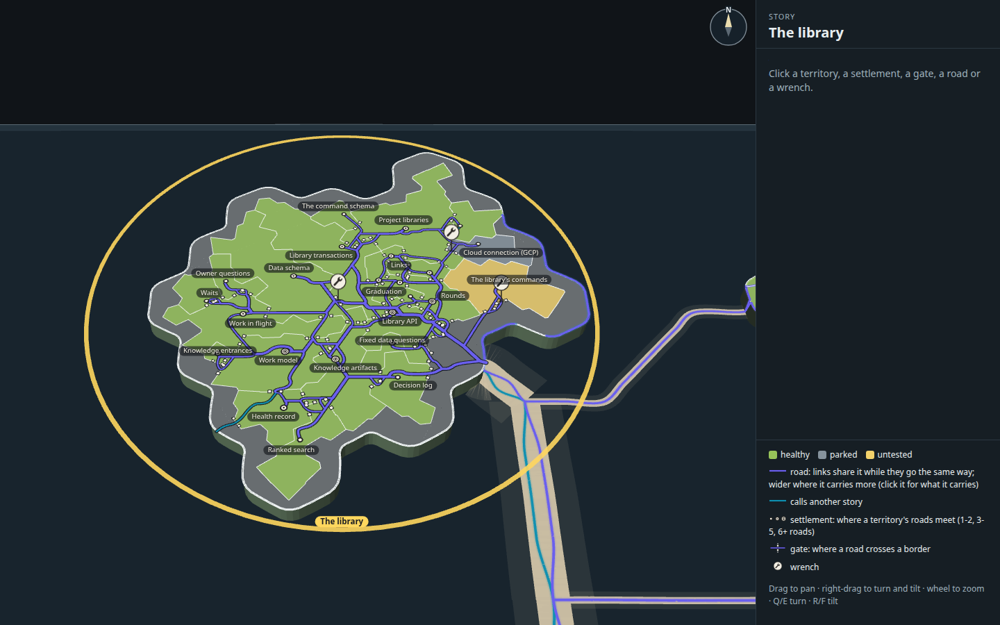 | 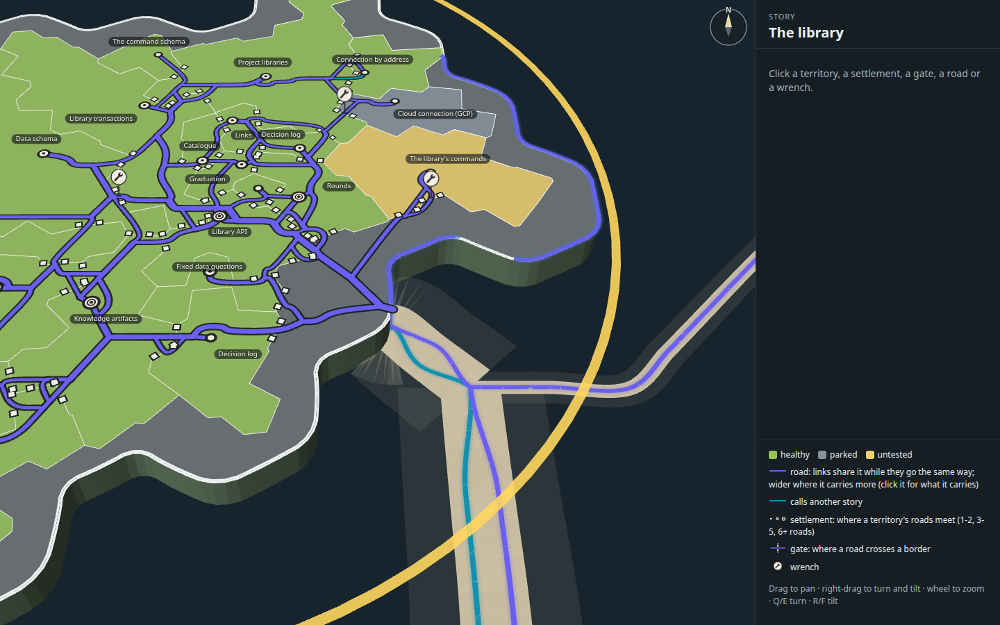 |
| The whole island | The mouth: the sea road comes ashore and the trunk branches inland |
| 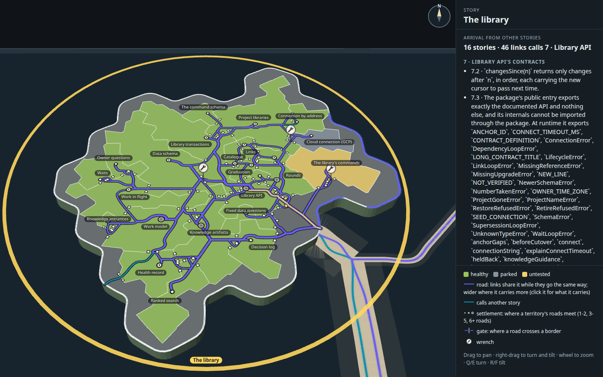 |  |
| Library API's arrivals (46 links from 16 stories) lit along the trunk | Library API calls Project libraries, lit along the roads it shares |
| 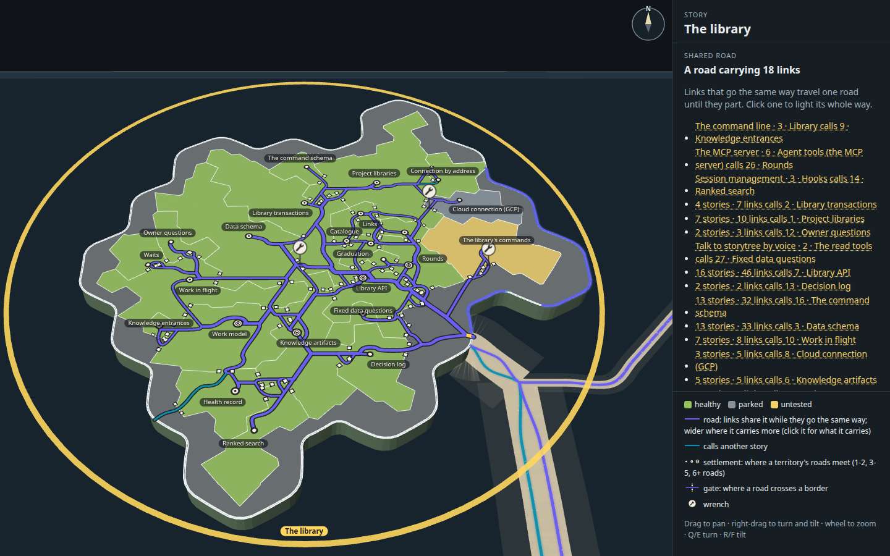 | 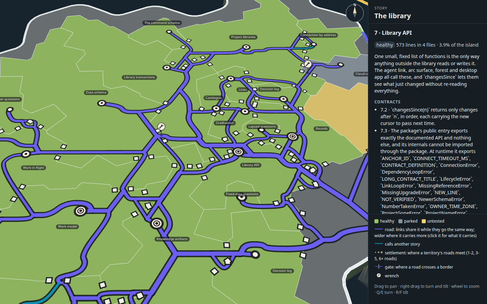 |
| The trunk's first stretch, clicked: it carries 18 links | Settlements close up, Library API's opened (a city: 12 links meet) |
| 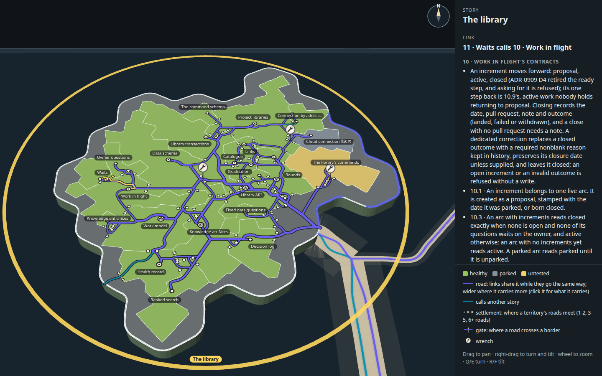 | 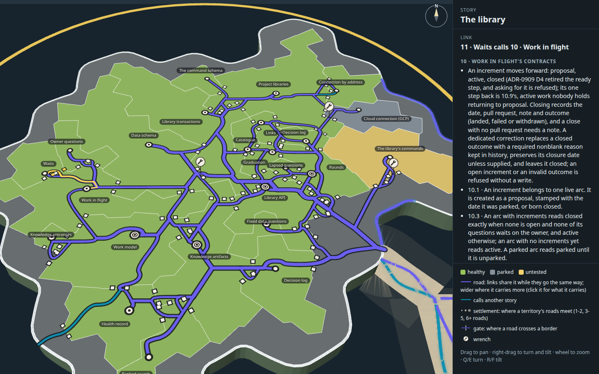 |
| A gate's contracts open (Waits calls Work in flight), its way lit | Gates and entrances, close up |
| 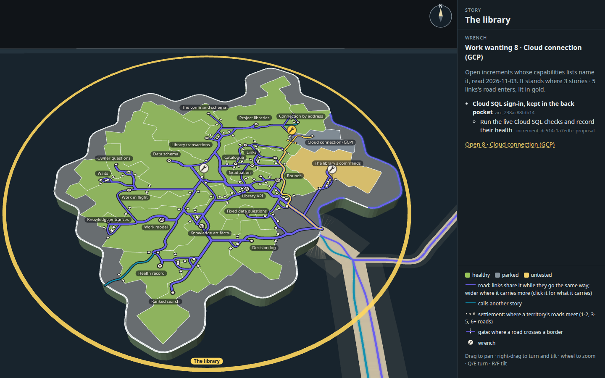 | 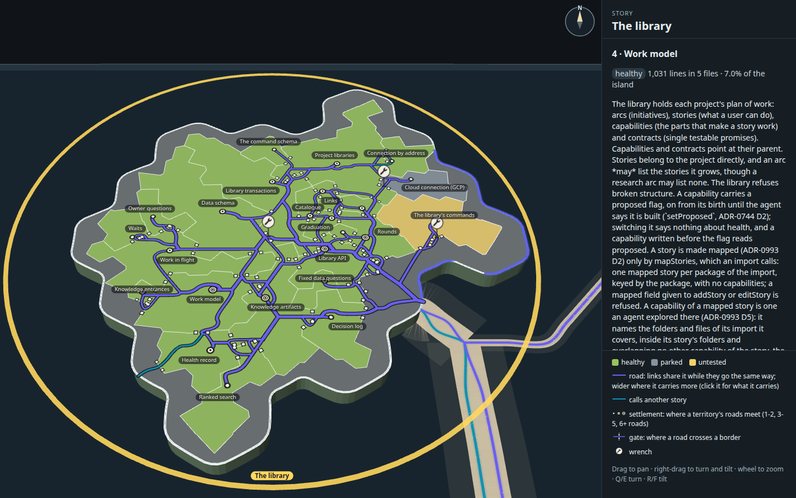 |
| The wrench open | A territory open (Work model) |
| 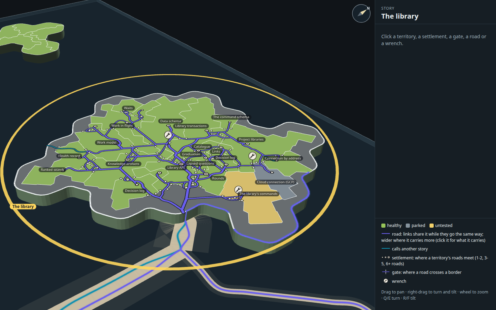 | |
| A second angle | |

## Five things to look at next

1. **The knot round Library API.** Links, Catalogue, Graduation, Rounds and Lapsed questions all call Library API and
   each other, and the rule that every link keeps its own entrance gate forces several roads to run side by side into
   Library API (12 links meet there). Letting links into one territory share one entrance gate, with the panel saying what
   it carries, would merge them into one road, at the cost of a click target per link.
2. **The lattice shows.** Roads run mostly in the lattice's three directions, so the network reads a little like a metro
   map. A finer lattice, or pulling each segment straight across open ground, would read more like country roads; or the
   metro-map look could be leaned into, since Mick has liked the flowchart look.
3. **Width by load.** Widths step by links on the road, so the trunk's first stretch, carrying 18 arrivals and 196 links
   between them, is drawn no wider than a road carrying 8. A width that also counts the links each arrival carries would
   show the trunk's load at rest.
4. **Roads through towns.** A road here keeps clear of other territories' settlements. Real roads pass through towns, and
   allowing it would shorten some ways, at the cost of the settlement reading as "where this territory's links meet".
5. **Derived links.** When increment_5a0cfa824c70 lands, the map's own links inside a story include derived ones. Run
   `tools/measure.mjs`, the search and the network again: more links should suit a shared network better than one road
   each, since links that go the same way add no new road.

## How it was made

From the checkout root:

1. `node --import tsx docs/design/capability-tree-3d/g-network/tools/measure.mjs` snapshots the plan into `data.json`.
2. `SEED=12 ITER=9000 RESTARTS=1 node --import tsx docs/design/capability-tree-3d/g-network/tools/layout.ts` searches the
   arrangement, routes the network and writes `layout.json` and `measures.json` (about eight minutes; with `REUSE=1` it
   keeps `layout.json`'s arrangement and only routes and measures, in seconds).
3. `node --import tsx docs/design/capability-tree-3d/g-network/tools/plain.mjs --retake` draws the two plain diagrams.
4. `node docs/design/capability-tree-3d/g-network/tools/build.mjs` builds `index.html`, `page.min.js` and `page.css` from the
   real map code (with the territories shim). Round 9 built against the website package, which has since left the
   repository; this build reads the forest's own package instead.
5. `node --import tsx docs/design/capability-tree-3d/g-network/tools/shots.mjs --retake` takes the styled stills in the
   desktop capture kit's Chromium, clicking each mark where it stands and checking the panel it opens.
