# Capability tree mock, round 11: quiet roads, open land only at the mouth, a little 2.5D

Round 10's shared road network (`../g-network/`), with Mick's four notes on it acted on. The coast band is given back to
the territories, so open land is left only where a road comes ashore. The roads are drawn as a faint sandy track instead
of a thick blue line. The territories stand a little above the open land, like plateaus, with standing gate posts and
ramps where the roads climb in from the open land. A mock only (increment_8c638d03937e on arc_9bbaa3497530): it changes no
product code.

His notes on round 10 (2026-11-03): "Do we still need the coastal space for pathways to take? in this case seems like
no? Maybe we only draw this space where its needed? like at the entraces to the storynode?"; "The crowding looks like its
just because we havn't drawn the capability territories wide enough."; "I think we can make the pathways look like
pathways again instead of a think blue line ... thinner and fainter or something thats low key"; "I wonder if we added a
little 2.5d here if this would be easier on the eyes, make it more easier to tell that the gates are gates or
entrances."; "with the road mocks, just mock a peice of road, dont mock the whole island". His picks from the pieces:
"17 sandy track. 4+5 bevel and standing posts, i also like the ramps idea though we would need to decide which territory
sits higher, maybe we only do this on no-mans land, so noman land going into a territory has to go up a ramp."

**Open it:** `index.html`, straight from disk; it needs no network. The map's own controls: drag to pan, right-drag (or
Q/E and R/F) to turn and tilt, wheel to zoom. Click a territory, a settlement, a gate, a road or the wrench, as in
round 10. `index.html?relief=0` is the same island flat; `index.html?road=<key>` draws another road style (`r10`,
`hair`, `worn`, `worn-soft`, `pencil`, `pale`, `pale-faint`, `pale-dark`, `sand-faint`, `worn-faint`).

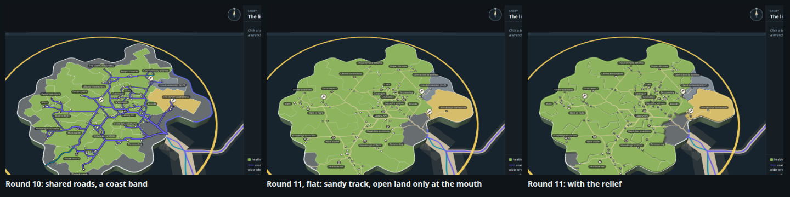

## What changed from round 10

| Round 10 | Round 11 |
| --- | --- |
| A band of open land all round the coast, and a wide open mouth: 28% of the island belongs to no territory | No coast band. Open land only at the mouth, where the sea road comes ashore, and at the way out to Keys: 4% of the island |
| Roads in the selection lanes' purple, `#6a5fee`, on a dark casing: 0.7 to 1.6 units wide | A sandy track, tan `#e2d3aa` mixed 70% into the land under it, no casing: 0.5 / 0.7 / 0.95 / 1.3 units for 1 / 2-3 / 4-7 / 8+ links |
| The map's white borders at full strength | The borders white at 40%, so the pale roads do not read as borders |
| A link lit in gold `#ffd34d` | The same gold with a thin dark edge, because gold alone vanished on the untested territory's yellow |
| Flat land, flat ink-and-paper gate posts | Every territory a plateau 1.3 units above the open land (all at one height, so no territory outranks another), walls where it stands above the open land or the sea, a bevel rim inside every border broken at the gates, standing gate posts, and a ramp at every gate onto the open land |
| The map's lanes to other islands cut at the coast | Cut a little offshore too (1.4 units), except where a sea road comes ashore, because with no band the lane round to Knowledge graph ran along the island's very edge |

## The land

`tools/layout.ts` with `REGROW=1` grows round 10's arrangement again on the land the band gave back: `BAND=0`, open land
within `MOUTH=25` units of where the main road comes ashore and `KEYS_OPEN=11` of the way out to Keys. Each territory
keeps its place and grows outward into the coast it had lost, still sized by its lines of code (no territory's share of
the land is more than 1.3 points off its share of the lines). `measures.json` holds every line.

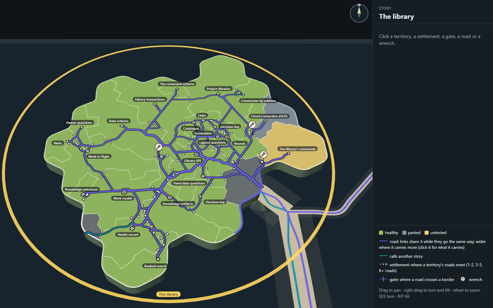

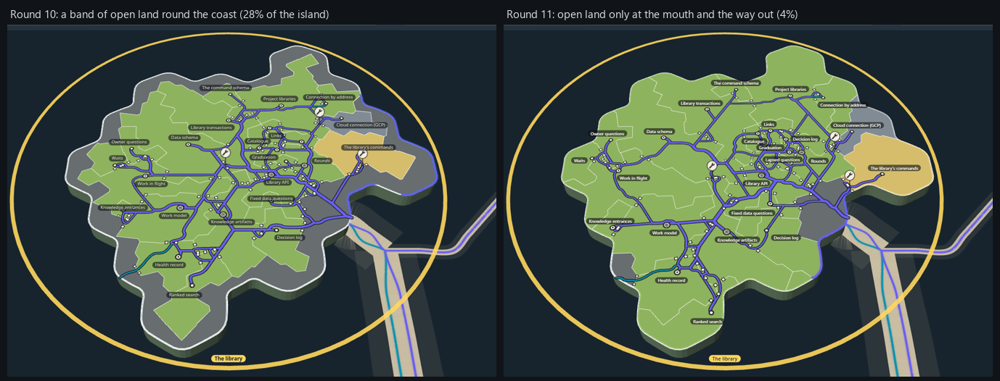

| Measure (the layout tool's, on the ground plan) | Round 10 | Round 11 |
| --- | ---: | ---: |
| Open land, of the island | 28% (71 of 259 cells) | **4% (12 of 259)** |
| Line crossings on the land | 0 | 0 |
| Road drawn | 1247 units | 1400 units |
| Inside links passing over a third territory | 11 of 35 | 12 of 35 |
| Borders those links cross (most for one link) | 25 (3) | 27 (3) |
| Inside links between neighbours | 25 of 35 | 24 of 35 |
| Junctions on the network | 68 | 81 |

On the styled page, where each road starts and ends at a settlement (`stills/shots.json`):

| Measure (the page's) | Round 10 | Round 11 |
| --- | ---: | ---: |
| Road segments | 131 | 135 |
| Road drawn | 1239 units | 1331 units |
| Links per segment, mean (most) | 3.44 (18) | 3.43 (18) |
| Inside links over a third territory | 13 of 35 | 13 of 35 |
| Gates cut (entrances, pass-throughs) | 57 (54, 3) | 58 (54, 4) |
| Gates more than one link passes | 24 | 21 |
| Gates onto the open land (each with a ramp) | 10 | 6 |

What the band was costing: the roads are a little longer (1400 against 1247), because the coast now belongs to
territories and the network prices a road through a territory's land, and one more inside link passes over a third
territory. The island reads less crowded at rest because each territory is wider, not because the network changed.

## The road swatches

Mick asked for a piece of road, not the whole island, so `pieces/roads.html` (made by `pieces/roads-tools/roads.mjs`)
draws one piece of The library's land (Library API, Graduation, The library's commands, Work model, the open land at the
mouth, the coast) with the same small network in 18 styles, at rest, close up and with a link lit.

| | |
| --- | --- |
|  | 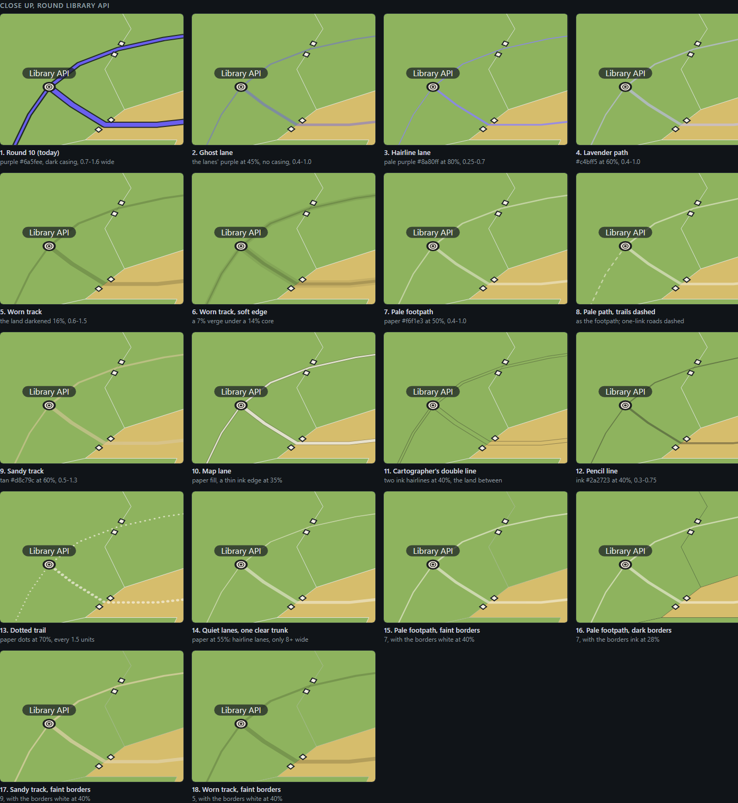 |
| 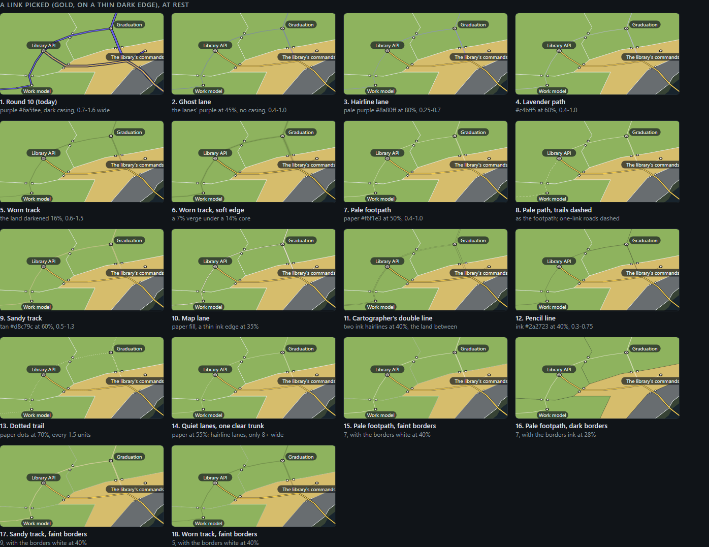 | 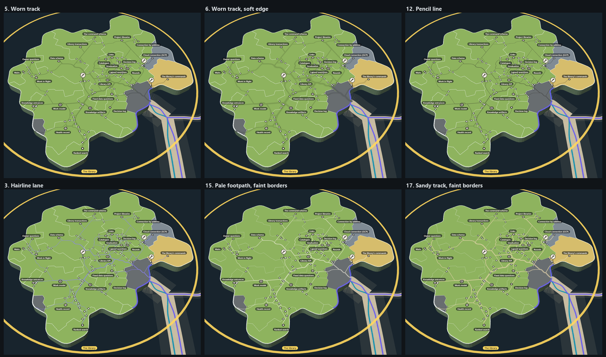 |

What they showed:

1. **Pale roads read as borders** unless the borders are quietened. The footpath and the sandy track (7, 9) looked like
   more border lines until the white borders dropped to 40% (15 to 18); a dark border (16) went the other way and read
   heavier than the roads.
2. **Gold vanished on yellow.** A lit link in plain gold was lost on the untested territory, so it now has a thin dark
   edge, in the swatches and on the island.
3. **Mixed, not see-through.** A faint road drawn see-through darkened where two segments overlap at a join, so every
   style is mixed into the land under it and drawn opaque: joins show no knots.
4. Six of them on the whole island: `stills/island-<key>.png` (`hair`, `worn`, `worn-soft`, `pencil`, `pale-faint`,
   `sand-faint`).

## The relief

`pieces/relief.html` (made by `pieces/relief-tools/`) draws one piece of the map six ways: flat as today, bevelled tiles,
raised tiles, standing posts on flat land, bevel and standing posts, and levels where every gate is a ramp. Mick picked 4
(bevel and standing posts) with 5's ramps only where the open land meets a territory.

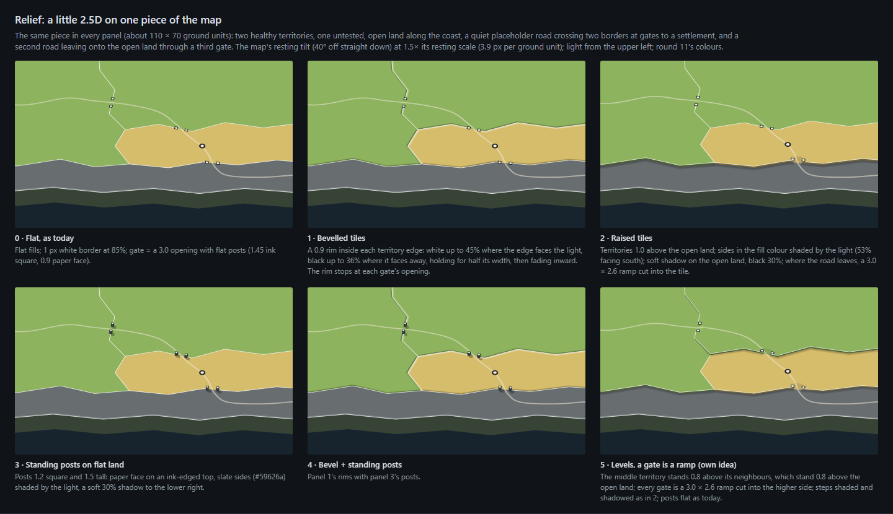

On the island (`tools/overlay.ts`, `RELIEF`; `?relief=0` turns it off):

| Mark | Values |
| --- | --- |
| A territory's plateau | 1.3 units above the open land, every territory at that height. The map's fills and borders are lifted onto it |
| A wall | Where a territory meets the open land or the sea; the fill's colour shaded by the light, 84% facing it, 56% facing away; light from the upper left at rest |
| Its shadow | On the open land, 30% black, reaching 1.0 unit and feathered over 0.9 |
| A ramp | At every gate onto the open land, on the open land's side: 3.4 units wide, climbing over 3.2 units; the wall and rim are broken for it, and the road rides it up |
| A bevel rim | 0.9 units inside every border: white up to 45% where the edge faces the light, black up to 36% where it faces away, held for half its width then fading; it stops at each gate's opening |
| A gate post | Standing: 1.2 square (1.4 at an entrance), 1.0 tall (1.2 at an entrance); a paper face on an ink-edged top, slate `#9aa2a8` sides shaded by the light, a 22% shadow reaching 0.8 of its height |

The posts were first built at the pieces' 1.5 tall in the pieces' darker slate `#59626a`. On the whole island at rest, 58
gates' worth of them read as a scatter of dark blocks, louder than the roads, so they were cut to 1.0 tall and a lighter
slate.

| | |
| --- | --- |
| 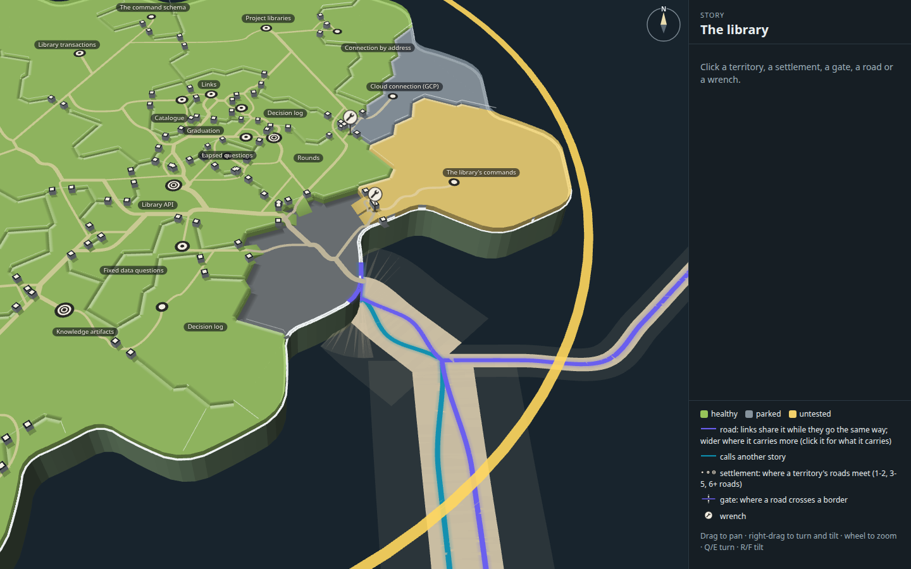 | 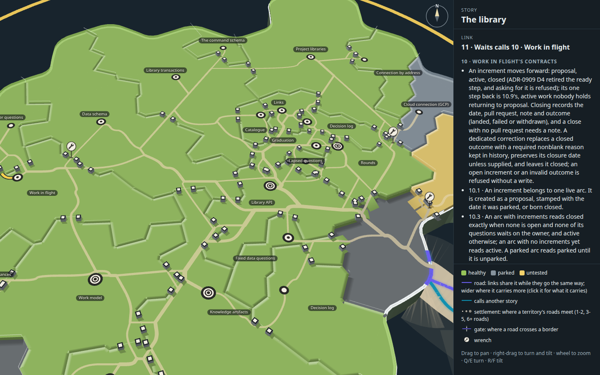 |
| The mouth: the sea road comes ashore on the open land, and the roads climb ramps into the territories | Gates between neighbours, close up (Waits calls Work in flight, open): posts standing on the plateau, the rims broken for them |
| 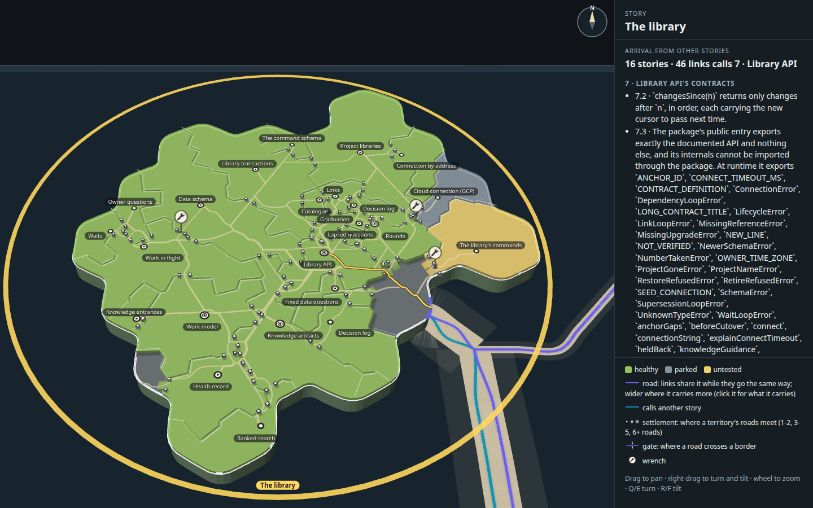 |  |
| Library API's arrivals (46 links from 16 stories) lit from the mouth | Library API calls Health record, lit along the roads it shares |
| 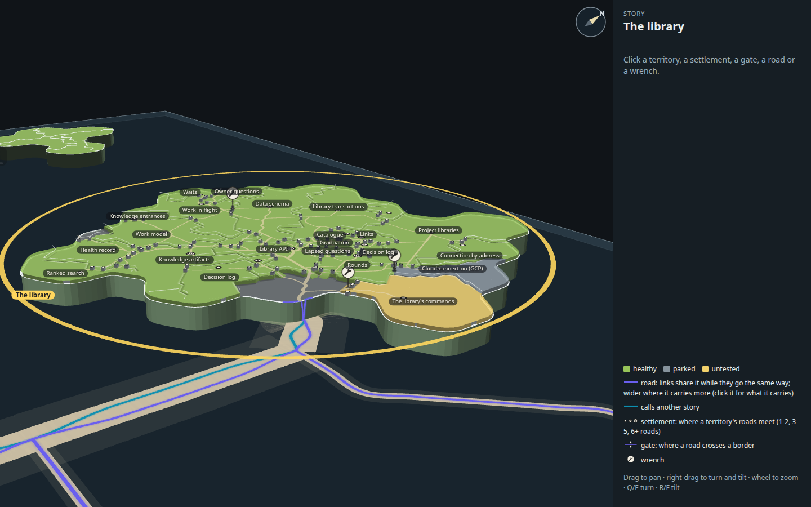 | 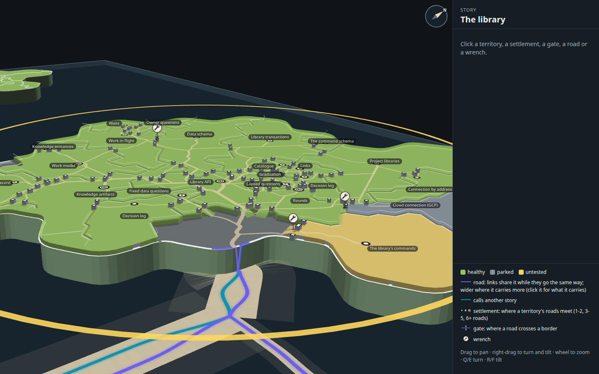 |
| Turned and tilted nearer level | The same, closer: the plateau's walls onto the sea and the open mouth, the ramp at the mouth |

## How it was made

Run from the checkout root.

1. `REGROW=1 node --import tsx docs/design/capability-tree-3d/h-quiet-roads/tools/layout.ts` writes `layout.json` and
   `measures.json`.
2. `node docs/design/capability-tree-3d/h-quiet-roads/tools/build.mjs` builds `index.html`, `page.js` and `page.css` from
   the real map code with round 11's overlay.
3. `node --import tsx docs/design/capability-tree-3d/h-quiet-roads/tools/shots.mjs --retake` takes the stills above into
   `stills/` (without `--retake`, into the capture kit's scratch folder), clicking each mark where it stands and checking
   the panel's heading; `stills/shots.json` records the clicks, the page's counts and that the page logged no errors.
4. `tools/look.mjs <name> [query] [steps]` takes one still while drawing.
5. The pieces: `node --import tsx docs/design/capability-tree-3d/h-quiet-roads/pieces/roads-tools/roads.mjs --shots
   --retake`, and `pieces/relief-tools/build.mjs` then `shoot.mjs`.

## Five things to look at next

1. **Two capabilities called "Decision log"** (13 and 22) are two territories with the same name, so the map shows the
   name twice. One of them wants a truer title in the plan.
2. **A layout search scored on the network itself.** The arrangement is round 9's, searched against round 9's ring road
   and only regrown here. A search that scores each arrangement by the shared network's own measures (road drawn, links
   over a third territory) might find one that suits the network better.
3. **Nothing prices the coast now.** With no band, one arrival road runs along the coast edge inside the territories it
   passes, where round 10's price on the band kept it inland. A small price on a step near the sea would pull it in.
4. **The map's own lanes at the mouth.** The lanes to other islands are still the map's purple and teal, louder than the
   sandy track, and stubs of them stop just short of the shore at the mouth. If the roads stay quiet, the lanes at sea
   likely want the same treatment.
5. **Ramps where gates crowd.** Six gates open onto the open land at the mouth, so their ramps sit close together there.
   Letting the arrivals share one wide ramp, with the panel saying what it carries, would read more like a town gate.
