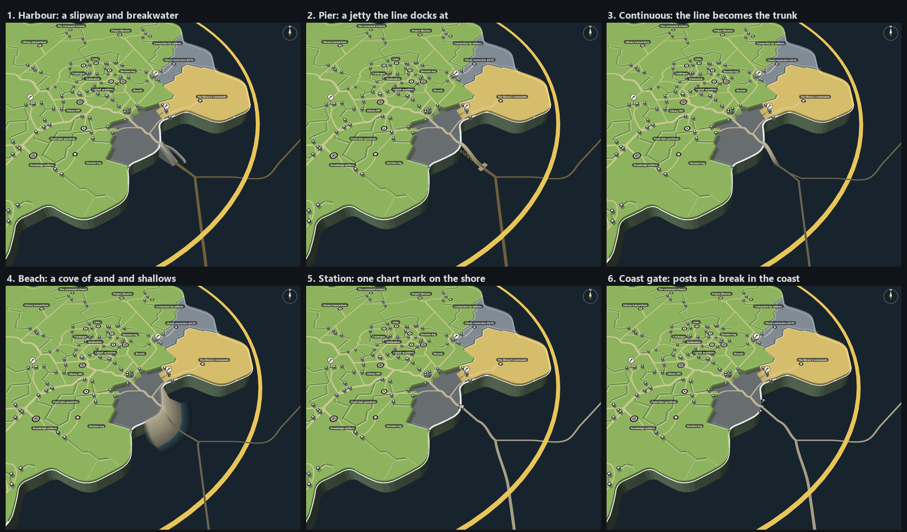
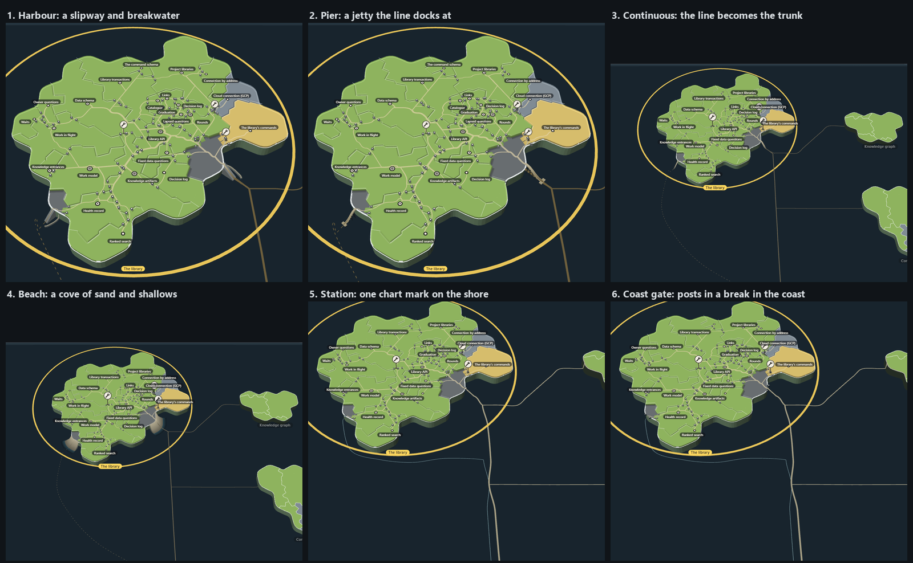

# Sea lane options: one simple line, six ways to meet the coast

A mock only (increment_7110371d3553 on arc_9bbaa3497530), on round 11's island (`../h-quiet-roads/`). Mick, on round 11:
"before we kick off round 12 for this i think we need to mock up the sea lane ... gut feel is shipping route feel not a
pathway but i'm open to ideas ... atm it looks quite disjointed. from the island." Then, as the options were being drawn:
"the map looks good because i think its not gymicy and minimalist. From memory cartographers often draw shipping lanes
with just a simple line. so maybe its the coast connection thatneeds to work not the lane" (resteer_31828afb5662).

So every option draws the sea the same way, and only the landing differs. `BRIEF.md` is the brief the three drawing
agents shared.

## At sea, in all six

- The map's purple and teal lanes, their end dots and the wide tan road band are hidden on the selection's routes.
- One plain line per stretch of route, read from the map's own lane or road segments, so routes share a line and branch
  where the map branches them. Opaque, mixed into the sea, so joins show no dark knots.
- Weight by load, the widest equal to the sandy trunk at the mouth (196 links arrive there).
- In versus out by a quiet cue: solid and dashed in `a-shipping` and `b-causeway`, sand and pale sea-grey tone in `c-cable`.
- The one link out (Connection by address to Keys) leaves from Keys' landfall, where round 11's island road takes it,
  and joins the map's route out offshore; the map itself sends it from the mouth.

## The six landings

| | Landing | Folder, query | Works | Does not |
| --- | --- | --- | --- | --- |
| 1 | Harbour: a stone slipway down to the water, a breakwater arm round it | `a-shipping/?sea=harbour` | The line visibly becomes the trunk; echoes round 11's ramps | The slip drops the cliff's 8 units, so its sides read as a heavy wedge; the arm looks a little like a pipe |
| 2 | Pier: a jetty on piles, the line docking at its T head | `a-shipping/?sea=pier` | Light; reads "the route docks here" at rest | The deck slopes like a slide; the line comes alongside rather than joining |
| 3 | Continuous: the line runs up a narrow slipway and becomes the sandy trunk | `b-causeway/?sea=continuous` | Sea and land are one road; very quiet | At rest it reads only as a kink at the coast; the coastline still crosses the ramp |
| 4 | Beach: a small cove of sand and shallows where the line comes ashore | `b-causeway/?sea=beach` | The mouth reads as a landing place even at rest | The loudest: at rest the beaches look like glow patches |
| 5 | Station: one small chart mark on the shore, the line ending on it | `c-cable/?sea=station` | Line, mark and trunk read as one route; quietest of all | A few pixels at rest; could be read as another gate post |
| 6 | Coast gate: the coastline breaks and two standing posts frame the line | `c-cable/?sea=gap` | The coast reads as the story's front door, in the island's own gate language | At rest the posts are tiny and the break hardly shows |

Each folder has its own `-rest`, `-mouth` and `-keys` stills (c-cable also `-mouth-near`), and builds with its own
`tools/build.mjs`; data and layout are read from `../../h-quiet-roads/`.

## Shared loose ends

- The way out from Keys' landfall is a route the mock draws by hand (the map has none), so it wobbles a little along
  the coast.
- Lines at other islands stop at their coasts with no landing; the chosen landing would go there too.
- The legend still describes purple and teal roads.
- `a-shipping` and `b-causeway` keep their first-brief folder names; their options are the landings above.
