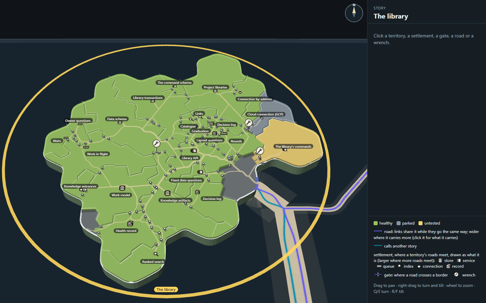
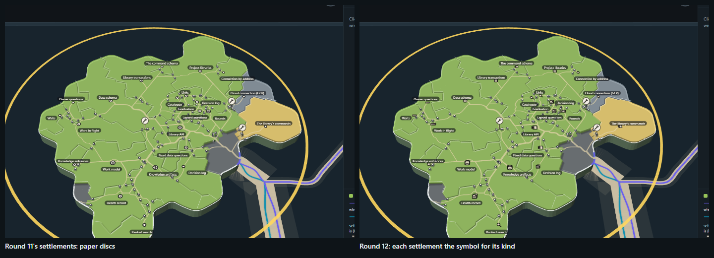
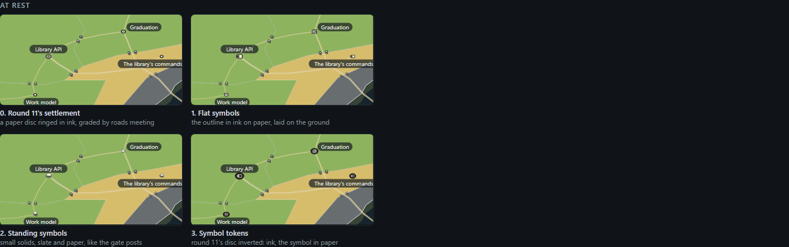
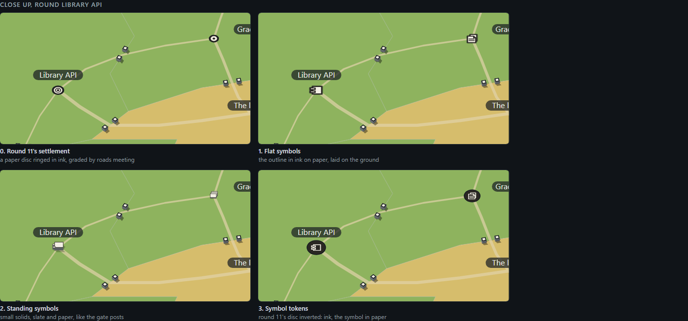
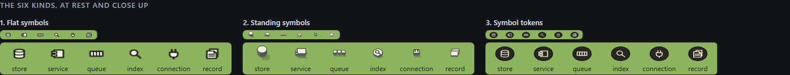
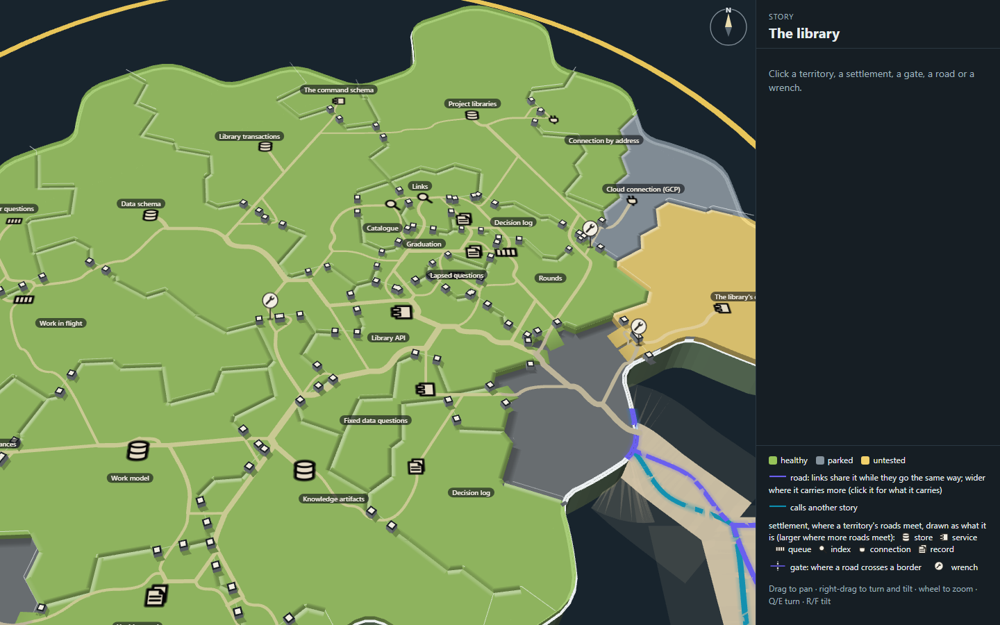
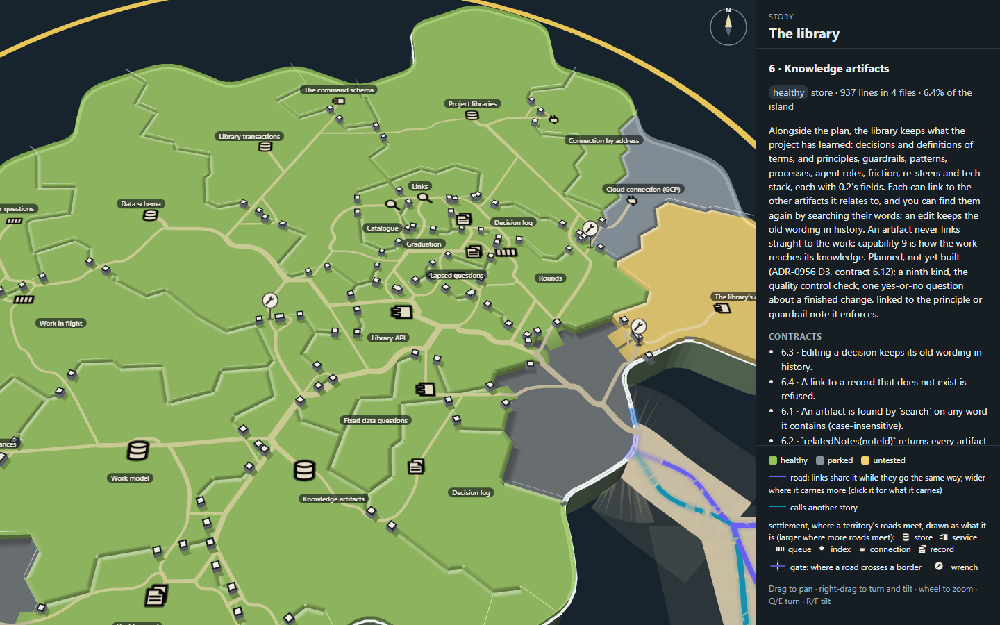
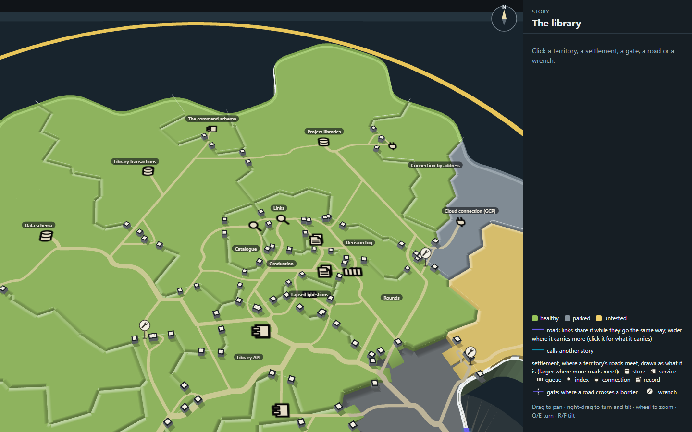
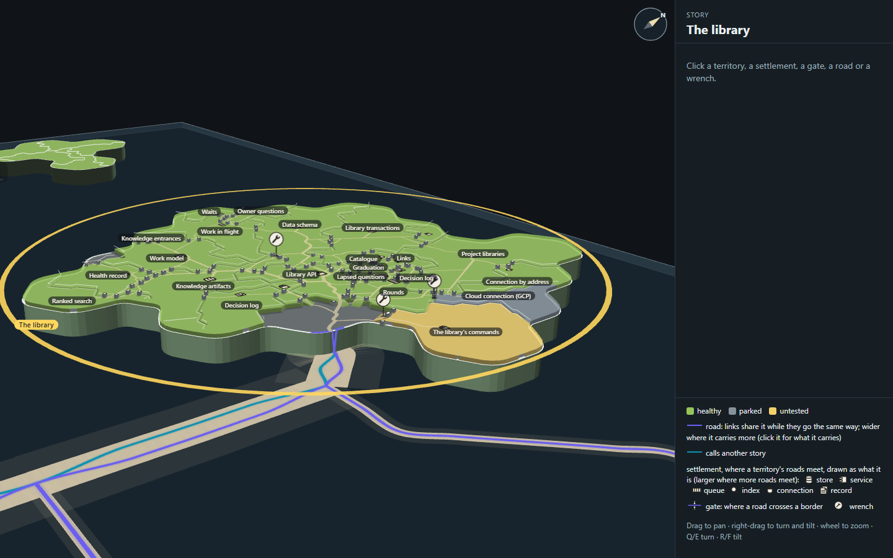
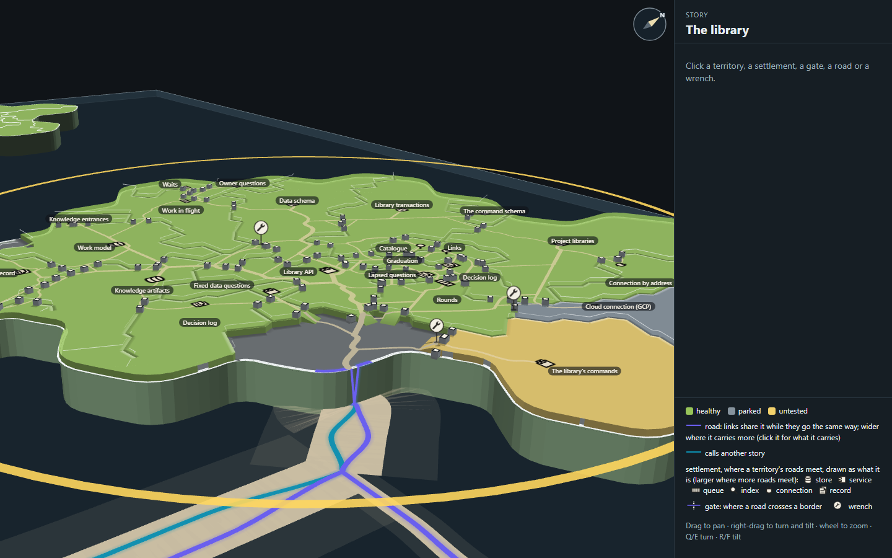

# Capability tree mock, round 12: settlements as architecture-diagram symbols

Round 11's island (`../h-quiet-roads/`: the sandy track, open land only at the mouth, plateaus and standing gate posts),
with each settlement drawn as the architecture-diagram symbol for what its capability is, in place of round 11's paper
disc. A store is a database cylinder, a service a component box, and so on: six kinds in all. A mock only
(increment_c9d1d9c9f9d7 on arc_9bbaa3497530): it changes no product code.

Mick's ask (2026-11-04): "can we also cut a separate fresh session to mock using architecture diagrams for example a
database is usually shown as a cylinder to be used instead of the settlements."

**Open it:** `index.html`, straight from disk; it needs no network. The map's controls are round 11's. `index.html?icons=disc`
draws round 11's discs on the same page. Click a settlement: the panel now names its kind beside its health.

## The six kinds

A settlement is where a territory's roads meet, so its symbol says what kind of thing the roads are reaching. The kind is
read from the capability's description in the plan (`../h-quiet-roads/data.json`), and kept to six so each symbol stays
familiar: these are the symbols an architecture diagram uses.

| Kind | Symbol | The library's capabilities | Why |
| --- | --- | --- | --- |
| store | a database cylinder | 1 Project libraries, 2 Library transactions, 3 Data schema, 4 Work model, 6 Knowledge artifacts | They are the database: one per project, the only writes it allows, its record types, and the plan's and the knowledge's tables |
| service | a component box, two tabs on its side | 7 Library API, 16 The command schema, 17 The library's commands, 27 Fixed data questions | Surfaces that other parts call: the one list of functions, the shapes commands are declared with, the command family, a few fixed queries served as commands |
| queue | a row of cells | 10 Work in flight, 11 Waits, 12 Owner questions, 25 Lapsed questions, 26 Rounds | Things that line up and move on: increments from proposal to closed, what waits on what, questions raised then settled, the lapsed-question drain, the librarian's pass due at a landing |
| index | a lens | 9 Knowledge entrances, 14 Ranked search, 21 Links, 23 Catalogue | Ways of finding: the shelves from the work into the knowledge, search by meaning, related-but-unlinked neighbours, one artifact per subject |
| connection | a plug | 8 Cloud connection (GCP), 15 Connection by address | They connect storytree to a database elsewhere |
| record | a page in front of another, its corner folded | 5 Health record, 13 Decision log, 22 Decision log, 24 Graduation | Kept records: health per record (reported and verified), the decision log's numbering and its truth, and graduation, which writes a memory out as an artifact |

Calls a reader could make the other way: Data schema could be a record (it is the store's shape, not its rows), and
Rounds could be a service (it is when the librarian runs). Both sit with the kind their roads mostly lead to. The mapping
is in `kinds.mjs` (`KIND_OF`), with the symbols' paths; the island and the pieces both draw from it.

On the island: 5 stores, 4 services, 5 queues, 4 indexes, 2 connections, 4 records (`stills/shots.json`, `layer.kinds`).

## The pieces

Mick's rule for quick variations is a piece, not the whole island, so `pieces/icons.html` (made by
`pieces-tools/icons.mjs`) draws round 11's piece of road (Library API, Graduation, The library's commands, Work model,
the open land at the mouth) with its sandy track and standing posts, and the settlements three ways against round 11's
disc, at the map's resting scale and tilt and close up, then the six kinds side by side.

| | |
| --- | --- |
|  |  |

1. **Flat symbols:** the symbol's outline in ink on a paper fill, over a faint dark casing, laid on the ground. The same ink
   and paper as round 11's disc and the posts' faces, so it adds no colour. Close up it reads as a diagram's symbol; at
   rest (about 9 to 12 pixels) the cylinder, the page and the box still tell apart.
2. **Standing symbols:** small solids in the posts' slate and paper (a cylinder, a box with tabs, three cubes, stacked
   slabs, a hexagon with a lens on top, a plug). At rest a box or a row of cubes reads as more gate posts, and the
   cylinder as a white blob: the gates lose their meaning, and the map gets busier.
3. **Symbol tokens:** round 11's disc inverted, ink with the symbol drawn in paper. Clear, but 24 dark discs are the
   loudest marks on the island, louder than the roads.

**Chosen: 1, flat symbols.** It is the quietest of the three and the only one that keeps the standing posts the one thing
that stands up, so gates still read as gates.

## On the island

`tools/overlay.ts` (`ICONS`, `SYMBOL`) draws each symbol once into a canvas and lays it flat on the plateau where round 11's
disc stood, a step larger than the disc and graded by the roads meeting there the same way:

| Mark | Values |
| --- | --- |
| A symbol's box across | 3.4 / 4.0 / 4.7 ground units for 1-2 / 3-5 / 6+ roads (round 11's discs: 2.1 / 2.8 / 3.5) |
| Its ink | `#2a2723`, 2.1 units wide in its 24-unit box, round joins |
| Its fill | paper `#f3efe4` |
| Its casing | `#141a20` at 55%, 2.2 units wider than the ink |

| | |
| --- | --- |
|  |  |
| Round Library API, close up: services (the component box) and the stores below | Knowledge artifacts picked: the panel says "store" |
|  |  |
| Where the knowledge's settlements crowd: lenses, pages and a queue together | Turned and tilted nearer level: the symbols lie on the plateau, the posts stand |

The cost of laying them flat: tipped near level (below, closer), a symbol foreshortens with the ground and turns with the
map, so it reads best near the resting tilt. Standing them up as small upright cards would fix that, at the price of a
second kind of thing standing beside the posts.

## How it was made

Run from the checkout root. The island's data and layout are round 11's, read from `../h-quiet-roads/`.

1. `node --import tsx docs/design/capability-tree-3d/j-arch-icons/pieces-tools/icons.mjs --shots --retake` writes
   `pieces/icons.html` and its stills.
2. `node docs/design/capability-tree-3d/j-arch-icons/tools/build.mjs` builds `index.html`, `page.js` and `page.css` from the
   real map code with round 12's overlay.
3. `node --import tsx docs/design/capability-tree-3d/j-arch-icons/tools/shots.mjs --retake` takes the stills into `stills/`
   (without `--retake`, into the capture kit's scratch folder; this round's stills were taken there and copied in); `stills/shots.json` records the click, the layer's counts
   and that the page logged no errors.
4. `tools/look.mjs <name> [query] [steps]` takes one still while drawing.

## Next to look at

1. **The two Decision logs** (13 and 22) are now the same symbol as well as the same name, which makes round 11's note 1
   sharper: one of them wants a truer title in the plan.
2. **The kind as data.** The mapping is the mock's own table. If the map keeps the symbols, a capability's kind belongs in
   the plan beside its description, so a new capability is born with one.
3. **Other islands.** Six kinds fit The library, a data story. A story that is mostly screens or commands may want a kind
   this set lacks (a screen, a job); the set should be checked against two more islands before it is fixed.
