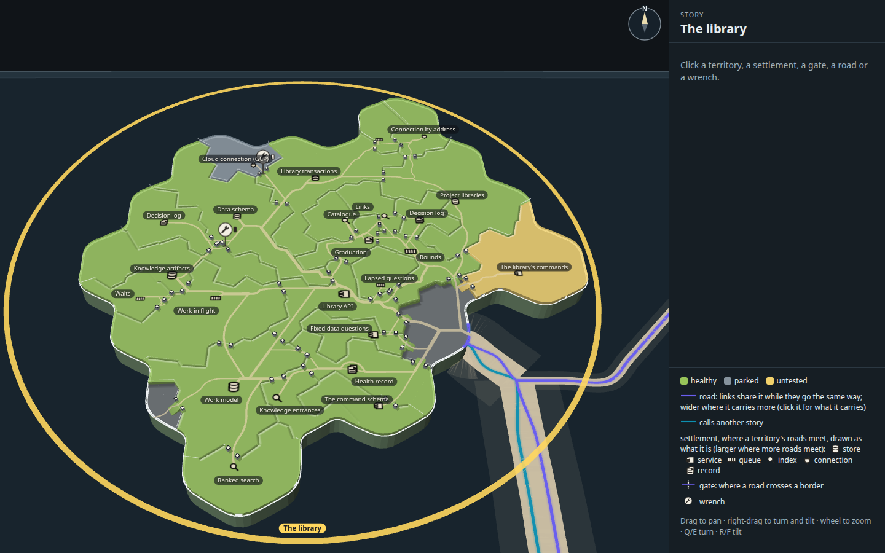
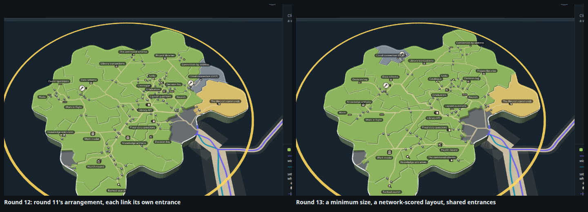
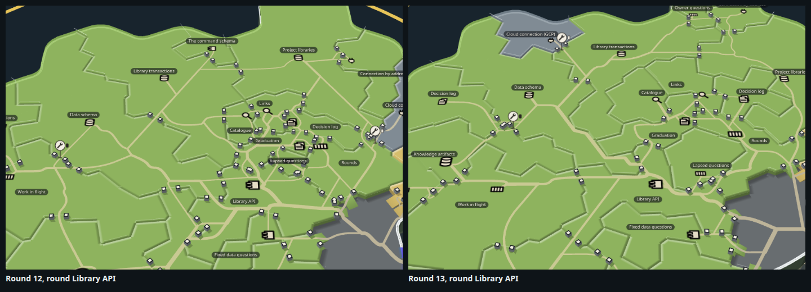
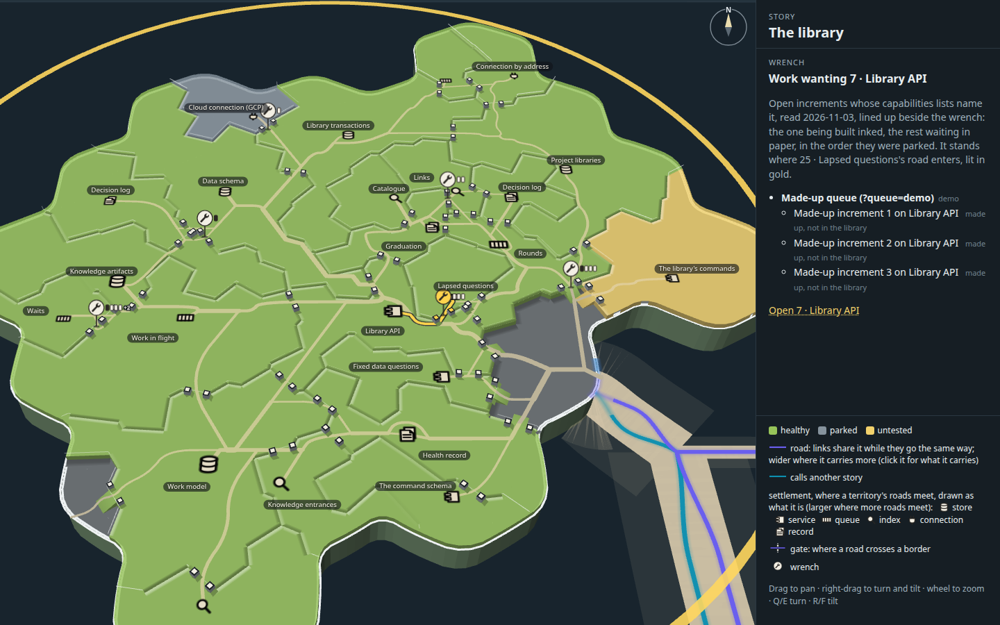
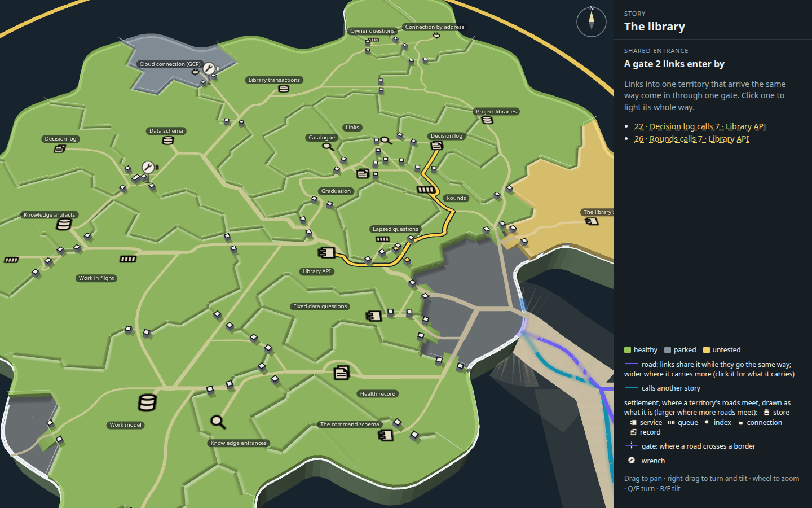
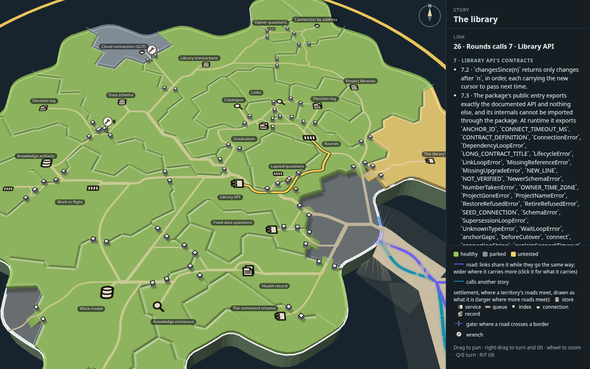
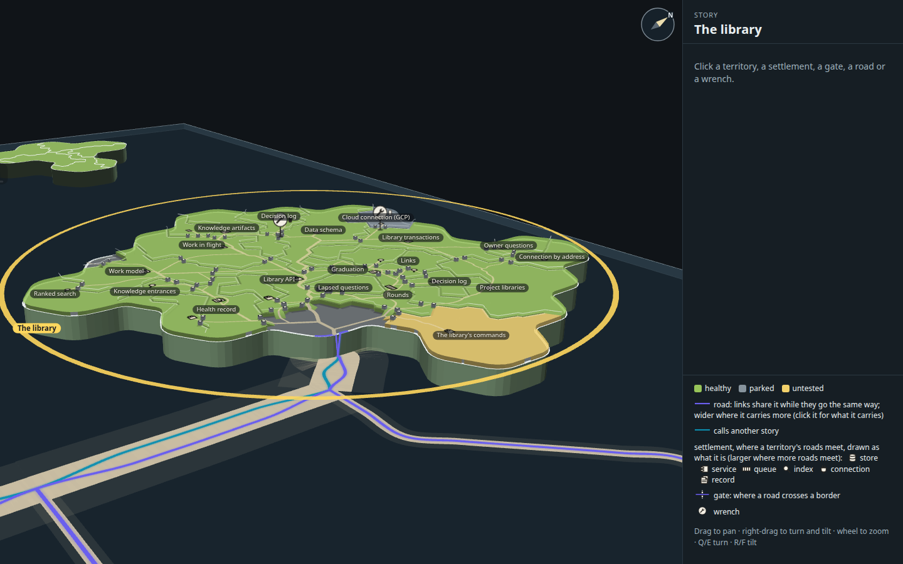

# Capability tree mock, round 13: room round the knot, a network-scored layout, the tree on the map

Round 12's island (`../j-arch-icons/`: the sandy track, plateaus, ramps, standing posts and the flat architecture symbols),
with the crowding round Library API dealt with, the arrangement searched again on the shared road network's own measures,
a small price on road near the coast, and the first of the story panel's capability tree moved onto the map. A mock only
(increment_e374d27da66e on arc_9bbaa3497530): it changes no product code. The sea lanes and the mouth's landing are left as
round 11 draws them (increment_7110371d3553 mocks those).

Mick, 2026-11-03/04: "This looks really good and makes me think we can actually put the capability tree on the map,
removing the need for it being in the story panel, it just needs more iterations to deal with the crowding." Earlier: "The
crowding looks like its just because we havn't drawn the capability territories wide enough."

**Open it:** `index.html`, straight from disk; it needs no network. The controls are round 11's. `?layout=<name>` draws
another arrangement from `layouts/` (`r11` is rounds 11 and 12's, `min5`, `min6`, `net5`, `net6b`, `chosen` the default),
`?net={"shareEntrance":0,"edge":0}` routes with other prices, and `?queue=demo` adds made-up increments to show a longer
queue by the wrenches (the panel marks them made up).

## What changed from round 12

| Round 12 | Round 13 |
| --- | --- |
| Every territory sized by its lines of code alone: Lapsed questions (12 lines) is one cell | **No territory under 5 cells** (`MIN=5`). The 18 cells this gives eight small territories are taken one at a time from whichever is then largest, so Project libraries, Library transactions and Data schema give up 8, 4 and 6 cells (their land 9.3 to 9.7% of the island against 11.9 to 13.5% of the lines; the worst gap is 4.2 points, round 11's 1.1) |
| Round 9's arrangement, regrown on round 11's land | **Searched again on the shared network itself**, on the new land: each change scored by the network routed over it |
| Every link enters the territory it calls through a gate of its own | **Links into one territory may share one entrance**: 13 gates now carry 2 to 4 entrances each. Click one: the panel lists the links that enter by it |
| Nothing prices the coast | **A step on a territory's land costs up to 0.8 more per unit near the coast** (falling to nothing 3 units in), outside the mouth |
| The wrench alone says work names a capability | **The increments lined up beside the wrench**, a tab each: the one being built inked, the rest waiting in paper, in the order they were parked, past four a count |

## The crowding: three ways, measured

Two kinds of measure. The layout tool's, on the ground plan, routes between the names (`tools/layout.ts`, as rounds 10 and
11). The page's, at rest, routes between the settlements as drawn and measures the marks themselves (`tools/crowd.mjs`,
reading `overlay.ts`'s `crowding`): each name's box as the map lays it out, each settlement's symbol, each gate's opening
with its two posts, each wrench's plate; how many pairs of those overlap, and how many more stand within 4 pixels. "The
knot" is the marks of Library API, Links, Catalogue, Graduation, Rounds, Lapsed questions and Decision log (22). Every row
is in `variants.json`.

| On the page, at rest | Marks overlapping (island) | Within 4 px | Marks overlapping (knot) | Within 4 px | Gates | Road drawn | Inside links over a third territory |
| --- | ---: | ---: | ---: | ---: | ---: | ---: | ---: |
| Round 12 (round 11's arrangement) | 44 | 26 | 23 | 17 | 58 | 1331 | 13 of 35 |
| (a) a minimum size of 5, round 11's arrangement regrown | 44 | 22 | 18 | 4 | 57 | 1202 | 19 |
| (c) shared entrances, round 11's arrangement | 35 | 13 | 17 | 7 | 42 | 1103 | 12 |
| (a) + (c) + the coast price, regrown | 31 | 13 | 12 | 1 | 46 | 1090 | 20 |
| Searched on the network, minimum 5 (`net5`) | 39 | 16 | 10 | 7 | 48 | 1173 | 12 |
| Searched on the network, minimum 6 (`net6b`) | 32 | 20 | 7 | 8 | 47 | 1128 | 15 |
| **Chosen: `net5` searched again** | **25** | **11** | **7** | **3** | **39** | **1173** | **14** |

What they showed:

1. **(a) A minimum size** alone hardly widens the knot. A territory's room (the largest disc it holds) for the smallest went
   from 4.4 units to 5.4 at a minimum of 5 cells and 5.9 at 6, because the cut's cells are already wide; and on round 11's
   arrangement the regrown land sends more inside links over a third territory (13 to 19), because the arrangement was
   searched for the old sizes. It earns its place only once the arrangement is searched again on it.
2. **(b) A bigger island** for a story with many capabilities and links is not reachable from the mock's shim: the island's
   size is the forest's land-per-capability ratio (`packages/forest-world/src/land-per-capability.ts`, ADR-0528), applied
   to every island alike, upstream of the territories module the shim replaces. And at rest it would mostly cancel out:
   the rest view frames the island to the window, so a bigger island is drawn smaller, and the symbols, posts and ramps,
   which are sized in ground units, shrink with it. Only the names, which are a fixed size on the screen, would gain. Not
   tried.
3. **(c) Shared entrances** (round 10's note 1) did the most on its own: 16 fewer gates, 228 fewer units of road, 9 fewer
   overlapping pairs, and one fewer link over a third territory. Round 11's note 5 (one wide shared ramp at the mouth) is
   not done: the chosen arrangement still opens 6 gates onto the open land, each with its ramp.
4. **The network-scored search** (below) is what makes (a) pay: with the arrangement searched on the new land, the knot
   drops to 7 overlapping pairs from 23.
5. **Chosen**: the last row. It is the calmest on every crowding measure on the island and in the knot, with the fewest
   gates and road segments (94 against 135). It pays one more inside link over a third territory than round 12 on the page
   (14 against 13; on the ground plan, 11 against 12), and the 4.2-point size gap above. `net6b`, at a minimum of 6, is as
   calm in the knot but busier across the island and sends 15 links over a third territory.

## The layout search, scored on the network

`tools/layout.ts`, `SEARCH=net` (round 11's note 2): simulated annealing from a start arrangement (its ring order of the
interfaces, the ring's turn and the inland seeds), each change grown into territories on the land and the whole network
routed over it (`measureNet`, about a second a change), and scored on the network's own measures:

    14 × crossings + 10 × inside links over a third territory + 3 × the borders those links cross
      + 0.05 × road drawn − 4 × inside links between neighbours (+ round 9's guards: every interface on the coast,
      the way out near Keys)

The chosen arrangement came in two runs: from round 11's, at a minimum of 5 with shared entrances and the coast price,
250 changes (`net5`); then from `net5`, 400 more with another seed. A third run from `net6b` found nothing better.

| On the ground plan (the layout tool's) | Round 11 / 12 | Round 13 |
| --- | ---: | ---: |
| Line crossings on the land | 0 | 0 |
| Road drawn | 1400 units | **1222** |
| Inside links passing over a third territory | 12 of 35 | **11 of 35** |
| Borders those links cross | 27 | 27 |
| Inside links between neighbours | 24 of 35 | 24 of 35 |
| Road segments (junctions) | 139 (81) | **92 (50)** |
| Smallest room: the largest disc the smallest territory holds | 4.4 units (Lapsed questions) | **5.5** (Graduation) |

## The coast

`network.ts`'s `edge` price (round 11's note 3): a step on a territory's land within 3 units of the coast, outside the
mouth, costs up to 0.8 more per unit at the very edge, falling to nothing 3 units in. On round 12's page, 8 units of road
ran that close to the coast outside the mouth; on the chosen arrangement, none (`roadOnEdge` in `variants.json`). On round
11's arrangement alone the price took it from 8 to 5: most of the gain is the new arrangement's.

## The capability tree on the map

What the story panel's capability tree shows today (`packages/forest/src/view/story-panel.ts`, laid out by
`packages/forest/src/drill-down/tree-layout.ts` from `drill-down.ts`), and where the map stands on each:

| The panel's tree shows | The map |
| --- | --- |
| A card per capability, its title and status word | A territory per capability, its name and its status word's fill: **on the map** |
| What each builds on, as arrows, laid out bottom to top | The links as shared roads, with no arrowheads: **on the map, without the direction**; the panel says which way when a link is clicked |
| Other stories' capabilities it builds on, as small muted cards | The lanes to other islands and the arrivals at the mouth: **on the map**, though the lanes are cut at the coast and the panel names them |
| Two health marks per card: the agent's report, and what storytree saw (local, CI, or both) | The fill is storytree's word only. **Not yet**: round 13 has the panel say both when a territory is clicked ("storytree saw: passing · the agent reports: not checked"); on The library every agent report reads not checked, so there is nothing to mark on the land yet |
| For the selected capability: "why not green" (the reason, its contracts, who moves it), parked arcs, the description, the contracts with each one's trail and last run | The panel here gives the description, the contracts and the links; **not yet** "why not green", the parked arcs or each contract's trail |
| The default selection: the first capability not yet landed, in build order | **Not yet**: nothing is picked at rest |
| A pop-out larger view to pan and zoom | The map is itself the larger view |
| Not shown in the panel's tree: claims, open increments, files, tests | The wrench (open work) and now its queue: **only on the map** |

Drawn this round, as the cheap one: **the increments lined up on a capability**, beside its wrench. A tab each, the one being
built inked and the rest waiting in paper, in the order they were parked, at most four and then a count. The library holds
two open increments naming The library's capabilities today (read fresh into `open-work.json`; the island's snapshot stays
round 11's so the territories compare), one each, so at rest each wrench has one tab. `?queue=demo` adds made-up
increments (Library API 3, Links 2, Rounds 4, Work in flight 6) to show what a queue looks like; the panel marks them "made
up, not in the library".

| | |
| --- | --- |
|  |  |
| `?queue=demo`: Library API's wrench clicked, its three made-up increments listed; Work in flight's shows four tabs and "+2" | A gate two links enter by (Decision log and Rounds into Library API), clicked: the panel lists both |
|  |  |
| Rounds calls Library API, lit along the roads it shares, through the shared gate | Turned and tilted nearer level |

## How it was made

Run from the checkout root.

1. `tools/layout.ts` writes an arrangement and its measures into `layouts/` (its header gives the chosen one's command;
   `REUSE=1 START=docs/design/capability-tree-3d/h-quiet-roads/layout.json NAME=r11` routes round 11's again).
2. `node --import tsx docs/design/capability-tree-3d/k-room/tools/open-work.mjs` reads the open work into `open-work.json`.
3. `node docs/design/capability-tree-3d/k-room/tools/build.mjs` builds `index.html`, `page.js` and `page.css` from the real
   map code with every arrangement in `layouts/`.
4. `node --import tsx docs/design/capability-tree-3d/k-room/tools/crowd.mjs '?layout=r11' '?layout=chosen' …` measures each
   query on the page at rest.
5. `node --import tsx docs/design/capability-tree-3d/k-room/tools/shots.mjs --retake` takes the stills above into `stills/`
   (without `--retake`, into the capture kit's scratch folder); `stills/shots.json` records the clicks, each page's counts
   and crowding, and that the pages logged no errors. The shared gate and the wrench are real clicks where the mark
   stands; the lit link is picked through the page's own `mock.pick`, because its gate is shared and a click there opens
   the gate.

## Five things to look at next

1. **Sizes against room.** The minimum takes its cells from the largest territories, so the three biggest now hold about 9%
   of the island each against 12 to 13% of the lines. A softer rule (the small ones' room taken from all the large ones in
   proportion, or the map's sizing by the square root of lines) would keep the big ones truer.
2. **Symbols far from their names.** A few settlements sit well away from their name (Fixed data questions, Health record),
   where the settlement's spot chases the roads it meets. Holding a settlement within a short reach of its name, and
   letting the roads come to it, would read more like a town and its label.
3. **The direction of a link.** The panel's tree shows which way each link points; the map shows it only when a link is
   clicked. A quiet mark at each entrance gate (a post a shade darker on the side the road comes in) would carry it at rest
   without arrowheads.
4. **The panel's selection.** The panel's tree picks the first capability not yet landed; the map picks nothing at rest. If
   the tree moves onto the map, the rest view could light that one, and the panel open on it.
5. **The queue at scale.** Today's library has one open increment per capability here, so the queue was shown on made-up
   work. Looked at against a busier island (one whose capabilities carry several increments, with one being built), the
   tabs may want to stand by the territory's settlement instead of its wrench.
