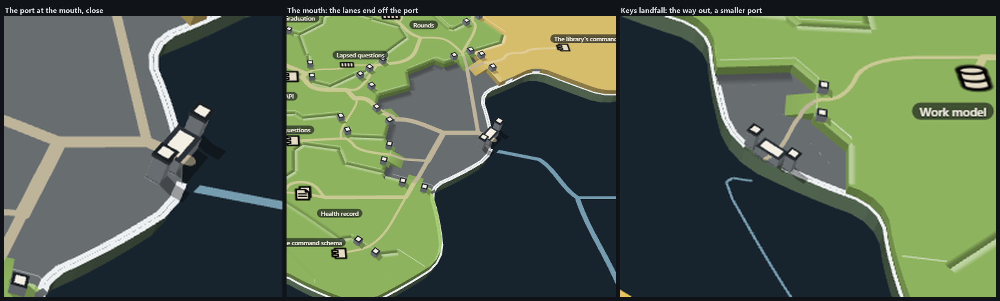
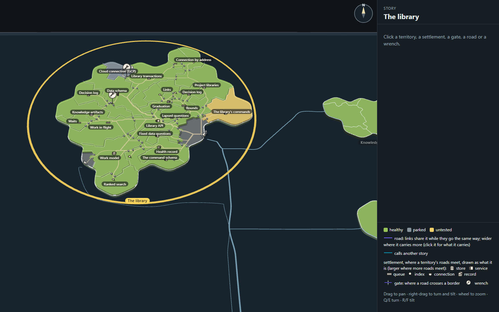
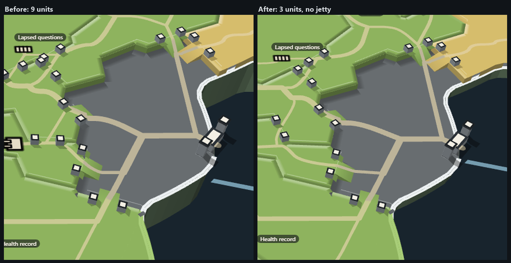

# Sea lanes: a port at the coast, one pale-blue line at sea

A mock only (increment_f204c0909030 on arc_9bbaa3497530), on round 13's island (`../k-room/`, copied). It follows the six
landings in `../i-sea-lanes/`. Mick picked the coast gate (6), then: "I think we have the pathway leading into a
port/structure then we draw a different style line for the shipping lanes, like a light blue or something. This way the
two lines don't need to connect ... maybe a port building but with gate style towers?" and "no dotted lines please,
shipping lines all stay the same. Only add thickness for more lines merging." (resteer_4b076c531810)

## What it draws (`tools/sea.ts`, `?sea=port`, the default)

- **At sea:** every shipping lane is one solid pale sea-blue line (`#8fbfd4` mixed into the sea), in and out alike: no
  dashes, no second tone. A stretch several lanes share is drawn once, a step wider by how many share it (1, 2-7, 8-31,
  32+). The lines stop at every coast; at this island they end just off the quay's head and never touch the road. The
  map's purple and teal lanes, their pips and the tan band are hidden.
- **The port,** at the mouth and, smaller, at Keys' landfall, where the sandy road ends:
  - a low building at the coast with a door on the land side, where the road arrives;
  - two towers either side in the gate posts' slate, shading and ink-and-paper top, about three times a post's height
    and capped wider, so it reads as the gates' kin and not as another gate;
  - no jetty: Mick, "remove the jetty though dont think its needed". The lanes end just off the building's front, where
    the white coastline breaks.
- **Islands 3 units thick** (the map's own `SHEET_LAND_THICKNESS`, 9 before; chosen from `../m-height/`).
- `?sea=map` draws the map's own lanes. `?lane=#rrggbb` and `?laneMix=0.6` try another lane tone, and `?port=1.3` scales the
  port.

## Looking at it

- A solid quay down to the water read as a stone pillar on the 9-unit cliff, then a jetty on piles; with 3-unit islands
  and no jetty the building and towers stand on the coast alone.

- At rest the lanes read as chart lines, and the ports as small pale marks where they meet the island.
- At Keys the line leaves the berth with a small curl before it turns along the coast (the hand-drawn way out, as in
  `i-sea-lanes/`).

## Next

1. The way out at Keys kinks where it leaves the port.
2. Ports on the other islands, where the lanes now just stop at the coast.
3. The legend still describes purple and teal roads.

Build: `node docs/design/capability-tree-3d/l-port/tools/build.mjs`; stills: `node docs/design/capability-tree-3d/l-port/tools/stills.mjs`.
