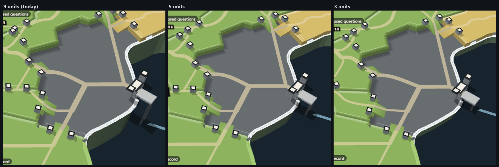
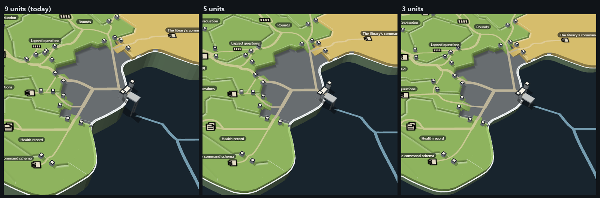
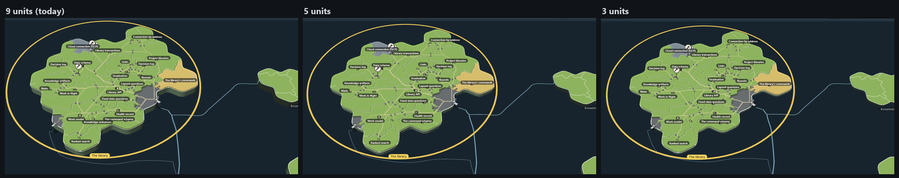

# Island height: 9, 5 and 3 units

A mock only (increment_73cc0eadfed9 on arc_9bbaa3497530), on the port mock (`../l-port/`, round 13's island). Mick, on
the port: "is there a reason why we made the islands so tall? maybe we shorten them?"

Every island on the sheet is `SHEET_LAND_THICKNESS = 9` units thick (`packages/forest-world/src/planet/sheet.tsx`).
ADR-1059 D2 asks only for real thickness, shared by every island, with visible sides; 9 was chosen when the camera sat at
a fixed 40° tilt (since freed by ADR-1062). The mock's build reads the thickness from `?thick=<n>` instead (9 when
absent) and changes no product code. The port's quay and piles follow the cliff, measured off the lanes.

| | 9 (today) | 5 | 3 |
| --- | --- | --- | --- |
| Sides at rest | A heavy dark band under every island | A clear slab | A thin slab edge, still visible |
| Plateaus, ramps, posts | Small next to the cliff | Read as steps | Read as real height, about half the cliff |
| The port's jetty | Long spindly piles | Shorter piles | The deck nearly sits on the water |

At 3 the sides still show at rest, so the island stays a raised slab; the relief and the port read best.

Build: `node docs/design/capability-tree-3d/m-height/tools/build.mjs`; stills: `NAME=h3 node docs/design/capability-tree-3d/m-height/tools/stills.mjs "?thick=3" mouth-near mouth rest`.
