# Capability tree map, polish round 1 of 3: names clear of their marks, a smooth way out, a true legend

The port mock (`../l-port/`, round 13 with the port and 3-unit islands, copied whole), polished one round. A mock only
(increment_39784ac109f1 on arc_9bbaa3497530): it changes no product code. Everything Mick picked stands as he picked it:
the sandy faint roads, the plateaus, ramps only from open land, standing posts, bevel rims, round 12's flat symbols, round
13's minimum size, shared entrances and wrench queue, one solid pale sea-blue lane wider only where lanes merge, the port
with its two capped towers and no jetty, and islands 3 units thick.

Mick, 2026-11-04: "It can add improvements too but it must be confident they improve the look or add value not takes away
from what we have achieved." He likes the map because it is "not gymicy and minimalist", so this round adds no new kind of
mark, colour or effect: it moves what is there so it stops colliding, and makes the legend say what the map draws.

**Open it:** `index.html`, straight from disk. Each change has a switch that draws it as before: `?symbolClear=-1`
(symbols placed as before), `?symbolEdge=0`, `?wrenchClear=0`, `?kink=1`.

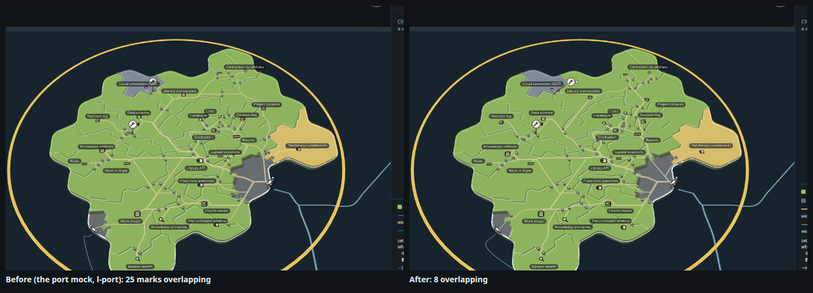

## What changed

| The port mock | Polish round 1 |
| --- | --- |
| A settlement's spot kept only its middle off the names, tested at the open land's height, so 15 names sat on their own symbols at rest | **The whole symbol keeps 4 px clear of every name**, tested at the plateau's height where it is drawn, and its edge stands 1.5 units from any border so the gates on it do not touch it. Every name now reads above its symbol with a gap |
| A wrench stood at its territory's entrance nearest the name, so Cloud connection's plate covered its name | **Of its own entrances, the nearest whose plate clears every name**; where none does (Cloud connection has one), the stem leans a few pixels until the plate clears |
| The way out at Keys left the berth and swung straight onto its offshore round: a kink just off the port | **It runs 9 units straight out from the port, then eases onto the round** over four steps, its corners cut rather than splined, so it cannot curl |
| The legend drew a purple road, a teal "calls another story" and a purple gate | **The legend draws what the map draws**: the sandy road, the sea-blue shipping lane ("calls to or from another story, wider where lanes merge; it ends at a port"), the gate on a sandy road, and the open land, whose grey otherwise reads as parked |

| | |
| --- | --- |
| 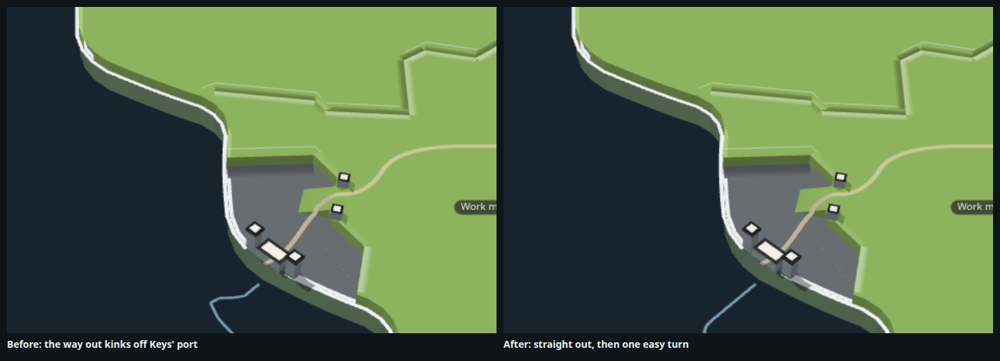 | 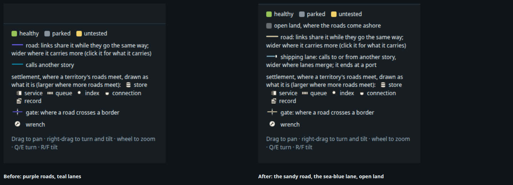 |

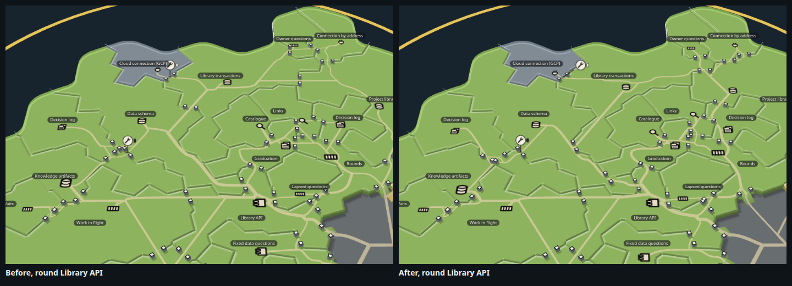

## The measures, at rest

Round 13's page measures (`tools/shots.mjs` reads `overlay.ts`'s `crowding` and `stats` at rest): each name's box as the
map lays it out, each settlement's symbol, each gate's opening with its posts and each wrench's plate; how many pairs
overlap and how many more stand within 4 pixels, across the island and in the knot (Library API, Links, Catalogue,
Graduation, Rounds, Lapsed questions, Decision log). `crowding` now lists the overlapping pairs too. The numbers are in
`stills/before.measures.json` and `after.measures.json` (`pass1.measures.json` is the first pass, its wrench search still reaching other territories' gates).

| On the page, at rest | Marks overlapping (island) | Within 4 px | Overlapping (knot) | Within 4 px (knot) | Gates | Road drawn | Inside links over a third territory | Road on the coast's edge |
| --- | ---: | ---: | ---: | ---: | ---: | ---: | ---: | ---: |
| The port mock (as landed) | 25 | 12 | 8 | 3 | 39 | 1188 | 14 of 35 | 0 |
| The whole symbol 2 px clear | 15 | 26 | 3 | 10 | 42 | 1158 | 14 | 0 |
| 4 px clear | 11 | 14 | 3 | 7 | 41 | 1165 | 14 | 0 |
| 4 px, and 1.5 units off the borders | 9 | 15 | 4 | 9 | 40 | 1120 | 14 | 0 |
| **+ wrenches clear of the names (after)** | **8** | **15** | **4** | **9** | **40** | **1120** | **14** | **0** |
| (2.5 units off the borders, not kept) | 14 | 12 | 2 | 6 | 40 | 1161 | 15 | 0 |

What they showed:

1. **Names on their own symbols were most of the crowding**: 15 of the 25 pairs. All 15 are gone; what overlaps now is two
   pairs of the map's own names (Links and Catalogue, Owner questions and Connection by address), two gates under a name,
   two gates touching a symbol, and two pairs of gates side by side.
2. **The knot halves**, 8 to 4. Its near misses rise from 3 to 9, and the island's from 12 to 15: marks that overlapped
   now stand apart by a few pixels instead. Those are the next ones to give room.
3. **Less road**: the symbols' new spots, a little off the borders, let the roads meet them sooner (1188 to 1120 units).
   Links over a third territory are unchanged (14), and no road runs on the coast's edge.
4. **2.5 units off the borders** calms the knot further but crowds the gates against the names across the island, and
   sends one more link over a third territory. 1.5 is kept.

## Tried and dropped

- **A port where the lanes come ashore on the other islands** (`?otherPorts=1`). The map's lanes hug another island's
  coast on their way to the capability they call, so a port at each landfall stood two or three to an island, some where no
  lane could be seen arriving; ending each lane at its first touch on the island still left two on Knowledge graph's one
  side. It added marks and read busier, so it is off. The code stays behind the switch.

  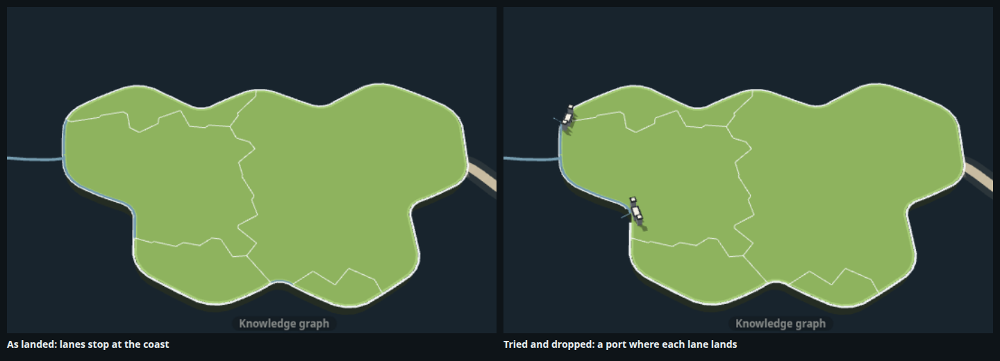

## The stills

| | |
| --- | --- |
| 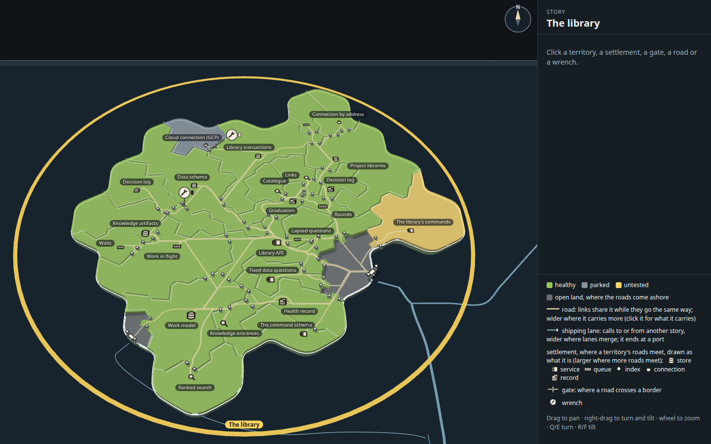 | 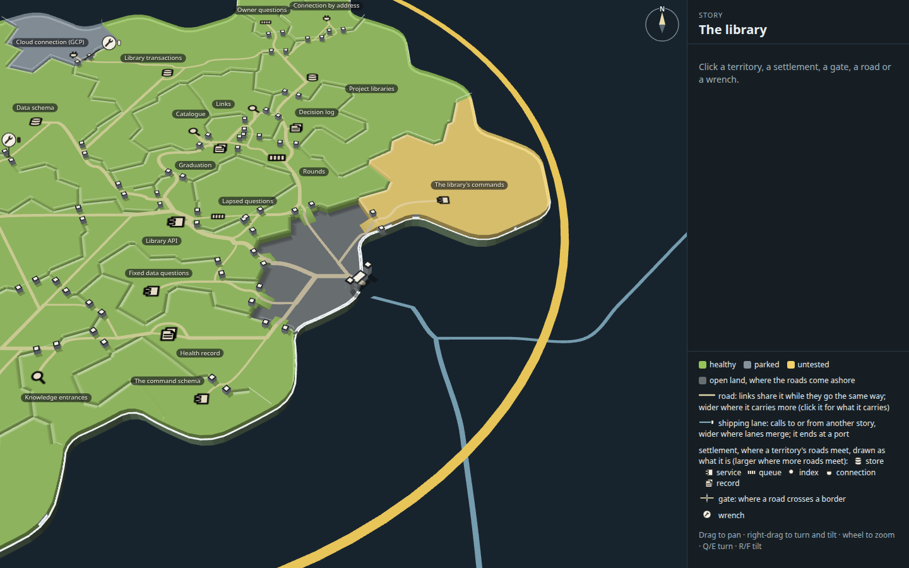 |
| At rest, the whole island | The mouth, close |
| 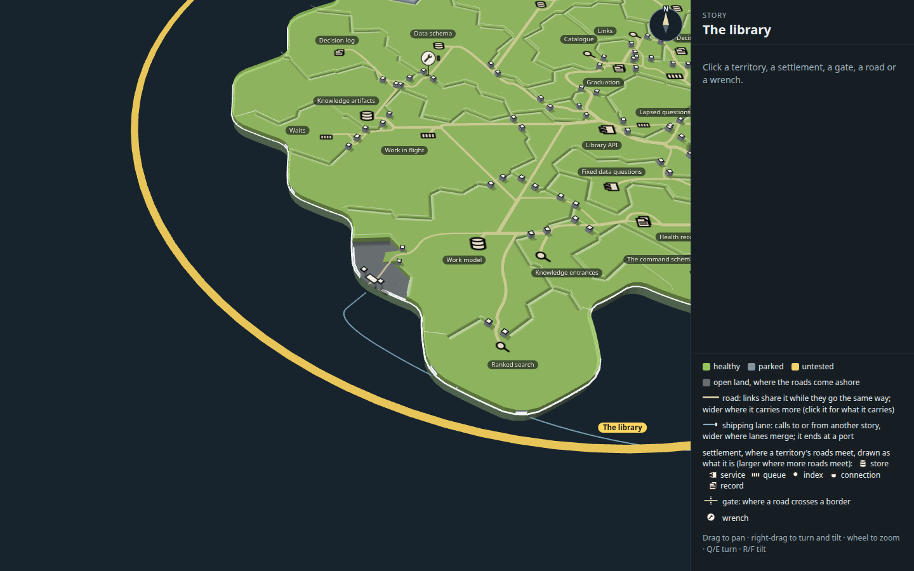 | 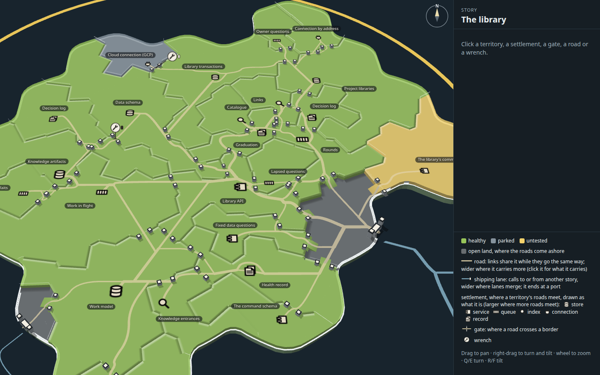 |
| Keys' landfall, close | The Library API knot, close |
| 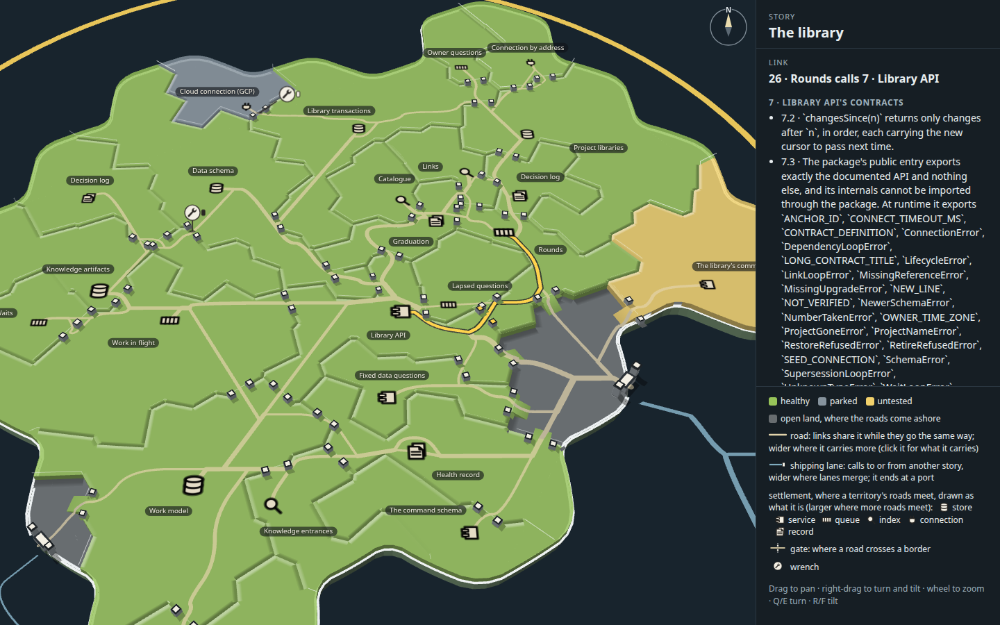 | 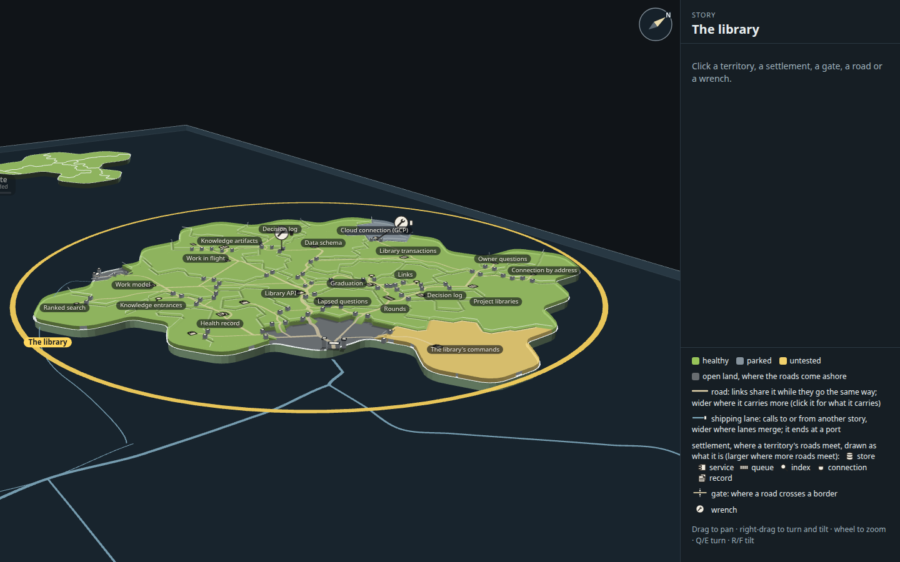 |
| Rounds calls Library API, lit | Turned and tilted nearer level |

The same six views of the port mock as landed are `stills/before-*.png`.

## How it was made

Run from the checkout root.

1. `node docs/design/capability-tree-3d/n-polish-1/tools/build.mjs` builds `index.html`, `page.js` and `page.css` from the
   real map code (packages/forest's view, on `../h-quiet-roads/data.json`).
2. `node --import tsx docs/design/capability-tree-3d/n-polish-1/tools/shots.mjs <tag> [query]` takes the six stills as
   `stills/<tag>-*.png` (in the capture kit's scratch folder unless `--retake` is given) and writes the measures at rest to
   `<tag>.measures.json`.
3. `node --import tsx docs/design/capability-tree-3d/n-polish-1/tools/crowd.mjs '' '?symbolEdge=2.5' …` prints the measures
   for each query, faster, with no stills.
4. `node --import tsx docs/design/capability-tree-3d/n-polish-1/tools/sheet.mjs --retake` lays the before-and-after sheets.
   `look.mjs` takes one still with steps (grab, wheel, drag, click, eval).

## Next things to look at

1. **Posts round the mouth.** About ten gates stand on the open land's border at the mouth, one for each road that climbs
   from it into a territory. They come from how the network branches the arrivals on the open land; a shared ramp where
   several roads leave it together (round 11's note 5) would thin them.
2. **The near misses.** 15 pairs on the island stand within 4 pixels; most are gates beside gates, or a gate beside a name.
   Pricing a border crossing under a name in the network (`extra`) would move those gates.
3. **The map's own names.** Links over Catalogue, and Owner questions over Connection by address, are the map's nameplates
   colliding; the mock cannot move them without changing the map's label layout.
4. **A leaned wrench at other angles.** The lean is chosen at rest; turned, a leaned stem keeps its lean in pixels. It
   reads fine in the second angle, but a lean chosen on the ground would hold better.
5. **Round 13's next steps** still stand: sizes against room, a link's direction at rest, the panel's selection on the map,
   and the queue at scale.
