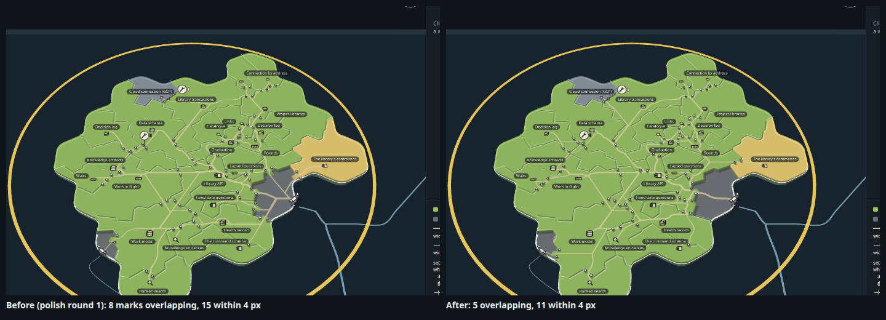
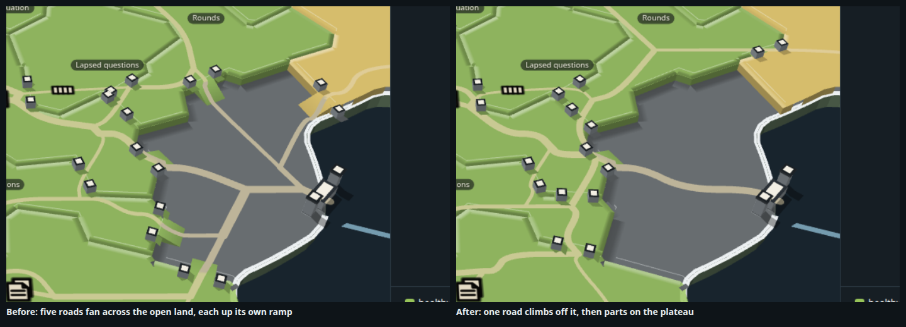
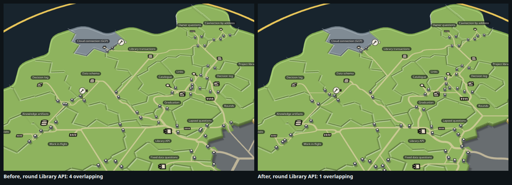
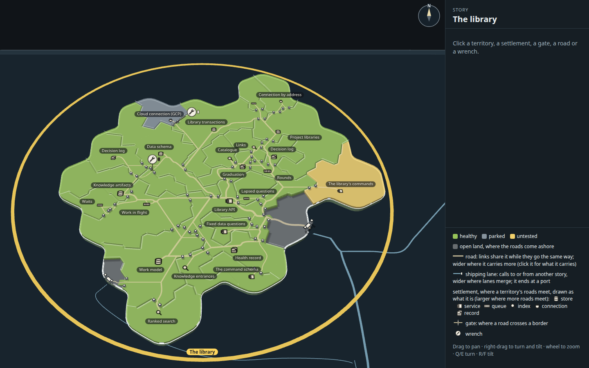
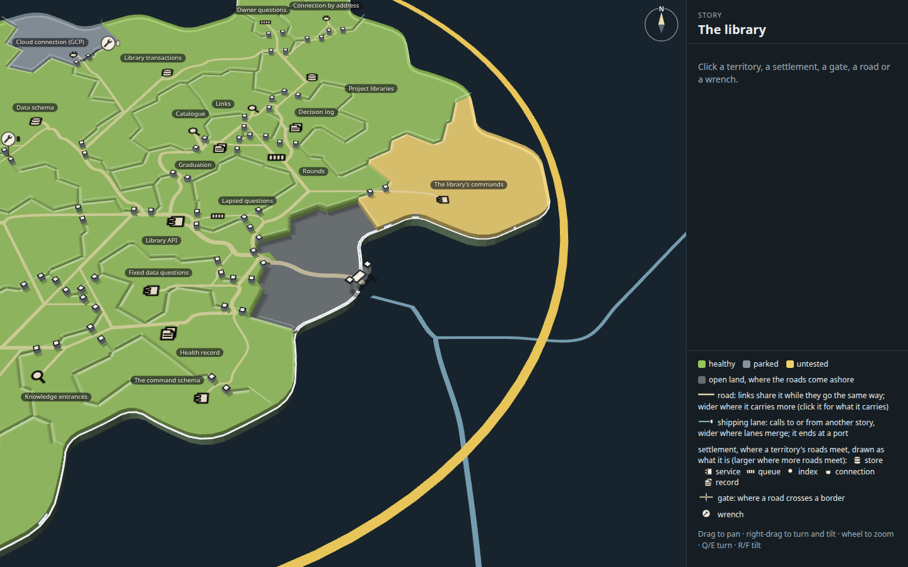
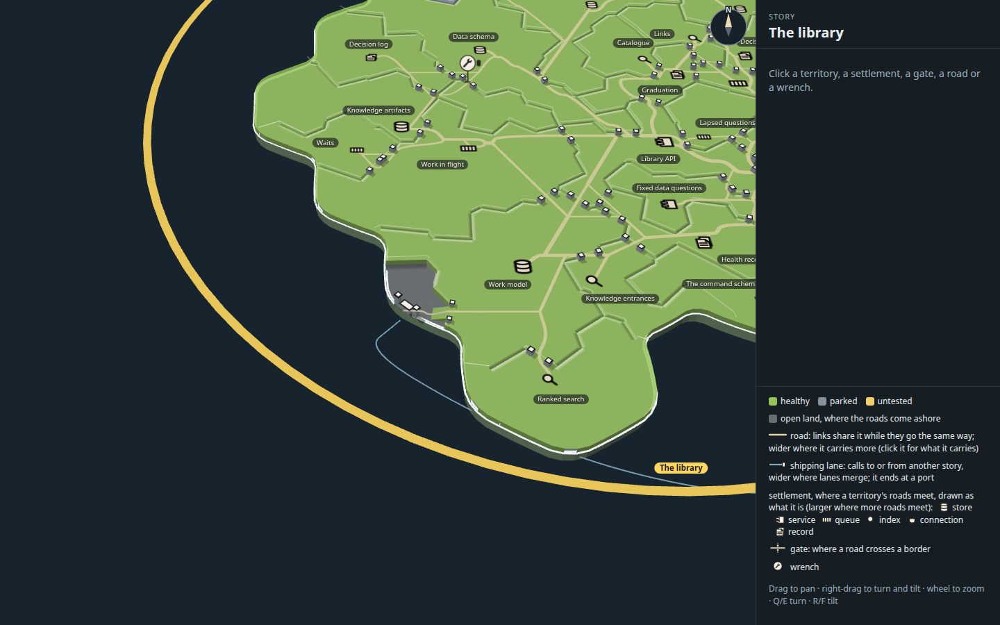
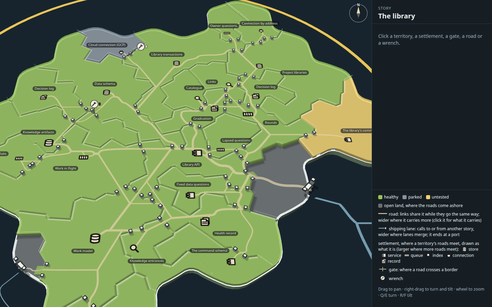
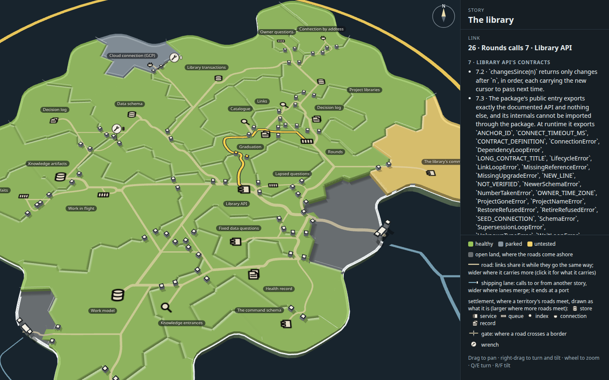
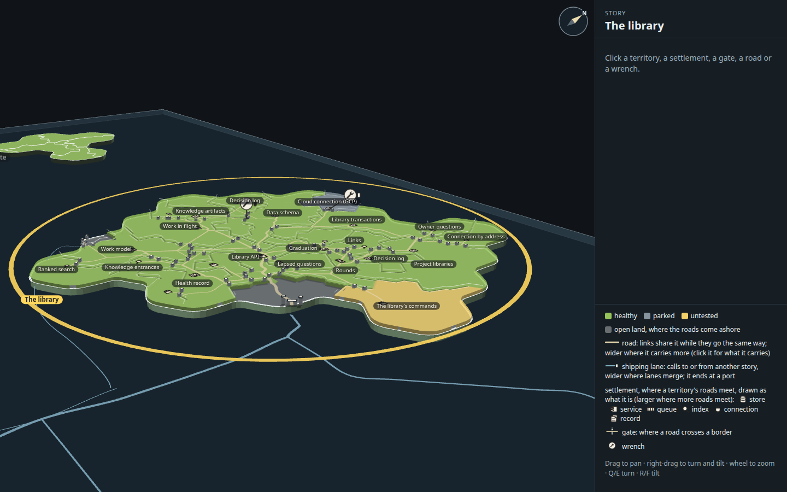

# Capability tree map, polish round 2 of 3: gates clear of the names, one ramp off the open land

Polish round 1 (`../n-polish-1/`, copied whole), polished one round further. A mock only (increment_5847f3d90d9a on
arc_9bbaa3497530): it changes no product code. Everything Mick picked stands as he picked it: the sandy faint roads, the
plateaus, ramps only from open land, standing posts, bevel rims, round 12's flat symbols, round 13's minimum size, shared
entrances and wrench queue, one solid pale sea-blue lane wider only where lanes merge, the port with its two capped towers
and no jetty, and islands 3 units thick.

As in round 1, this round adds no new kind of mark, colour or effect. It changes only where the roads run, so the gates
they make stop landing on names, on symbols and on one another, and the mouth stops sprouting a ramp for every road.

**Open it:** `index.html`, straight from disk. Each change has a switch that draws it as before: `?gateClear=0`,
`?ramp=0`, `?net={"entranceApart":3.8}`. All three together draw round 1 exactly (the same measures).

## What changed

| Polish round 1 | Polish round 2 |
| --- | --- |
| A road kept out from under the names, but its gates did not: a gate is where a road crosses a border, and with its posts it is about 6 units long, so a road could pass a name's edge and leave a post under it | **A gate costs the road more (8 units) wherever any part of it would stand under a name, or within 5.5 units of a settlement.** The router takes another crossing where there is one. Gates under names or on symbols fall from 4 to 2 |
| Every arrival climbed off the open land by its own ramp: five roads fanned across the grey from the port, each cutting its own notch in the plateau's rim, with its two posts | **Climbing off the open land costs more (30) unless another road already climbs there, and an arrival's trunk over a territory on its way costs less (0.5, from 3).** The arrivals cross the open land together, climb by one ramp, and part on the plateau, the way round 10's network already shares road everywhere else. Openings on the open land's edge fall from 6 to 2 |
| Two links entering through one border, opposite ways, were kept 3.8 units apart: less than a gate is wide with its posts, so their posts touched | **Two entrances stand 6 units apart**, a whole gate (the 3-unit opening and two entrance posts). One pair of touching gates goes |

## The measures, at rest

Round 13's page measures, as round 1 took them (`tools/shots.mjs` reads `overlay.ts`'s `crowding` and `stats` at rest):
each name's box, each settlement's symbol, each gate's opening with its posts and each wrench's plate; how many pairs
overlap and how many more stand within 4 pixels, across the island and in the knot (Library API, Links, Catalogue,
Graduation, Rounds, Lapsed questions, Decision log). The numbers are in `stills/before.measures.json` and
`after.measures.json`; the rows between are from `tools/crowd.mjs` with the query shown.

| On the page, at rest | Marks overlapping (island) | Within 4 px | Overlapping (knot) | Within 4 px (knot) | Gates | On the open land's edge | Road drawn | Inside links over a third territory | Road on the coast's edge |
| --- | ---: | ---: | ---: | ---: | ---: | ---: | ---: | ---: | ---: |
| Polish round 1 (as landed) | 8 | 15 | 4 | 9 | 40 | 6 | 1120 | 14 | 0 |
| Gates clear, 12 (`?gateClear=12&ramp=0&net={"entranceApart":3.8}`, not kept) | 5 | 11 | 2 | 6 | 38 | 6 | 1112 | 15 | 0 |
| One ramp alone (`?gateClear=0&net={"entranceApart":3.8}`) | 10 | 8 | 4 | 3 | 39 | 3 | 1065 | 14 | 0 |
| Gates clear, 8, and one ramp (`?net={"entranceApart":3.8}`) | 6 | 10 | 1 | 5 | 39 | 2 | 1075 | 14 | 0 |
| **+ entrances 6 apart (after)** | **5** | **11** | **1** | **5** | **39** | **2** | **1092** | **14** | **0** |
| (entrances 8 apart, `?net={"entranceApart":8}`, not kept) | 9 | 11 | 5 | 6 | 41 | 2 | 1125 | 17 | 0 |

What they showed:

1. **Gates were what crowded.** After round 1 every overlap but the map's own nameplates had a gate in it. Pricing a gate
   by where it stands, not only that it is there, takes the island from 8 to 5 and the knot from 4 to 1.
2. **Of the 5 left, 2 are the map's own names** (Links over Catalogue, Owner questions over Connection by address), which
   the mock cannot move. The other three: a gate under The command schema's name (its entrance, with no other border
   crossing in reach), a gate touching Cloud connection's symbol (a small parked territory with one border to enter by),
   and two gates side by side where three territories meet.
3. **One ramp shortens the road** (1120 to 1092) and leaves the open land bare but for the one road across it. The posts
   do not vanish (40 gates to 39): the roads now part on the plateau just inside the ramp, so the gates stand there instead
   of round the open land's edge, on ordinary borders.
4. **The router is touchy.** A price a little either side moves the network enough to swap one overlap for another (gate
   clear at 6, 10 and 16 gave 7, 7 and 6 with no ramp). Every price tried beat round 1; the kept ones were the best of
   their sweep, and the near misses do not rise above round 1's.
5. **Gate clear at 12 alone** scored as well as the final on the island but sent one more link over a third territory
   (15), and did nothing for the mouth.

## Tried and dropped

- **A price on a gate beside another road's gate** (two posts side by side on one border, `gateCrowd`, 6 and 12, within
  3.2 and 4.5 units). It never moved the side-by-side pairs: those pairs were two entrances held apart by the rule above,
  not two roads that could share. Widening that rule fixed one; the price only reshuffled the rest (6 overlapping at
  best). Its code is gone.
- **A ramp price of 6 or 15.** At 6 the arrivals still fanned out (6 openings); 15 with the trunk at 1 left 4. Only 30
  with the trunk at 0.5 brought them to one road.

## The stills

| | |
| --- | --- |
|  |  |
| At rest, the whole island | The mouth, close |
|  |  |
| Keys' landfall, close | The Library API knot, close |
|  |  |
| Rounds calls Library API, lit | Turned and tilted nearer level |

The same six views of polish round 1 as landed are `stills/before-*.png`, with the mouth nearer in
`before-mouth-near.png` and `after-mouth-near.png`.

## How it was made

Run from the checkout root.

1. `node docs/design/capability-tree-3d/o-polish-2/tools/build.mjs` builds `index.html`, `page.js` and `page.css` from the
   real map code (packages/forest's view, on `../h-quiet-roads/data.json`).
2. `node --import tsx docs/design/capability-tree-3d/o-polish-2/tools/shots.mjs <tag> '' --retake` takes the six stills as
   `stills/<tag>-*.png` and writes the measures at rest to `<tag>.measures.json`. The query comes before `--retake`, even
   when empty: given straight after the tag, `--retake` is read as the query, and the page never opens.
3. `node --import tsx docs/design/capability-tree-3d/o-polish-2/tools/crowd.mjs '' '?gateClear=12' …` prints the measures
   for each query, faster, with no stills.
4. `NAME=after node docs/design/capability-tree-3d/o-polish-2/tools/stills.mjs '' mouth-near` takes the near mouth view.
5. `node --import tsx docs/design/capability-tree-3d/o-polish-2/tools/sheet.mjs --retake` lays the before-and-after sheets.

## Next things to look at

1. **Posts where the roads part inside the ramp.** About five gates now stand on the plateau just inside the mouth, where
   the shared road splits toward its territories. A split that happens inside one territory, before the border, would
   carry fewer crossings; pricing a border crossing near a junction might get it.
2. **The three gate overlaps left** each have one border to cross and little room on it. A gate placed at its border
   segment's clearest point (rather than where the lattice step crosses) could slide them off the name and the symbol.
3. **The map's own names.** Links over Catalogue, and Owner questions over Connection by address, still collide; the mock
   cannot move them without changing the map's label layout.
4. **Round 1's next steps** still stand: a leaned wrench at other angles, and round 13's sizes against room, a link's
   direction at rest, the panel's selection on the map, and the queue at scale.
