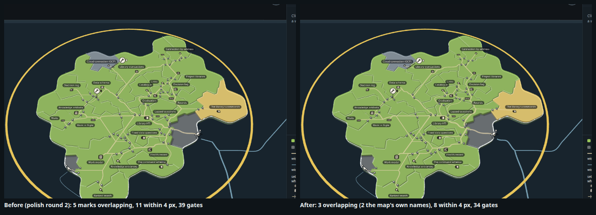
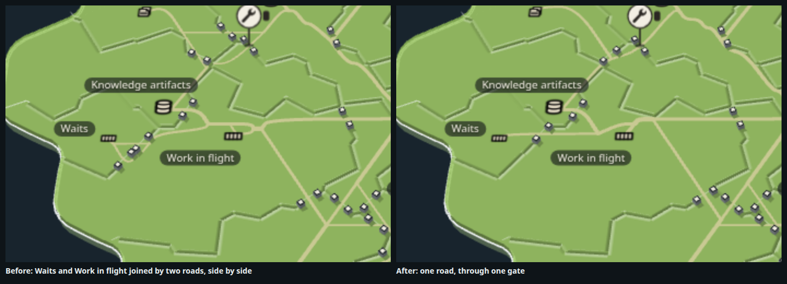
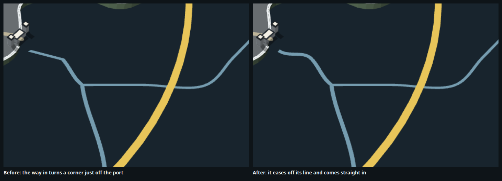
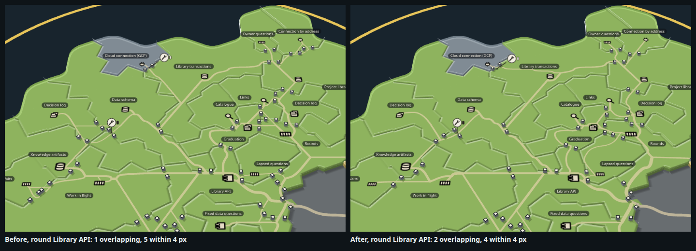
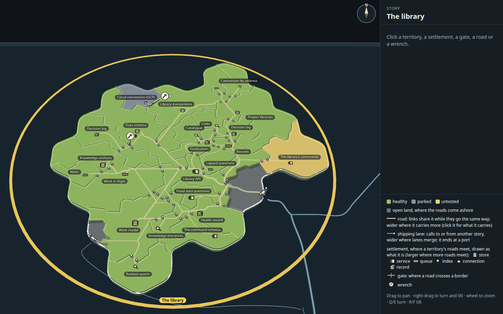
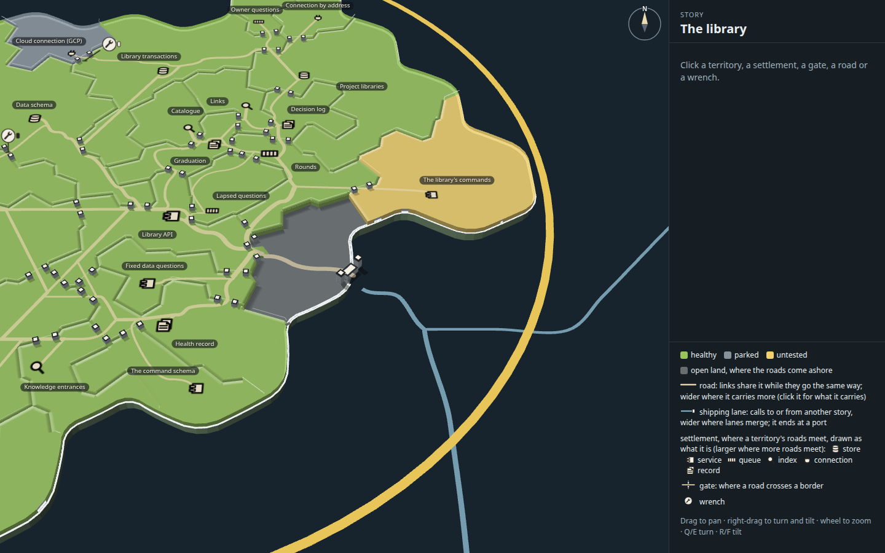
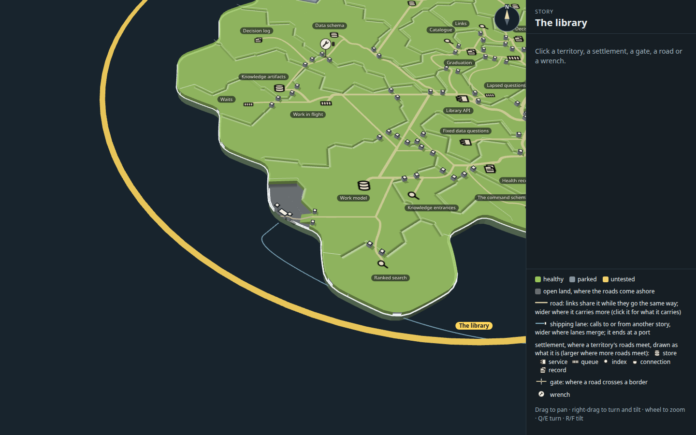
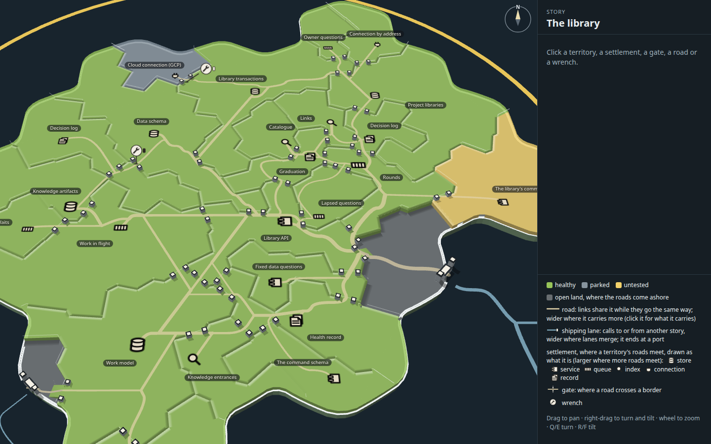
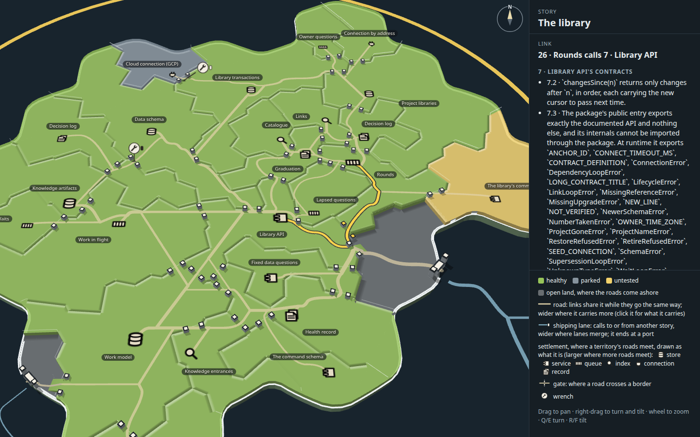
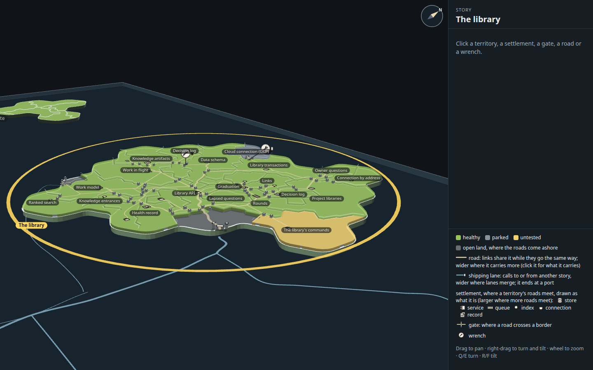

# Capability tree map, polish round 3 of 3: one road between neighbours, gates priced off the names, a smooth way in

Polish round 2 (`../o-polish-2/`, copied whole), polished one round further. A mock only (increment_5a6f05cbb8d2 on
arc_9bbaa3497530): it changes no product code. Everything Mick picked stands as he picked it: the sandy faint roads, the
plateaus, ramps only from open land, standing posts, bevel rims, round 12's flat symbols, round 13's minimum size, shared
entrances and wrench queue, one solid pale sea-blue lane wider only where lanes merge, the port with its two capped towers
and no jetty, and islands 3 units thick.

Like rounds 1 and 2, this round adds no new kind of mark, colour or effect. It takes marks away: five gates and the
roads that ran beside each other to reach them, and the corner in the shipping lane just off the mouth's port.

**Open it:** `index.html`, straight from disk. Each change has a switch that draws it as before: `?pair=0`,
`?gateClear=8`, `?inKink=1`. All three together draw round 2 exactly (the same measures).

## What changed

| Polish round 2 | Polish round 3 |
| --- | --- |
| Two links that crossed the same border, one each way, each had to have its own gate, 6 units from any other link's. So where Waits calls Work in flight and an arrival reaches Waits through Work in flight, two roads ran side by side to two gates whose posts touched; Connection by address had the same pair | **Links whose own gates stand on the same border, between the same two territories, may share one gate, either way through.** The two roads become one road through one gate, the way round 13 already let links into one territory share an entrance. Five gates go (39 to 34) and 69 units of road (1092 to 1023) |
| A gate under a name or beside a settlement cost the road 8 more | **It costs 18.** With fewer gates competing for each border the router has room to move one, and 18 was the best of a sweep from 6 to 30: the gates under The command schema's name and on Cloud connection's symbol move off them |
| The way in from the sea followed the map's lane until it came within 10 units of the mouth's berth, then ran straight onto it: a corner just off the port, the kink round 1 took out of the way out at Keys | **It eases off the lane** (a curve tangent to the lane where it leaves it) **and comes onto the berth straight in from the sea**, as wide as the lane it leaves |

| | |
| --- | --- |
|  |  |

## The measures, at rest

Round 13's page measures, as rounds 1 and 2 took them (`tools/shots.mjs` reads `overlay.ts`'s `crowding` and `stats` at
rest): each name's box, each settlement's symbol, each gate's opening with its posts and each wrench's plate; how many
pairs overlap and how many more stand within 4 pixels, across the island and in the knot (Library API, Links, Catalogue,
Graduation, Rounds, Lapsed questions, Decision log). The numbers are in `stills/before.measures.json` and
`after.measures.json`; the rows between are from `tools/crowd.mjs` with the query shown.

| On the page, at rest | Marks overlapping (island) | Within 4 px | Overlapping (knot) | Within 4 px (knot) | Gates | On the open land's edge | Road drawn | Inside links over a third territory | Road on the coast's edge |
| --- | ---: | ---: | ---: | ---: | ---: | ---: | ---: | ---: | ---: |
| Polish round 2 (as landed, `?pair=0&gateClear=8&inKink=1`) | 5 | 11 | 1 | 5 | 39 | 2 | 1092 | 14 | 0 |
| Shared gates alone (`?gateClear=8`) | 5 | 8 | 2 | 4 | 34 | 2 | 1023 | 14 | 0 |
| Gate price 18 alone (`?pair=0`) | 4 | 10 | 2 | 4 | 39 | 2 | 1126 | 14 | 0 |
| **Both (after; the smooth way in changes none of these)** | **3** | **8** | **2** | **4** | **34** | **2** | **1045** | **14** | **0** |

What they showed:

1. **Of the 3 left, 2 are the map's own names** (Links over Catalogue, Owner questions over Connection by address), which
   the mock cannot move. The third is the gate into Graduation from Library API, which three links share. It stood in
   the same place in round 2, then a hair clear of the name; it now just touches it, and it is the knot's second overlap.
   It is the only border those links can enter Graduation by without crossing a third territory.
2. **Shared gates are what take marks away**: 5 gates, 69 units of road, and the touching pair at Waits. Alone, they let
   the router put a gate under Graduation's name (the price was too low to keep it off once two roads became one).
3. **The price alone does little** (4 overlapping, and more road): with every link still needing its own gate the router
   has few other borders to take. Together, the two take the island from 5 to 3.
4. **The router is touchy, as round 2 found.** Prices either side of 18 swap one overlap for another (14 and 20 also gave
   3; 24 put a gate on Rounds' symbol; 30 gave 7). Every setting with shared gates beat round 2's gate count.
5. **The router reads the names' boxes as the page lays them out**, so on a heavily loaded machine one run caught them
   mid-layout and routed differently (4 overlapping, 1049 road). Re-run, the measures repeat exactly; the kept numbers are
   from runs that agree.

## Tried and dropped

- **A wider name test round a gate** (`gateReach`, from round 2's 3.2 units to 4, 4.5 and 5, rings at full and 0.6 of
  the reach). A gate three links share is wider than 3.2 units each side, so the test seemed to miss the Graduation gate.
  It moved that gate at 4.5, but put another on Rounds' symbol and sent one more link over a third territory; at 5 it
  gave 5 overlapping. Its code is gone.
- **Entrances held 5 or 7 units apart** (round 2 keeps 6) with shared gates, at round 2's gate price: each gave 6 overlapping.
- **A dearer gate (6, 8, 12) or a cheaper shared road (`share` 0.2)** before shared gates: neither moved the gate count
  from 38 to 40. The gates are where the links' own entrances must be, not where the prices put them.

## The stills

| | |
| --- | --- |
|  |  |
| At rest, the whole island | The mouth, close |
|  |  |
| Keys' landfall, close | The Library API knot, close |
|  |  |
| Rounds calls Library API, lit | Turned and tilted nearer level |

The same six views of polish round 2 as landed are `stills/before-*.png`.

## How it was made

Run from the checkout root.

1. `node docs/design/capability-tree-3d/p-polish-3/tools/build.mjs` builds `index.html`, `page.min.js` and `page.css` from the
   real map code (packages/forest's view, on `../h-quiet-roads/data.json`).
2. `node --import tsx docs/design/capability-tree-3d/p-polish-3/tools/shots.mjs <tag> [query] --retake` takes the six
   stills as `stills/<tag>-*.png` and writes the measures at rest to `<tag>.measures.json` (in the capture kit's scratch
   folder without `--retake`).
3. `node --import tsx docs/design/capability-tree-3d/p-polish-3/tools/crowd.mjs '' '?pair=0' …` prints the measures for
   each query, faster, with no stills. `stats.gateList` (new) lists each gate, where it stands, its border and how many
   links it carries, which is how the side-by-side pairs were found.
4. `node --import tsx docs/design/capability-tree-3d/p-polish-3/tools/sheet.mjs --retake` lays the before-and-after sheets.

## Next things to look at

1. **The Graduation gate.** Three links share it and it just touches Graduation's name at rest. Placing a gate at its
   border segment's clearest point, rather than where the lattice step crosses it (round 2's note 2), would slide it clear.
2. **Where three territories meet.** West of Health record, Library API, Work model, Health record and Knowledge entrances
   meet, and six gates stand within a few units of one another. A road that crosses at the meeting point's far side, or a
   price on a gate within a gate's width of another border's, might thin them.
3. **The lit link's detour.** Rounds to Library API now runs down to the junction inside the ramp and back west, sharing
   the arrivals' road; round 2's ran up through Graduation. Neither is direct: the knot leaves Rounds no straight border
   with Library API.
4. **The map's own names** (Links over Catalogue, Owner questions over Connection by address) still collide; the mock
   cannot move them without changing the map's label layout.
5. **Round 2's other next steps** still stand: a leaned wrench at other angles, round 13's sizes against room, a link's
   direction at rest, the panel's selection on the map, and the queue at scale.
