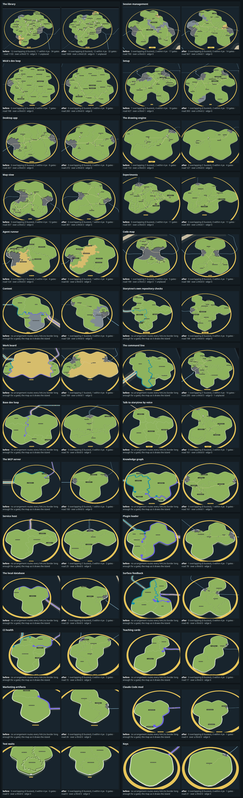
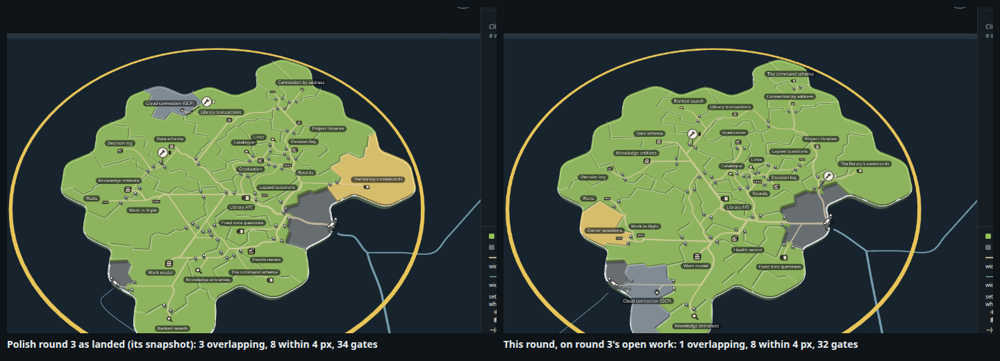
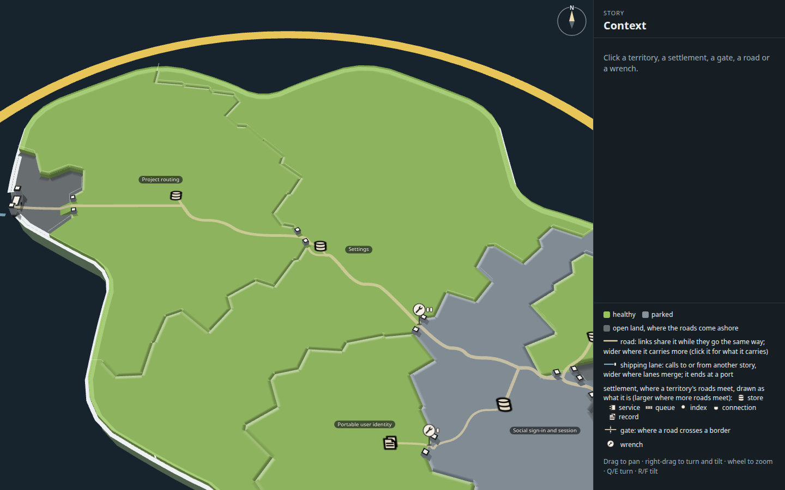
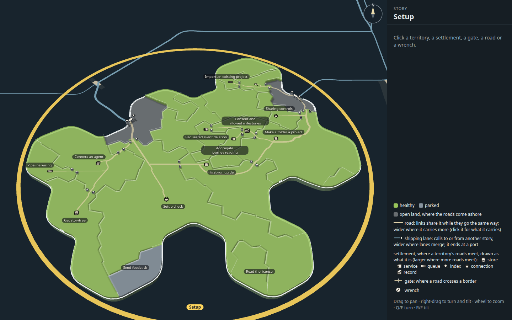
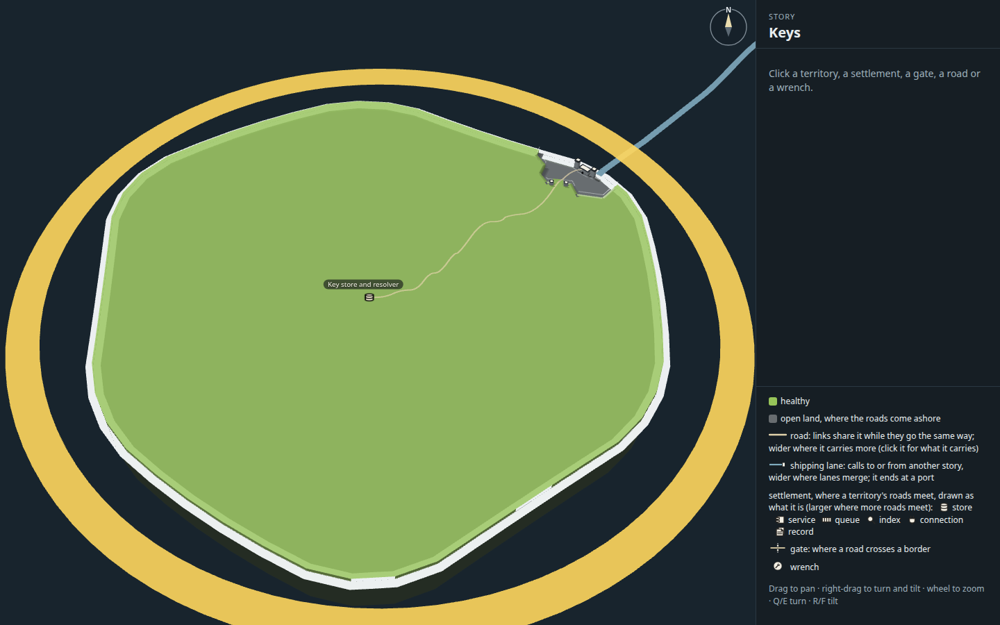
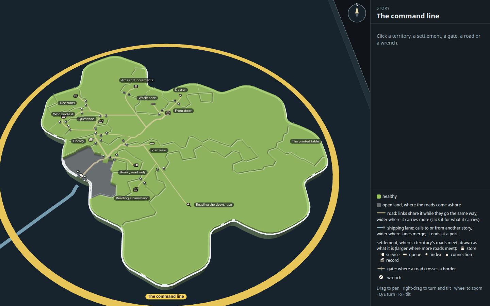

# Capability tree map, rollout 1 of 2: the look checked on every island

Polish round 3 (`../p-polish-3/`, copied whole), drawn on every story's island instead of The library's alone. A mock only
(increment_4dcec77d7833 on arc_9bbaa3497530): it changes no product code. Every round so far was tuned on The library; this
one takes a fresh snapshot of the plan for all 28 stories, draws each island with round 3's look, measures each the way
round 13 did, and fixes what broke in the mock's general rules, never by special-casing an island. Step 2, the build into
the map, starts from this folder.

Everything Mick picked stands as he picked it: the sandy faint roads, the plateaus, ramps only from open land, standing
posts, bevel rims, round 12's flat symbols, round 13's minimum territory size, shared entrances and wrench queue, one solid
pale sea-blue lane wider only where lanes merge and ending just off a port, the port with its two capped towers and no
jetty, islands 3 units thick, and rounds 1 to 3's gate pricing, shared gates and smooth ways in and out. This round adds no
new kind of mark, colour or effect.

**Open it:** `index.html?story=<story id>`, straight from disk (The library with no `story`). Each fix has a switch that
draws round 3's rule instead (below); `?layout=<story id>.before&wrenchClear=names&crowd=0` draws an island as round 3's
rules lay it out, where they lay it out at all.

## What broke, worst first, and how each fix generalises

| What broke | Where | The fix, in the mock's rules | Switch back |
| --- | --- | --- | --- |
| **No arrangement at all.** The map cuts every island into about 260 cells whatever its size, but a gate needs a border segment 4.2 units long and stands 6 from the next: on a small island no border is long enough, so a link cannot get into the territory it calls | 17 of the 28 islands, from Keys (1 capability) to Storytree's own repository checks (10) and Context (5) | **The look is laid out at The library's size and drawn at the island's** (`layout-core.ts`, `islandScale`): the island is scaled by the square root of The library's land over its own, laid out and routed exactly as round 3 lays out The library, and the layer is drawn back at its own size. At rest each island fills the window, so every gate, post, symbol, road and port stands on the page as large as on The library, and its cells give a gate the room they give it there. The library itself is unchanged (scale 1) | layout tool `BEFORE=1` |
| **Marks too big at rest** on the islands that did lay out: their ground sizes were The library's, and a smaller island is framed larger | Map view (1.7 times), Code map, Agent runner | The same fix | the same |
| **A capability with no code has no land**, so its links have no settlement to reach. The map gives land only to code | The command line (7 of 13 capabilities, 24 links), Mick's dev loop (all 18: its code is in the factory), The local database, Claude Code mod | **Every capability holds land** (`withCodeless`): one with no code gets the smallest territory round 13's minimum allows, coloured by its word as the map colours any | layout tool `CODELESS=0` |
| **The page drew no roads** where the layout tool had routed them: the tool searched with round 13's prices, the page routes with polish rounds 2 and 3's (entrances 6 apart, one ramp off the open land, shared gates), and an arrangement could route under one and not the other | The command line | **The search routes with the page's own prices**, so it scores the network the page draws; and **a link with no gate of its own comes in beside another link's entrance** (`crowd`), listed in `stats.crowded`, rather than having no road. No island needs it at the arrangements kept (0 crowded) | `?crowd=0` |
| **Wrenches crowd** as open work grows: the fresh snapshot has 5 open increments on 10 of The library's capabilities (round 3's had 2), and 9 of the island's 12 overlaps under round 3's rules are a wrench's plate on a name, a symbol, a gate or another plate | The library | **A wrench's plate keeps clear of every mark**, not only the names: symbols, gates and the plates already standing; and every gate of its capability (its ways out too) is tried, upright and then leaning, before the nearest is taken as it stands | `?wrenchClear=names` |
| **Ports where the lanes hug the coast.** The map's lanes skim a coast before they dock, and from the dock the map's way inland often rides along the coast or across a bay, so "where the lane comes ashore" read naively gave ports in the wrong places: 5 on Desktop app, where the map docks twice; The library's mouth 32 units from its own | Desktop app, Session management, The library and most others | **Every island meets the sea at a port at each of the map's own docks**, read where the lane climbs from its height at sea to the land's (`docks.ts`), and snapped onto the coast. Docks within a port's width share the busier one's port. Every island reads one or two (Test waits, with no outside links, none): usually one for its arrivals and one for its ways out, as The library's mouth and Keys' landfall, which the reading now finds where round 7 read them by hand (62.7, 33.3 and -51.1, 71.5; round 7: 62.5, 35.5 and -51.7, 70.6) | none: round 3 had no reading |
| **An island's unclaimed code read as open land**: a territory with no capability was taken for no territory, so it drew flat with ramps | any island with code no capability claims | It is its own territory (`UNCLAIMED`), with no links | none |

How the islands meet the sea, decided with the pictures: each island draws a port at each dock the map lands its lanes at,
and only the selected island's (round 1 dropped other islands' ports, and nothing here brings them back). Islands with
many outside links (Desktop app 78, Context 76, The MCP server 54, The command line 63) take them all through one port and
one sandy trunk, as The library's 188 arrivals do: nothing broke there.

## The measures, at rest

Round 13's page measures, as rounds 1 to 3 took them (`tools/islands.mjs` reads `overlay.ts`'s `crowding` and `stats` at
rest): marks overlapping and within 4 pixels across the island and in its busiest part (the settlement most links meet at
and every territory bordering it: on The library, Library API's), gates, road drawn (in the island's own ground units),
inside links over a third territory, road on the coast's edge, and links the layer could not place. Before is round 3's
rules (`?layout=<id>.before&wrenchClear=names&crowd=0`); after is this round's. The numbers are in
`stills/islands/before.measures.json` and `after.measures.json`; the stills, each island at rest and close on its busiest
part, in `stills/islands/before/` and `after/`.

TABLE

### The library against round 3

The fresh snapshot is not round 3's: The library's territories are sized by today's lines of code, its lanes land where the
map now docks them, and it carries 5 open increments to round 3's 2. So it was measured twice: on this snapshot's open work, and
on round 3's (`?work=round3`, round 3's own `open-work.json`), which is the like-for-like comparison.

| The library, at rest | Overlapping | Within 4 px | Knot overlapping | Knot within 4 px | Gates | Road drawn | Over a third | Road on the edge |
| --- | ---: | ---: | ---: | ---: | ---: | ---: | ---: | ---: |
| Polish round 3, as landed (its snapshot) | 3 | 8 | 2 | 4 | 34 | 1045 | 14 | 0 |
| Round 3's rules on this snapshot, round 3's open work | 5 | 8 | 2 | 3 | 34 | 1133 | 15 | 0 |
| **This round, round 3's open work** | **1** | **8** | **1** | **6** | **32** | **993** | **14** | **0** |
| Round 3's rules on this snapshot, today's open work | 12 | 11 | 7 | 4 | 34 | 1133 | 15 | 0 |
| This round, today's open work | LIBNOW |

(The knot is round 13's list: Library API, Links, Catalogue, Graduation, Rounds, Lapsed questions, Decision log.) On round
3's open work every number but one is round 3's or better; the knot's marks within 4 px go from 4 to 6, all pairs of gates
and names standing a few pixels apart rather than overlapping. The one overlap left is a gate under Decision log's name.
On today's open work the wrenches are what overlaps: see the next things to look at.

## Tried and dropped

- **The last place a lane comes ashore** as its dock: on Session management the map's way inland crosses the south bay, so
  the bay's far shore read as two docks with no lane to them.
- **The first place it comes ashore**: lanes skimming a coast before they dock read as docks there (Desktop app's three
  extra ports, The library's mouth 32 units south of its own).
- **The first point on the land after the lane climbs**: on Desktop app the way inland rides just off the coast from the
  east dock to the north-east, so that read the north-east. The dock is where the climb starts, snapped to the coast.
- **The minimum as a share of the land** instead of a cell count: every island is cut into about 260 cells, so 5 cells is
  already the same share everywhere; it changed nothing, and the scale fix is what gives a small island's territory room.
- **The library from round 3's arrangement**, searched under the page's prices (two seeds, 800 steps each): on the page,
  13 marks overlapping and 17 links over a third territory, and 12 overlapping (22 within 4 px) and 12 over a third.
  Searched from round 3's rules' own arrangement instead, it found 8 overlapping and 14 over a third, the one kept
  (`layouts/library-a.json`, `library-b.json`, `library-c.json`, kept as `story_754e87e7d531.json`; `library-search1.json`
  is the 400-step first try, at 20 over a third).

## The stills

| | |
| --- | --- |
|  |  |
| Context's busiest part, close (Settings) | Setup at rest: two ports, at the map's two docks |
|  |  |
| Keys, the smallest, at rest: the look at The library's size on the page | The command line, every capability with land |

Every island's close-up of its busiest part is `stills/islands/after/<story>-busy.png` (and `before/`), laid out in
`stills/contact-busy.png`; each island as the map draws it today is `stills/today/<story>.png`.

## How it was made

Run from the checkout root.

1. `node --import tsx docs/design/capability-tree-3d/q-all-islands/tools/measure.mjs` snapshots the plan, code survey and
   open work for every story into `data.json`; `tools/survey.ts` writes each island's size and links to `survey.json`.
2. `node docs/design/capability-tree-3d/q-all-islands/tools/build.mjs` builds `index.html`, `page.js` and `page.css` from the
   real map code (packages/forest's view) with every arrangement in `layouts/`.
3. `node --import tsx docs/design/capability-tree-3d/q-all-islands/tools/docks.mjs --stills` reads where the map docks each
   island's lanes into `docks.json`, and takes each island as the map draws it today into `stills/today/`.
4. `node docs/design/capability-tree-3d/q-all-islands/tools/lay-all.mjs` runs the layout tool (`tools/layout.ts`) for every
   story into `layouts/<story>.json`; `BEFORE=1` for round 3's rules, into `<story>.before.json`. Build again after.
5. `node --import tsx docs/design/capability-tree-3d/q-all-islands/tools/islands.mjs <tag> [query] --retake` takes every
   island at rest and close on its busiest part, with its measures; `?layout={id}.before&wrenchClear=names&crowd=0` for the
   before. `tools/contact.mjs <name> before after` lays the contact sheets, `tools/table.mjs before after` the table above.

## Next things to look at

1. **The library's wrenches on today's queue.** Ten wrenches on one island leave 7 overlaps on the page even clear of every
   mark they can find; the queue of 5 is real. A wrench that cannot clear might stand off its gate on a short leader, or
   one plate might serve a territory's whole queue where wrenches stand side by side.
2. **Parked territories read close to open land** where both meet (Context's Social sign-in and session, Session
   management's Agent activity log): the map's parked slate and the open land's grey are near each other under the relief.
3. **Two capabilities called "Decision log"** on The library (round 11's note 1) still draw two names the same.
4. **The knot's marks within 4 px** (4 to 6 on round 3's queue): gates standing a few pixels from Decision log's and Rounds'
   names, where round 3's price on a gate under a name stops short of the pixels just beside it.
5. **Step 2 inherits the dock reading**: the map knows its docks (`plan.docks` in forest-world's pathways), so the build
   can take them from there rather than reading them off the lanes.
