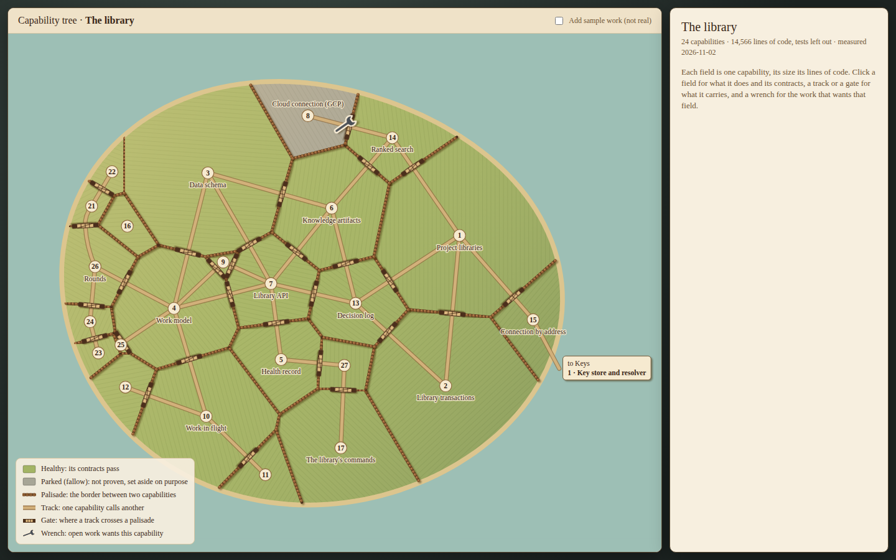

# Capability tree, medieval mock B: timber palisade and farm gates

Each capability of a story is a tended field on the story's island, fenced from its neighbours by a timber palisade, with
packed-earth tracks between the fields that call each other and a plain five-bar farm gate wherever a track crosses a
palisade, flat and top-down in warm late-afternoon light. One of several medieval directions for the capability tree
(question_752b6ef53b90 on arc_9bbaa3497530); a mock only, changing no product code.

**Open it:** `index.html` in any browser, straight from disk; it needs no network. Click a field, a track, a gate, the
road off the island or a wrench; the panel on the right shows what it holds. Clicking the sea goes back to the story.

## What it shows, and what is measured

Every number is the real story "The library" (story_754e87e7d531), snapshotted on 2026-11-02 into `data.json` by
`tools/measure.mjs`, which reads the library and the code survey the map itself uses:

- **A field per capability, its area its lines of code** without tests: the survey's files that each capability owns
  (`packages/map`'s `readCodeSurvey`, summed as `packages/forest/src/render/forest-scene.ts` sums them), 14,566 lines
  over 24 capabilities and none unclaimed. Areas match their shares to within 0.5%.
- **Its colour is its health**, as the map draws it (`packages/forest/src/view/territory-land.ts`): 23 healthy and one,
  8 · Cloud connection (GCP), parked, so drawn fallow.
- **A palisade on every border** between two fields, none on the coast.
- **A track for each link** (`dependsOn`) between two capabilities of the story, 27 of them, and a gate where it
  crosses a palisade. Where two linked fields do not touch (9 of the 27 here), the track runs through a neighbouring
  field and its gates, and the panel says so. A track or gate shows the contracts of the capability that is called. The
  one link to another story, 15 · Connection by address calling Keys' 1 · Key store and resolver, is a road off the east
  coast with a tag; click it for that capability's contracts.
- **A wrench per field that open work names**, on that field's gate (the gate of the track its work goes out on,
  else its busiest gate), however many increments name it. Today one open increment names one of these capabilities:
  increment_dc514c1a7edb (arc "Cloud SQL sign-in, kept in the back pocket") on 8 · Cloud connection (GCP).
- **Sample work, clearly marked:** the box "Add sample work (not real)" adds three made-up increments on two made-up
  arcs, on 17 · The library's commands and 10 · Work in flight, so a wrench shows several arcs. Their wrenches are
  dotted and tagged "sample", the page says they are made up, and their arcs carry a "sample" tag. Nothing else is
  sample.

## Palette

| Meaning | Hex |
| --- | --- |
| Healthy field (meadow) | `#a3b465`, furrows `#7f9148` |
| Unhealthy field (blighted) | `#c4663f`, furrows `#9c4a2b` |
| Proposed or untested field (ripe wheat) | `#e3c25c`, furrows `#c09d3c` |
| Parked field (fallow) | `#a7a596`, furrows `#858374` |
| Palisade logs, tops, base | `#8a5a30`, `#b98250`, `#4b2f1a` |
| Track, its edge | `#d2b07a`, `#8f6b3f` |
| Gate leaf | `#e0bb82` |
| Wrench | `#4a4f57`, outline `#fff3dc` |
| Sea, shore | `#9dbfb5`, `#dcc58e` |
| Ink, paper | `#3a2716`, `#f7efdf` |

Only healthy and parked appear on this island, so the legend lists only those two; the others keep the map's meanings,
told apart by hue. The furrows run at a different angle in each field, so neighbours read as a patchwork; they carry
no meaning beyond "a field". The light comes from the west: warm on the left, cooler to the east, with shadows cast to
the south-east.

## Stills

- `stills/resting.png`: nothing picked.
- `stills/wrench-arcs.png`: the wrench's arcs and increments open.
- `stills/gate-contracts.png`: a gate three tracks pass through, with each track's carried contracts.
- `stills/field.png`: a field's description and contracts.
- `stills/sample-wrench-arcs.png`: with sample work on, a wrench whose field two arcs want.

## Remaking it

From the checkout root:

1. `node --import tsx docs/design/capability-tree-medieval/b-palisade/tools/measure.mjs` re-measures `data.json`
   (it reads the library this checkout names).
2. `node docs/design/capability-tree-medieval/b-palisade/tools/layout.mjs` lays the fields out (a power diagram tuned to
   the areas, the best of 40 seeded starts by how many linked fields touch) and writes the data into `index.html`.
3. `node docs/design/capability-tree-medieval/b-palisade/tools/shots.mjs` captures the stills.
