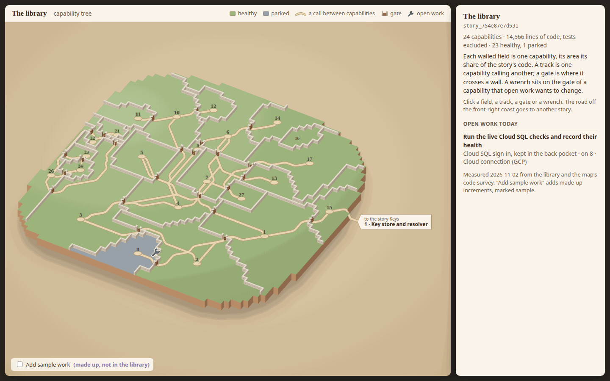

# Capability tree, medieval mock E: a tabletop island diorama

The story is a small clay island standing on a table, seen from a gentle three-quarter view: each capability is a flat
walled field on it, low drystone walls run between the fields, and a chunky wooden gate stands open wherever a track
crosses a wall. One of several medieval directions for the capability tree (question_752b6ef53b90 on
arc_9bbaa3497530); a mock only, changing no product code.

**Open it:** `index.html` in any browser, straight from disk; it needs no network. Click a field, a track, a gate,
the road off the island or a wrench; the panel on the right shows what it holds. Clicking the table goes back to the
story. It is drawn at the size of the story detail panel's tree space beside a 352-pixel panel, in a 1440 × 900 window.

## What it shows, and what is measured

Every number is the real story "The library" (story_754e87e7d531), snapshotted on 2026-11-02 into `data.json` by
`tools/measure.mjs`, which reads the library and the code survey the map itself uses (`packages/map`'s
`readCodeSurvey`, each capability's files' lines summed as `packages/forest/src/render/forest-scene.ts` sums them):

- **A field per capability, its area its lines of code** without tests: 14,566 lines over 24 capabilities, none
  unclaimed. The island is 2,806 square tiles. Each field is grown, as one connected piece, from a seed to its share
  of the tiles, then evened out tile by tile. Every field but the smallest is within 10% of its share; the furthest off
  are 17 · The library's commands, 9% over, and 1 · Project libraries, 5% under. The smallest, 25 · Lapsed questions
  (12 lines), is rounded up to three tiles so it can still hold its number and a gate, which draws it 30% large. `window.mock.layout()` in the page's console
  prints each share wanted and drawn.
- **Its colour is its health**, as the map draws it (`packages/forest/src/view/territory-land.ts`): 23 healthy and
  one, 8 · Cloud connection (GCP), parked, so drawn in parked's slate. Height carries no meaning: every field lies at
  one level (ADR-0804 D1).
- **A drystone wall on every border** between two fields, none on the coast; the clay edge is the coast.
- **A track for each link** (`dependsOn`) between two of the story's capabilities, 27 of them, and an open gate where
  a track crosses a wall (25 gates; tracks between the same two fields share one). Linked capabilities are seeded next
  to each other, so 19 of the 27 links are neighbours; for the other 8 the track runs through a field between, and its
  gates, and the panel says so. A track or a gate shows the contracts of the capability that is called. The one link
  to another story, 15 · Connection by address calling Keys' 1 · Key store and resolver, is a road down the clay edge
  onto the table, ending in a paper tag; click it for that capability's contracts.
- **A wrench per field that open work names**, floating over that field's gate (the gate its own outgoing track
  leaves by, else its busiest gate), however many increments name it. Today one open increment names one of these
  capabilities: increment_dc514c1a7edb ("Run the live Cloud SQL checks and record their health", arc "Cloud SQL
  sign-in, kept in the back pocket") on 8 · Cloud connection (GCP). Clicking the wrench lists the arc and its
  increment.
- **Sample work, clearly marked:** the box "Add sample work (made up, not in the library)" adds three made-up
  increments on two made-up arcs, on 10 · Work in flight (both arcs, so one wrench lists two) and 14 · Ranked
  search. Their wrenches have a dotted purple ring and a "sample" tag, and every sample arc and increment in the
  panel carries a "sample" tag. Nothing else is sample.
- **Clicking a field** shows its description, lines and share, the capabilities it calls and is called by, and its
  contracts, as the panel does today.

The legend lists only what appears: healthy, parked, a track, a gate, a wrench. Unhealthy and proposed or untested keep
their own colours (below), so every health meaning stays told apart at the resting view.

## Palette

Matte clay colours, lit softly from the upper left.

| Meaning | Hex |
| --- | --- |
| Healthy field | `#9cb47a` |
| Unhealthy field | `#c8735b` |
| Proposed or untested field | `#e0bf66` |
| Parked field | `#96a1a7` |
| Drystone wall: top, lit face, shaded face, mortar course | `#e6ddd0`, `#c9bcab`, `#a89a88`, `#8f8172` |
| Gate leaves, their planks | `#9a6a42`, `#6e4a2d` |
| Track, its edge | `#e9d7b3`, `#b99d72` |
| Picked track | `#b4652a` |
| Clay edge: lit, shaded | `#b98d68`, `#8f6a4c` |
| Wrench, its rim | `#59626c`, `#fff6e4` |
| Sample marking | `#8a6fb0` |
| Table | `#e2d0b2` to `#c9b28e` |
| Ink, paper | `#3b2e24`, `#faf4ea` |

No file dots, trees, buildings or people. The only things on the island are fields, walls, gates, tracks, each
field's number on a small paved yard where its tracks meet, and wrenches.

## Stills

- `stills/resting.png`: nothing picked.
- `stills/wrench-arcs.png`: the real wrench, on 8 · Cloud connection (GCP), with its arc and increment open.
- `stills/sample-wrench-arcs.png`: with sample work added, 10 · Work in flight's one wrench listing two arcs.
- `stills/pathway-contracts.png`: the track from 2 · Library transactions to 1 · Project libraries, lit, with the
  29 contracts it carries.
- `stills/gate-contracts.png`: the gate most tracks pass, with its four tracks lit and each one's contracts.
- `stills/territory.png`: 4 · Work model picked, with its description and contracts.
- `stills/road-to-keys.png`: the road off the island, with Keys' 1 · Key store and resolver's contracts.

## Reopening and remaking

From the checkout root:

1. `node --import tsx docs/design/capability-tree-medieval/e-diorama/tools/measure.mjs` measures the story again into
   `data.json` (it needs the library, as `pnpm storytree` does).
2. `node docs/design/capability-tree-medieval/e-diorama/tools/embed.mjs` copies `data.json` into the page, so it
   opens from disk with no fetch.
3. `node docs/design/capability-tree-medieval/e-diorama/tools/shots.mjs` takes the stills again, and fails on any
   page error. The stills were then cut to 256 colours with Pillow (`Image.quantize(256, method=FASTOCTREE,
   dither=FLOYDSTEINBERG)`) to keep them small.

The layout is worked out in the page from the data each time it opens, with no randomness, so the same data always
draws the same island.
