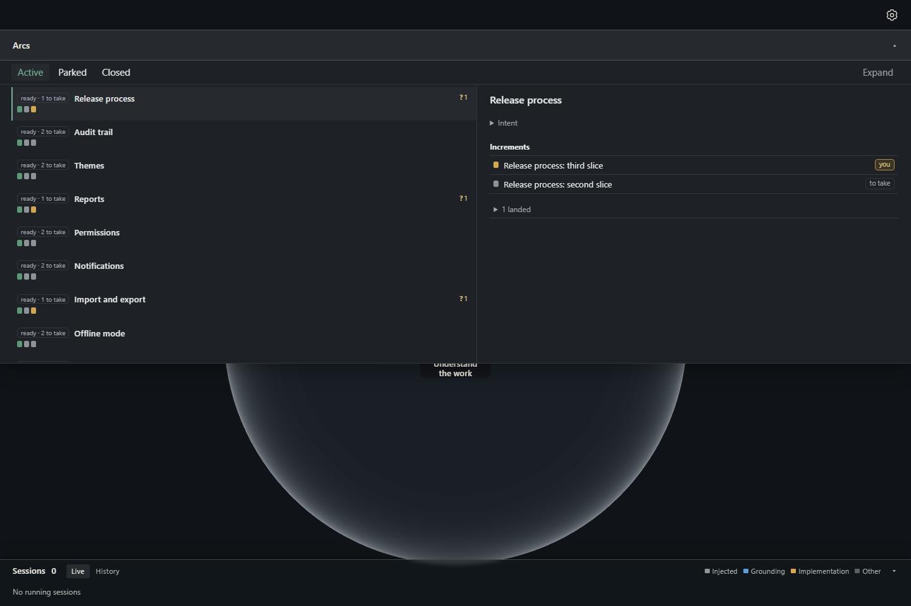
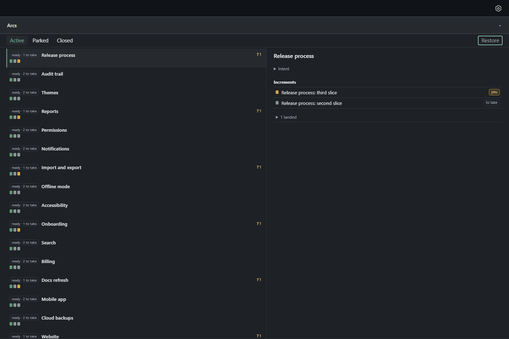
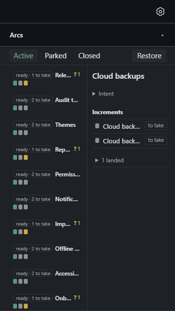

# The Arcs drawer expands to fill the window and restores — arc surface 3.10, ADR-1002 D3

The open Arcs drawer carries a control, at its top right, that reads **Expand**. Pressed, the drawer fills
the window below the two bars (the app's 48 px gear bar and the 48 px Arcs bar), over the forest pane and
the Sessions strip, and the control reads **Restore**; pressed again, the drawer returns to half the
window's height. The choice is kept per project in the page's storage. Everything here is the actual
desktop renderer, captured unedited in headless Chromium 148 over an isolated Postgres holding an
explicit fixture (16 arcs, so the board has more rows than the half-height drawer shows). Dark theme,
1x scale. Nothing in the owner's library or running app is opened or changed. **The owner has not accepted
the look.**

- [Half height, 1440 × 960](drawer-half.png) — the control reads Expand
- [Expanded, 1440 × 960](drawer-expanded.png) — Restore, focused from the keyboard
- [Expanded, 360 × 640](drawer-expanded-narrow.png)
- [Half height, 360 × 640](drawer-half-narrow.png)
- [Every measured box](capture.json)





## What the capture proves

Geometry happy-dom cannot measure, on the real renderer (`capture.mjs`):

- **Half height.** The drawer is 1440 × 480 at y = 96 (the Arcs bar's bottom edge). The control lies
  inside it at the top right (x 1353.75–1422, y 101–127.5), on the row the scope buttons start, clear of
  all three (they end at x = 216), and not on the Arcs bar; a click at the bar's right end
  (`x = barWidth − 20`) still closes the drawer and one at its left end opens it.
- **Expanded.** The drawer is 1440 × 864 at y = 96, reaching y = 960, the window's foot. The control
  reads Restore and keeps focus when pressed with the keyboard (Enter to expand, Space to restore).
  `elementFromPoint` at the Sessions strip's centre (y ≈ 923), at its top edge and at 4 px above the
  window's foot all return elements inside `#arc-drawer`; clicks there give the forest canvas no pointer
  event and leave the strip as it was. The gear (36 × 36 at the top right) still opens the app menu. The
  board's panes run to the drawer's foot (825.5 px high, from 442 at half height) and the lanes pane
  scrolls inside; the page itself does not (`scrollHeight` 960 = `innerHeight`).
- **Escape and reload.** Escape closes the expanded drawer and returns focus to the bar; opened again it
  is still expanded; after `page.reload()` it opens expanded; Restore returns it to 480 px, and a second
  reload opens it at 480 px.
- **360 × 640.** Half height is 360 × 320; expanded is 360 × 544 (y 96 to 640). The control (about 69 × 26
  px) stays inside the window, off the bar and clear of the scope buttons at both sizes; the gear is
  reachable and the page does not scroll.
- Zero page errors, and the library's history is unchanged: the interactions write nothing.

[red.txt](red.txt): with the height removed from `.arc-overlay[data-expanded=true]` the capture fails
on "expanded, the drawer reaches the window's bottom edge (576 of 960)"; restored, it passes.

## Principles judged by

- **Legible at the resting view** (`principle_1e3418812c33`). A first take set the control at 12 px
  (the stylesheet's `font: inherit` rule is more specific than `.arc-scopes button`, so the scope buttons
  read at 16 px while the control, set at .75rem, read at 12 px beside them), too small and quiet to read as
  a button. It now takes the scope buttons' size and padding, and sits on their row (top 5 px, 26.5 px
  high), so it reads as one of the drawer's controls at both viewports.
- **The resting view is designed, not fitted** (`principle_43ea5d4f68c4`). Expanded, the lanes and the
  briefing fill the new height and scroll inside it, so none of the 864 px is an empty band; the briefing
  pane, which has only a short body for the selected arc, shows empty space beneath it. That is the
  content, not a layout fault; a longer briefing scrolls in its own pane. Half height is unchanged.
- **Meaning outranks appearance.** The control is a native button whose text names what pressing it does
  (Expand / Restore), and the Arcs bar's own open/close name and both-ends click are untouched.

## Reproduce

```sh
node apps/desktop/build.mjs
node --import tsx packages/arc-surface/evidence/drawer-expand/capture.mjs --retake
```

Without `--retake` the pictures and `capture.json` go to a scratch folder. `CAPTURE_PLAYWRIGHT` and
`CAPTURE_CHROMIUM` name other Playwright or Chromium installs by path.
