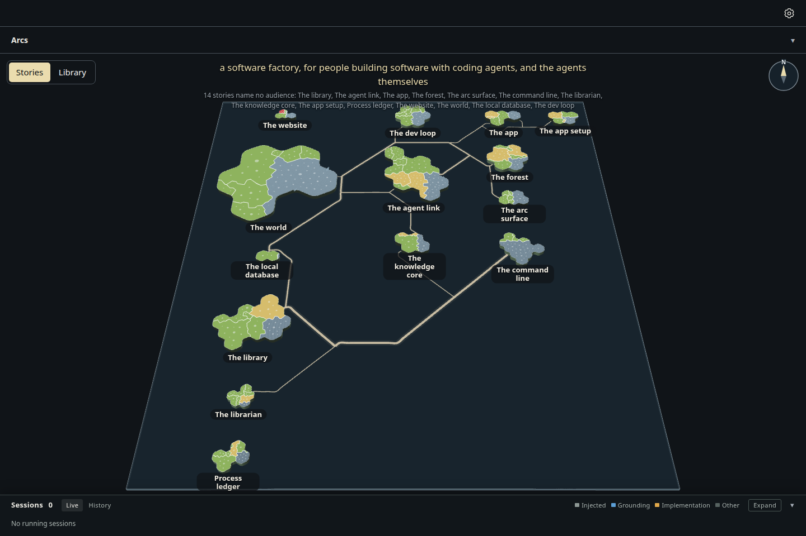
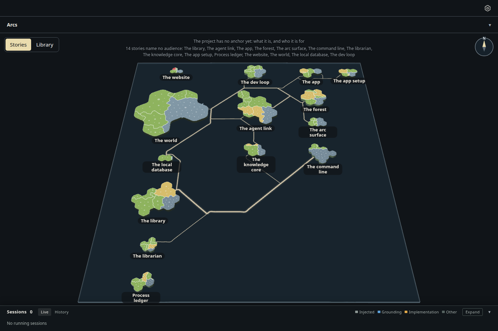

# The map's anchor line (3.67, ADR-1085 D1)

The project's sentence, what it is and who it is for, now sits at the top of the map, above the plan it governs.
Under it, quieter, the map says what the plan has not said yet: an anchor half not written, and each story that
names no audience. It is a reading, never a failure; filling the words in removes the line.

Captured on the actual desktop page with the rows capture's build, seed and survey
(`node ../rows/build.mjs <checkout> after-anchor`, then `node --import tsx capture.mjs after-anchor --retake`),
1440 × 960, headless Chromium on SwiftShader. The seed's tree is given storytree's anchor (ADR-1085 D2) for the
first shot, and none for the second; its 14 stories (the seed's age) name no audience, as storytree's do today.
No page errors in either shot.

| | the anchor said | no anchor yet |
|---|---|---|
| top line | "a software factory, for people building software with coding agents, and the agents themselves" | "The project has no anchor yet: what it is, and who it is for" |
| beneath it | 14 stories name no audience, by name | the same |
| picture |  |  |
