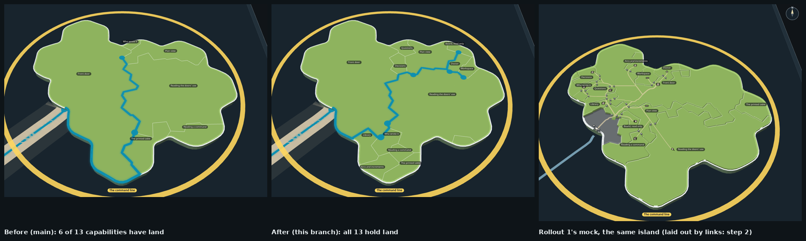

# Every capability holds land (rollout 2, step 1; ADR-1236 D1)

The command line's island at rest, selected, drawn by the real map code: before (main), 7 of its 13 capabilities have
no code yet and so no territory; after (this branch), each holds land, the codeless ones the least a territory holds
(round 13's minimum, 5 of 246 cells, which on the map's own 120-cell cut is 2). The third picture is rollout 1's mock of
the same island (`docs/design/capability-tree-3d/q-all-islands/stills/islands/after/`), whose layout by links is step 2.

Taken with rollout 1's kit, which bundles packages/forest's view on its snapshot: `node docs/design/capability-tree-3d/q-all-islands/tools/build.mjs`,
then `node --import tsx docs/design/capability-tree-3d/q-all-islands/tools/docks.mjs --stills story_f9fb5136c28f` (the
`?real&layout=today` view), on main and on this branch.

