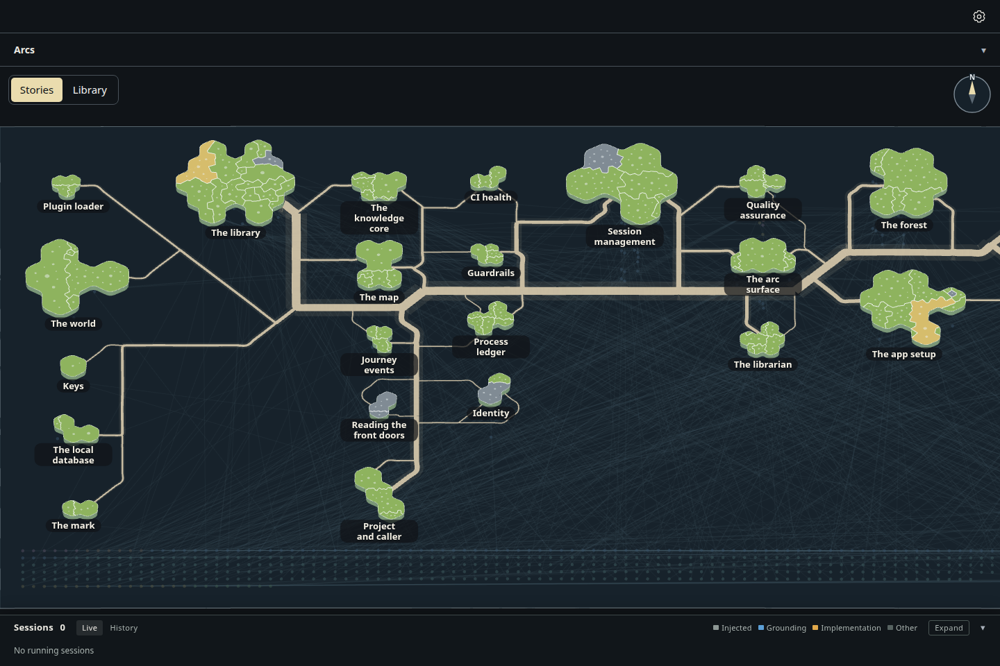
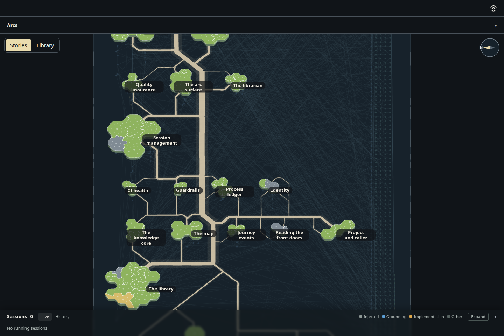
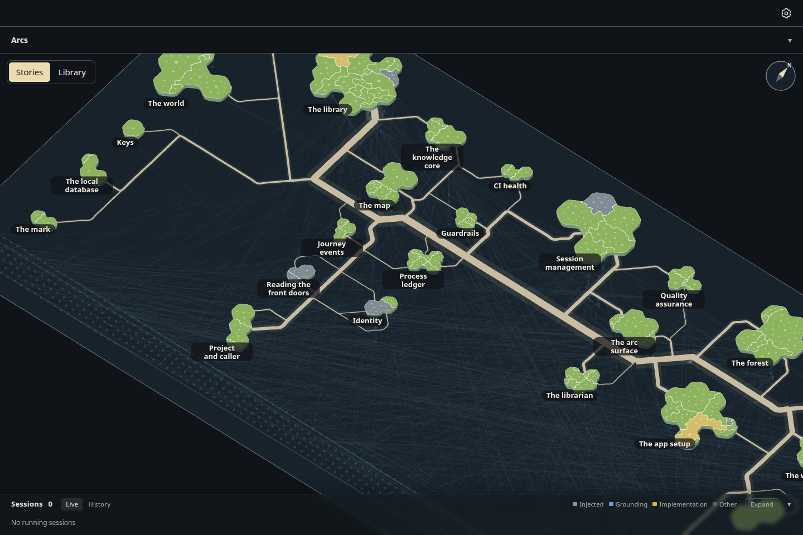
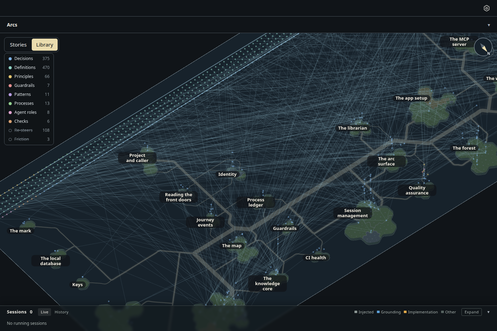
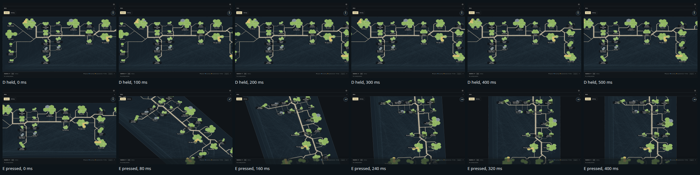

# The glass sheet moved by drag and the keys, spun about its upright axis, with a compass home

Increment `increment_f9d799c44ac5`, arc `arc_87529c1ba43b`, decision ADR-1060 (narrowing ADR-1043 D4 and ADR-1059 D1).
The owner asked for WASD or the arrows to move around, keeping a way to rotate, and took the usual practice: drag and the
keys move you, rotation is on its own keys and buttons, and nothing switches what a drag does.

- **Pan** (D1): a left-drag (one finger on touch), a sideways scroll, and WASD or the arrow keys, held to pan smoothly at
  600 window pixels a second whatever the zoom. W is always away from you, whatever way the sheet faces.
- **Spin** (D2): Q turns the sheet a quarter turn anticlockwise on the window, E clockwise, eased over 0.35 s (at once with
  reduced motion); a right-drag or a Ctrl+drag spins it smoothly, 0.3° per pixel across the window; two fingers twist it on
  touch. It spins about the place in the middle of the view, and never changes the 40° tilt or the zoom.
- **Compass** (D3): in the top right corner, where the globe's mini globe was, its needle points to the sheet's starting
  north on the window. A click on it, or Home, spins the sheet back the short way round and eases to the opening view.
- **Turn** (D4): the Stories and Library buttons, and the key **T**. The heading holds across the turn.

Drawn by the actual desktop page, 1440 × 960, dark theme, headless Chromium, from the same read-only snapshot of storytree's
own library as `../glass-sheet-tilt/` (27 stories). Every move is a real key press or a real right-drag of the mouse.

| At rest | After Q |
| --- | --- |
|  |  |

| A right-drag to an odd heading, compass showing it | Then T: the underside, the heading held |
| --- | --- |
|  |  |

Frame sequences, the page's clock held and stepped: D held for half a second (top), and E pressed (bottom).

`sheet-home.png` is the view after Home from a Q spin: the same as the rest view.

## Measured (`measurements.json`)

| View | Facing (cos of the tilt) | Zoom (px per unit) | Compass north (° from the window's right) | Islands on screen |
| --- | --- | --- | --- | --- |
| At rest | 0.766 | 1.043 | 90 | 21 |
| After Q | 0.765 | 1.043 | 180 | 14 |
| After Home | 0.766 | 1.043 | 90 | 21 |
| Right-dragged | 0.767 | 1.043 | 51 | 21 |
| Turned over (T) | -0.767 | 1.043 | -51 | 21 |

The capture asserts: Q keeps the tilt and zoom, turns the compass a quarter and the sheet anticlockwise; Home puts every
island back where it opened, within 1.5 px; the right-drag keeps the tilt and reaches an odd heading; T turns the spun sheet
over to the Library face at the tilt, its compass mirrored about the window's horizontal line; and the page logs no error.

Re-take, from the checkout root, in the foreground:

    node packages/dev-loop/src/heavy-lock.mjs -- node --import tsx packages/forest/src/view/evidence/glass-sheet-spin/capture.mjs <seed folder> --retake
