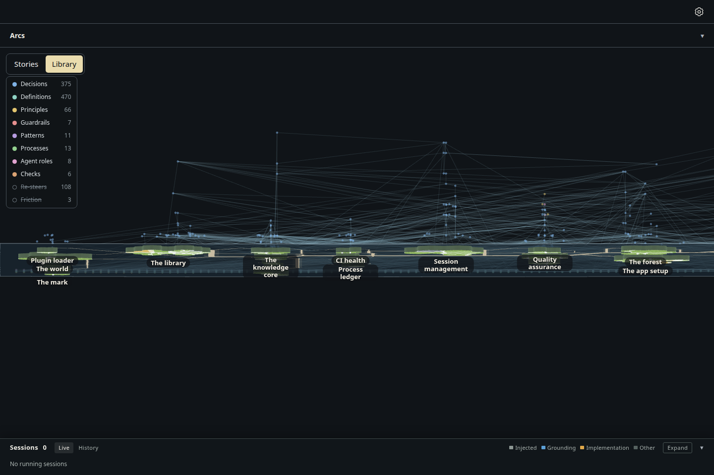
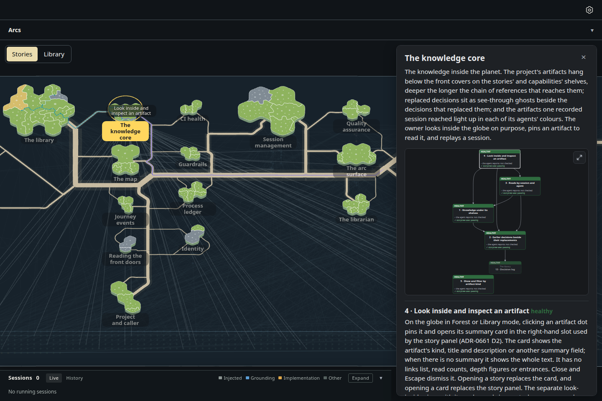

# The glass sheet at a fixed tabletop tilt, with thick land and the knowledge graph hanging below

Increment `increment_a90998ba85f2`, arc `arc_87529c1ba43b`, decision ADR-1059 (narrowing ADR-1043 D4). The owner saw the
built sheet as flat ("a glass thats not 3d that flips and showes the memory graph as a 2d surface"): the eye looked straight
down, the land was flat to 0.02 units and the graph's depth ran along the line of sight. Now:

- **One fixed tilt, 40°** from looking straight down, on both faces (D1). The edge at the window's top lies away from the
  eye; turned over, the sheet rests at the same tilt from the other side. Pan (drag, sideways scroll), the wheel's zoom and
  the turn are still the only controls, and none of them changes the tilt. The opening view and Home still frame the sheet's
  height from its west edge; north-south is drawn shortened by cos 40°, so the resting zoom rises from 0.799 to 1.043 pixels
  per ground unit.
- **Every island is a raised plate 9 units thick** (D2), its sides shaded lighter where they face the eye, standing on the
  glass; the roads ride on the glass between them. One thickness for all, so height stays free for a signal.
- **The knowledge graph hangs below the glass** (D3): each computed depth 20 units below the one above it (was 7), so at the
  tilt deeper notes are seen hanging lower under their island, with the faint links drawn in that depth. From the top face
  it shows faintly through the glass; on the underside it hangs toward the eye, which at the tilt is up the window, toward
  the pool along the south edge.

Drawn by the actual desktop page, 1440 × 960, dark theme, headless Chromium, from the same read-only snapshot of storytree's
own library as `../glass-sheet-turn/` (27 stories; branch `spike/glass-sheet`'s `seed.json.gz` and `survey.json`, kept out of
the repository for its size). Every turn is a real button press and the selection a real click. The app's teaching cards
are hidden by the capture: they sit over the sheet and are not the subject.

| Top face, at rest | Before: top-down (`../glass-sheet-turn/`) |
| --- | --- |
|  |  |

| Underside, at rest | Before: top-down underside |
| --- | --- |
|  |  |

Mid-turn, the page's clock held where the eased turn stands nearly edge-on: the islands' plates on the glass, and the graph
hanging beneath them.

| The knowledge core selected, top face | The same selection, turned over |
| --- | --- |
|  |  |

## Measured (`measurements.json`)

| View | Facing (cos of the tilt) | Zoom (px per unit) | Notes | In the pool | Links (quiet / lit) | Names shown |
| --- | --- | --- | --- | --- | --- | --- |
| Top face | 0.766 | 1.043 | 956 | 661 | 1003 / 0 | 27 |
| Mid-turn | 0.074 | 1.043 | | | | |
| Underside | -0.766 | 1.043 | 956 | 661 | 1003 / 0 | 27 |
| Top, selected | 0.766 | 1.043 | 956 | 661 | 944 / 59 | 27 |
| Underside, selected | -0.766 | 1.043 | 956 | 661 | 944 / 59 | 27 |

The capture asserts: the sheet opens on its top face at the tilt, every island keeps its place west to east across the turn
(within a pixel), every pair of islands on screen changes places north to south, the pool lies beyond every island toward the
south edge (the top of the window on the underside), and the selected story is still selected, lit, after the turn.

Seen in the pictures and left for the owner's feedback: on the underside the deepest notes under the southern islands reach
up the window toward the pool, and the links are many (1003 in this snapshot); ADR-1043 D5 makes them a one-line switch off.

Re-take, from the checkout root, in the foreground:

    node packages/dev-loop/src/heavy-lock.mjs -- node --import tsx packages/forest/src/view/evidence/glass-sheet-tilt/capture.mjs <seed folder> --retake
