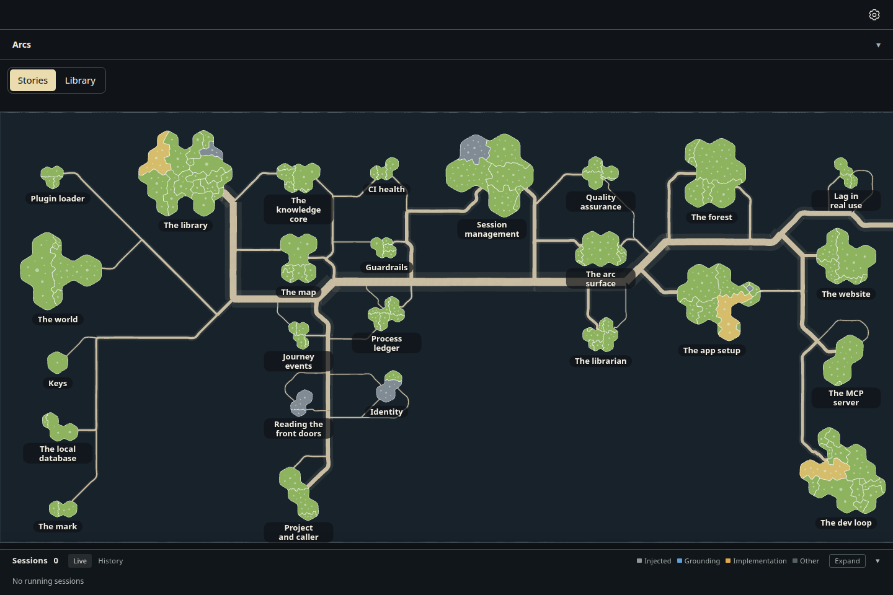
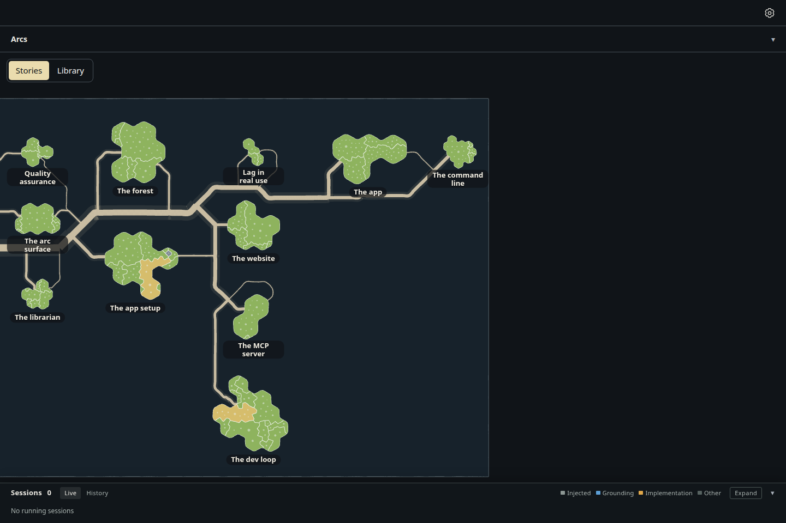
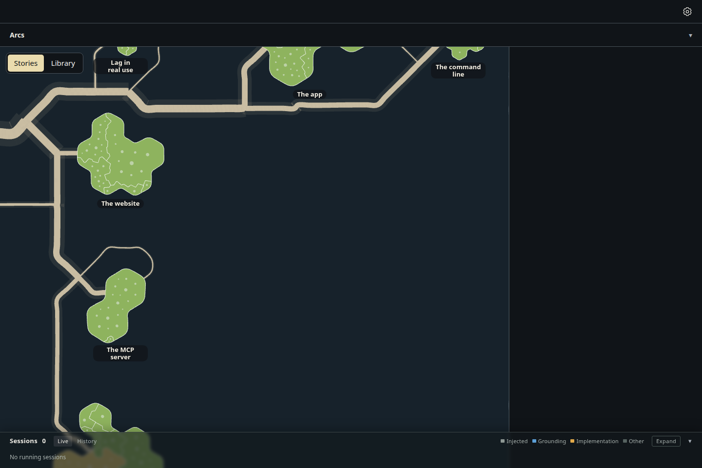

# The forest on a glass sheet: the top face

Increment `increment_5e1d982b32a6`, arc `arc_87529c1ba43b`, decision ADR-1043 (D1, D2, D4). The forest page now draws
its stories on a flat sheet of glass, in place of the globe: dependency depth runs west to east, the stories of one depth
spread north to south, and the only controls are a pan (a drag, or a sideways scroll) and the wheel's zoom. Home returns to
the opening view. The mini globe is gone from the sheet.

Drawn by the actual desktop page, 1440 × 960, dark theme, headless Chromium, from the spike's read-only snapshot of
storytree's own library (27 stories, 142 capabilities; branch `spike/glass-sheet`, its `seed.json.gz` and `survey.json`).

| Today's globe (the spike's picture, same snapshot) | The glass sheet at rest |
| --- | --- |
|  |  |

| Dragged and scrolled east | Zoomed in by the wheel |
| --- | --- |
|  |  |

## Measured (`measurements.json`)

| View | Px per ground unit | Islands on screen | Median island across | Names shown | Least facing (cos) |
| --- | --- | --- | --- | --- | --- |
| Globe, front (spike) | 1.223 | 24 face the eye, 1 square-on | 51.8 px | 22 / 27 | — |
| Sheet at rest | 0.920 | 25 / 27 | 60.3 px | 25 / 27 | 0.99998 |
| Scrolled east | 0.920 | 11 / 27 | 60.3 px | 11 | 0.99996 |
| Zoomed in | 1.703 | 2 / 27 | 111.6 px | 5 | 0.99996 |
| After Home | 0.920 | 25 / 27 | 60.3 px | 25 / 27 | 0.99998 |

The resting zoom frames the sheet's height (clear of the Sessions strip) from its west edge; the two easternmost stories
lie past the window's right, a scroll away. Every island stays within a degree of square-on wherever the sheet is
panned. The capture asserts each step: a 500 px drag moves every island 500 px, a sideways scroll pans, the wheel zooms,
and Home puts every island back within a pixel of where it opened.

## While the underside is still to come

The Library's notes are still drawn inside the globe, so switching the Library on shows the globe as before, and off again
shows the sheet. The next increment on the arc turns the sheet over to the knowledge graph beneath and replaces the
switch with the turn (ADR-1043 D3, D5).

## How to reproduce

From the checkout root, in the foreground, with a folder holding the snapshot (`seed.json.gz`, `survey.json`):

```sh
node packages/dev-loop/src/heavy-lock.mjs -- node --import tsx packages/forest/src/view/evidence/glass-sheet-top/capture.mjs <folder> --retake
```
