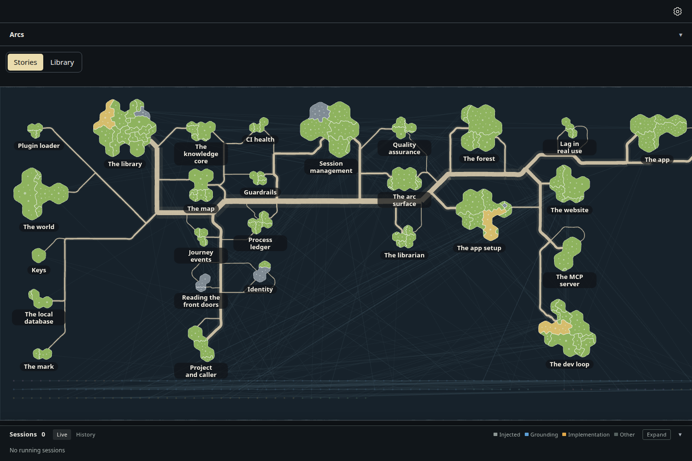
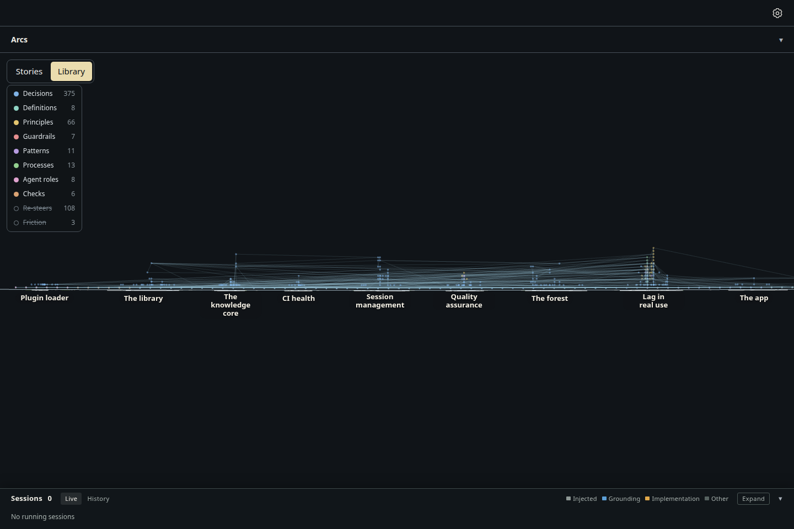
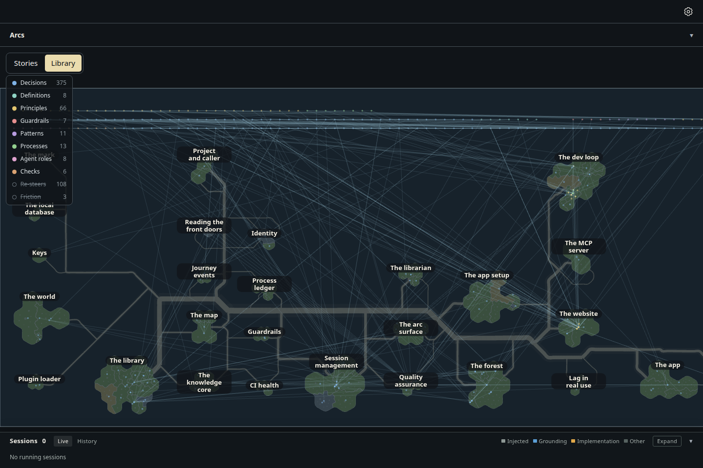
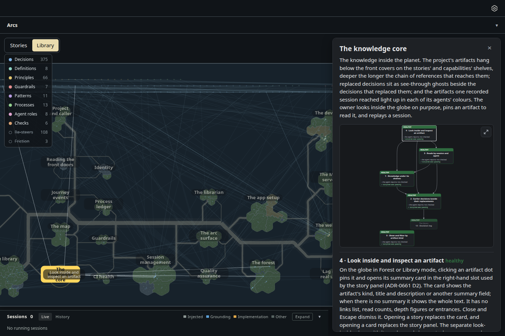
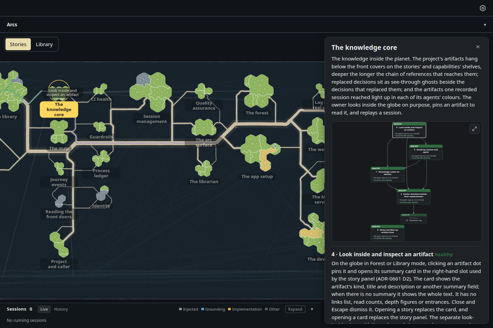

# The glass sheet turns over to the knowledge graph beneath

Increment `increment_19e7395041b6`, arc `arc_87529c1ba43b`, decision ADR-1043 (D3, D4, D5). The forest page's Stories and
Library buttons are now the glass sheet's two faces, one pressed at a time. Pressing Library turns the sheet over north to
south, about its west-east line through the middle of the view, passing edge-on in 0.9 s (at once with reduced motion). The
underside shows the knowledge graph: each story's notes hang under its island, a capability's under its territory, one step
deeper per computed depth; notes on no shelf lie in a pool along the south edge; the links between notes are faint lines.
Depth still runs west to east; north and south change places. A selected story stays selected, and its notes and links are
lit while the rest go quieter, on both faces. Pan, zoom and the turn are the only controls.

Drawn by the actual desktop page, 1440 × 960, dark theme, headless Chromium, from the same read-only snapshot of storytree's
own library as the top face's evidence (27 stories, 142 capabilities; branch `spike/glass-sheet`, its `seed.json.gz` and
`survey.json`, kept out of the repository for its size). Every turn is a real button press and the selection a real click.

| Top face | Edge-on, half way through the turn |
| --- | --- |
|  |  |

| Underside | Underside, The knowledge core selected |
| --- | --- |
|  |  |

The top face with the same selection: 

## Measured (`measurements.json`)

| View | Facing | Notes hung | In the pool | Links (quiet / lit) | Quieter notes | Names shown |
| --- | --- | --- | --- | --- | --- | --- |
| Top face | 1 | 295 | 199 | 541 / 0 | 0 | 27 |
| Edge-on | 0.001 | | | | | |
| Underside | -1 | 295 | 199 | 541 / 0 | 0 | 27 |
| Top, selected | 1 | 295 | 199 | 527 / 14 | 481 | 27 |
| Underside, selected | -1 | 295 | 199 | 527 / 14 | 481 | 27 |

The capture asserts: every island keeps its place west to east across the turn (within a pixel), every pair of islands
on screen changes places north to south, the pool lies beyond every shelf toward the south edge (the top of the window on
the underside), and the selected story is still selected, lit, after the turn.

The pool needs room, so the glass runs on 90 ground units past the southernmost island: the resting zoom drops from 0.920
to 0.799 pixels per ground unit against the top face's own evidence.

## What this build settled, of what ADR-1043 left open

- **The four switch combinations do not survive on the forest page.** The turn replaces them outright: one face at a time,
  no "both off" and no islands hidden over the notes (ADR-1002's switches stay for globe hosts, the website's tour).
- **The top face sees through to the underside, faintly.** The graph and its links show dimmed by the glass between the
  islands, and an island facing the eye hides the notes beneath it (ADR-0919 D2, its depth layer); from below, the
  islands show faintly through the glass behind the notes.
- **Zooming in shows no more knowledge.** The globe's "zoom past the islands to the core" (ADR-0919 D3) has no place on a
  flat sheet: the turn is how the knowledge is reached.
- **Names read from both faces**, so the underside says whose notes are whose.
- **A session's traversal and window** (knowledge core 4.7, 4.16) draw on the underside's notes, as they did in the globe's
  core: their browser smokes now turn the sheet over instead of reaching the globe.

Seen in the pictures and left for the owner's feedback: on the underside a small selected island's capability names can
sit over its own story name, and the links are many (541); D5 makes them a one-line switch off.

Re-take, from the checkout root, in the foreground:

    node packages/dev-loop/src/heavy-lock.mjs -- node --import tsx packages/forest/src/view/evidence/glass-sheet-turn/capture.mjs <seed folder> --retake
