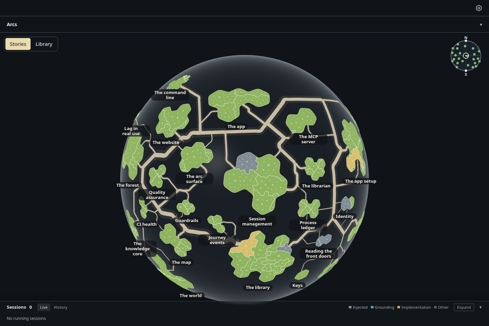
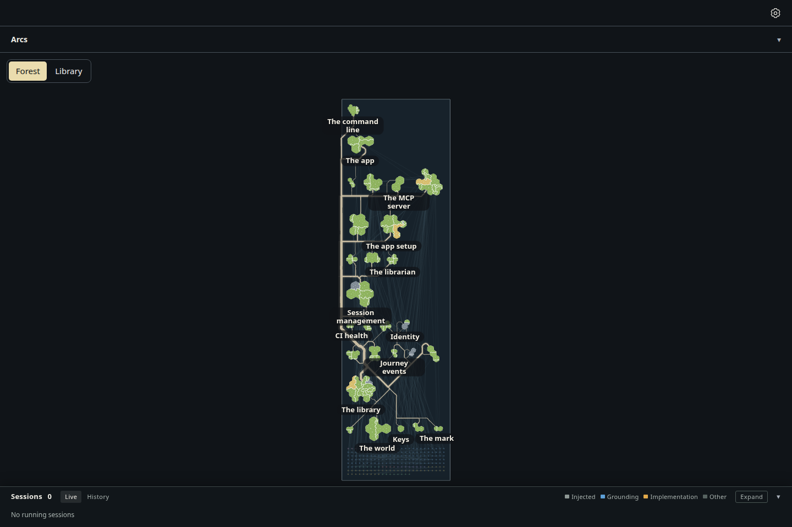
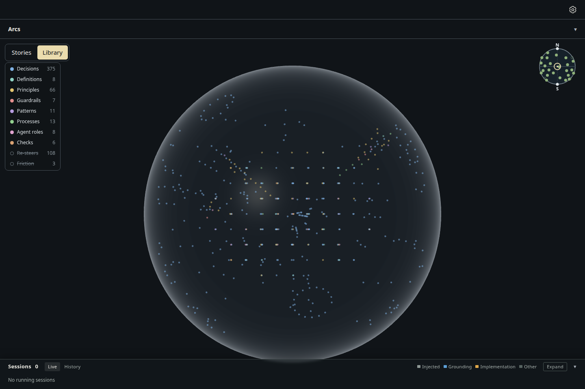
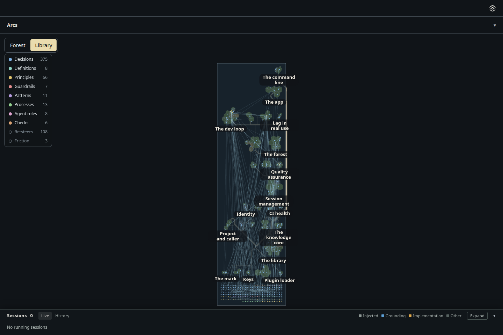

# Spike: the forest on a glass sheet, turned over to its knowledge graph

Increment `increment_51fa55407bf5`, arc `arc_87529c1ba43b`, branch `spike/glass-sheet`. **Never merged**: this branch
exists so the owner can compare the sheet with today's globe, drawn from the same real library, and decide. It decides nothing.

## What was built

The actual desktop renderer draws both. `index.html` draws today's globe unchanged, and `index.html?sheet` draws the sheet,
so the two sets of pictures come from one bundle, one seed and one window (1440 × 960, dark theme, headless Chromium, SwiftShader).

- **The sheet is the near pole of a very large sphere** (radius 200,000 units, `forest-world/src/planet/sheet.tsx`). Every
  island keeps its plate, coast, territories, file circles and nameplate. The roads are routed, docked and raised as
  ribbons by the globe's own code. Over the sheet's width the sphere sags under 6 units and tilts an edge island by under
  half a degree. No road or island code was forked.
- **Top face** (`forest/src/planet-places/sheet-places.ts`): rows by dependency depth (each story's permanent row and slot),
  north at the top and the shallowest row at the bottom. A row runs west to east from the sheet's west edge, so it only
  grows east and adding a story moves no other. The sheet is as wide as its longest row (the owner's answer "A" to
  question_232f5f22ae4d). Neighbouring rows sit as close as their own islands allow. At rest the whole sheet is framed;
  right-drag pans and the wheel zooms.
- **Underside** (`knowledge-core/src/view/sheet-underside.tsx`): each note hangs at the depth knowledge core capability 1
  computes for it (`underShelves`): a story's own shelf under its island's middle, a capability's under its territory, one
  depth 7 units below the last. Notes no shelf reaches lie in a pool of their own, a band of glass south of the bottom row.
  **The links between notes are drawn, as a graph.** This differs from ADR-0658, which chose no threads inside the globe.
  The owner asked for a "knowledge graph" here, so the links are shown; whether that overrides ADR-0658 is not decided here.
- **The turn** (`forest/src/view/planet-view.tsx`, `forest-view.tsx`): a left drag, or the Forest / Library control, turns
  the sheet left to right about its north-south line, passing edge-on. The underside is the true mirror (east and west
  swap, north stays up), which was the owner's answer "A" to question_fb76041ec1ac. The glass is smoked, so whatever lies
  beyond it shows faintly through it: the graph from above, the islands from below. Nameplates face the viewer from either
  side. A selected story stays selected across the turn: its nameplate and panel stay, and its notes and their links are lit.
- The sheet never tilts north or south. The globe's mini globe and its rim markers for failures on the far side are off.

## Pictures

Seed: storytree's own library, read-only, taken 2026-10-15 (`seed.json.gz` from `seed.mts`; code survey `survey.json` from
`survey.mjs`): **27 stories, 142 capabilities**. On the sheet, 494 notes are drawn (295 on shelves, 199 in the pool) with
541 links between them. Re-steers and friction are switched off by default, as on the globe.

| Today's globe | The glass sheet (as briefed) |
| --- | --- |
|  |  |
|  |  |

The turn, by real pointer drags: [part-turned, 50°](sheet-turning.png), [edge-on, 90°](sheet-edge-on.png).
A click selects the island nearest the middle (The librarian), and the Library control turns the sheet over:
[selected, top](sheet-top-selected.png), [still selected, underside](sheet-underside-selected.png).

**A comparison variant the brief did not ask for** (`?sheet=columns`). The real library is deep and narrow: about ten rows
of one to six islands. With depth running south to north, the sheet comes out tall in a wide window and draws small. The
variant lays the same lines north to south instead, with depth growing east:
[top](columns-top.png), [underside](columns-underside.png). It is here only so the owner can weigh the aspect; it changes
the brief's "north at the top" rule, which is his to change or keep.

## Measurements at the resting view

From `measurements.json`. "Square-on" means an island faces the eye within 18° (drawn at 95% or more of its true size on
both axes), from either face.

| View | Px per ground unit | Islands square-on | Median island across | Nameplates shown | Nameplate type |
| --- | --- | --- | --- | --- | --- |
| Globe, front | 1.223 | **1 / 27** (24 face the eye; median facing cos 0.56) | 51.8 px | 22 / 27 | 13.12 px |
| Sheet, top (as briefed) | 0.324 | **27 / 27** | 21.3 px | 13 / 27 | 13.12 px |
| Sheet, underside | 0.324 | 27 / 27 (through the glass) | 21.3 px | 15 / 27 | 13.12 px |
| Columns variant, top | 0.679 | 27 / 27 | 44.5 px | 26 / 27 | 13.12 px |

Read against **Legible at the resting view** (`principle_1e3418812c33`) and **The resting view is designed, not fitted**
(`principle_43ea5d4f68c4`):

- The sheet removes foreshortening entirely: every island is drawn at its true shape, against 1 of 27 on the globe.
- The sheet as briefed is *fitted*, not designed. A tall sheet in a wide window rests at a quarter of the globe's scale:
  islands draw at 21 px across, against 52 px, and the nameplate crowd fade hides 14 of 27 names (on the globe it hides 5).
  The type stays at 13.12 px; what is lost is room, not type size.
- The columns variant rests at about half the globe's scale (45 px islands) and shows 26 of 27 names, because it uses the
  window's width.

## Relief, the channel kept free

Today's land relief (`forest-world/src/land-relief.ts`) is not drawn on the globe at all: since ADR-0804 D1 an island is one
flat surface, and the relief module only sets how far plates stand off the shell. The globe's islands do have height, but
it is the sphere's curve: up to **12.6 units (15 px at rest)** under the largest island. On the sheet that curve falls to
**0.019 units (0.006 px)**. So the height channel is empty on the sheet, and a later signal would have nothing to fight.
Choosing what relief means is not this spike's job.

## Limits found (named, not fixed)

- Rows stand as close as their islands allow, so a new story **larger than its row's largest island** pushes the rows
  north of it up. Every other addition moves nothing. A fixed row pitch avoids this, at the cost of a taller sheet still.
- Left-aligned rows give a ragged east edge and run one trunk road down the west side.
- The pool's notes link to shelves all over the sheet, so long lines fan across the underside. They are faint, but they
  are the busiest thing on it.
- Edge-on at rest, the graph hangs only a few pixels below the glass (7 units per depth at 0.32 px per unit). It reads as
  a line, not a curtain; zooming in shows the depth.
- The view is orthographic, so a turn reads as the sheet narrowing, not as perspective.
- Notes cannot be clicked on the underside yet, and the far-side failure markers are off on the sheet.

## How to reproduce

From the checkout root, in the foreground (`--retake` writes here; without it, into `/tmp/storytree-captures/`):

```sh
node --import tsx packages/forest/src/view/evidence/glass-sheet/seed.mts      # optional: a fresh snapshot
node --import tsx packages/forest/src/view/evidence/glass-sheet/survey.mjs
node packages/dev-loop/src/heavy-lock.mjs -- node --import tsx packages/forest/src/view/evidence/glass-sheet/capture.mjs --retake
```

Every turn in the capture is a real left-button drag or a real click on the Forest / Library control. The selection
checks are assertions: a click selects the island's story, and the same story is still selected after the turn. The
page logged no errors. This spike adds no tests; it is never merged.
