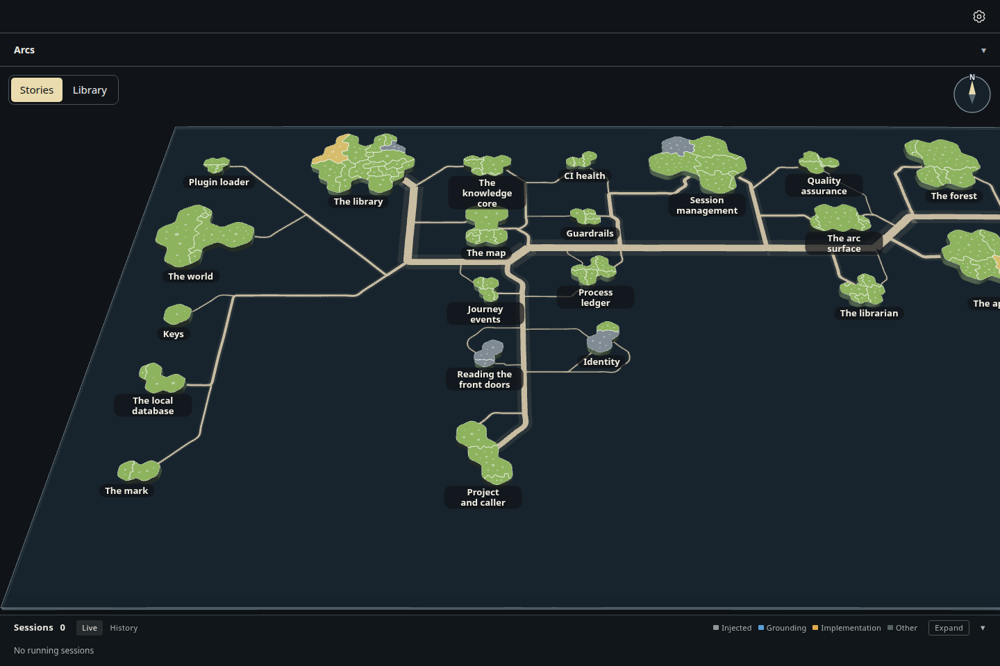
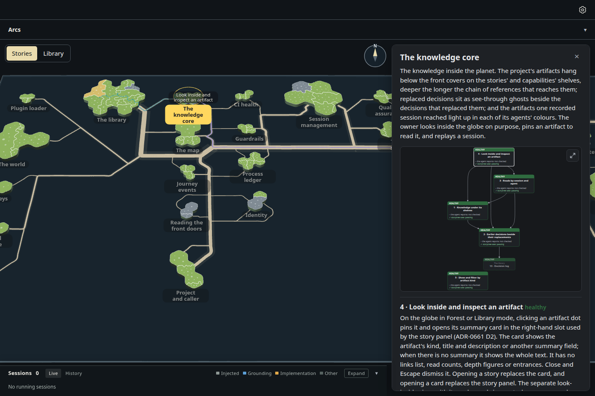
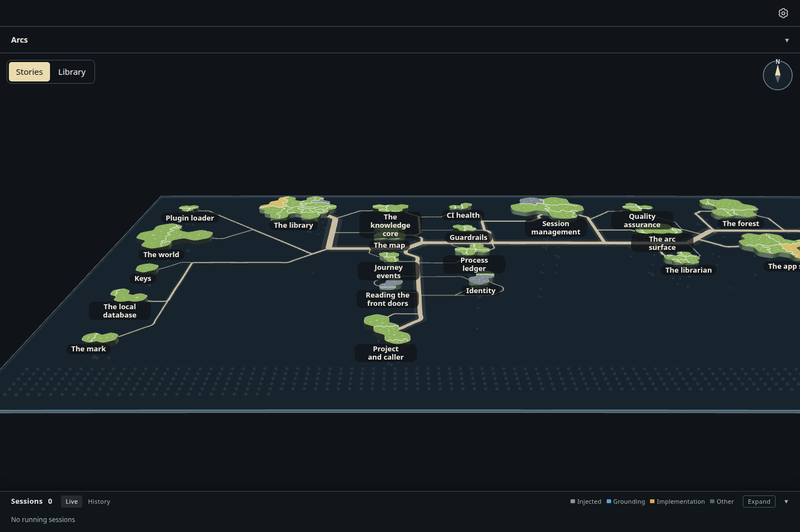
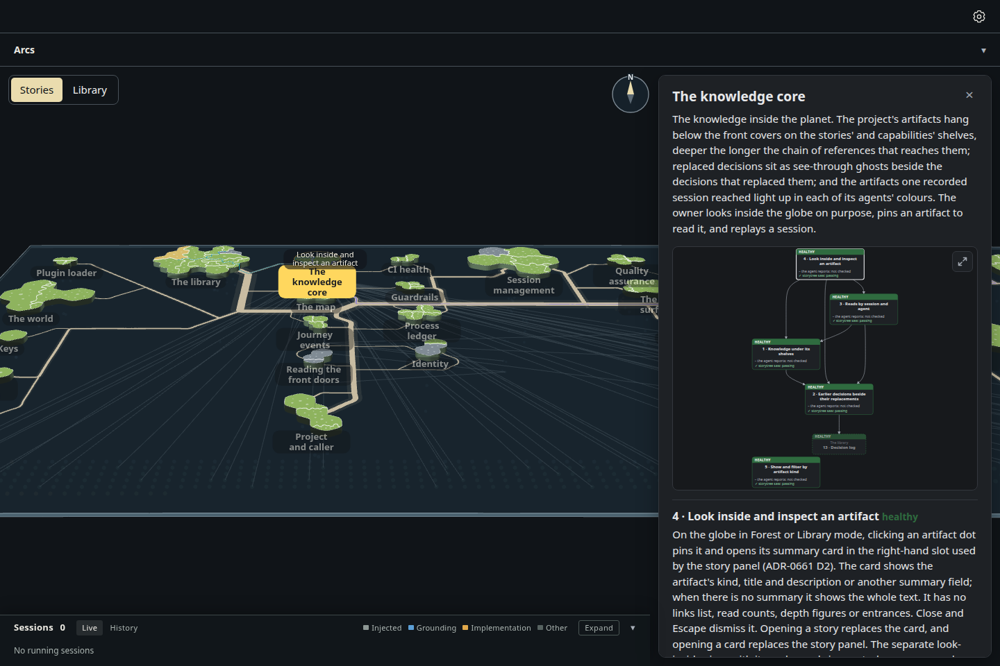
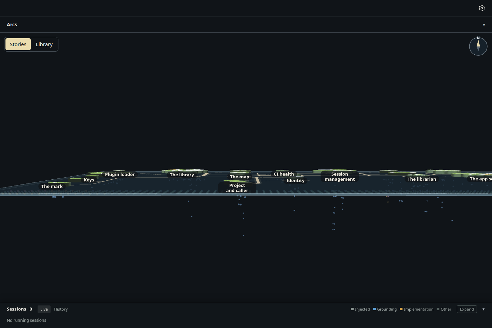
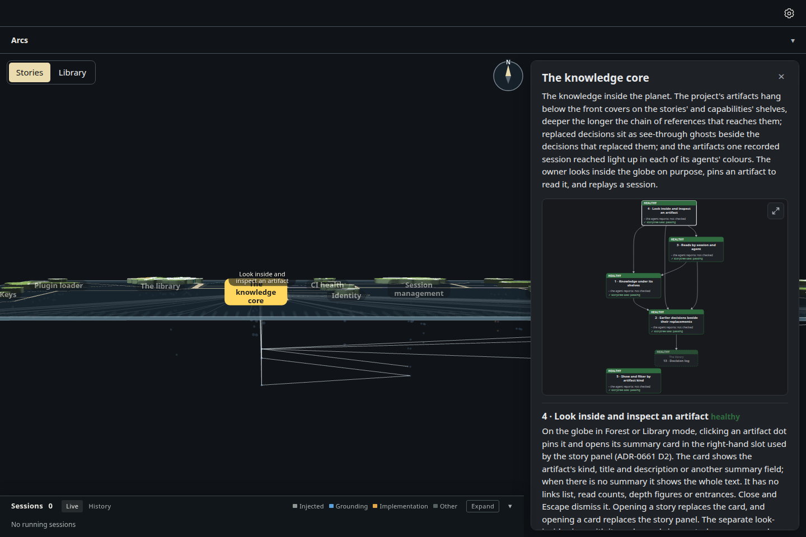
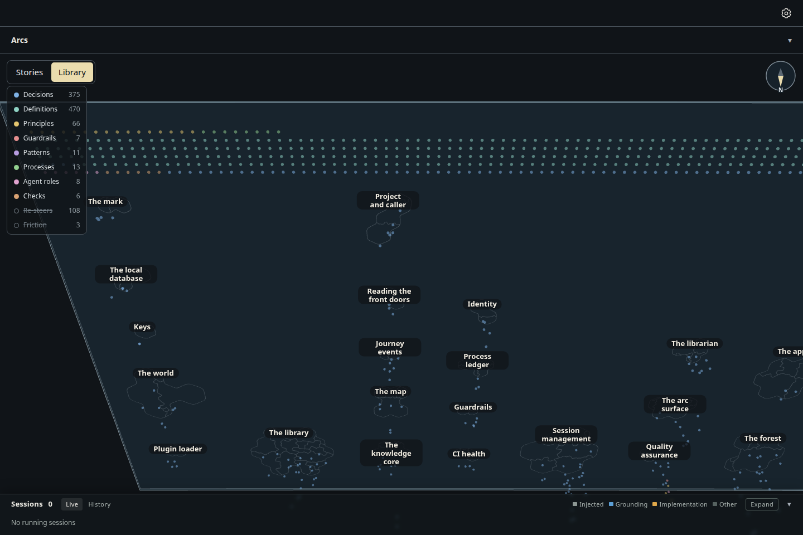
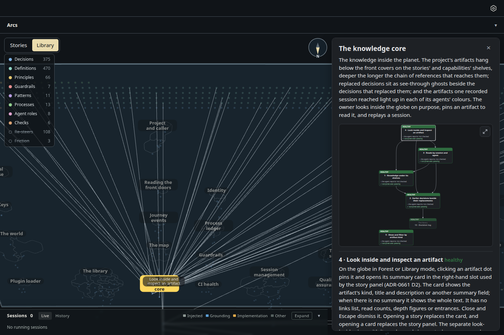
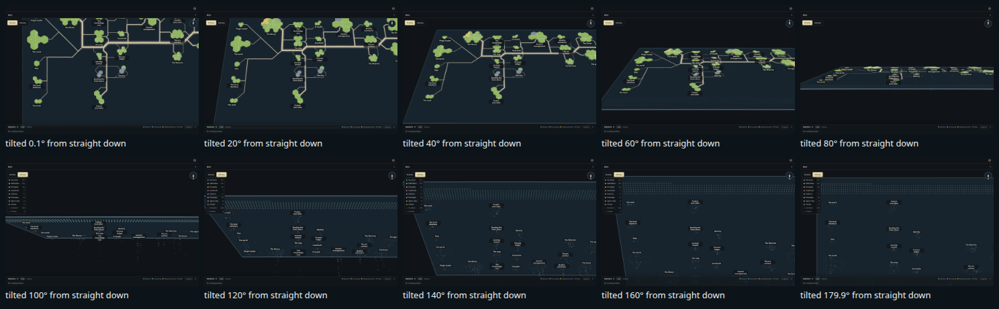

# The glass sheet as a floating 3D table you tilt

Increment `increment_9922ecd7a56a`, arc `arc_ea0f2a347b65`, decision ADR-1062. The owner, on the built sheet: "the map
should be like a floating panel of glass, with the knowledge graph under the glass panel, and the island on the top side
... if you look from the side you will see both, and you can rotate the table to see more or less of each."

- **A lit slab in perspective** (D1): the sheet's eye is now a perspective one (a 35° lens), so the near edge is drawn bigger
  than the far one; the wheel moves the eye toward the middle of the view rather than changing the lens. Soft light all
  round and one lamp over the eye's left shoulder shade the islands' sides and the glass's edge; the land's top keeps its
  exact colour. The glass is a slab 4 units thick, with a rim round its top and its underside.
- **Tilt by hand** (D2): a right-drag (or Ctrl+drag) still spins the sheet with its sideways part, and now tilts it with its
  up-and-down part: drag up to tip toward the underside, down to look down on the islands. Two fingers slide up and down to
  tilt and twist to spin. **R** and **F** tilt it 15° a step (R toward looking down on the islands, F toward looking up at
  the graph). The tilt stops at straight down and straight up, never rolls, and pivots on the middle of the view. Home and
  the compass bring it back to the opening view, tilt included.
- **Two resting views** (D3): Stories swings the tilt to 40° from above, Library to its mirror from below, over 0.9 s; a
  grab stops the swing where it is. Tilting by hand past level presses the other button. **T** swings to the other view.
- **The angle decides what shows** (D4): from steeper than 60° above, the smoked glass hides the knowledge graph (the top
  resting view shows none of it); from there to level it comes into view below the slab; from below it is drawn over the
  glass and the islands are see-through outlines. A selected story's links show at every angle.
- A pan keeps the place you grabbed under the pointer, at any tilt (the eye's ray is cast onto the glass); where the
  pointer is over no place on the glass (edge-on, above its line), the sheet moves as far as the middle of the view would.

Drawn by the actual desktop page, 1440 × 960, dark theme, headless Chromium (SwiftShader), from the same read-only snapshot
of storytree's own library as `../glass-sheet-tilt/` (27 stories). Every tilt is a real right-drag, key press or button
press; the selection a real click on an island. Beside the earlier builds' pictures: `../glass-sheet-tilt/`,
`../glass-sheet-spin/`, `../knowledge-on-library-face/`.

| | Nothing selected | A story selected (The knowledge core) |
| --- | --- | --- |
| Top resting view, 40° from above |  |  |
| Part-way, 65° |  |  |
| Edge-on, 86°: islands above, the graph below |  |  |
| Underside resting view, 40° from below |  |  |

One continuous right-drag, from straight down on the islands to straight up at the graph, 20° a frame:

## Measured (`measurements.json`)

| View | Tilt from straight down | Zoom (px per unit) | Pressed | Notes shown | Islands filled |
| --- | --- | --- | --- | --- | --- |
| Top | 40° | 1.093 | Stories | 0 | 54 parts |
| Part-way | 65° | 1.093 | Stories | 956 | 54 parts |
| Edge-on | 86° | 1.093 | Stories | 956 | 54 parts |
| Underside | 140° | 1.093 | Library | 956 | 0 (outlines) |

R pressed six times from 55° stopped at straight down (0.1°, the big sphere's bend). A grab during the Library swing, at
132°, held it at 132° while the page's clock ran on 0.6 s. The selected story's 59 links showed at every tilt. Roll at
every view: 0.1°.

Under the software renderer, passing level stalls the swing for a moment, while the islands change to outlines and back;
that is recorded as its own increment on the arc.
