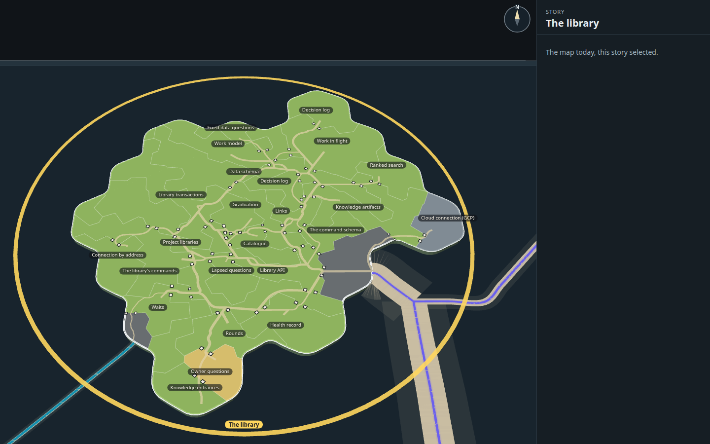
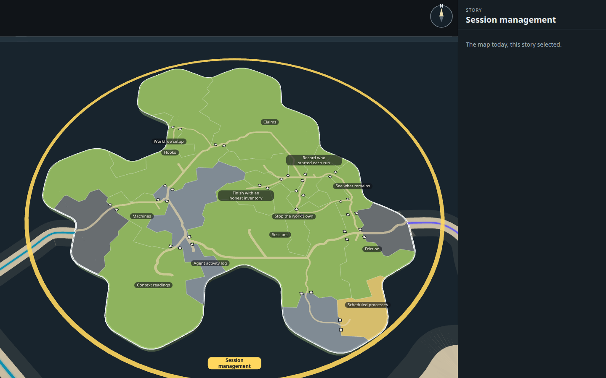
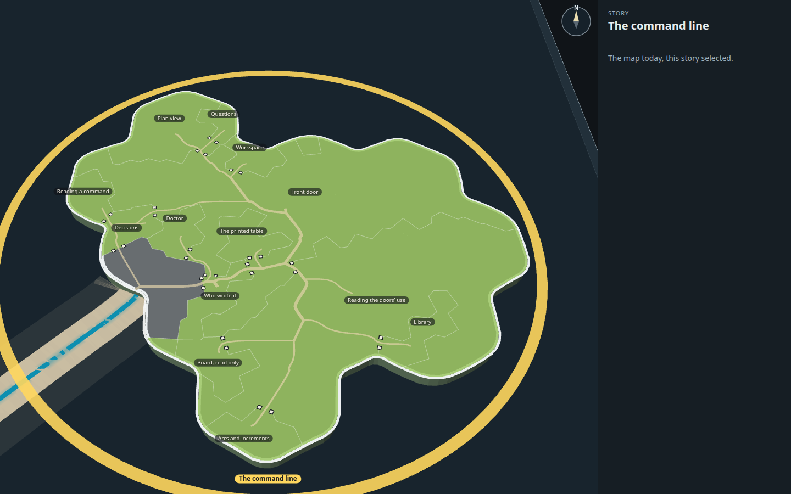
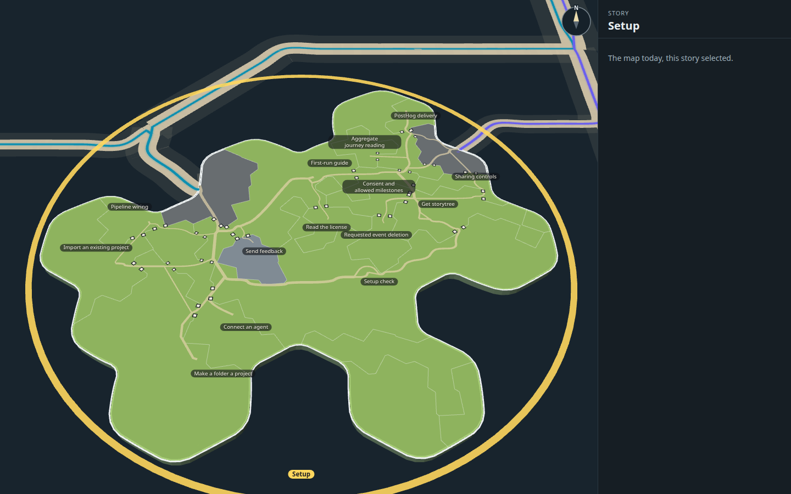

# Roads and gates inside the selected island (rollout 2, step 3a; ADR-1236 D1)

Four islands at rest, selected, drawn by the real map code on this branch, beside rollout 1's mock of the same island
(`docs/design/capability-tree-3d/q-all-islands/stills/islands/after/<story>-rest.png`).

What this step draws (contract 3.77): one shared road network over the selected island, routed on a triangular
lattice heaviest link first and re-routed twice, links going the same way sharing road; each road sandy and faint
(round 11's `sand-faint`, #e2d3aa mixed into the land at 0.7), a step wider by the links it carries; the island's
borders quietened (#f4f7f8 at 0.4) and cut open at each gate, with a flat ink post and paper face either side of every
gate. The selection's purple and teal lanes no longer run inland and their end discs are gone (ADR-1236 D2): a lit
lane ends at its dock.

Not yet: plateaus, bevel rims, ramps and standing posts (step 3b), a picked link lit in gold (step 3c), settlement
symbols and names placed clear of them (step 4), and the pale-blue sea lanes and ports (step 5). The mock's stills
show all of those, so its roads end at symbols the real map does not draw yet.

Routing takes about 0.7 s for The library (188 lanes ashore), 0.3 to 0.4 s for the others, once per island.

Taken with rollout 1's kit: `node docs/design/capability-tree-3d/q-all-islands/tools/build.mjs`, then
`node --import tsx docs/design/capability-tree-3d/q-all-islands/tools/docks.mjs --stills <story>...`.

