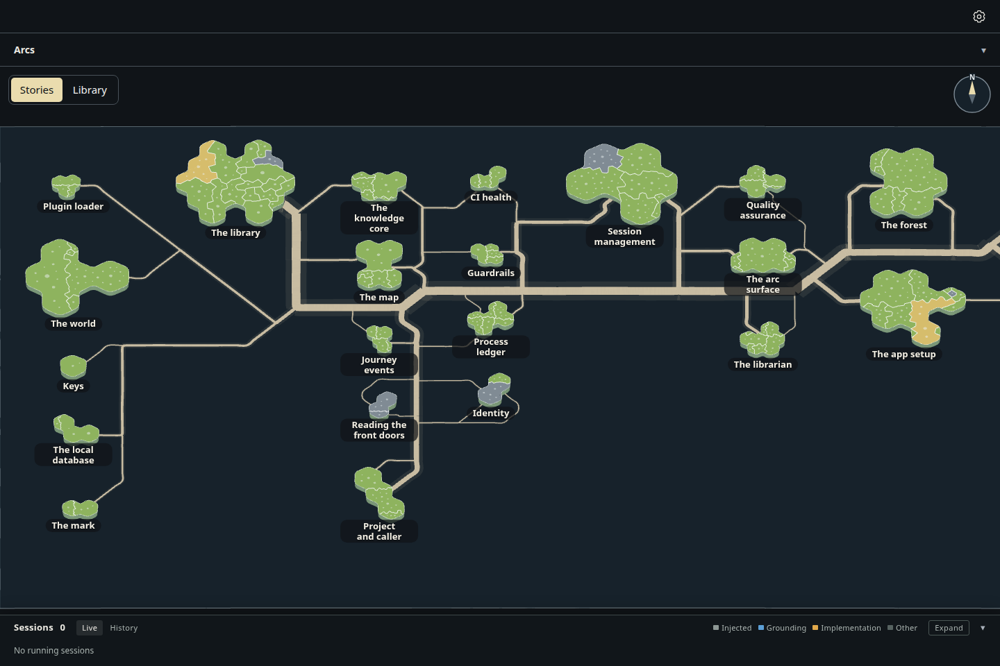
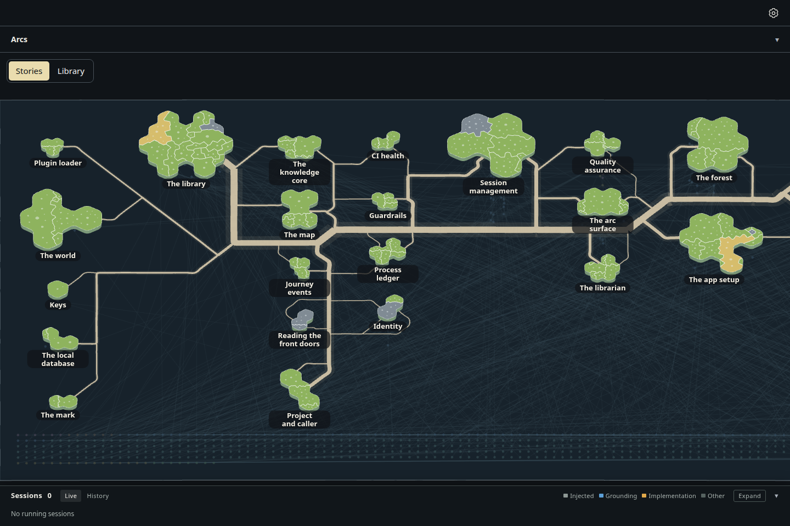
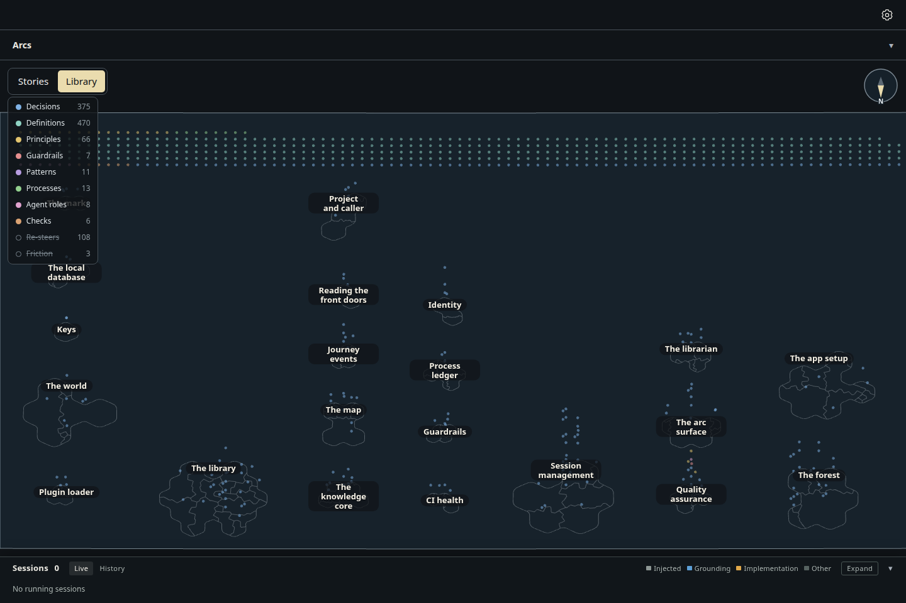
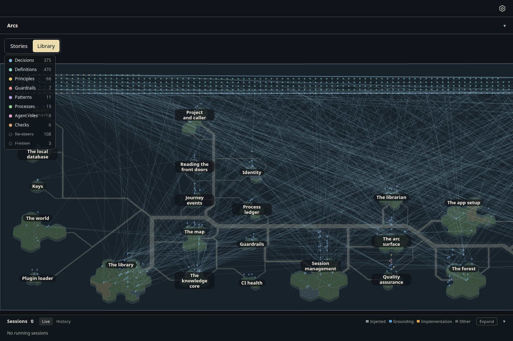
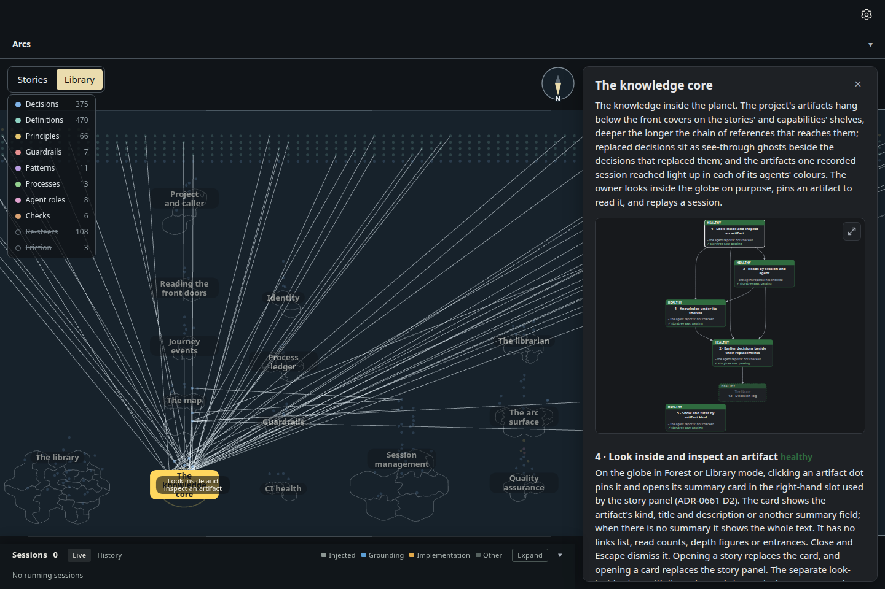
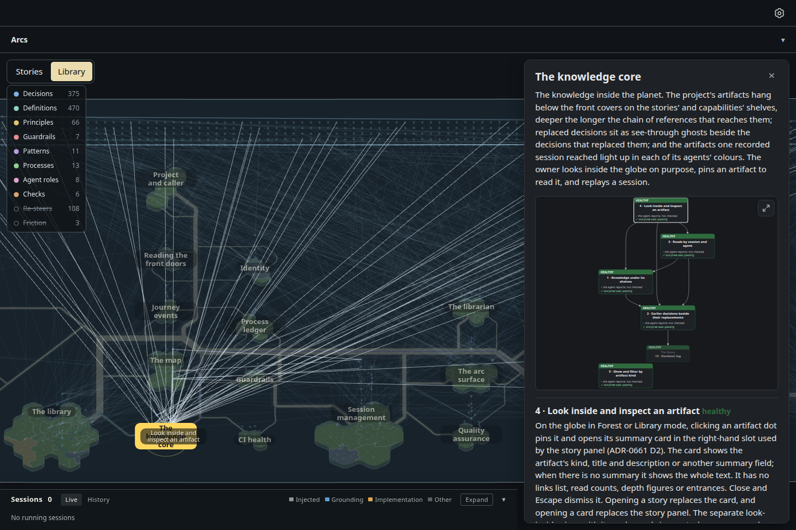
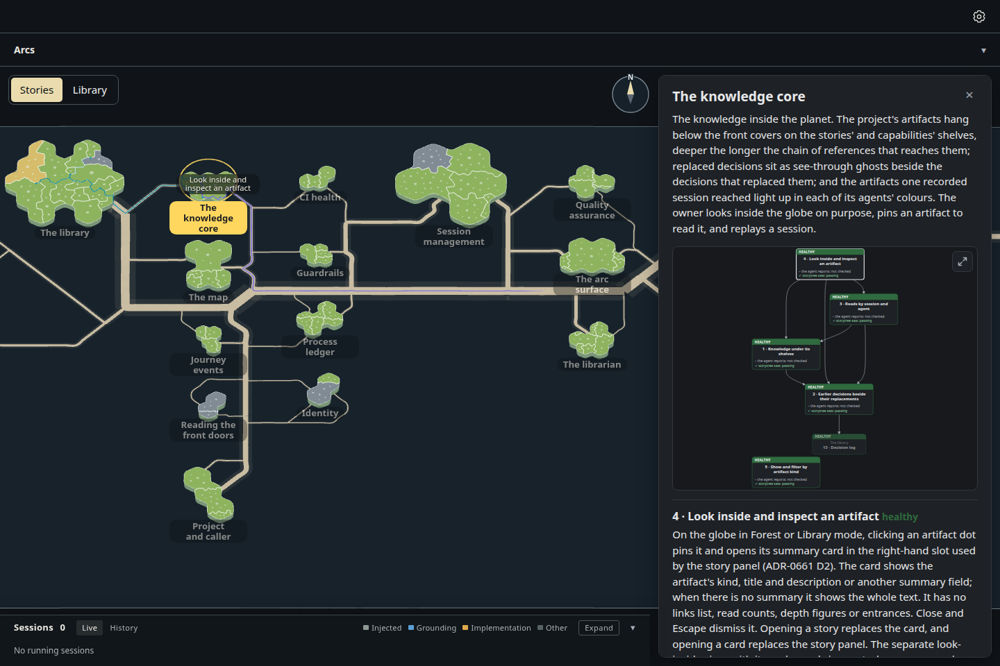

# The knowledge only on the Library face, the islands hollow outlines there, links only for the selected story

Increment `increment_6d39e6e22ce1`, arc `arc_87529c1ba43b`, decision ADR-1061 (narrowing ADR-1059 D3, ADR-1043 D5 and,
on the sheet's Library face, ADR-0919). The owner, on the built sheet: "only show nodes. Dont show the nodes unless library
is selected, and when library is selected hollow the islands to just an outline and make them transparent." Now:

- **The Stories face shows no knowledge** (D1): no notes, no pool, no links, not even faintly through the glass. What hangs
  under the glass is drawn only while the eye looks at the sheet's underside, so turning over shows it the moment the sheet
  passes edge-on.
- **On the Library face the islands are hollow outlines** (D2): each island's coast line alone, with its territories'
  borders and no fill, and its nameplate. Its ground, the depth layer under it and its sides are not drawn, so no note
  beneath it is hidden. Roads and file circles go: on this face they competed with the notes. A session's tints still light the islands it works on.
- **Links show only for the selected story** (D3): none at rest; with a story selected, exactly the links touching its notes,
  lit. Its other notes stay quieter, as built.
- **The pool** of notes no shelf reaches stays along the south edge (D4).

Drawn by the actual desktop page, 1440 × 960, dark theme, headless Chromium, from the same read-only snapshot of storytree's
own library as `../glass-sheet-tilt/` (27 stories, 956 notes under the glass of which 661 lie in the pool). Every turn is a
real button press and the selection a real click. Measured in `measurements.json`: the Stories face draws 0 notes and
0 links; the Library face 956 notes, 0 links and 0 filled island parts (27 coast lines); The knowledge core selected,
59 links.

| Stories face, at rest | Before (`../glass-sheet-tilt/`) |
| --- | --- |
|  |  |

| Library face, at rest | Before |
| --- | --- |
|  |  |

| The knowledge core selected, Library face | Before |
| --- | --- |
|  |  |

The same selection on the Stories face, which still shows no knowledge: 
