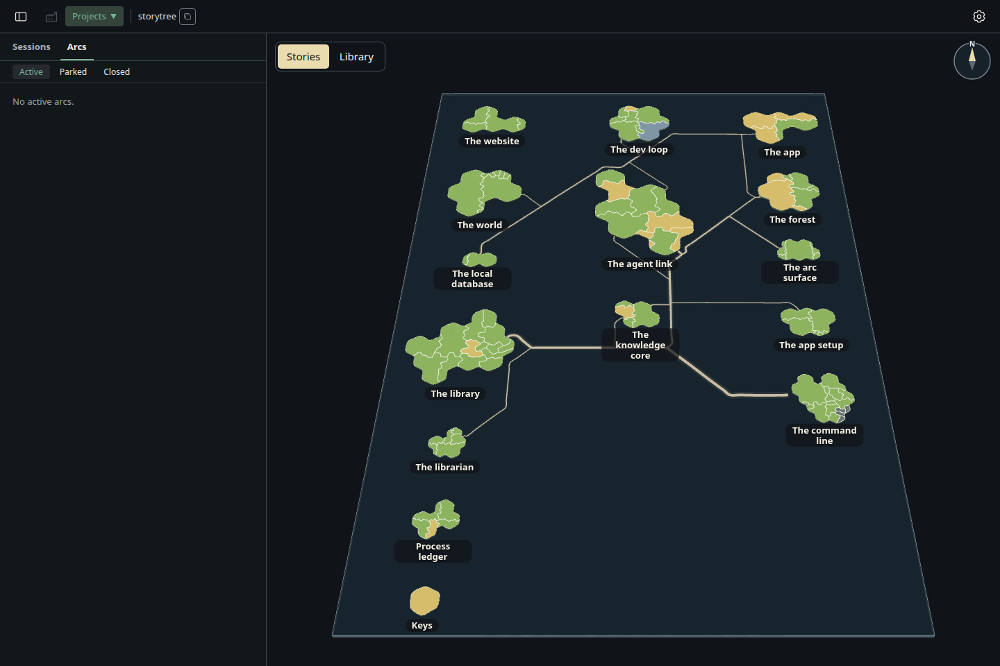

# Roads stay drawn while an island grows (The drawing engine 4.37–4.39, increment_795fca1a3764)

The real desktop on storytree's own snapshot (the `code-rows` seed). Once its 30 roads are drawn, The command line grows by
four capabilities, recorded as the library records them, and the app's own poll reads it. Each picture is taken 0.4 s after
that read; `measurements.json` holds every frame drawn after it, with how many roads it drew.

- `before/` (main): 20 of 24 frames after the read draw no road, for 1.4 s, until the new routing lands.
- `after/` (this branch): none of 15 frames is without roads; the roads drawn before stay on show, as they were, until the
  new ones are routed (4.38), and a routing in flight is not started over by the next layout with the same key (4.39).

In this snapshot growing The command line moves it alone, so the capture shows 4.38 and 4.39; a uniform shift of every
island (4.37) is shown by its test in `packages/forest-world/src/planet/road-routing.test.ts`.

Taken with `node --import tsx packages/forest/testing/view/pathway-repair/build.mjs <checkout> before|after`, then
`node --import tsx packages/forest/testing/view/pathway-repair/grow-capture.mjs before|after --retake`.

