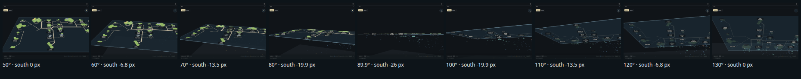
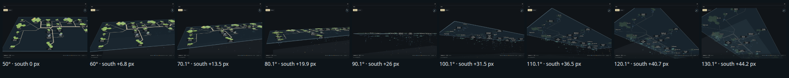

# A rotating drag keeps one direction all the way through level

Increment `increment_293a37334470`, arc `arc_ea0f2a347b65`. The owner, on the glass table (PR #1442): "Rotation feels
strange, seems to change direction midway."

The sideways part of a rotating drag (a right-drag, a Ctrl+drag or two fingers sliding) spun the sheet one way above level
and the other way below it, so a drag that tilted through level while moving sideways reversed its spin halfway. Now it
spins the sheet like a table: the edge nearest the eye, the south edge at every tilt, follows the hand, above level and
below it (3.65). Q and E and a two-finger twist still turn the sheet clockwise on the window, as 3.58 says; neither crosses
level during a gesture. The view never rolls, at straight down and straight up included: the eye is fixed and the tilt
turns the sheet about the window's horizontal line, so east stays along the window.

One continuous right-drag, up and to the right, from 40° above level to 40° below, 10° of tilt and 7.5° of spin a frame.
Under each frame: the tilt from straight down, and how far right of the middle the sheet's south (40 units out) is drawn.

Before (main at `ad89a6d8`): the near edge goes left until level, then turns back.

After: the near edge keeps going right all the way.

Drawn by the actual desktop page, 1440 × 960, dark theme, headless Chromium (SwiftShader), from the same read-only snapshot
of storytree's own library as `../glass-table/`. Each frame is a real right-drag of the mouse; `measurements.json` holds
both runs. The tilt's stall as it passes level is its own increment (`increment_057d5c0cb2be`).
