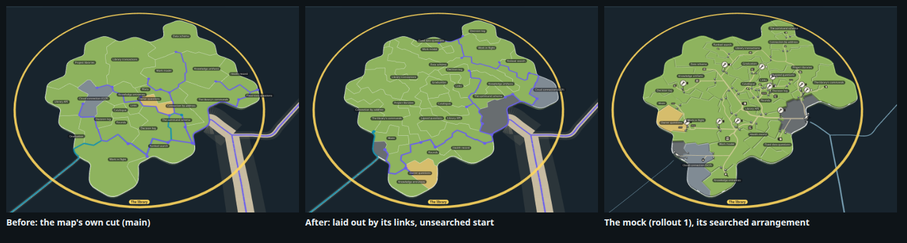
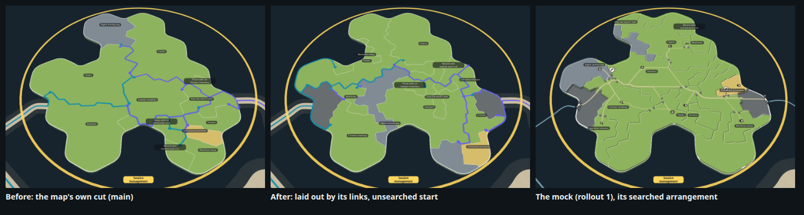
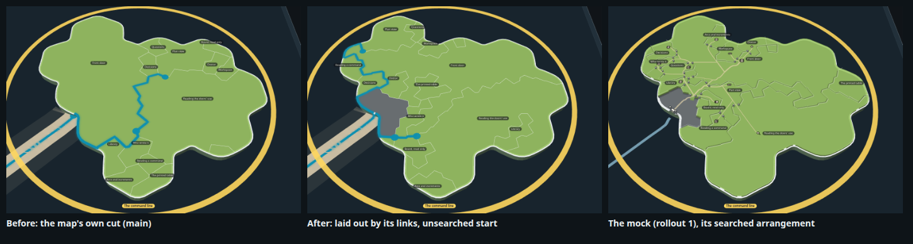
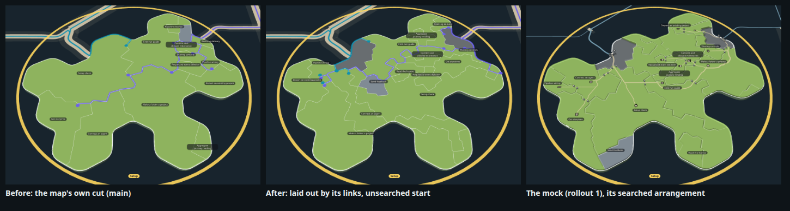

# Territories laid out by their links (rollout 2, step 2; ADR-1236 D1)

Four islands at rest, selected, drawn by the real map code: before (the map's own cut, as on main), after (this
branch: the start arrangement laid out by the island's links, contract 3.76), and rollout 1's mock of the same island
(`docs/design/capability-tree-3d/q-all-islands/stills/islands/after/`), whose arrangement its network-scored search
found. That search, run off the page and kept, is step 2b (increment_45fb1b3db15c); it scores on step 3's road network.

After: open land (grey, held by no territory) round each dock the island's sea lanes come ashore at, wider at a dock
carrying more lanes; each capability a lane lands at beside it; the rest grown inland near the capabilities they link to.
Laying out takes 70 to 130 ms an island (all 28 islands of the kit's snapshot, The library the slowest).

Taken with rollout 1's kit, which bundles packages/forest's view on its snapshot: `node docs/design/capability-tree-3d/q-all-islands/tools/build.mjs`,
then `node --import tsx docs/design/capability-tree-3d/q-all-islands/tools/docks.mjs --stills <story>...` (the
`?real&layout=today` view); the before with the link layout switched off.

