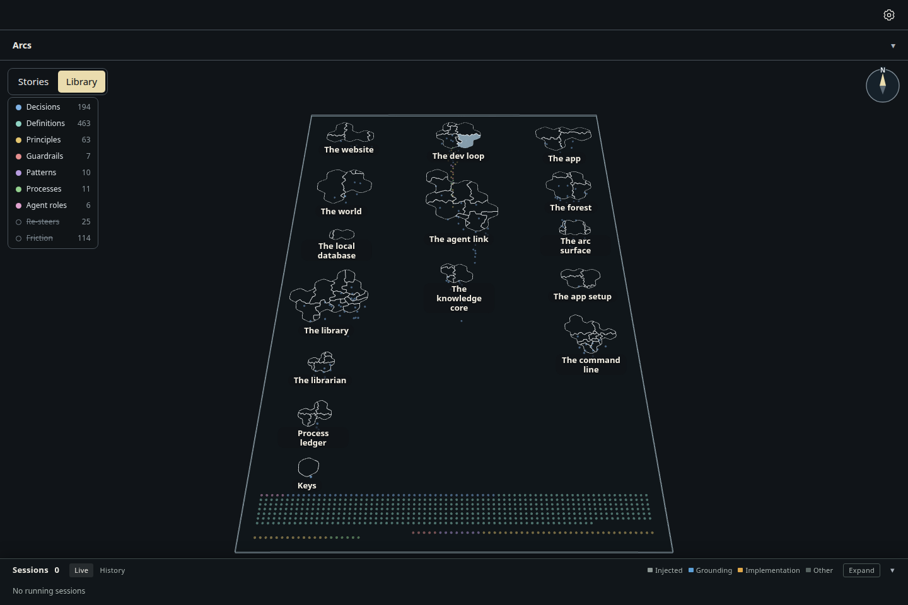
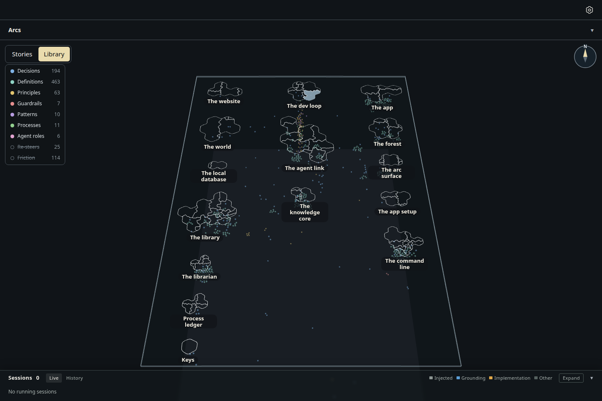
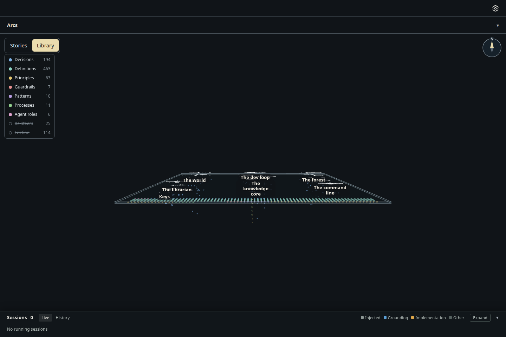
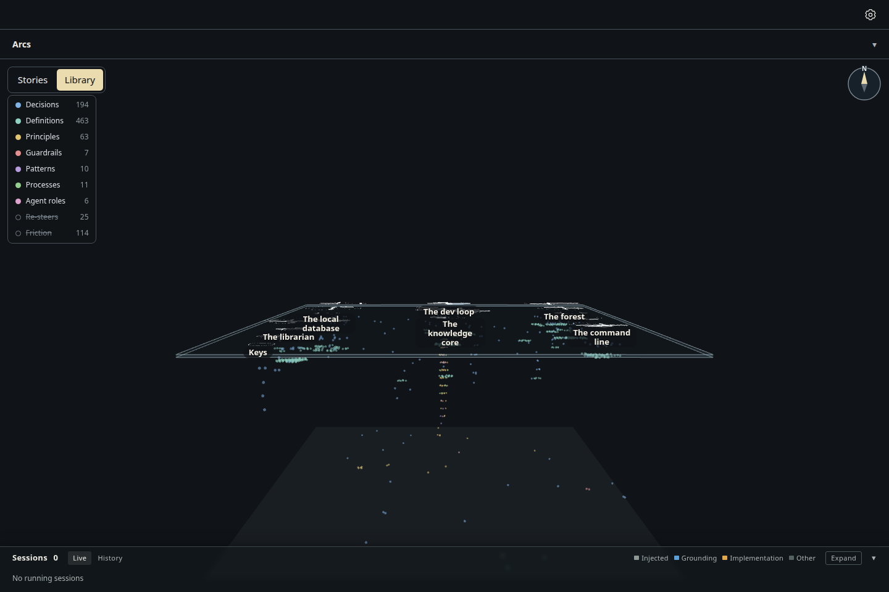
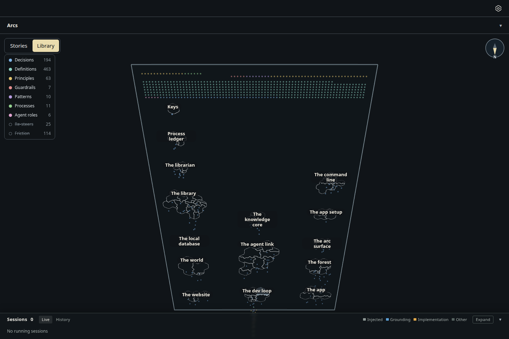
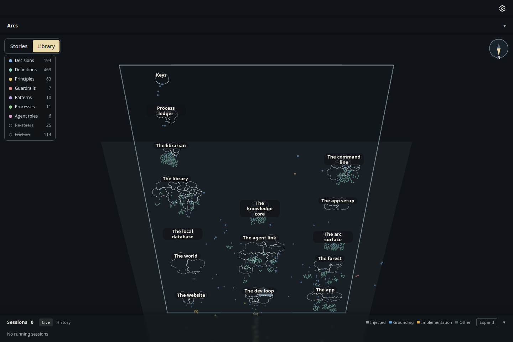
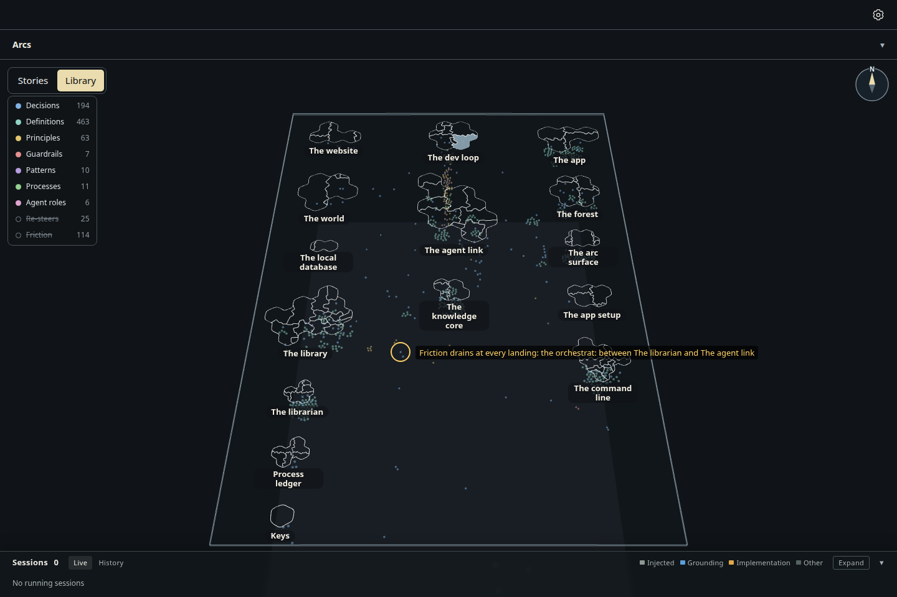

# Notes pulled toward their islands, unlinked notes on a sea floor

Increment `increment_80d5beb81cff`, decision ADR-1063, from the owner's words on the glass table: "put them under the map,
you can decide where and how. I would of expected library artifacts to have edges that trace to more than one island and
so they would position in between islands or get pulled in multiple directions to determin their position, for ones
without edges i would just position them spread out creating a sea floor."

- **No pool.** Nothing lies along the sheet's edge any more, and the glass no longer runs south past the islands to hold it.
- **Pulled by every island a note's links reach** (D1, D2), links counting both ways: a note one island reaches hangs under
  it, one reached from two or more settles between them, nearer the one it has more links to. A note citing hung knowledge
  that no shelf reaches hangs one step below the deepest note it links to.
- **A sparse sea floor** (D3): notes with no links, or linked only among themselves, lie on one faint plane below the
  deepest hanging note, spread across the islands' footprint.

| | Before (the pool, from `packages/forest/src/view/evidence/glass-library-look/`) | After |
| --- | --- | --- |
| From above (40°) |  |  |
| Side on (85°) |  |  |
| From below (140°) |  |  |

One note between two islands, ringed:  "Friction drains at every landing" (decision_13a84b8340ca),
pulled toward both The librarian and The agent link.

| | Before | After |
| --- | --- | --- |
| Notes in the pool along the south edge (kinds shown at opening; every kind) | 572; 711 | none |
| Notes on the sea floor (kinds shown at opening; every kind) | none | 38; 163 |
| Notes hanging under or between islands, on show | 182 | 716 |
| Notes pulled toward two or more islands | none | 87 |

Before is the same seed and the same three tilts, taken by the build this one amends (PR #1444). Drawn by the actual
desktop page, 1440 × 960, dark theme, headless Chromium (SwiftShader), from the capture kit's `code-rows` seed (storytree's
own library), Library pressed and tilted there by a real right-drag. `measurements.json` has each view's counts; `capture.mjs`
asserts the floor is drawn with notes on it at every tilt and that some note is pulled toward two islands.
