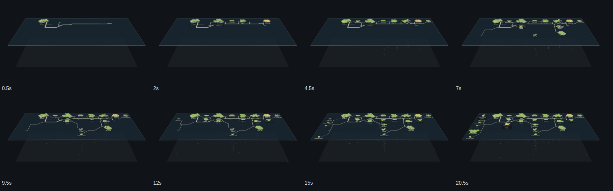

# storytree's own map growing, for LinkedIn

2026-10-23, Mint box, increment_04461fe17938 (arc_5f25ac1bb05a). This is a 20.5-second clip of storytree's own map growing on the glass sheet, drawn frame by frame by the shipped engine for the owner's first build-in-public post. It replaces `../growth/storytree-sheet-growth.webm` (2026-10-19), which spent its first six seconds on a page still loading, framed one corner, hid the notes under the glass and recorded no claims.



## What it shows

- **It moves from the first frame.** The library's island rises from 0 s, and the other islands follow in the order their stories were created, from 25 September to 23 October. The growth runs for 18 seconds. The clip then holds the whole grown map for 2.5 seconds.
- **The whole sheet is in view.** The sheet is tilted toward the underside by a right-drag, as the app's own tilt works (about 61°, past the 60° at which notes under the glass show). Seen from there, all 25 islands are named, from Surface feedback and Plugin loader at the left to The command line at the right. Their roads, territories and file circles fill in as main's code stood each day.
- **The knowledge graph forms under the glass.** The core's dots hang beneath the sheet and appear as the replay reaches each note's creation date (knowledge core 1.9).
- **Agents are at work.** The library's activity log holds every claim since 27 September with its time, so the clip stages those claims. Each claim lasts from the moment it was taken until the first of these: its release, its landing, the merge of the branch it was taken on, or its session's end. A claim with no recorded end is cut off after 12 hours. Most claims last minutes (a median of 15), which would be shorter than a frame. So each 3-hour slice of history shows every claim held at any moment inside it, as the app draws one: a flag in the session's colour on the claimed territory (ADR-0968). 185 of the 223 slices hold claims, from 1,563 sessions across 170 capabilities.

Timing is compressed and order is as recorded. A day of history takes about half a second, and days when stories arrived take longer, since each new island has its rise.

## The reading

The reading comes from storytree's library, read-only, on 2026-10-23 at 12:07 UTC:

- the plan, with all 25 stories;
- every dated change, of which 3,790 are records the knowledge core reads;
- the activity log.

It also uses main's merge history. The plan is staged in 53 states, each the plan as it stood at a moment, with the code survey of main's last landing before then (`codeAt`, as the shop's saved growth does):

- each story's arrival (stories made in the same minute arrive together);
- the end of each day;
- the plan as it stands now.

## The files

The video is not committed: evidence videos are ephemeral (question_fd8ff8dfaf88). The render leaves these in `~/storytree-out/linkedin-map/` on the machine that runs it:

| File | What |
| --- | --- |
| `storytree-map-growth-1080p.mp4` | 1920×1080, H.264, yuv420p, 30 fps, 615 frames, 20.5 s, no audio, 0.5 MB |
| `storytree-map-growth-4x5.mp4` | 1080×1350 cut: the same frames at the feed's width, centred on the same dark ground, 0.2 MB |
| `storytree-map-growth-poster.png` | the last frame, the whole grown map |
| `still-*.png`, `strip.png` | eight moments (0.5, 2, 4.5, 7, 9.5, 12, 15 and 20.5 s), also committed here |

## Reproduce

Run this from a checkout routed to storytree's library, after `git fetch origin`:

```sh
node --import tsx packages/website/evidence/linkedin-map/render.mjs            # read, draw 615 frames, encode
node --import tsx packages/website/evidence/linkedin-map/render.mjs --still 1,8,20   # only those moments, to frame the camera
```

The library's reading is kept in `~/storytree-out/linkedin-map/work/`. It is read again only with `--reread`, and `--reuse-frames` encodes the frames already drawn. On the Mint box the reading took about 5 minutes, most of it for the 53 code surveys, and the 615 frames about 15 minutes (headless Chromium, SwiftShader). The frames grow slower as more of the map is drawn.

The render lives here, in the website's evidence, rather than in Marketing artifacts (`packages/mark`). The website already depends on mark, so mark cannot import the website's saved-growth reading (`planAt`, `codeAt`, `publicNotes`) without a cycle. It would also have to take on the forest, the knowledge core, Playwright, esbuild and Remotion's ffmpeg, which the website already has. Like `../first-short/render.mjs`, this is a one-off render with no product behaviour of its own: the engine behaviour it uses (growth, notes by date, claim flags) is pinned by those packages' tests.
