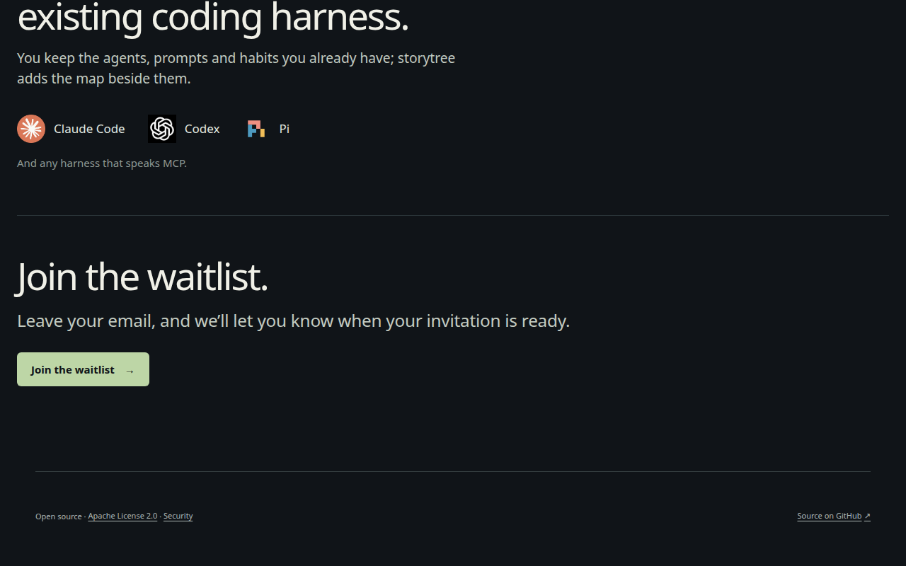
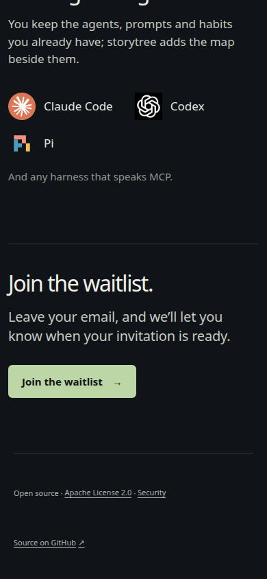
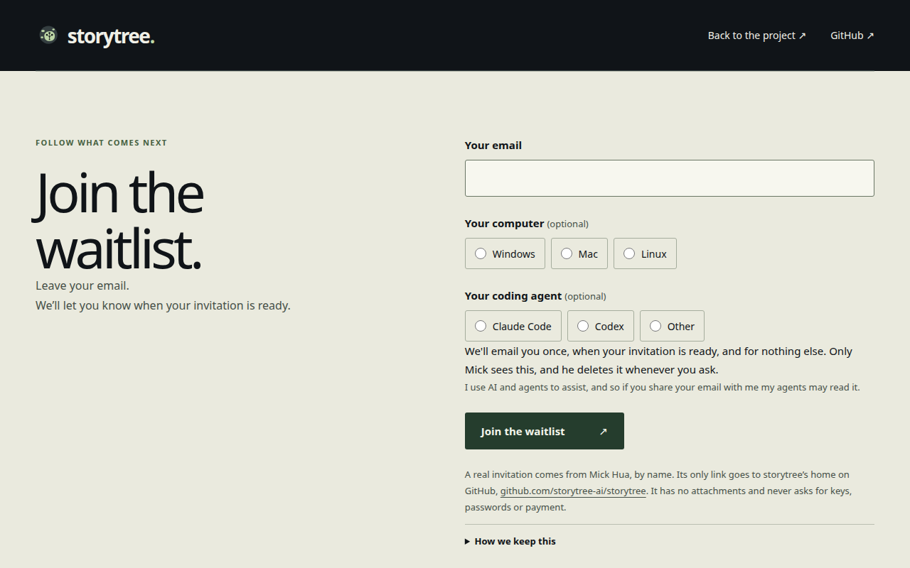
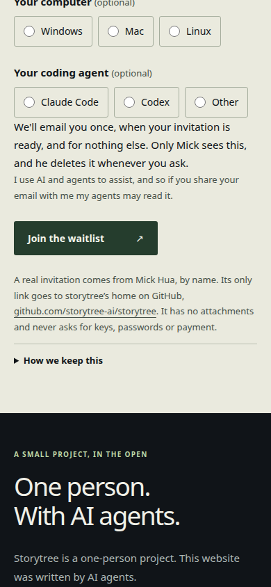

# Official sources on the site, 2026-10-24

The built site (`buildWebsite`) served locally and captured in headless Chrome at desktop
(1280 x 800) and phone (390 x 844) width.

- The home page now ends with a footer: license, the security policy, and the source on GitHub.
   
- The waitlist says what a real invitation looks like, below the join button.
   
